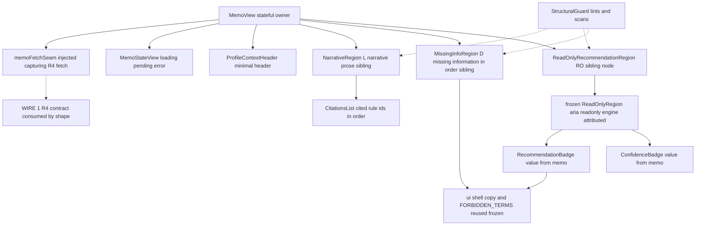

# NFR Design — Plan (Part 1) — `ui-memo-view` (U6)

**Stage**: BUILD → per-unit loop → NFR Design **Part 1 (Plan)** · **Unit**: U6 `ui-memo-view` · C5 · Phase 1
**Depth**: **lighter (display) + fetch-lifecycle addendum + three-region read-only-separation addendum** (consistent with
the FD and NFR Requirements depth) · **Date**: 2026-07-09
**Built ON** the frozen FD (**BR-MEMO-1..11**, component/prop inventory, four-state render enum, region-level `data-testid`
inventory, fetch/state + three-region composition flows) **and** the approved NFR Requirements (fourteen `NFR-MEMO-*`
targets; the **single injected/capturing fetch-double** convention D6; **NFR-MEMO-Fold-A/B/C**) — **re-opening none of it**.
Mirrors ui-queue's NFR-Design structure: **patterns → logical components → reference-not-own → component→target coverage →
validated Mermaid** (rectangle-only, per this unit's own §1 correction).

> **Part 1 (Plan) only.** Draft pattern map + logical components + ref-not-own + coverage + Mermaid + open [Answer]
> questions. **No NFR-Design artifact (`nfr-design-patterns.md` / `logical-components.md`) is generated here.**

---

## 0. Prerequisites & grounding (read, not re-derived)

- [x] NFR Requirements approved for `ui-memo-view` (`nfr-requirements.md` + `tech-stack-decisions.md`, gate approved 2026-07-09).
- [x] Frozen FD + the fourteen `NFR-MEMO-*` targets are the substrate — patterns realize them, re-opening neither.
- [x] **ui-queue NFR-Design structure inherited** (frozen, U5): `*Pattern` naming; a **StructuralGuard test/lint substrate**
  grouping structural scans (testid lint + no-TS/no-router/no-`RoleGate`/bounded-fetch scans + `FORBIDDEN_TERMS` reuse
  lint, each with a **detector self-test**); a component-relationship Mermaid under the 7-rule convention.
- [x] **Reused-not-modified / mirrored-not-imported**: ui-shell's **one `FORBIDDEN_TERMS`** + ESLint + testid convention +
  `RoleContext` seam + **`ReadOnlyRegion`** primitive are **reused** (frozen); ui-queue's fetchSeam/StructuralGuard/testid-lint
  are **mirrored as a convention, not imported** (frozen); WIRE-1 **R4** contract consumed **by shape**. Nothing frozen is edited.
- [x] **The genuinely-new design concern vs ui-queue**: the **load-bearing SEPARATION-1** target — the RO region must be
  **structurally isolated** from the L narrative. NFR-Design must decide whether isolation is guaranteed **by the component
  tree's construction** (Q1) or only confirmed by the DOM-containment test.

---

## 1. Draft pattern map (`NFR-MEMO-*` → named pattern → primary logical component)

| # | Pattern (draft) | Target(s) | Primary component | Tier |
|---|---|---|---|---|
| P1 | **SharedForbiddenTermsReusePattern** — reuse ui-shell's **one** `FORBIDDEN_TERMS` + ESLint; **no new word-list**; enum labels look up by value; **scoped to exclude `narrative_prose`** per the BR-MEMO-2 governance statement (Q6-A) | COPY-1, ADVISORY-1, NAMESPACE-1 | StructuralGuard + ReadOnlyRecommendationRegion / MissingInfoRegion | lint / structural |
| P2 | **StructuralIsolationCompositionPattern** *(the load-bearing pattern)* — the three regions are **siblings by construction**: `MemoView` renders `NarrativeRegion`, `MissingInfoRegion`, `ReadOnlyRecommendationRegion` as **sibling children**; the RO region is the **sole** holder of `recommendation`/`confidence`; `NarrativeRegion` has **no prop/path** to receive them (Q1). The DOM-containment test is a **confirmation/regression guard**, not the only safeguard | SEPARATION-1 | MemoView + ReadOnlyRecommendationRegion + NarrativeRegion | component (RTL) |
| P3 | **ErrorEnvelopeToRenderPattern** — map `{error:{code,message,detail}}` → `message` visible, `code` testid-only, `detail` never in DOM; **uniform** for every non-2xx incl. 401 (Q5) | ERROR-1 | MemoStateView | component + structural |
| P4 | **FetchSeamPattern** — an **own local** injected/capturing memo fetch seam (D6; mirrors ui-queue's `fetchSeam` **without importing**, Q6-A of FD): builds the R4 request **by `applicationId`**, returns the `MemoView` body / error envelope; production wires the real fetch at the composition root, tests inject a **capturing double** recording the requested `applicationId`. **Single construction** (Fold-A). **Single-resource, bounded** (PERF-1) | ERROR-1 (Retry), FETCH-1 (fetch), PERF-1 (bounded) | memoFetchSeam | component + capturing double |
| P5 | **FourStateMachinePattern** — `loading→ready\|pending\|error`; `error--retry-->loading` (**re-fetch same `applicationId`**, not a page); **no page transition**; built **on** memoFetchSeam | FETCH-1 (states), ERROR-1 (retry transition) | MemoView (+ MemoStateView / the three regions) | component |
| P6 | **StatusDiscriminatorPattern** — `pending` derived from the R4 **`status`** discriminator, **not** an array-length check (explicit contrast to ui-queue's array-length-derived `empty`); a `status:"ready"` memo with empty lists renders **ready, not pending** (Fold-C teeth) | PENDING-1 | MemoView + MemoStateView | component |
| P7 | **RoleInvariantRenderingPattern** — **no `RoleGate`**, **no router**, **no commit affordance**; render identical across roles (contrast: U7/U8 will compose `RoleGate` for the underwriter-only act path) | VIEWONLY-1 | MemoView + StructuralGuard | structural + component |
| P8 | **OrderPreservingListPattern** — `missing_information` + `cited_rule_ids` rendered in the **delivered order** (no client sort); each missing-info row = `detail` + `MISSING_INFO_SOURCE_LABELS[source]`; empty arrays → neutral empty copy | LISTORDER-1 | MissingInfoRegion + CitationsList | component |
| P9 | **StructuralGuardPattern** — the file/import/lint substrate (ui-queue StructuralGuard precedent): **testid convention lint incl. the region-level testids** (TESTID-1), no-`.ts`/`.tsx` scan (NOTS-1), no-router-import scan, no-`RoleGate`-import scan, bounded-fetch scan, `FORBIDDEN_TERMS` reuse lint — each with a **detector self-test** | TESTID-1, NOTS-1 (+ structural halves of ADVISORY-1/NAMESPACE-1/VIEWONLY-1/PERF-1) | StructuralGuard | structural / lint |
| P10 | **ReferencedObservedBoundaryPattern** — soft/observed, not over-specified | PERF-1, A11Y-1, SCOPE-1 | (cross-cutting) | observed / soft / governance |

**No orphaned target**: COPY/ADVISORY/NAMESPACE→P1; SEPARATION→P2; ERROR→P3+P5; FETCH→P4+P5; PENDING→P6; VIEWONLY→P7;
LISTORDER→P8; TESTID/NOTS→P9; PERF/A11Y/SCOPE→P10.

## 2. Draft logical components (responsibilities · ownership)

`ui-memo-view` production components live at `frontend/src/memoView/`; the StructuralGuard is a **test/lint substrate**
(not a production component). Names align with the FD inventory (`domain-entities.md §4`).

| ID | Component | Responsibility | Ownership | Backs |
|---|---|---|---|---|
| **C1** | **MemoView** | The **only stateful** component: calls **memoFetchSeam** for `applicationId`, holds `{state, view, error}`, drives the **four-state machine** (P5) + the **status-discriminator** selection (P6), and **composes the three regions as siblings** (P2 — the structural isolation is set here). Selects `MemoStateView` vs the ready composition. Emits nothing (view-only). | owns | FETCH-1, ERROR-1(transition), PENDING-1(discriminator), VIEWONLY-1(render), SEPARATION-1(sibling composition) |
| **C2** | **memoFetchSeam** *(own local thin module, P4)* | Builds the R4 request (**by `applicationId`** → path) and returns the `MemoView` body / error envelope; **injected** into `MemoView` via prop. **Duck-typed, no formal interface** (D-Fold precedent) — JSDoc-documented; tests inject a **capturing double** (single construction, Fold-A). **Mirrors ui-queue's `fetchSeam` pattern, NOT imported.** Real wiring deferred to the composition root / Build & Test. | owns the **seam interface**; real wiring deferred | FETCH-1, ERROR-1(retry), PERF-1(bounded) |
| **C3** | **MemoStateView** | Presentational non-ready states: `loading` (placeholder — **no memo region while loading**), `pending` ("memo not yet drafted", from the `status` discriminator, P6), `error` (message visible / code testid-only / detail never — uniform incl. 401, Q5). | owns | ERROR-1, FETCH-1(states), PENDING-1(render), A11Y-1 |
| **C4** | **ProfileContextHeader** | Minimal identifying context header from `profile` (which fields → Code-Gen, deferred); read-only, no affordance. | owns | A11Y-1, TESTID-1 |
| **C5** | **NarrativeRegion** *(L)* | Renders the LLM-authored `narrative_prose` as read-only body text; composes `CitationsList`. **Has no `recommendation`/`confidence` prop or path** (structural isolation, P2). Runtime prose is **not** linted (BR-MEMO-2 governance). | owns | SEPARATION-1(L node), TESTID-1 |
| **C6** | **CitationsList** *(L sub-list)* | Renders `cited_rule_ids` as a local presentational list **in delivered order** (P8); empty → neutral copy. | owns | LISTORDER-1, TESTID-1 |
| **C7** | **MissingInfoRegion** *(D)* | Renders `missing_information` as a local list **in delivered order** (P8); each row = `detail` + `MISSING_INFO_SOURCE_LABELS[source]` (memo-local copy, P1); empty → neutral copy. | owns | LISTORDER-1, COPY-1, TESTID-1 |
| **C8** | **ReadOnlyRecommendationRegion** *(RO)* | Composes the **frozen `ReadOnlyRegion`** (`aria-readonly`, first use) + `RecommendationBadge`/`ConfidenceBadge`, engine-attributed; the **sole** render site for `recommendation`/`confidence` (P2/N3). Renders only **system** `Recommendation`, never a human `CommitAction` (P1/NAMESPACE-1). | owns | SEPARATION-1(RO node), COPY-1, NAMESPACE-1, TESTID-1 |

**Test / lint substrate (test-only, not a production component):**
- **C9 StructuralGuard** *(one substrate, Q4)* — grouping independent checks, **each with a detector self-test**: ESLint
  reuse over ui-shell's **one `FORBIDDEN_TERMS`** (COPY-1 no-inline + ADVISORY-1 vocabulary + NAMESPACE-1 collision),
  **testid** convention lint incl. **region-level testids** (TESTID-1), **no-`.ts`/`.tsx`** scan (NOTS-1),
  **no-router-import** scan (P7), **no-`RoleGate`-import** scan (P7), **bounded-fetch** scan (P4/PERF-1). Mirrors ui-queue's
  single StructuralGuard substrate (convention, not imported).

## 3. Reference-not-own check (draft)

| Concern | Owner | This unit? |
|---|---|---|
| The memo view behavior (fetch/state/three-region render/lists) | **`ui-memo-view`** (C1–C9) | ✅ owns |
| Shell primitives / copy / `FORBIDDEN_TERMS` / `RoleContext` / **`ReadOnlyRegion`** | **`ui-shell`** (frozen U10) | ❌ **consumed by import/shape, not modified** (reused; `ReadOnlyRegion` composed, first use) |
| The fetchSeam / StructuralGuard / testid-lint **convention** | **`ui-queue`** (frozen U5) | ❌ **mirrored as a convention, NOT imported** |
| The frontend↔backend **wire/serialization** (R4 route, `MemoView`, session) | **WIRE-1** (composition-root) | ❌ consumed **by shape**; the **real memoFetchSeam wiring** is deferred (composition root / Build & Test) |
| **R4 route implementation** (`backend/app/main.py`) | Build & Test | ❌ not authored here |
| Authorization **decision** | **`auth-rbac`** (SEC-4) | ❌ the memo view gates nothing (VIEWONLY-1); no `RoleGate`, no authz call |
| Navigation / routing to the commit path | later shell/router integration | ❌ **emits nothing**; no router import (VIEWONLY-1) |
| Human commit / gate (`approve`/`override`) | **`ui-approval-gate` (U7)** / **`ui-override-form` (U8)** | ❌ no write path; the view never renders a `CommitAction` (NAMESPACE-1) |
| **`narrative_prose` advisory conformance** | **`memo-agent-core`** (CON-BR2, backend) | ❌ **out of scope** — the view renders prose as-is, lints only its static code (BR-MEMO-2 governance) |
| Aesthetic token **values**, minimal profile-header field set, loading-placeholder markup, state hook/reducer mechanics | **Code-Gen** | ❌ direction/shape only; values + mechanics deferred |

## 4. Component → target coverage (draft, no orphan)

| Target | Component(s) / item |
|---|---|
| NFR-MEMO-COPY-1 | C7/C8 (label look-up) + C9 (no-inline lint, `FORBIDDEN_TERMS` reuse) |
| NFR-MEMO-ADVISORY-1 | C7/C8 + memo-local copy + C9 (advisory-vocabulary lint, static-scope) |
| NFR-MEMO-SEPARATION-1 | C1 (sibling composition) + C8 (RO node) + C5 (L node, no rec/conf path) |
| NFR-MEMO-ERROR-1 | C3 (error-envelope render) + C2 (capturing double, same id) + C9 (detail-never structural) |
| NFR-MEMO-VIEWONLY-1 | C1 (render) + C9 (no-`RoleGate` / no-router scans) |
| NFR-MEMO-PENDING-1 | C1 (discriminator) + C3 (pending render) |
| NFR-MEMO-LISTORDER-1 | C6 (citations order) + C7 (missing-info order) |
| NFR-MEMO-TESTID-1 | C3–C8 + C9 (testid lint incl. region testids) |
| NFR-MEMO-NOTS-1 | whole unit + C9 (file scan) |
| NFR-MEMO-FETCH-1 | C1 (state machine) + C2 (seam) + C3 + the three regions (renders) |
| NFR-MEMO-NAMESPACE-1 | C8 + C9 (collision guard) |
| NFR-MEMO-PERF-1 | C2 (single-resource bounded fetch) + C9 (scan) — observed |
| NFR-MEMO-A11Y-1 | C3/C4/C8 (semantic regions + `aria-readonly` + focusable Retry) — soft |
| NFR-MEMO-SCOPE-1 | governance / boundary (documented, not an orphan) |

**All fourteen targets covered**; every component backs ≥1 target; SCOPE-1 is a documented boundary. No orphan.

## 5. Draft component-relationship diagram (validated Mermaid — 7 rules, rectangle-only)

Validated before write: alphanumeric node IDs; every label double-quoted; **no hyphens, no semicolons, no bare colons, no
parentheses, no other special characters** (underscore per the established convention); balanced blocks; **rectangle-only,
no decision diamonds** (this unit's §1 correction). The **structural isolation is a visible graph property**: `MemoView`
has **sibling** edges to `NarrativeRegion`, `MissingInfoRegion`, and `ReadOnlyRecommendationRegion`; the recommendation /
confidence nodes are **descendants of the RO region only**, never of the narrative — mis-nesting would be visible as a
re-parented edge.

**Text alternative (always included)**:
- **MemoView** calls **memoFetchSeam** (R4 by `applicationId`), and selects **MemoStateView** (loading/pending/error) or
  the ready composition.
- The ready composition renders **four siblings** under MemoView: **ProfileContextHeader**, **NarrativeRegion** (L),
  **MissingInfoRegion** (D), and **ReadOnlyRecommendationRegion** (RO). NarrativeRegion composes **CitationsList**.
- **Structural isolation (visible)**: **ReadOnlyRecommendationRegion** is a **sibling** of NarrativeRegion, not a child;
  it wraps the **frozen ReadOnlyRegion** which holds **RecommendationBadge** + **ConfidenceBadge** — so the recommendation/
  confidence nodes are descendants of **RO only**, never of the narrative.
- **RecommendationBadge** + **MissingInfoRegion** look up labels from the **reused frozen ui-shell copy / `FORBIDDEN_TERMS`**
  (never inlined).
- Dashed = substrate/boundary: **StructuralGuard** lints/scans the regions; **WIRE-1 R4** (external, real wiring deferred
  to the composition root) is what **memoFetchSeam** consumes by shape.

---

## 6. Open pattern-decision questions ([Answer] tags — lettered; full Q&A embedded on disk once answered)

> Answered by the user (2026-07-09) — **all A**; the full Q&A is embedded here per the standing convention, before Part 2.

### Q1 — Structural isolation: by-construction or test-only? (P2/C1 — the load-bearing decision)  *(user-flagged)*
- **A.** **Structural-isolation-by-construction** — the component tree **guarantees** the RO/L separation by design:
  `MemoView` composes `NarrativeRegion`, `MissingInfoRegion`, `ReadOnlyRecommendationRegion` as **sibling children**;
  `ReadOnlyRecommendationRegion` is the **sole** component that receives `{recommendation, confidence}`; `NarrativeRegion`'s
  props are **only** `{narrative, testid}` (**no** recommendation/confidence prop or path). A developer therefore has **no
  wired way** to render the recommendation inside the narrative without adding a new prop to `NarrativeRegion` — an
  obvious, reviewable change that the SEPARATION-1 DOM-containment test then **catches as a regression**. The test is a
  **confirmation/regression guard**, not the only safeguard. *(Recommended — makes mis-nesting structurally awkward to
  write, giving CON-BR2-TYPE a design-level guarantee **and** a test, not just a test.)*
- **B.** **Test-only** — allow any component tree; rely solely on the SEPARATION-1 DOM-containment test to catch
  mis-nesting after the fact. *(Weaker — the invariant lives only in a test; a refactor could wire a rec/conf prop into
  the narrative and the design wouldn't resist it, only the test would fail.)*

`[Answer]:` **A** — structural-isolation-by-construction. `MemoView` composes `NarrativeRegion`, `MissingInfoRegion`,
`ReadOnlyRecommendationRegion` as **sibling children**; `ReadOnlyRecommendationRegion` is the **sole** component receiving
`{recommendation, confidence}`; `NarrativeRegion`'s props are **only** `{narrative, testid}` with **no** rec/conf prop or
path. A developer has **no wired way** to mis-nest without first adding an obvious, reviewable prop to `NarrativeRegion`.
The SEPARATION-1 DOM-containment test becomes a **confirmation/regression guard on top of a design-level guarantee**, not
the only safeguard.

### Q2 — memoFetchSeam shape (P4/C2)
- **A.** **Own local distinct thin module** `memoView/memoFetchSeam` that builds the R4 request (`applicationId` → path)
  and is **injected** into `MemoView` via prop; tests replace it with a capturing double; **mirrors ui-queue's `fetchSeam`
  pattern without importing it** (ui-queue frozen). *(Recommended — a real "distinct component" seam; one place owns
  request-building; clean capture for the same-`applicationId` Retry; keeps the two sibling UI units decoupled.)*
- **B.** **No separate module** — just a fetch-function prop on `MemoView` (the seam is only the prop boundary).

`[Answer]:` **A** — own local distinct thin module `memoView/memoFetchSeam`, injected via prop; **mirrors ui-queue's
`fetchSeam` pattern without importing it**; keeps the two sibling UI units decoupled.

### Q3 — Four-state machine: component or responsibility? (P5/C1)
- **A.** A **responsibility of `MemoView`** (the logical state owner); the concrete hook/reducer mechanism is **Code-Gen**.
  No separate state-machine component. *(Recommended — lean component set; mirrors ui-queue Q2-A; mechanics already
  deferred.)*
- **B.** A **distinct `MemoStateMachine`** logical component (reducer/hook) separate from `MemoView`.

`[Answer]:` **A** — the four-state machine is a **responsibility of `MemoView`**, not a separate component; hook/reducer
mechanics deferred to Code-Gen, mirroring ui-queue's Q2-A precedent.

### Q4 — StructuralGuard granularity (P9/C9)
- **A.** **One `StructuralGuard` substrate** grouping the structural scans (testid incl. region testids / no-TS /
  no-router / no-`RoleGate` / bounded-fetch / `FORBIDDEN_TERMS` reuse), each an independent check with its own detector
  self-test. *(Recommended — mirrors ui-shell/ui-queue's single test/lint substrate.)*
- **B.** **Separate named guard per concern** (one component each).

`[Answer]:` **A** — one `StructuralGuard` substrate grouping the structural scans, each an independent check with its own
detector self-test, mirroring ui-shell/ui-queue's single test/lint substrate.

### Q5 — Error handling: uniform vs 401 special-case (P3/C3)
- **A.** **Uniform** — every non-2xx (incl. **401 unauthenticated**) renders the generic error state + Retry; any
  auth-handshake/redirect is **deferred** (WIRE-1 §6 abstract seam, composition root). *(Recommended — consistent with
  ui-queue Q4-A; 401-specific handling belongs with the deferred auth handshake, not the memo view.)*
- **B.** **Special-case 401** now — a distinct "session expired / sign in" affordance in the memo view.

`[Answer]:` **A** — uniform error handling including **401**; any auth-handshake/redirect deferred to the composition root
(WIRE-1 §6 abstract seam), consistent with ui-queue's precedent.

---

## 6.5 Ambiguity-check (RUN 2026-07-09, after the Q1–Q5 answers) — **CLEAN, no STOP** (1 fold)

Ran against the five answers (all A) + the frozen FD (BR-MEMO-1..11) + the approved NFR Requirements (fourteen `NFR-MEMO-*`
targets; Fold-A/B/C) + the frozen contracts. **No genuine gap.** All five answers are the recommended, precedent-consistent
options (no conflict with any frozen decision). One fold surfaced (resolvable by applying an **established** convention, no
improvisation):

### NFR-DESIGN-Fold-1 (check i) — making the Q1-A by-construction guarantee self-evident in isolation — **CLEAN**
Q1-A's guarantee is that `NarrativeRegion` has **no recommendation/confidence prop or path**. In a **no-TS** codebase
there is no type declaration to enforce this, and a future developer reading `NarrativeRegion` **in isolation** (not
tracing `MemoView`'s composition) should be able to **see** the guarantee. Resolution — apply the project's **existing
header-comment convention** (frozen precedents: `ReadOnlyRegion.jsx`'s purpose comment; `fetchSeam.js`'s JSDoc): the
**`NarrativeRegion` component carries a header comment** stating its props are **`{narrative, testid}` only**, with **no**
recommendation/confidence prop or path — the **`ReadOnlyRecommendationRegion` (RO) is the sole holder** (P2/N3/CON-BR2).
This makes the by-construction guarantee **legible without reading MemoView**, complementing (not replacing) the
SEPARATION-1 DOM-containment regression test. **Recorded** into P2 (nfr-design-patterns.md — the prop-signature argument)
and C5 (logical-components.md — the header-comment convention on `NarrativeRegion`). No new mechanism, no gap, no STOP.

> The fold is a documentation/self-evidence refinement realized with the established comment convention; **no STOP**. It is
> carried into Part 2 (P2 statement + C5 responsibility note).

---

## 7. NFR Design **Part 2** plan — artifacts generated **after** approval (checkboxes)

- [x] **`guide-docs/build/ui-memo-view/nfr-design/nfr-design-patterns.md`** — one section per pattern P1–P10 (with Q1–Q5
  folded in), each: pattern statement + how it structurally meets its `NFR-MEMO-*` target(s) + tier; a **pattern-integration
  Mermaid** (validated, rectangle-only) + text alternative; a **pattern → target → tier → rigor** traceability table (no
  orphan). P2 (StructuralIsolationCompositionPattern) documented as the load-bearing pattern with the by-construction
  guarantee (per Q1) — the **prop-signature argument** spelled out + the NarrativeRegion header-comment (NFR-DESIGN-Fold-1).
- [x] **`guide-docs/build/ui-memo-view/nfr-design/logical-components.md`** — the components C1–C9 (finalized with Q1–Q5),
  responsibilities/ownership; the **component-relationship Mermaid** (validated, rectangle-only, RO-sibling isolation as a
  visible graph property) + text alternative; the **reference-not-own check**; the **component → target coverage** table
  (no orphan); settled items held.

## 8. Holds / guardrails (this Part 1)

- [x] **No NFR-Design artifact generated** — only this plan file written.
- [x] **Frozen FD + approved NFR Requirements not re-opened** — patterns/components realize them.
- [x] **WIRE-1 untouched** (R4 by shape; real memoFetchSeam wiring deferred to composition root / Build & Test);
  **`ui-shell` (frozen) untouched** (copy/`FORBIDDEN_TERMS`/`RoleContext`/`ReadOnlyRegion`/testid convention **reused, not
  modified**); **`ui-queue` (frozen) untouched** (fetchSeam/StructuralGuard/testid-lint **mirrored as a convention, not imported**).
- [x] **No application/test code** written (patterns/components only). **No LLM. No TypeScript.**
- [x] **tier-B corpus run NOT authorized**; **no other unit started**; `audit_store` Docker-guard gap still deferred.
