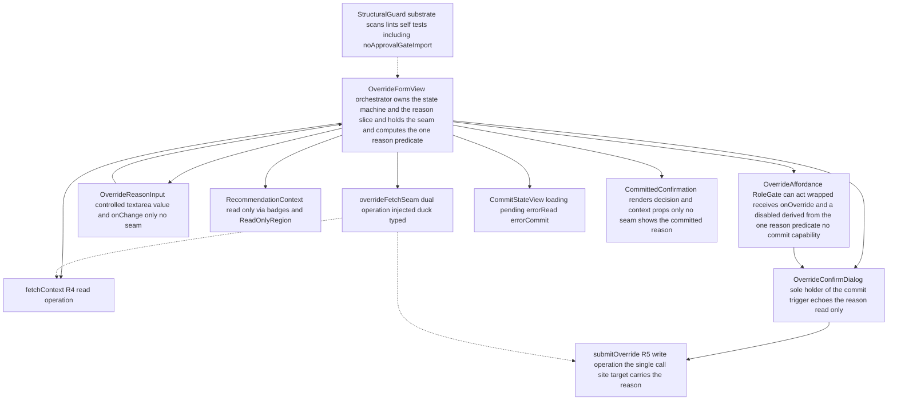

# NFR Design Part 1 (Plan) — `ui-override-form` (U8)

**Stage**: BUILD → per-unit loop → NFR Design → Part 1 (Planning)
**Unit**: `ui-override-form` (U8) · C-cluster UI · Phase 1 · **Depth**: **COMPREHENSIVE** (consistent with the FD + NFR-Requirements depth)
**Date**: 2026-07-09
**Status**: **Part 1 plan — ANSWERED (Q1–Q4 all A) · ambiguity-check CLEAN (three folds) · Part 2 GENERATED.** The four `[Answer]` tags are embedded (§6). Ambiguity-check run against the four answers + the frozen FD + approved NFR Requirements — no genuine gap → three clarity-folds (§6A). Part 2 (`nfr-design-patterns.md` + `logical-components.md`) generated under `guide-docs/build/ui-override-form/nfr-design/`. WIRE-1 / ui-shell / ui-queue / ui-memo-view / ui-approval-gate (all frozen) untouched; tier-B NOT authorized; no other unit started. **STOPPED at the NFR-Design 2-option completion gate.**

**Built ON** the frozen FD (`domain-entities.md` / `business-rules.md` / `business-logic-model.md` — **BR-OVR-1..12**, the component/prop inventory incl. the **capability-free `OverrideReasonInput`**, the full client state machine **including reason preservation across cancel/error**, the **two-server-gate** (AUTHZ-1 + BR-COMMIT-GATE) defense-in-depth note) **and** the approved NFR Requirements (**twenty `NFR-OVR-*` targets** across full-highest/full/medium/soft/governance; the dual-operation reason-carrying single-double convention; **NFR-OVR-Fold-A/1/2/3**) — **re-opening none of it**. One design pattern per target-cluster, each **structurally** meeting its target(s) + traced. **Advisory-only; no LLM; no live backend** (R4/R5 doubled). Tier convention inherited (Vitest + RTL + jsdom · ESLint over the one `FORBIDDEN_TERMS` · file/import scans · detector self-tests).

> **Reference-not-own (stated once, upheld everywhere).** No `ui-override-form` component **modifies** `ui-shell` (frozen — its copy/`FORBIDDEN_TERMS`/`RoleGate`/`ReadOnlyRegion`/badges/`RoleContext`/`COMMIT_ACTION_LABELS.override`/testid convention are **reused**), **imports** `ui-queue` / `ui-memo-view` / **`ui-approval-gate`** (all frozen — their fetchSeam/StructuralGuard/by-construction/testid-lint conventions are **mirrored**, not imported — incl. the **NEW `noApprovalGateImport`** relationship), or authors the wire: WIRE-1 **R4 + R5** are consumed **by shape**; the **real `overrideFetchSeam` wiring** is the composition root's / Build & Test's, not designed here. The unit **owns no authorization decision** (`RoleGate` is cosmetic; AUTHZ-1 is the server's), **no authoritative reason validation** (the UI guard is non-authoritative; the backend `_gate` is the server's — CON-BR4 single-sourced), and **no persistence** (audit-store's).

> **ND-D-Fold (from the sibling D-Fold precedent).** `overrideFetchSeam` is a **duck-typed injected seam with no formal Protocol/interface** — no-TS React, so no interface construct exists; the contract is self-documenting via **JSDoc** (`fetchContext(applicationId)` → `MemoView`; `submitOverride(recommendationId, reason)` → `CommittedDecision`; both reject with a `{error:{code,message,detail}}` envelope) **plus the single capturing double** as the worked example.

---

## 1. Pattern → target map (each pattern structurally meets its target(s))

### §P1 — SingleCallSiteConfirmGatedCommitPattern → NFR-OVR-NOFINAL-1 + CONFIRM-1 + CANCEL-1 — **LOAD-BEARING (mirror of U7, extended for the reason)**
- **Pattern (by-construction guarantee)**: the commit-trigger capability exists **structurally** in only one place. `OverrideAffordance` receives **only** an `onOverride` callback (which opens the dialog) + a `disabled` flag — it holds **no** reference to `submitOverride` or the seam. The commit trigger (the wired `submitOverride` invocation) is passed **only** to `OverrideConfirmDialog`, whose `Confirm` handler is the **sole** call site — and that handler **closes over both the trigger AND the current `reason`** (it invokes `submitOverride(recommendationId, reason)`). A premature commit is therefore **structurally unwritable** in `OverrideAffordance`. Re-derived **locally** (mirror-not-import U7's frozen `SingleCallSiteConfirmGatedCommitPattern`). The **single inbound invocation edge into `submitOverride` (from `OverrideConfirmDialog`)** is a **visible graph property** (§5).
- **Meets the targets**: (NOFINAL-1) structural scan — `submitOverride` has exactly one call site (the confirm handler) + no seam import in non-dialog components; mount/read/reason-typing/`confirming`-toggle issue no POST. (CONFIRM-1, teeth) `Override`-click → `submitOverride.calls.length === 0` **and** `fetchContext.calls.length === 1`; only `Confirm` → `=== 1`. (CANCEL-1, teeth) open + `Cancel` → both counts unchanged; context identical; state `ready(idle)`; **reason preserved**.
- **Tier**: structural + component (teeth). **Rigor**: **full (highest)**.

### §P2 — MandatoryNonBlankReasonGatePattern → NFR-OVR-REASONGATE-1 — **THE NEW LOAD-BEARING PATTERN (by-construction — Q2)**
- **Pattern (by-construction where possible)**: a **single-sourced** predicate `isReasonPresent(reason) = reason.trim() !== ''` (the non-authoritative `trim()` UX guard, FD-OVR-Fold-1) is computed in **one** place (the orchestrator `OverrideFormView`). The `OverrideAffordance`'s **enablement is derived directly from that one predicate** — it receives `disabled={ !isReasonPresent(reason) }` — so it is **structurally impossible** for the affordance to be enabled while the reason is blank (there is no second, independently-computed predicate that could drift due to a logic bug elsewhere). Because the affordance is `disabled` when blank, the confirm dialog **cannot open** with a blank reason, and the single call site (P1) is therefore never reached with a blank reason. The predicate is **non-authoritative** — the backend `_gate` remains the single source of truth (CON-BR4); any UI↔backend `trim()`/`strip()` divergence resolves via the generic 409 (P5). **The by-construction question — whether enablement is derived from the one predicate vs independently computed — is Q2.**
- **Meets the target** (REASONGATE-1, teeth): the whitespace fixture set `{ "", " ", "\t", "\n", " \t\n " }` each keeps the affordance disabled → **zero** `submitOverride`; a non-blank control → exactly one POST carrying the reason **verbatim/as-entered**; the divergence-documentation test records the non-byte-identical `trim()` vs `str.strip()` relationship.
- **Tier**: structural (single-predicate derivation) + component (teeth) + unit (doc). **Rigor**: **full (highest)**.

### §P3 — CosmeticRoleGateCompositionPattern → NFR-OVR-RBAC-1 *(mirror of U7)*
- **Pattern**: `OverrideAffordance` is wrapped in `<RoleGate can="act">` (frozen ui-shell), which reads the current Role **internally** via `useCurrentRole()` (no `role` prop), renders children for `underwriter` (`act:true`) and the `fallback` for `auditor`/`admin`/`null` (`act:false`/no role). **Cosmetic only** — imports no backend, calls no authz function; AUTHZ-1 is the real gate.
- **Meets the target** (RBAC-1): (a) structural — no backend import / no authz call (StructuralGuard); (b) RTL stub `RoleProvider` over **all three roles + null** — `underwriter` → affordance present; `auditor`/`admin`/`null` → absent.
- **Tier**: structural + component. **Rigor**: full.

### §P4 — OverrideRequestBuilderPattern (reason-required) → NFR-OVR-BODY-1 — **by-construction (Q3)**
- **Pattern (by-construction — the inverse of U7's narrow-signature)**: `buildOverrideRequest(recommendationId, reason)` takes `reason` as a **required positional parameter** and returns the literal body `{ action: 'override', reason }`. It has **no `underwriter_id` parameter** (so it structurally cannot emit one — session-derived committer), and it **structurally cannot omit the `reason` key** (the body always carries `action` + `reason`). Where U7's builder enforced *excluding* a field by having no parameter, U8's enforces *requiring* a field by making it a required positional. **The by-construction question — required positional vs optional param — is Q3.**
- **Meets the target** (BODY-1): the body **deep-equals** `{ action: 'override', reason }` (has `action` + `reason`, **no** `underwriter_id`); `recommendation_id` in the path; `reason` sent **as-entered** (no trim in the builder).
- **Tier**: unit + structural. **Rigor**: full.

### §P5 — PerStatusEnvelopeToRenderPattern (dual-cause 409) → NFR-OVR-ERROR-1
- **Pattern**: `CommitStateView` maps the WIRE-1 envelope `{error:{code,message,detail}}` to the correct state — **200** → committed; **403** → not-permitted; **409** → conflict (**one** rendered state for **both** already-committed **and** the blank-reason race/bypass tail — same `commit_conflict` code, no special-casing beyond copy); **400 & 422** → generic invalid — with uniform discipline: `message` visible (`override-error-message`), `code` testid-only hidden (`override-error-code`), `detail` never rendered.
- **Meets the target** (ERROR-1): table-driven RTL, each status programmed on the double; DOM scan finds `detail` nowhere; the two 409 causes render identically.
- **Tier**: component (table-driven) + structural. **Rigor**: full.

### §P6 — ConfirmationFromEchoPattern (reason in echo) → NFR-OVR-NOREFETCH-1
- **Pattern (by-construction)**: `CommittedConfirmation` receives the R5 `CommittedDecision` echo (incl. the committed `reason`) + the R4 context **as props only** — it holds **no** seam reference, so a re-fetch is **structurally impossible**. It renders `action=override` + the committed `reason` + `recommendation_id` + `underwriter_id` (echo) + the recommendation value (context in hand). The displayed committed `reason` **equals the sent (as-entered) reason** — the backend does not normalize (NFR-OVR-Fold-1, verified).
- **Meets the target** (NOREFETCH-1, teeth): after a successful override, **both** `fetchContext.calls.length` and `submitOverride.calls.length` stay unchanged (`1` and `1`); no further transport call.
- **Tier**: component (teeth). **Rigor**: full.

### §P7 — CauseDifferentiatedRecoveryPattern (reason preserved) → NFR-OVR-RECOVERY-1
- **Pattern**: `errorRead`'s `Retry` re-issues `fetchContext(same applicationId)`; `errorCommit` returns the machine to `ready(idle)` with **no** automatic `submitOverride` — **and the reason is preserved** (reason preservation is part of the recovery contract, coordinating with P8). A fresh `Override → Confirm` cycle is required.
- **Meets the target** (RECOVERY-1, teeth): (a) `errorRead` Retry → exactly one further `fetchContext`, recorded arg === X; (b) `errorCommit` → `ready(idle)`, `submitOverride.calls.length` stays `1`, reason input still holds the typed value.
- **Tier**: component (teeth). **Rigor**: full.

### §P8 — ReasonStatePreservationPattern → NFR-OVR-REASONKEEP-1 — **NEW (by-construction — Q4)**
- **Pattern (by-construction where possible)**: the `reason` is an **independent state slice** owned by `OverrideFormView`, and the `Cancel` and `errorCommit` transitions **structurally do not touch it** (they set the phase, never `reason`) — so preservation is a property of the state machine, not a discipline. Distinct from but **coordinating with** the confirm-gated-commit pattern (P1): the reason slice is orthogonal to the phase slice. The confirm dialog renders the current `reason` as a **read-only echo** (`override-confirm-reason-echo`) — a distinct node/state/source from the post-submission committed display (NFR-OVR-Fold-2). **The by-construction question — reason as an independent slice untouched by cancel/error transitions vs cleared-and-repopulated — is Q4.**
- **Meets the target** (REASONKEEP-1): (a) preservation teeth — reason survives `Cancel` and `errorCommit` unchanged; (b) dedicated read-only echo DOM assertion in the `confirming` state.
- **Tier**: component. **Rigor**: full.

### §P9 — CapabilityFreeComponentPattern (extended to `OverrideReasonInput`) → NFR-OVR-CAPFREE-1
- **Pattern (by-construction)**: the presentational components hold no commit capability, each with a **header comment** making the guarantee self-evident in isolation (the frozen ND-Fold precedent). `OverrideAffordance` props `{ onOverride, disabled, testid }` — no seam/`submitOverride`. **`OverrideReasonInput` props `{ value, onChange, testid }`** — a controlled `<textarea>` holding **no** seam reference (the NEW capability-free component; holding reason *text* is not a commit capability — the refined invariant). `CommittedConfirmation` props `{ decision, context, testid }` — no seam. The single `submitOverride` call site is `OverrideConfirmDialog`.
- **Meets the target** (CAPFREE-1): (a) structural import-scan — `OverrideReasonInput`/`OverrideAffordance` import no seam module and reference no `submitOverride` (U7's invocation/import refinement; each detector non-vacuous); (b) prop-contract RTL — `OverrideReasonInput` renders from `{ value, onChange }` alone.
- **Tier**: structural + component. **Rigor**: full.

### §P10 — DualOperationFetchSeamPattern + ExtendedStateMachinePattern → NFR-OVR-FETCH-1 (+ BODY builder + PERF bounded)
- **Pattern**: an **own-local thin module `overrideForm/overrideFetchSeam`** with **two** operations — `fetchContext` (R4 read) + `submitOverride(recommendationId, reason)` (R5 write) — both **injected** via prop, duck-typed (ND-D-Fold). Tests inject the **single capturing double** with **two independently-counted spies** recording args incl. `reason` (Fold-A). `OverrideFormView` **owns** the machine (a responsibility, hook/reducer mechanics → Code-Gen): `loading → ready(idle) → confirming → submitting → {committed | errorCommit}`, plus `pending` and `errorRead`; the reason slice is orthogonal (P8). Sub-components are **presentational**. Bounded: R4 one resource, R5 one commit.
- **Meets the target** (FETCH-1): the seam is injected, never hard-wired; per-operation counting supports the teeth; per-state renders + **ONE consolidated transition test** (mirror of U7) covering all legs incl. both split-error recovery paths + the reason-carrying states. (PERF-1) structural bounded-fetch scan.
- **Tier**: component + structural.

### §P11 — StructuralGuardPattern → NFR-OVR-COPY-1 + ADVISORY-1 + NAMESPACE-1 + TESTID-1 + NOTS-1 + REFNOTOWN-1 *(one substrate)*
- **Pattern**: **one `StructuralGuard` substrate** grouping independent structural checks, each with a **detector self-test** (non-vacuous), mirroring the sibling single-substrate convention: **testid** convention (`override-<element>-<purpose>`); **no-`.ts`/`.tsx`**; **no-backend-import**; **no-`ui-queue`-import**; **no-`ui-memo-view`-import**; **`no-`ui-approval-gate`-import` (NEW `noApprovalGateImport`)**; **no-router-import**; **bounded-fetch** (P10); the **`FORBIDDEN_TERMS` reuse** lints (`no-inline-label` + `advisory-vocabulary`); and the **NOFINAL-1 single-call-site scan** (P1). **Verified property (NFR-OVR-Fold-3)**: the `advisory-vocabulary` lint is applied **UNMODIFIED** because all 21 `OVERRIDE_COPY` strings were audited against the real detector and trip zero (no copy change, no carve-out).
- **Meets the targets**: COPY-1, ADVISORY-1 (unmodified + `LINT_FORBIDDEN_TERMS === FORBIDDEN_TERMS`), NAMESPACE-1 (`FORBIDDEN_TERMS` collision guard + `COMMIT_ACTION_LABELS.override`; override ≠ DECLINE-RECOMMEND), TESTID-1, NOTS-1, REFNOTOWN-1 (incl. `noApprovalGateImport`) — each + self-test.
- **Tier**: structural / lint.

### §P12 — ReferencedObservedBoundaryPattern → NFR-OVR-PERF-1 + A11Y-1 + SCOPE-1 *(soft / governance)*
- **PERF-1** — bounded (R4 one resource, R5 one commit; structural via P10/P11); latency/bundle observed, non-gating.
- **A11Y-1** — semantic markup + focusable `Override`/`Confirm`/`Cancel`/`Retry` + the reason `<textarea>` label association; **soft**. The confirm-dialog **focus-trap** + **Escape-to-cancel** + the label association are **recorded NFR-Design→Code-Gen targets**, not Phase-1 gates. **Note**: the BR-OVR-3 "cancelable" (CANCEL-1) and BR-OVR-8 "blank blocks submit" (REASONGATE-1) invariants stay **gated** as full-rigor teeth — only the a11y polish is soft.
- **SCOPE-1** — governance/exclusion: patterns realize only `ui-override-form`'s behavior; **not** other UI units, backend internals, or the WIRE-1 route implementation; ui-shell mechanisms **reused, not modified**; the siblings' (incl. frozen `ui-approval-gate`) **mirrored, not imported**.
- **Tier**: observed / soft / governance.

---

## 2. Logical components (responsibilities · ownership)

| # | Component | Responsibility | Owns / holds |
|---|---|---|---|
| **C1** | `OverrideFormView` | orchestrator; owns the state machine (P10) **and the `reason` state slice** (P8); holds the injected `overrideFetchSeam`; runs the initial R4 read; computes the **single** `isReasonPresent` predicate (P2); passes state + callbacks to presentational children; passes the **commit trigger ONLY to `OverrideConfirmDialog`** (P1), whose handler closes over `reason` | the seam ref; the machine; the reason slice; the predicate |
| **C2** | `overrideFetchSeam` | own-local dual-operation seam (`fetchContext` R4 + `submitOverride(recommendationId, reason)` R5) + `buildMemoRequest`/`buildOverrideRequest(recommendationId, reason)` (P4) + `normalizeError` (P5 envelope) | request builders; no real network |
| **C3** | `CommitStateView` | non-`ready`/non-`committed` renders: `loading`, `pending` (no affordance / no reason input), `errorRead`/`errorCommit` envelope render (P5); `Retry` re-runs R4 read (P7) | none (presentational) |
| **C4** | `RecommendationContext` | read-only display of the recommendation being overridden via `RecommendationBadge`/`ConfidenceBadge` inside `ReadOnlyRegion` | none (presentational) |
| **C5** | `OverrideReasonInput` | **NEW** controlled, capability-free reason `<textarea>`; props `{ value, onChange, testid }` — holds **no** seam reference (P9, header comment) | none; **no commit capability** |
| **C6** | `OverrideAffordance` | the override button, wrapped in `RoleGate can="act"` (P3); props `{ onOverride, disabled, testid }` — `disabled` **derived from the single reason predicate** (P2); **no `submitOverride`/seam access** (P1/P9) | none; **no commit capability** |
| **C7** | `OverrideConfirmDialog` | the confirm step (pure client-side toggle); the **SOLE holder of the commit trigger**; props `{ onConfirm, onCancel, reason, testid }`; its `Confirm` handler is the single `submitOverride` call site (P1) and **echoes the `reason` read-only** (P8); `Cancel` → `ready(idle)`, reason preserved | the commit trigger |
| **C8** | `CommittedConfirmation` | the success state; props `{ decision, context, testid }` only — **no seam access** (P6); shows `action=override` + committed `reason` + linkage | none; **no fetch capability** |
| **C9** | `StructuralGuard` | one substrate grouping the structural/lint checks + detector self-tests (P11), incl. the **NEW `noApprovalGateImport`** | the guard test suite |
| **C10** | `overrideForm/copy.js` | override-local UI strings (advisory-clean per Fold-3); LINT-SUBJECT | the local copy |

---

## 3. Reference-not-own check (consumed / mirrored / by-shape — none modified)

| Dependency | Relationship | Evidence |
|---|---|---|
| ui-shell `RoleGate`/`AppFrame`/`Panel`/`ReadOnlyRegion`/`RecommendationBadge`/`ConfidenceBadge`/`shell/copy`+`FORBIDDEN_TERMS`+`COMMIT_ACTION_LABELS.override`/`shell/session` | **reused, not modified** | composed as imports; no `src/shell` edit; `RoleContext` stub is RBAC-1's injection point |
| ui-queue / ui-memo-view / **ui-approval-gate** `fetchSeam` + `StructuralGuard` + by-construction conventions | **mirrored, not imported** | REFNOTOWN-1 `noUiQueueImport`/`noMemoViewImport`/**`noApprovalGateImport`**/`noRouterImport` guards (P11) |
| auth-rbac `Role`/`PERMISSION_MATRIX`/`RBAC_COMMIT` | **referenced by value shape, not imported** | `RoleGate` cosmetic capability mirrors the semantics; cross-language |
| audit-store `DecisionCommitService`/`_gate`/`CommittedDecision`/`CommitAction` | **consumed by shape** | `CommittedDecision` is R5's response shape (P6); the real gate (authz + non-blank reason) is the server's |
| WIRE-1 R4 + R5 + envelope | **consumed by shape** | seam builders (P4/P10); route impl deferred to Build & Test (SCOPE-1) |

---

## 4. Component → target coverage (no orphan)

| Target | Pattern(s) | Component(s) |
|---|---|---|
| NFR-OVR-NOFINAL-1 / CONFIRM-1 / CANCEL-1 | P1 | C1, C6, C7 |
| NFR-OVR-REASONGATE-1 | P2 | C1, C5, C6, C7 |
| NFR-OVR-RBAC-1 | P3 | C6 (+ ui-shell `RoleGate`) |
| NFR-OVR-BODY-1 | P4 | C2 |
| NFR-OVR-ERROR-1 | P5 | C3 |
| NFR-OVR-NOREFETCH-1 | P6 | C8 |
| NFR-OVR-RECOVERY-1 | P7 | C1, C3 |
| NFR-OVR-REASONKEEP-1 | P8 | C1, C5, C7 |
| NFR-OVR-CAPFREE-1 | P9 | C5, C6, C8 |
| NFR-OVR-FETCH-1 | P10 | C1, C2 |
| NFR-OVR-COPY-1 / ADVISORY-1 / NAMESPACE-1 / TESTID-1 / NOTS-1 / REFNOTOWN-1 | P11 | C9 (+ C10) |
| NFR-OVR-PERF-1 / A11Y-1 / SCOPE-1 | P12 | C1..C10 (observed / governance) |

**All twenty `NFR-OVR-*` targets covered; no orphan.**

---

## 5. Validated component-relationship Mermaid — single-call-site AND reason-state flow as visible graph properties

Validated against the 7 rules (alphanumeric node IDs; every label double-quoted; **no hyphens, semicolons, colons, parentheses, or special characters**; balanced blocks; **rectangle-only**). **Solid = invokes / data-flow; dashed = provides / scans.** Two guarantees are shown structurally: (1) the **only solid inbound edge into `SubmitOverride` originates from `Dialog`** (single call site); (2) the **reason flows `ReasonInput → View → {Affordance disabled, Dialog echo, SubmitOverride arg}`** (the reason-state flow).

### Text alternative (always included)
- `OverrideFormView` (C1) holds the injected `overrideFetchSeam` (C2), **invokes `fetchContext`** for the initial R4 read (and for `errorRead` Retry, both View-owned), owns the `reason` slice, and computes the **one** `isReasonPresent` predicate.
- **Reason-state flow (visible)**: `ReasonInput --> View` (the controlled `<textarea>` reports edits up via `onChange`); the View then feeds the reason downward — the `Affordance`'s `disabled` is **derived from the one predicate** (`View --> Affordance`), the `Dialog` **echoes the reason read-only** (`View --> Dialog`), and the single call site carries the reason into `submitOverride` (`Dialog --> SubmitOverride`).
- **Single-call-site (visible)**: the **only solid inbound edge into `submitOverride` is `Dialog --> SubmitOverride`** — `OverrideConfirmDialog` (C7) is the **sole** commit-trigger holder; its `Confirm` handler is the single call site, closing over the current reason (P1).
- `OverrideAffordance` (C6) is rendered by the View and **only opens the dialog** (`Affordance --> Dialog`); it has **no edge to `SubmitOverride`** — a premature commit is structurally unwritable there — and it is `disabled` while the reason is blank (P2).
- `OverrideReasonInput` (C5) has **no edge to the seam** — it is a controlled input holding text only.
- `CommittedConfirmation` (C8) is rendered by the View from props only — **no edge to the seam** (P6).
- Dashed = the seam **provides** both operations, and the **StructuralGuard** (C9) scans the source tree (the single-call-site scan, no-import guards incl. `noApprovalGateImport`, lints).

---

## 6. Open questions — full text + lettered options (`[Answer]` BLANK; standing convention)

### Q1 — NFR-Design depth
Confirm the depth.
- **A. COMPREHENSIVE** *(Recommended)* — consistent with the FD + NFR-Requirements; by-construction structural rigor on the load-bearing patterns.
- **B. Lighter.** *(Rejected — contradicts the invariant-bearing classification.)*

**[Answer]:** A

### Q2 — By-construction mandatory-reason gate: is the affordance's enablement STRUCTURALLY derived from the reason? *(the key pattern decision)*
Should the `OverrideAffordance`'s enabled/disabled state be **structurally derived from a single `reason` predicate**, rather than independently computed — so there is **no way** for the affordance to be enabled while the reason is blank due to a logic bug elsewhere?
- **A. Yes — single-sourced predicate, enablement derived from it** *(Recommended)*. One pure predicate `isReasonPresent(reason) = reason.trim() !== ''` is computed in **one** place (`OverrideFormView`). `OverrideAffordance` receives `disabled={ !isReasonPresent(reason) }` — its enablement is **derived** from that one predicate, never independently recomputed. So a blank-reason affordance-enable is **structurally impossible**; the confirm dialog cannot open with a blank reason; the single call site (P1) is never reached blank. The predicate is **non-authoritative** (backend `_gate` is the real gate; divergence resolves via 409). REASONGATE-1's fixture teeth are the regression guard on top. *(Optionally the `onConfirm` call site re-applies the same one predicate as belt-and-suspenders — harmless, keeps the "cannot submit blank" property even under a future refactor.)*
- **B. Independent computation** — the affordance computes its own disabled state from its own predicate/copy of the reason. *(Rejected — two predicates can drift; a bug in one path could enable a blank submission, exactly the failure this question guards against.)*
- **C. No enablement gate** — the affordance is always enabled; blank is caught only at submit-time. *(Weaker UX — the button looks actionable when it is not; relies on the call-site check alone.)*

**[Answer]:** A

### Q3 — By-construction override request builder: is `reason` a REQUIRED positional (structurally un-omittable)?
Should `buildOverrideRequest` structurally **require** the reason (the inverse of U7's structurally-*excluded* field)?
- **A. Yes — required positional; no `underwriter_id` param** *(Recommended)*. `buildOverrideRequest(recommendationId, reason)` takes `reason` as a **required positional parameter** and returns `{ action: 'override', reason }` — it **cannot omit** the `reason` key, and it has **no `underwriter_id` parameter** so it cannot emit one (session-derived committer). Reason-carried + session-derived-committer are enforced by the **signature**, not discipline. BODY-1's deep-equality is the regression guard. (Non-blankness is P2's runtime gate, not the builder's job — the builder serializes whatever reason it is handed, as-entered.)
- **B. Optional `reason` param** — the builder accepts `reason?` and this unit passes it. *(Rejected — an optional param could be omitted by a caller bug, emitting an override with no reason key.)*

**[Answer]:** A

### Q4 — By-construction reason preservation: is `reason` an independent state slice untouched by cancel/error transitions?
Should reason preservation be a **structural property of the state machine** rather than a discipline?
- **A. Yes — independent slice, transitions never touch it** *(Recommended)*. The `reason` is an **independent state slice** in `OverrideFormView`, orthogonal to the phase slice. The `Cancel` and `errorCommit` transitions set **only** the phase — they **structurally do not** call `setReason` — so the reason survives by-construction (not by remembering to preserve it). It is cleared only implicitly by leaving the unit (committed is terminal). REASONKEEP-1's preservation teeth are the regression guard. Coordinates with P1 (phase slice) without coupling.
- **B. Reason cleared on cancel/error and repopulated** — a transition clears the reason, and something restores it. *(Rejected — loses the underwriter's justification on any cancel/transient failure; fragile.)*

**[Answer]:** A

---

## 6A. Ambiguity-check (RUN against Q1–Q4 all-A + the frozen FD + approved NFR-Req) — **CLEAN, three folds, no STOP**

The three explicitly-requested checks resolve as clarity-folds; no genuine gap.

- **ND-OVR-Fold-i — check (i): the belt-and-suspenders `onConfirm` re-check stays genuinely OPTIONAL; REASONGATE-1's teeth cover the reachable failure modes.** If REASONGATE-1's blank-fixture teeth drive the **full attempt** (fire `Override → Confirm`, not merely assert the `disabled` attribute), they **already catch a broken predicate→`disabled` wiring**: a broken wiring would enable the affordance while blank, the attempt would reach `Confirm`, and `submitOverride.calls.length === 1 ≠ 0` **fails** the teeth. The one path the teeth do **not** exercise is "reason cleared to blank **after** the dialog opened, then `Confirm`" — and that path is **unreachable by design**: the `confirming` state renders the **read-only reason echo**, not an editable input (the reason is **frozen at dialog-open**; the editable `OverrideReasonInput` belongs to `ready(idle)`), so the reason cannot change between open and `Confirm`. Therefore the `onConfirm` re-check guards **only a future-refactor hazard** (someone later making the reason editable during `confirming`). It is **retained as documented optional insurance** — its **presence** is lightly asserted (a unit check that `onConfirm` applies the same `isReasonPresent` predicate before invoking `submitOverride`, keeping it non-vacuous) — but it is **not elevated to a hard gate**, because the reachable failure modes are fully covered by REASONGATE-1's teeth given the frozen-during-confirming design. **Adopted design fact (clarity-fold): the reason is not editable during `confirming`.**

- **ND-OVR-Fold-ii — check (ii): no committed-state source-of-truth ambiguity.** The **committed display's single source of truth is the `CommittedDecision` echo** (`decision.reason`), **not** the client `reason` slice. `CommittedConfirmation` is **`{ decision, context }`-only** (P6, by-construction) — it **structurally cannot read** the orchestrator's client `reason` slice, because that slice is never passed to it. The orchestrator still holds the client `reason` slice in the terminal `committed` state (it is not force-cleared), but the committed render sources the reason **exclusively** from `decision.reason`. The two values **coincide** (NFR-OVR-Fold-1, verified: the backend does not normalize), so there is no observable divergence — and even if they could differ, the **source of truth is unambiguous** (the echo). Pre-submission the reason is read from the client slice (the `confirming` echo, `override-confirm-reason-echo`); post-submission it is read from the echo (`override-committed-reason`) — distinct nodes/states/sources (NFR-OVR-Fold-2). Clarity-fold (confirmed).

- **ND-OVR-Fold-iii — check (iii): the predicate and the builder read the SAME single `reason` slice — no two-copy divergence.** There is exactly **one** `reason` state slice (Q4-A, `OverrideFormView`). The predicate `isReasonPresent(reason) = reason.trim() !== ''` (P2) applies `.trim()` **transiently, inside the boolean expression only** — it produces a throwaway trimmed string for the comparison and **never writes it back** to the slice. The `onConfirm` handler closes over the **same** slice and passes it **verbatim (as-entered)** to `submitOverride(recommendationId, reason)` → `buildOverrideRequest(recommendationId, reason)` → `{ action:'override', reason }` (Q3-A, P4 — no trim in the builder). So the predicate and the builder read the **identical** underlying value; the `trim()` is a local detail of the gate decision, not a second stored copy. **Consistent — no divergence.** Clarity-fold (confirmed).

**→ CLEAN. Proceeding to Part 2.**

---

## 7. Planned Part-2 structure (generated)

On the filled answers → ambiguity-check → explicit go, Part 2 generates in `guide-docs/build/ui-override-form/nfr-design/`:
- **`nfr-design-patterns.md`** — §P1..§P12 (adjusted per answers), each structurally meeting its `NFR-OVR-*` target(s) + tier + rigor; the **pattern-integration Mermaid** (7-rule validated) + text alt; the traceability table (pattern → target → tier → rigor, no orphan).
- **`logical-components.md`** — C1..C10 with responsibilities + ownership + the **exact by-construction prop shapes**; the reference-not-own check (§3); the component → target coverage (§4, no orphan); the **component-relationship Mermaid** (§5, single-call-site + reason-state visible) + text alt.

Per the standing convention, the plan file is **re-saved with the filled answers + any folds embedded** at that point. **Precedent-determined (not questions)**: the header-comment self-evidence for the capability-free components — incl. the **NEW `OverrideReasonInput`** header comment ("props `{ value, onChange }` only — controlled textarea, no seam reference, holds text not a commit capability") — mirroring U7's ND-Fold-1/2/3; the `OverrideConfirmDialog` sole-`onConfirm` header comment; the one StructuralGuard substrate (sibling P-substrate); the RoleGate cosmetic composition (all-roles+null); the dual-operation reason-carrying single-double (Fold-A).

---

## 8. Holds (this stage)
- **No NFR-Design artifact generated** — `nfr-design-patterns.md` / `logical-components.md` deferred to Part 2 on explicit go; **no ambiguity-check run yet** (follows the answers).
- **No code** under `frontend/src/overrideForm/`; **WIRE-1 · ui-shell · ui-queue · ui-memo-view · ui-approval-gate (all frozen) untouched**; no backend file touched.
- Frozen FD (BR-OVR-1..12 + inventory + state machine incl. reason preservation + two-server-gate note) and the approved NFR Requirements (20 `NFR-OVR-*` + Fold-A/1/2/3) are the substrate — **not re-opened**.
- **tier-B NOT authorized**; **no other unit started**; `audit_store` Docker-guard gap still deferred.

---

## 9. Gate
**Part 2 GENERATED** (`guide-docs/build/ui-override-form/nfr-design/nfr-design-patterns.md` + `logical-components.md`) after the four answers (all A) + the CLEAN ambiguity-check (§6A, three folds: ND-OVR-Fold-i/ii/iii). **STOPPED at the NFR-Design 2-option completion gate (1. Request Changes / 2. Continue to Next Stage → Infrastructure Design)** for the user's review of both artifacts. Did NOT advance past the gate. WIRE-1 · ui-shell · ui-queue · ui-memo-view · ui-approval-gate (all frozen) untouched; tier-B NOT authorized; no other unit started.
