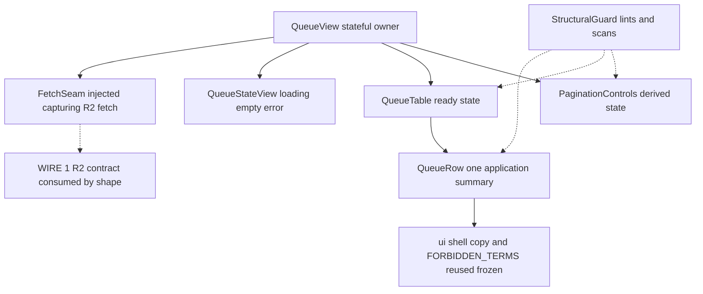

# NFR Design — Plan (Part 1) — `ui-queue` (U5)

**Stage**: BUILD → per-unit loop → NFR Design **Part 1 (Plan)** · **Unit**: U5 `ui-queue` · C5 · Phase 1
**Depth**: **lighter (display) + async-state addendum** (consistent with the FD and NFR Requirements depth) · **Date**: 2026-07-09
**Built ON** the frozen FD (**BR-QUEUE-1..9**, component/prop inventory, four-state render enum, `data-testid` inventory,
pagination/selection flows) **and** the approved NFR Requirements (fourteen `NFR-QUEUE-*` targets; the **single
injected/capturing fetch-double** convention D6; **NFR-QUEUE-Fold-1**) — **re-opening none of it**. Mirrors ui-shell's
NFR-Design structure: **patterns → logical components → reference-not-own → component→target coverage → validated Mermaid**.

> **Part 1 (Plan) only.** Draft pattern map + logical components + ref-not-own + coverage + Mermaid + open [Answer]
> questions. **No NFR-Design artifact (`nfr-design-patterns.md` / `logical-components.md`) is generated here.**

---

## 0. Prerequisites & grounding (read, not re-derived)

- [x] NFR Requirements approved for `ui-queue` (`nfr-requirements.md` + `tech-stack-decisions.md`, gate approved 2026-07-09).
- [x] Frozen FD + the fourteen `NFR-QUEUE-*` targets are the substrate — patterns realize them, re-opening neither.
- [x] **ui-shell NFR-Design structure inherited** (frozen, U10): `*Pattern` naming; a **test/lint substrate** grouping
  structural scans (the **StructuralGuard precedent** — ui-shell's `StructuralFileScanPattern` + testid lint +
  reference-not-own scan, each with a **detector self-test**); component-relationship Mermaid under the 7-rule convention.
- [x] **Reused-not-modified**: ui-shell's **one `FORBIDDEN_TERMS` object** + ESLint + testid convention + `RoleContext`
  seam; WIRE-1 **R2** contract consumed **by shape**. Nothing frozen is edited.

---

## 1. Draft pattern map (`NFR-QUEUE-*` → named pattern → primary logical component)

| # | Pattern (draft) | Target(s) | Primary component | Tier |
|---|---|---|---|---|
| P1 | **SharedForbiddenTermsReusePattern** — reuse ui-shell's **one** `FORBIDDEN_TERMS` + ESLint; **no new word-list**; badges look up labels by value | COPY-1, NAMESPACE-1 | StructuralGuard + QueueRow | lint / structural |
| P2 | **NullRowPlaceholderPattern** — a row with null `recommendation`/`confidence` renders the pending placeholder, no badge, row present | PENDING-1 | QueueRow | component |
| P3 | **ErrorEnvelopeToRenderPattern** — map `{error:{code,message,detail}}` → `message` visible, `code` testid-only, `detail` never in DOM | ERROR-1 | QueueStateView | component + structural |
| P4 | **FetchSeamPattern** — the **injected/capturing** R2 fetch function (D6, Fold-1) as a distinct seam; production wires the real fetch at the composition root, tests inject a capturing double that records the requested page | RETRY-1, FETCH-1 (fetch), PERF-1 (bounded) | FetchSeam | component + capturing double |
| P5 | **FourStateMachinePattern** — `loading→ready\|empty\|error`; `error--retry-->loading` (last page, Fold-B); `ready--page-->loading`; built **on** FetchSeam | FETCH-1 (states), RETRY-1 (transition) | QueueView (+ QueueStateView / QueueTable) | component |
| P6 | **EmissionOnlyEventPattern** — a row emits `onSelect(application_id)` and nothing else; **no router coupling** | SELECT-1 | QueueRow + StructuralGuard | component + structural |
| P7 | **RoleInvariantRenderingPattern** — **no `RoleGate` composition**; render identical across roles (contrast: U7/U8 will compose `RoleGate`) | VIEWONLY-1 | QueueView/QueueTable + StructuralGuard | structural + component |
| P8 | **DerivedStatePaginationPattern** — `isFirstPage`/`isLastPage`/indicator derived from the R2 `page` wrapper; boundary disabling | PAGINATION-1 | PaginationControls | component |
| P9 | **StructuralGuardPattern** — the file/import/lint substrate (StructuralGuard precedent): testid convention lint, no-`.ts`/`.tsx` scan, no-router-import scan, no-`RoleGate`-import scan, bounded-fetch scan — each with a **detector self-test** | TESTID-1, NOTS-1 (+ structural halves of SELECT-1/VIEWONLY-1/PERF-1) | StructuralGuard | structural / lint |
| P10 | **ReferencedObservedBoundaryPattern** — soft/observed, not over-specified | PERF-1, A11Y-1, SCOPE-1 | (cross-cutting) | observed / soft / governance |

**No orphaned target**: COPY/NAMESPACE→P1; PENDING→P2; ERROR→P3; RETRY/FETCH→P4+P5; SELECT→P6; VIEWONLY→P7;
PAGINATION→P8; TESTID/NOTS→P9; PERF/A11Y/SCOPE→P10.

## 2. Draft logical components (responsibilities · ownership)

`ui-queue` production components live at `frontend/src/queue/`; the StructuralGuard is a **test/lint substrate** (not a
production component). Names align with the FD inventory (`domain-entities.md §4`).

| ID | Component | Responsibility | Ownership | Backs |
|---|---|---|---|---|
| **C1** | **QueueView** | The **only stateful** component: calls **FetchSeam** for the current page, holds `{state, page, items, error}`, drives the **four-state machine** (P5), selects `QueueStateView` vs `QueueTable`+`PaginationControls`. | owns (queue) | FETCH-1, RETRY-1, VIEWONLY-1(render) |
| **C2** | **FetchSeam** | The **injected/capturing** R2 access boundary (P4/D6): builds the R2 request (`page`+`size`), returns the list wrapper or error envelope; **production wires the real fetch at the composition root**, tests inject a capturing double. **Single construction** (Fold-1). | owns the **seam interface**; real wiring **deferred** (composition root / Build & Test) | FETCH-1, RETRY-1, PERF-1(bounded) |
| **C3** | **QueueStateView** | Presentational non-ready states: `loading` (skeleton, count deferred — Q2-A), `empty` ("no applications"), `error` (P3 — message visible, code testid-only, detail never rendered). | owns | ERROR-1, FETCH-1(states), A11Y-1 |
| **C4** | **QueueTable** | Ready-state semantic `<table>`: header + one `QueueRow` per item; forwards `onSelect`. | owns | COPY-1(look-up), TESTID-1, A11Y-1(semantic) |
| **C5** | **QueueRow** | One `ApplicationSummary`: `RecommendationBadge`/`ConfidenceBadge` **iff** non-null else the **pending placeholder** (P2); the **emission-only** select affordance (P6). Renders only system `Recommendation`, never a human `CommitAction` (P1/NAMESPACE-1). | owns | PENDING-1, COPY-1, NAMESPACE-1, SELECT-1, TESTID-1 |
| **C6** | **PaginationControls** | Derived-state prev/next + indicator from the `page` wrapper (P8); boundary disabling. | owns | PAGINATION-1, TESTID-1 |
| **C7** | **StructuralGuard** *(test/lint substrate)* | The consolidated structural checks (P9): ESLint reuse (COPY-1/NAMESPACE-1), testid lint (TESTID-1), no-TS file scan (NOTS-1), no-router-import scan (SELECT-1), no-`RoleGate`-import scan (VIEWONLY-1), bounded-fetch scan (PERF-1) — **each with a detector self-test**. | test-only | TESTID-1, NOTS-1, structural halves of COPY/NAMESPACE/SELECT/VIEWONLY/PERF |

## 3. Reference-not-own check (draft)

| Concern | Owner | This unit? |
|---|---|---|
| The queue view behavior (fetch/state/rows/pagination/selection) | **`ui-queue`** (C1–C7) | ✅ owns |
| Shell primitives / copy / `FORBIDDEN_TERMS` / `RoleContext` | **`ui-shell`** (frozen U10) | ❌ **consumed by import/shape, not modified** (reused) |
| The frontend↔backend **wire/serialization** (R2 route, envelope, session) | **WIRE-1** (composition-root) | ❌ consumed **by shape**; the **real R2 wiring** of FetchSeam is deferred (composition root / Build & Test) |
| **R2 route implementation** (`backend/app/main.py`) | Build & Test | ❌ not authored here |
| Authorization **decision** | **`auth-rbac`** (SEC-4) | ❌ the queue gates nothing (VIEWONLY-1); no `RoleGate`, no authz call |
| Navigation / routing target of `onSelect` | later shell/router integration | ❌ **emission-only**; no router import (SELECT-1) |
| Human commit / gate (`approve`/`override`) | **`ui-approval-gate` (U7)** / **`ui-override-form` (U8)** | ❌ no write path; queue never renders a `CommitAction` (NAMESPACE-1) |
| Aesthetic token **values**, skeleton-row count, default page `size` | **Code-Gen** | ❌ direction/shape only; values deferred |

## 4. Component → target coverage (draft, no orphan)

| Target | Component(s) / item |
|---|---|
| NFR-QUEUE-COPY-1 | C5 (badge look-up) + C7 (no-inline lint, `FORBIDDEN_TERMS` reuse) |
| NFR-QUEUE-NAMESPACE-1 | C5 + C7 (collision guard) |
| NFR-QUEUE-PENDING-1 | C5 (pending placeholder) |
| NFR-QUEUE-ERROR-1 | C3 (error-envelope render) + C7 (detail-never structural) |
| NFR-QUEUE-RETRY-1 | C1 (transition) + C2 (capturing double, page N) |
| NFR-QUEUE-SELECT-1 | C5 (emit) + C7 (no-router scan) |
| NFR-QUEUE-VIEWONLY-1 | C1/C4 (render) + C7 (no-`RoleGate` scan) |
| NFR-QUEUE-TESTID-1 | C4/C5/C6 + C7 (testid lint) |
| NFR-QUEUE-NOTS-1 | whole unit + C7 (file scan) |
| NFR-QUEUE-FETCH-1 | C1 (state machine) + C2 (seam) + C3/C4 (renders) |
| NFR-QUEUE-PAGINATION-1 | C6 (derived state) |
| NFR-QUEUE-PERF-1 | C2 (bounded fetch) + C7 (scan) — observed |
| NFR-QUEUE-A11Y-1 | C3/C4 (semantic + focusable) — soft |
| NFR-QUEUE-SCOPE-1 | governance / boundary (documented, not an orphan) |

**All fourteen targets covered**; every component backs ≥1 target; SCOPE-1 is a documented boundary. No orphan.

## 5. Draft component-relationship diagram (validated Mermaid — 7 rules)

Validated before write: alphanumeric node IDs; every label double-quoted; **no hyphens, no semicolons, no bare colons, no
parentheses, no other special characters** in labels (underscore per the established convention); balanced blocks.

**Text alternative (always included)**:
- **QueueView** calls **FetchSeam** (R2), and selects **QueueStateView** (loading/empty/error) or **QueueTable** +
  **PaginationControls** (ready).
- **QueueTable** renders **QueueRow** per item; **QueueRow** looks up labels from the **reused frozen ui-shell copy /
  `FORBIDDEN_TERMS`** (never inlined).
- Dashed = substrate/boundary: the **StructuralGuard** lints/scans the row/table/pagination; **WIRE-1 R2** (external, real
  wiring deferred to the composition root) is what **FetchSeam** consumes by shape.

---

## 6. Open pattern-decision questions ([Answer] tags — lettered; full Q&A embedded on disk)

### Q1 — FetchSeam shape (P4/C2)
- **A.** **Distinct thin module** `queue/fetchSeam` that builds the R2 request (`page`+`size` → URL) and is **injected**
  into `QueueView` via prop/context; tests replace it with a capturing double. *(Recommended — a real "distinct component"
  seam; one place owns request-building; clean capture for RETRY-1.)*
- **B.** **No separate module** — just a fetch-function prop on `QueueView` (the seam is only the prop boundary).

`[Answer]:` **A** — a distinct thin module `queue/fetchSeam` that builds the R2 request (`page`+`size` → URL) and is
injected into `QueueView` via prop/context; tests replace it with a capturing double. One place owns request-building;
clean capture for RETRY-1.

### Q2 — Four-state machine: component or responsibility? (P5/C1)
- **A.** A **responsibility of `QueueView`** (the logical state owner); the concrete hook/reducer mechanism is **Code-Gen**
  (Fold-B). No separate state-machine component. *(Recommended — lean component set; Fold-B already defers mechanics.)*
- **B.** A **distinct `QueueStateMachine`** logical component (reducer/hook) separate from `QueueView`.

`[Answer]:` **A** — the four-state machine is a responsibility of `QueueView` (the logical state owner); the concrete
hook/reducer mechanism is Code-Gen (Fold-B). No separate state-machine component.

### Q3 — StructuralGuard granularity (P9/C7)
- **A.** **One `StructuralGuard` substrate** grouping the structural scans (testid / no-TS / no-router / no-`RoleGate` /
  bounded-fetch / `FORBIDDEN_TERMS` reuse), each an independent check with its own detector self-test. *(Recommended —
  mirrors ui-shell's single test/lint substrate.)*
- **B.** **Separate named guard per concern** (one component each).

`[Answer]:` **A** — one `StructuralGuard` substrate grouping the structural scans (testid / no-TS / no-router /
no-`RoleGate` / bounded-fetch / `FORBIDDEN_TERMS` reuse), each an independent check with its own detector self-test,
mirroring ui-shell's single test/lint substrate.

### Q4 — Error handling: uniform vs 401 special-case (P3/C3)
- **A.** **Uniform** — every non-2xx (incl. **401 unauthenticated**) renders the generic error state + Retry; any
  auth-handshake/redirect is **deferred** (WIRE-1 §6 abstract seam, composition root). *(Recommended — 401-specific
  handling belongs with the deferred auth handshake, not the queue.)*
- **B.** **Special-case 401** now — a distinct "session expired / sign in" affordance in the queue.

`[Answer]:` **A** — uniform error handling; every non-2xx (including 401 unauthenticated) renders the generic error
state + Retry; any auth-handshake/redirect is deferred (WIRE-1 §6 abstract seam, composition root). 401-specific
handling belongs with the deferred auth handshake, not the queue.

---

## 7. NFR Design **Part 2** plan — artifacts to generate **after** approval (checkboxes, not started)

- [x] **`guide-docs/build/ui-queue/nfr-design/nfr-design-patterns.md`** — one section per pattern P1–P10 (with Q1–Q4
  folded in), each: pattern statement + how it structurally meets its `NFR-QUEUE-*` target(s) + tier; a **pattern-
  integration Mermaid** (validated) + text alternative; a **pattern → target → tier → rigor** traceability table (no orphan).
- [x] **`guide-docs/build/ui-queue/nfr-design/logical-components.md`** — the components C1–C7 (finalized with Q1–Q4),
  responsibilities/ownership; the **component-relationship Mermaid** (validated) + text alternative; the **reference-not-own
  check**; the **component → target coverage** table (no orphan); settled items held.

## 8. Holds / guardrails (this Part 1)

- [x] **No NFR-Design artifact generated** — only this plan file written.
- [x] **Frozen FD + approved NFR Requirements not re-opened** — patterns/components realize them.
- [x] **WIRE-1 untouched** (R2 by shape; real FetchSeam wiring deferred to composition root / Build & Test); **`ui-shell`
  (frozen) untouched** (copy/`FORBIDDEN_TERMS`/`RoleContext`/testid convention **reused, not modified**).
- [x] **No application/test code** written (patterns/components only).
- [x] **tier-B corpus run NOT authorized**; **no other unit started**; `audit_store` Docker-guard gap still deferred.
