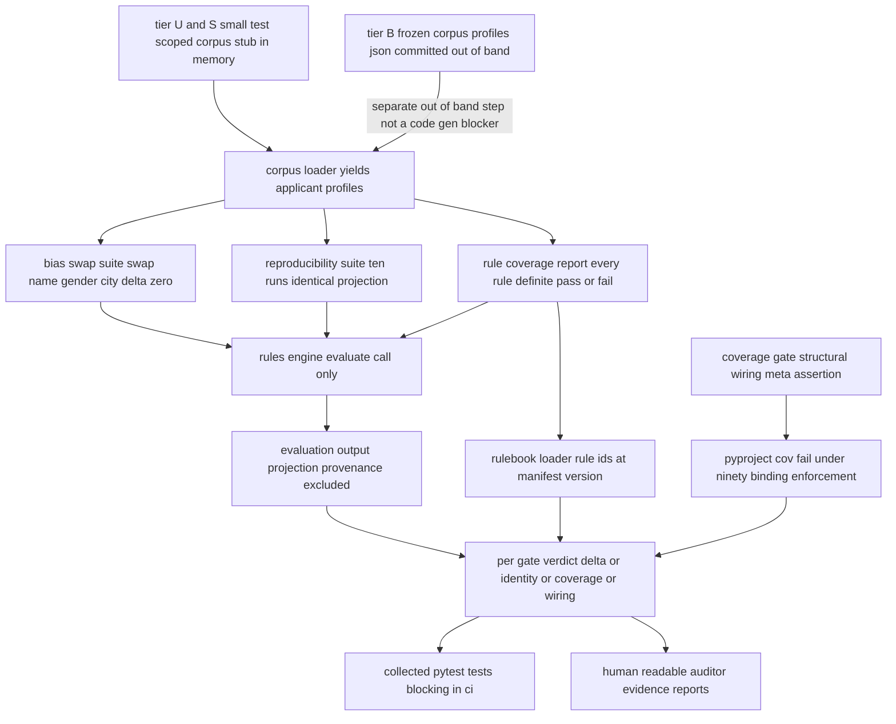

# Business Logic Model — `quality-gates` (U13)

**Stage**: BUILD → Functional Design (per-unit) · the four blocking verification gates · **Depth**: COMPREHENSIVE
**Unit**: U13 `quality-gates` · **Date**: 2026-07-08 · **single verification authority** for CON-BR1 / CON-BR2·AC-1 / QA-3 / AC-5 · Stories **US-PLAT-3/4/5/6**.
**Scope**: The **verification flow** (load corpus → per-gate assertion → blocking pytest test + evidence artifact), the **tier-U/S-vs-tier-B boundary**, the **single-verification-authority-vs-enforcement boundary**, the **coverage_gate dual nature** (QG-Fold-3), a **consumer/dependency map**, and an **invariant self-check**. Built exactly on the seven locked answers + five QG-Folds — re-opening none. **Verification only; no LLM; no real PII.**

---

## 1. Verification flow

`quality-gates` runs **in CI** over a corpus the **`CorpusLoader`** supplies — a **tier-U/S in-memory stub** by default (small test-scoped corpus + a controlled rulebook), or the **tier-B frozen `corpus/profiles.json`** when a real corpus has been committed (a separate out-of-band step). Each of the four gates asserts its invariant, **fails the build** on violation, and **emits a human-readable evidence report**.

Mermaid validated before write (alphanumeric node IDs + underscore; every label double-quoted; **no semicolons, no bare colons, no parentheses, no hyphens, no special characters** in labels; balanced blocks). Text alternative follows.

### Text alternative (always included)
1. The **`CorpusLoader`** yields `ApplicantProfile`s from either the **tier-U/S in-memory stub** (CI default) or the **tier-B frozen `corpus/profiles.json`** (committed out of band — a **separate step, not a Code-Gen blocker**).
2. **`bias_swap_suite`** swaps `{name, gender, city}` and re-evaluates → asserts the engine `recommendation` is unchanged (**delta = 0**).
3. **`reproducibility_suite`** runs `evaluate()` **10×** per profile → asserts an **identical `evaluation_output()` projection** each run (**100%**).
4. **`rule_coverage_report`** loads the rulebook's `rule_id`s at **`manifest.rulebook_version`** and evaluates over the corpus → asserts **every rule** reaches a **definite PASS or FAIL** (**100%**).
5. All three engine-driven gates call **`rules-engine evaluate()` (call-only)** and compare via the **imported `evaluation_output()` projection** (provenance excluded — reference-not-own, the same projection ReplayService uses).
6. **`coverage_gate`** asserts the **`pyproject --cov-fail-under=90` wiring** is present + ≥90 (structural meta-assertion, QG-Fold-3); the **binding** enforcement is `pyproject`'s.
7. Each gate produces a **per-gate verdict** that both **fails the build as a collected pytest test** (blocking in CI) and is written as a **human-readable auditor evidence report**.

---

## 2. Tier-U/S vs tier-B boundary (the registered gap; QG-Fold-1)

| Concern | **Tier-U/S (CI, now)** | **Tier-B (later, out-of-band, NOT CI)** |
|---|---|---|
| Corpus source | small **test-scoped stub** (in-memory `CorpusRecord`/profile list) + a controlled rulebook | the **committed frozen `corpus/profiles.json`** (real 300+, after the out-of-band build) |
| What is asserted | each gate's **logic/mechanics** (delta=0 detection, ×10 identity, uncovered-rule detection, wiring meta-assertion) | the **real acceptance runs** (bias-swap delta=0 over the actual corpus, 100% rule coverage over the real rulebook) |
| Code-Gen dependency | **NONE** — Code-Gen completes + passes CI on the stub; **no committed `corpus/` required** | a **separate, later, explicit** step — real `GEMINI_API_KEY`, **not authorized here**, **not a Code-Gen blocker** |
| LLM / network | none (no LLM anywhere in `quality-gates`) | the corpus was produced by corpus-generator's tier-B build; `quality-gates` still calls no LLM |

**The gates are designed and tier-U/S-testable now; the real full-corpus run is deferred to an authorized tier-B execution — exactly per the Deferred-Decisions register note.**

---

## 3. Single-verification-authority vs enforcement boundary

| Invariant | **Verification — single owner: `quality-gates`** | **Enforcement / definition — elsewhere (NOT re-owned here)** |
|---|---|---|
| **CON-BR1** no demographic proxy | `bias_swap_suite` asserts the invariant holds (**delta = 0, blocking**) — the one authority | `rules-engine` operates on financials only (rules never read demographics); `outlier-model` (P2) uses a demographic-excluded feature vector; `corpus-generator` respects segregation (layered) |
| **CON-BR2 / AC-1** deterministic decision | `reproducibility_suite` asserts identical decision ×10 | `rules-engine` produces the recommendation (pure `evaluate`); `memo-agent-core` consumes it read-only (`DecisionMemo` frozen) |
| **QA-3** rule coverage | `rule_coverage_report` asserts 100% | rules authored in the versioned rulebook (rules-engine) |
| **AC-5 / QA-6** code coverage | `coverage_gate` asserts the wiring | **`pyproject --cov-fail-under=90`** enforces (build-failing) |

**One verification owner + defense-in-depth enforcement ≠ a split** (unit-of-work.md §A.1 rule 4): no unit re-defines an invariant, so nothing can drift. `quality-gates` **verifies**; it never enforces or re-defines.

---

## 4. `coverage_gate` dual nature (QG-Fold-3 — resolved explicitly)

- A **collected pytest test cannot read the final coverage percentage mid-session** (coverage is computed at session end). Therefore `coverage_gate`'s collected test is a **structural wiring meta-assertion**: it reads `pyproject.toml` and asserts `[tool.pytest.ini_options].addopts` contains **`--cov-fail-under=90`** (present and value ≥ 90).
- The coverage **percentage evidence** (`CoverageGateReport.measured_pct`) is produced **separately** from the coverage data artifact (e.g. `coverage.json`/`.coverage`) — an **informational, auditor-consumable report**, generated after a run.
- **This is not a second enforcement mechanism.** The **binding, build-failing** ≥90% gate remains **`pyproject`'s `--cov-fail-under=90`** (Q4-A), already proven across nine units. `coverage_gate` guarantees that gate stays **wired**, and surfaces the number as evidence.

---

## 5. Consumer / dependency map

| Party | Relationship | Direction |
|---|---|---|
| **`rules-engine`** (`evaluate` / `evaluation_output` / `RulebookLoader`) | `quality-gates` **calls** the engine + the imported projection + loads the rulebook | quality-gates → rules-engine (call-only) |
| **`corpus-generator`** (`CorpusRecord` / `CorpusManifest`) | `quality-gates` **reads** the frozen corpus / accepts an in-memory stub via `CorpusLoader` | quality-gates → `corpus/` or stub (read-only) |
| **`intake`** (`ApplicantProfile` / `Demographics`) | `quality-gates` **swaps** demographics via `model_copy` | quality-gates → intake shapes (call-only) |
| **`audit-store`** (`ReplayService` pattern) | `quality-gates` **mirrors** the load+evaluate+compare-`evaluation_output()` pattern | pattern reference (not re-implemented) |
| **`pyproject.toml`** (`--cov-fail-under=90`) | `coverage_gate` **asserts the wiring**; `pyproject` **enforces** | quality-gates → pyproject (read/assert) |
| **`outlier-model`** (U18, P2) | its seeded-determinism verification is **deferred** into reproducibility when it lands | future (P2) |

`quality-gates` **imports none of its consumers**, **edits none of its dependencies' production code** (reference-not-own), **generates no corpus**, and **runs no LLM**. It **verifies**; direction is **quality-gates → deps (call-only)** and **quality-gates → corpus/stub (read-only)**.

---

## 6. Invariant self-check

| Invariant | Honored by | How |
|---|---|---|
| **CON-BR1** no demographic proxy (verification authority) | BR-QG-1/2; §3 | `{name,gender,city}` swap → engine recommendation unchanged (**delta=0, blocking**); proxy check over occupation+income via sanctioned rules; pincode N/A |
| **CON-BR2 / AC-1** deterministic decision | BR-QG-3; §3 | `evaluate()` ×10 → identical `evaluation_output()`; 100%; engine-deterministic, not LLM wording; outlier-seeded clause deferred P2 |
| **QA-3 / AC-4** rule coverage | BR-QG-4; §1 | every `rule_id` (at `manifest.rulebook_version`) definite PASS/FAIL over the corpus; uncovered = blocking |
| **AC-5 / QA-6** code coverage | BR-QG-5; §4 | binding ≥90% stays in `pyproject`; `coverage_gate` = wiring meta-assertion + evidence (not a 2nd enforcer) |
| **Registered corpus gap** | BR-QG-6; §2 | `CorpusLoader` tier-U/S stub now; tier-B real run separate, out-of-band, **not a Code-Gen blocker**, **not authorized here** |
| **Reference-not-own / verification-only** | BR-QG-7; §3/§5 | five surfaces call-only, none edited; no rule-eval/hasher/derivation; no enforcement/definition; no re-own of memo CON-BR2 |
| **Auditor evidence + blocking form** | BR-QG-8/9; §1 | each gate emits a human-readable read-only report AND is a collected blocking pytest test |
| **No LLM / no real PII / WIRE-1 untouched** | BR-QG-7; §5 | verifies the deterministic engine only; synthetic corpus; backend verification unit |
