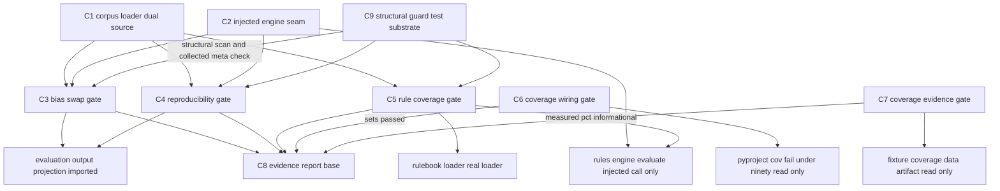

# NFR Design — Logical Components — `quality-gates` (U13)

**Stage**: BUILD → NFR Design (per-unit) · the four blocking verification gates · **Depth**: **COMPREHENSIVE**
**Unit**: U13 `quality-gates` · **Date**: 2026-07-08 · **single verification authority** for CON-BR1 / CON-BR2·AC-1 / QA-3 / AC-5 · Stories **US-PLAT-3/4/5/6**.
**Built ON** the frozen FD + approved NFR Requirements (**eleven `NFR-QG-*` targets**, the eight FD/NFR folds, the four evidence-record shapes, the `CorpusLoader` boundary) and the patterns in `nfr-design-patterns.md` (P1–P9 + the CollectedBlockingTestConvention; folds **ND-QG-Fold-1/2/3**) — **re-opening none**. Package **`backend/quality_gates/`** (Q6-A). **Verification only; reference-not-own; no LLM; no real PII; no new dependency (stdlib `tomllib` only).**

---

## 1. Logical components (responsibility · ownership · collaborators)

| # | Component | Responsibility | Owns / collaborators |
|---|---|---|---|
| **C1** | **CorpusLoader** | dual-source profile supply — `from_file(path)` (frozen `corpus/profiles.json` via `CorpusRecord.model_validate`) / `from_records(records)` (in-memory stub) / `profiles()` / `manifest_version()`; the tier-U/S-vs-tier-B seam (P6) | **owns**; imports `corpus_generator.records.CorpusRecord`/`CorpusManifest` (call-only) |
| **C2** | **InjectedEngine seam** | the engine injection point — a **constructor parameter** on the engine-driven gates, mirroring `ReplayService(__init__(self, repository, engine))` exactly (P7, ND-QG-Fold-2); real `RulesEngine` in prod, duck-typed fakes in test | **owns** the seam; references `rules_engine.RulesEngine.evaluate` (call-only) |
| **C3** | **BiasSwapGate** | swap `{full_name, gender, city}` via `model_copy` → assert engine `recommendation` unchanged (`delta_count == 0`); AttributionCheck over occupation/income via `evaluation_output()` `rule_results`; `pincode` N/A → `BiasSwapReport` (P1) | **owns**; references `intake.ApplicantProfile`/`Demographics`, `evaluation_output()`, C1, C2 |
| **C4** | **ReproducibilityGate** | `evaluate()` ×10 → identical imported `evaluation_output()` projection (`reproducibility_pct == 100`) → `ReproducibilityReport` (P2) | **owns**; references `rules_engine.report.evaluation_output` (imported), C1, C2 |
| **C5** | **RuleCoverageGate** | load rule-IDs via `RulebookLoader.load_rulebook(manifest.rulebook_version)`; accumulate definite PASS/FAIL over the corpus; P3a controlled fixture rulebook (real loader validates) → `RuleCoverageReport` (P3) | **owns**; references `rules_engine.loader.RulebookLoader` (real loader), C1 |
| **C6** | **CoverageWiringGate** | structural `pyproject --cov-fail-under=90` present + ≥90 meta-assertion via `tomllib`; **sets `passed`** on the coverage report (P4) | **owns**; reads `pyproject.toml` (read-only). **Distinct producer** |
| **C7** | **CoverageEvidenceGate** | extract `measured_pct` from a fixture coverage-data artifact; **informational only**, does **not** set `passed` (P5) | **owns**; reads a coverage-data artifact (read-only). **Distinct producer from C6 — same `CoverageGateReport` shape, never conflated (ND-QG-Fold-1)** |
| **C8** | **EvidenceReportBase** | shared base the four report models extend — `passed`, excluded-from-equality provenance stamp, readable serialization; determinism/field-equality is an inherited property (P9). **Holds no coverage/pyproject/engine logic** | **owns**; base of `BiasSwapReport`/`ReproducibilityReport`/`RuleCoverageReport`/`CoverageGateReport` |
| **C9** | **StructuralGuard / test substrate** | the reference-not-own AST/import scan (P8/REFNOTOWN-1) **and** the BLOCKING-1 collected-not-`skip`/`xfail` **static** meta-check (ND-QG-Fold-3); non-vacuous self-test | **owns**; statically scans `backend/quality_gates/` + the consumed-surface imports (no pytest internals) |

> **C2 and C8 are shared enablers** (the injection seam and the report base), not gates; they realize the teeth (C2) and determinism (C8) properties **across** the gates. **C6 and C7 are two distinct producers of one `CoverageGateReport` shape** — `passed` from C6's wiring verdict, `measured_pct` from C7's informational evidence — never conflated (ND-QG-Fold-1).

---

## 2. Reference-not-own check (all five consumed surfaces — call-only, none edited)

| Surface | How consumed | By | Edited? |
|---|---|---|---|
| `rules_engine` — `RulesEngine.evaluate` | **injected** engine (constructor param), call-only | C2 (→ C3/C4/C5) | **No** |
| `rules_engine` — `report.evaluation_output` | **imported** projection, call-only (the single-sourced equality projection) | C3, C4 | **No** |
| `rules_engine` — `loader.RulebookLoader` | **real loader** loads the rule set + validates the P3a fixture | C5 | **No** |
| `corpus_generator` — `CorpusRecord` / `CorpusManifest` | **imported** for deserialize / accept | C1 | **No** |
| `intake` — `ApplicantProfile` / `Demographics` | `model_copy` demographic swap | C3 | **No** |
| `audit_store` — `ReplayService` | **pattern reference only** (load + injected-`evaluate()` + compare `evaluation_output()`) — not necessarily imported, not re-implemented | C2/C3/C4 (pattern) | **No** |
| `pyproject.toml` — `--cov-fail-under=90` | **read-only** via `tomllib` | C6 | **No** |

> **Verification only** — no enforcement/definition of CON-BR1/CON-DET-1 (stays `rules-engine`/`outlier-model`); no re-own of memo CON-BR2. **No local** rule-eval / hasher / derivation / second engine (C9/P8 self-tested, non-vacuous). Injected fakes are duck-typed doubles (C2) — the real `evaluate()` is never routed through (NFR-QG-Fold-1).

---

## 3. Component → target coverage (no orphan)

| Target | Component(s) | Pattern(s) |
|---|---|---|
| NFR-QG-BIAS-1 | C3 (+C1, C2) | P1 |
| NFR-QG-PROXY-1 | C3 | P1 sub (AttributionCheck) |
| NFR-QG-REPRO-1 | C4 (+C1, C2) | P2 |
| NFR-QG-RULECOV-1 | C5 (+C1) | P3 / P3a |
| NFR-QG-COVWIRE-1 | C6 | P4 |
| NFR-QG-COVEVID-1 | C7 | P5 |
| NFR-QG-LOADER-1 | C1 | P6 |
| NFR-QG-REFNOTOWN-1 | C9 | P8 |
| NFR-QG-EVIDENCE-1 | C8 | P9 |
| NFR-QG-BLOCKING-1 | C3/C4/C5/C6/C7 (+C9 structural meta-check) | CollectedBlockingTestConvention |

All eleven `NFR-QG-*` targets covered; **no orphan**. C2 (InjectedEngine seam) and C8 (EvidenceReportBase) are shared enablers realizing the teeth + determinism properties across gates.

---

## 4. Component-relationship Mermaid (validated) + text alternative

Mermaid validated before write: **alphanumeric node IDs** (underscore allowed), **every label double-quoted**, **no semicolons, no bare colons, no parentheses, no hyphens, no special characters** in labels, **balanced blocks**.

### Text alternative (always included)
1. **C1 CorpusLoader** supplies profiles (stub in CI, frozen file at tier-B) to the three engine-driven gates **C3 / C4 / C5**.
2. **C2 InjectedEngine seam** provides the engine to **C3** and **C4** by constructor injection (the real `RulesEngine` — or a duck-typed fake in tests — behind `evaluate()`), calling `rules-engine evaluate()` **call-only**.
3. **C3 BiasSwapGate** and **C4 ReproducibilityGate** compare via the **imported `evaluation_output()` projection**; **C5 RuleCoverageGate** loads the rule set through the **real `RulebookLoader`** and iterates `evaluate()`.
4. **C6 CoverageWiringGate** reads `pyproject` (`tomllib`, read-only) and **sets `passed`** on the coverage report; **C7 CoverageEvidenceGate** reads a fixture coverage-data artifact and writes `measured_pct` as **informational** — a distinct producer, never conflated with C6.
5. **C3 / C4 / C5** (and the two coverage producers) emit reports on the shared **C8 EvidenceReportBase** (deterministic, provenance excluded, human-readable) — the base holds no gate logic.
6. **C9 StructuralGuard** statically scans `backend/quality_gates/` for reference-not-own (no local re-implementation) and performs the BLOCKING-1 collected-not-`skip`/`xfail` meta-check over the gate tests — no pytest internals.

---

## 5. Test / structural substrate
- **Runner**: pytest (tier U/S), folding into the **root pytest run** (`--cov=backend/quality_gates` joins `addopts`) — no new dependency, no separate runner; the frontend Vitest suite is untouched (tech-stack D1/D2).
- **Fixtures**: hand-crafted in-memory `CorpusRecord`/profile stubs; injected biased + non-deterministic fake engines (C2); a 2–3-rule controlled fixture rulebook loaded via the **real `RulebookLoader`** (C5/P3a); a fixture `pyproject`/coverage-data artifact for C6/C7.
- **Structural guards** (C9): AST/import scan (REFNOTOWN-1) + collected-not-`skip`/`xfail` meta-check (BLOCKING-1), each non-vacuously self-tested — no pytest internals, `tomllib` (stdlib) for the wiring read.

---

## 6. Settled items held (not re-opened)
The frozen FD + approved NFR-Req + the patterns (P1–P9 + CollectedBlockingTestConvention, folds ND-QG-Fold-1/2/3) are the substrate — components realize them, re-opening none. **Verification only**; **reference-not-own** (five surfaces call-only, none edited; injected fakes never route through real `evaluate()`); **C6/C7 distinct producers of one report shape** (never conflated). **Registered corpus-gap honored** — every own-logic component is tier-U/S over the stub; **tier-B is an external precondition, not a Code-Gen target/blocker; NOT authorized here**. **No LLM; no real PII; no new dependency (stdlib `tomllib` only); WIRE-1 untouched; no other unit started.**
