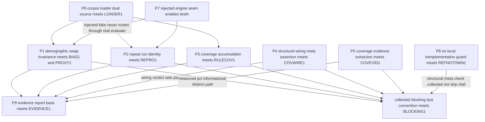

# NFR Design — Patterns — `quality-gates` (U13)

**Stage**: BUILD → NFR Design (per-unit) · the four blocking verification gates · **Depth**: **COMPREHENSIVE**
**Unit**: U13 `quality-gates` · **Date**: 2026-07-08 · **single verification authority** for CON-BR1 / CON-BR2·AC-1 / QA-3 / AC-5 · Stories **US-PLAT-3/4/5/6**.
**Built ON** the frozen FD (**BR-QG-1..9**, the module inventory + the **four evidence-record shapes** `BiasSwapReport`/`ReproducibilityReport`/`RuleCoverageReport`/`CoverageGateReport`, the **`CorpusLoader` boundary**) and the approved **NFR Requirements** (**eleven `NFR-QG-*` targets**, tiers **U/S**, the **eight FD/NFR folds** — QG-Fold-1..5 + NFR-QG-Fold-1/2/3) — **re-opening none**. Four NFR-Design `[Answer]` tags (all **A**) locked in the plan; the mandatory ambiguity-check resolved three design realizations as **ND-QG-Fold-1/2/3** (§0).

Each section is a **named design pattern** that structurally meets its `NFR-QG-*` target(s), at the rigor of the other comprehensive units (rules-engine / audit-store / memo-agent-core / corpus-generator). The concrete tests land at Code-Gen; here the **mechanism** is pinned. **Verification only; reference-not-own; no LLM; no real PII.**

---

## 0. Design folds resolved at the NFR-Design ambiguity-check (referenced, not re-derived)

- **ND-QG-Fold-1 — the shared `EvidenceReportBase` does NOT couple `CoverageGateReport`'s dual-producer nature (Q3 / P9 ↔ P4/P5).** `EvidenceReportBase` (C8) carries **only** cross-cutting *shape/property* concerns: a `passed` field, an **excluded-from-equality** provenance stamp, and a readable serialization. It holds **no** coverage/pyproject logic. `CoverageGateReport` extends the base like the other three reports, but its **`passed` is set solely by C6's wiring meta-assertion** (P4); `measured_pct` is populated **separately** by C7 (P5) and is **informational — excluded from `passed`**. The base concerns (equality/serialization) are **orthogonal** to *which producer writes which fields*, so the base cannot blur the P4/P5 separation (QG-Fold-3 preserved).
- **ND-QG-Fold-2 — the thin injection point needs no formal Protocol at design level (Q2 / P7 / C2).** Mirroring the frozen `ReplayService(__init__(self, repository, engine))` **exactly**: the engine is an **untyped constructor parameter** with a **documented duck-typed contract** (`engine.evaluate(profile, rulebook_version) -> report`, the single call site). A `typing.Protocol` for self-documentation is an **optional Code-Gen nicety**, not a design requirement and not needed to keep the fake contract clear — the docstring + the single call site suffice, exactly as ReplayService.
- **ND-QG-Fold-3 — C9's BLOCKING-1 meta-check uses static analysis, not pytest internals; no conflict with P8 (Q1/Q4 / C9 ↔ P8).** The "tests are collected and not `skip`/`xfail`" meta-check is a **static AST/marker scan** of the gate test modules (assert the gate test functions exist under the collected test paths and carry **no** `skip`/`xfail` marker / `pytestmark`), optionally a pytest **public** `--collect-only` assertion — **no pytest-internals import**. P8's no-local-reimplementation scope is the **five consumed production surfaces** (rules-engine/corpus-generator/intake/audit-store/pyproject), **orthogonal** to using the test framework's own facilities. No conflict.

---

## 1. Pattern → target map (one pattern per section; no orphan)

| Pattern | Target(s) | Component(s) |
|---|---|---|
| **P1 DemographicSwapInvariancePattern** (+ AttributionCheck sub) | NFR-QG-BIAS-1 + NFR-QG-PROXY-1 | C3 (+C2) |
| **P2 RepeatRunIdentityPattern** | NFR-QG-REPRO-1 | C4 (+C2) |
| **P3 CoverageAccumulationPattern** (+ P3a ControlledFixtureRulebook) | NFR-QG-RULECOV-1 | C5 |
| **P4 StructuralWiringMetaAssertionPattern** | NFR-QG-COVWIRE-1 | C6 |
| **P5 CoverageEvidenceExtractionPattern** | NFR-QG-COVEVID-1 | C7 |
| **P6 CorpusLoaderDualSourcePattern** | NFR-QG-LOADER-1 | C1 |
| **P7 InjectedEngineSeamPattern** *(cross-cutting enabler)* | enables BIAS-1 / REPRO-1 / BLOCKING-1 teeth | C2 |
| **P8 NoLocalReimplementationGuardPattern** | NFR-QG-REFNOTOWN-1 | C9 |
| **P9 DeterministicReportPattern** | NFR-QG-EVIDENCE-1 | C8 |
| **CollectedBlockingTestConvention** *(cross-cutting property, Q1-A)* | NFR-QG-BLOCKING-1 | woven into P1–P5 (+C9 structural meta-check) |

All **eleven** `NFR-QG-*` targets covered (BIAS-1+PROXY-1 share P1; COVWIRE-1/COVEVID-1 are **distinct** P4/P5; BLOCKING-1 is a cross-cutting property, not a ninth pattern — Q1-A; P7 is the cross-cutting teeth enabler).

---

## 2. P1 — DemographicSwapInvariancePattern (+ AttributionCheck sub) → NFR-QG-BIAS-1 + NFR-QG-PROXY-1

**Intent**: swapping the segregated demographic identifiers on an otherwise-identical profile leaves the engine `recommendation` unchanged (**delta = 0, blocking**); any recommendation change under `occupation`/`income` variation is attributable **only** to a sanctioned rule.

**Mechanism**:
- **Swap-invariance** — `BiasSwapGate` (C3) builds a swapped profile via `ApplicantProfile.model_copy(update={"demographics": Demographics(...)})` (frozen-safe; swap-set `{full_name, gender, city}` — QG-Fold-5), evaluates baseline and swapped through the **injected engine** (C2/P7), and compares via the recommendation (and, for the full projection, the imported `evaluation_output()`). `BiasSwapReport.delta_count` must be **0**; any delta is blocking.
- **AttributionCheck sub-pattern (PROXY-1)** — varying `occupation`/`income`, C3 reads `evaluation_output()` `rule_results` and attributes any recommendation change to the **sanctioned rule** (occupation-risk / affordability) that fired; a demographic swap alone leaves the recommendation unchanged (no proxy leakage). `pincode` is **asserted absent** from `ApplicantProfile`/`Demographics` (documented N/A, not silently skipped).
- **Teeth (NFR-QG-Fold-1)** — an **injected biased-fake engine** whose recommendation depends on a demographic field makes `delta_count > 0`, `passed is False`; the fake is a duck-typed double, so the real `evaluate()` is **never routed through**.

**Meets BIAS-1**: (a) real engine + stub → `delta_count == 0`, `passed`; (b) biased fake → `delta_count > 0`, fails. **Meets PROXY-1**: occupation/income changes attributable to sanctioned rules only; `pincode` N/A asserted.

**Tier**: U.

---

## 3. P2 — RepeatRunIdentityPattern → NFR-QG-REPRO-1

**Intent**: identical input → identical decision, 100% of the time, on the **deterministic engine output** (not LLM wording).

**Mechanism**:
- `ReproducibilityGate` (C4) runs `evaluate(p, v)` **×10** per stub profile through the **injected engine** (C2/P7), projects each run via the **imported `rules_engine.report.evaluation_output()`** (reference-not-own — the same projection ReplayService uses, QG-Fold-4), and asserts all 10 projections are **field-identical** → `ReproducibilityReport.reproducibility_pct == 100`.
- **Teeth (NFR-QG-Fold-1)** — an **injected non-deterministic-fake engine** (output varies by run) makes the ×10 identity assertion fail (`reproducibility_pct < 100`, `passed is False`).
- **Seeded-outlier** determinism clause **deferred to `outlier-model` (P2)** — documented, no target here.

**Meets REPRO-1**: (a) real engine → 100% identical, `passed`; (b) non-deterministic fake → fails; (c) uses the imported projection.

**Tier**: U.

---

## 4. P3 — CoverageAccumulationPattern (+ P3a ControlledFixtureRulebook) → NFR-QG-RULECOV-1

**Intent**: every rule in the loaded rulebook reaches a **definite PASS or FAIL** in ≥1 corpus record; any uncovered rule is blocking.

**Mechanism**:
- `RuleCoverageGate` (C5) loads the rule-ID set via `RulebookLoader.load_rulebook(manifest.rulebook_version)` (QG-Fold-2 — at the version the corpus was labeled against), iterates `evaluate()` over the corpus, and **accumulates**, per `rule_id`, whether a definite PASS/FAIL (status **not** `NOT_EVALUATED`) was observed. `uncovered_rule_ids` empty ⇒ `coverage_pct == 100`.
- **P3a — ControlledFixtureRulebookMechanism (teeth; NFR-QG-Fold-2)** — the tier-U logic test loads a small hand-authored **2–3-rule YAML** via the **real `RulebookLoader`** (its Pydantic `Rulebook` schema **is** the validator — thresholds quoted-as-strings, `input_fields` allowlisted, the file declares its own version; a malformed fixture raises `RulebookLoadError` at setup). **No bespoke validator.** The fixture leaves **one rule deliberately unexercised** by the stub profiles → that rule appears in `uncovered_rule_ids`, `passed is False`. Distinct from production `1.0.0`.

**Meets RULECOV-1**: (a) fixture with an unexercised rule → uncovered detected, fails; (b) stub exercising every rule → `coverage_pct == 100`, passes; (c) rulebook loaded at `manifest.rulebook_version`; fixture validated by the real loader.

**Tier**: U.

---

## 5. P4 — StructuralWiringMetaAssertionPattern → NFR-QG-COVWIRE-1

**Intent**: the **binding** coverage gate stays **wired** — assert `pyproject`'s `--cov-fail-under=90` is present and ≥90 (a structural meta-assertion, because a collected test cannot read the final coverage % mid-session — QG-Fold-3).

**Mechanism**:
- `CoverageWiringGate` (C6) reads `pyproject.toml` via stdlib **`tomllib`** and asserts `[tool.pytest.ini_options].addopts` (or the coverage config) contains `--cov-fail-under` **present** and its value **≥ 90** → `CoverageGateReport.wiring_present is True and fail_under_configured >= 90` sets `passed`.
- **Teeth** — a fixture `pyproject` with the setting **absent** or **< 90** → `passed is False`.
- This is the wiring check for the binding gate — **not** a second enforcement mechanism (binding enforcement stays `pyproject`'s `--cov-fail-under`).

**Meets COVWIRE-1**: (a) real `pyproject` → `wiring_present`, `fail_under_configured >= 90`, passes; (b) absent/`<90` fixture → fails; (c) not an enforcer.

**Tier**: U (structural).

---

## 6. P5 — CoverageEvidenceExtractionPattern → NFR-QG-COVEVID-1

**Intent**: surface the coverage **percentage** as auditor evidence — a **separate, informational** report, **never conflated** with the binding wiring check (QG-Fold-3 / NFR-QG-Fold-3).

**Mechanism**:
- `CoverageEvidenceGate` (C7) reads a **fixture coverage-data artifact** (`coverage.json` / `.coverage` sample) and extracts + formats `measured_pct` into `CoverageGateReport.measured_pct`.
- **Distinct producer / distinct code path from P4 (ND-QG-Fold-1)** — C7 writes **only** `measured_pct` (informational); it does **not** set `passed` (that stays C6's wiring verdict) and does **not** read `pyproject`. `measured_pct` is **excluded** from the report's pass/fail semantics.
- Fully pass/fail-testable (NFR-QG-Fold-3, rigor **full**) — given the fixture artifact, the generator produces a well-formed report with the extracted %.

**Meets COVEVID-1**: (a) fixture coverage artifact → well-formed report with `measured_pct`; (b) marked informational, not an enforcer; (c) distinct code path from COVWIRE-1 (never conflated).

**Tier**: U.

---

## 7. P6 — CorpusLoaderDualSourcePattern → NFR-QG-LOADER-1

**Intent**: the gates obtain profiles through an injected source that works **with no committed `corpus/` in CI**, and reads the frozen file only when a tier-B corpus exists.

**Mechanism**:
- `CorpusLoader` (C1) exposes `from_file(path)` (frozen `corpus/profiles.json` via `CorpusRecord.model_validate` — the tier-B path) **or** `from_records(records)` (in-memory stub — the tier-U/S path), plus `profiles()` and `manifest_version()`. `corpus_generator.records.CorpusRecord`/`CorpusManifest` are imported **call-only**.
- **Registered-gap accommodation** — CI runs green through `from_records` with **no `corpus/profiles.json` present**; `from_file`'s absence does not fail CI. The loader **never generates** a corpus and **never re-calls Gemini**.

**Meets LOADER-1**: (a) gates accept the injected source; suite green on the stub with no committed `corpus/`; (b) `from_file` exercised only when a tier-B corpus exists; (c) no hard Code-Gen dependency on a committed corpus.

**Tier**: U/S.

---

## 8. P7 — InjectedEngineSeamPattern *(cross-cutting enabler)* → BIAS-1 / REPRO-1 / BLOCKING-1 teeth

**Intent**: enable the "teeth" tests **without** editing or routing through the real `rules-engine`.

**Mechanism (ND-QG-Fold-2)**:
- Each engine-driven gate (C3/C4) takes the engine as a **constructor parameter** — mirroring the frozen `ReplayService(__init__(self, repository, engine))` **exactly** (`self._engine.evaluate(...)`). Production injects the real `RulesEngine`; tests inject **duck-typed fakes** (a biased fake, a non-deterministic fake).
- **No formal adapter/interface class** beyond the injection point; the duck-typed contract (`engine.evaluate(profile, rulebook_version) -> report`) is documented in the docstring — an optional `typing.Protocol` is a deferred Code-Gen nicety, not required.
- **Isolation (NFR-QG-Fold-1)** — with a fake injected, the gate calls the **fake**, so the real `evaluate()` is **never routed through** and no `rules-engine` code is exercised or edited.

**Enables**: BIAS-1's biased-fake teeth, REPRO-1's non-deterministic-fake teeth, and BLOCKING-1's deliberately-violating fixtures.

**Tier**: U (cross-cutting).

---

## 9. P8 — NoLocalReimplementationGuardPattern → NFR-QG-REFNOTOWN-1

**Intent**: `quality-gates` **verifies**; it re-implements none of the consumed surfaces and edits none.

**Mechanism**:
- `StructuralGuard` (C9) runs an **AST / import scan** over `backend/quality_gates/` asserting **no** local rule-eval, **no** local hasher/SHA, **no** local age/BMI derivation, **no** second engine, and **no** enforcement/definition of CON-BR1/CON-DET-1 (no re-own of memo CON-BR2). A **no-edit** check confirms no production file of a consumed unit is modified.
- **Non-vacuous self-test** — a synthetic local re-implementation (a local `evaluate`/hasher planted in a test fixture) is **flagged** by the guard, proving it bites. Mirrors the `auth-rbac` / `corpus-generator` precedent.

**Meets REFNOTOWN-1**: (a) structural scan finds no local re-implementation; (b) non-vacuous self-test; (c) no production edit of a consumed unit.

**Tier**: U (structural).

---

## 10. P9 — DeterministicReportPattern → NFR-QG-EVIDENCE-1

**Intent**: each gate's evidence record is reproducible auditor evidence — a pure function of `(corpus, rulebook, engine)`.

**Mechanism (Q3-A / ND-QG-Fold-1)**:
- `EvidenceReportBase` (C8) is the shared base the four report models (`BiasSwapReport` / `ReproducibilityReport` / `RuleCoverageReport` / `CoverageGateReport`) extend. It provides: a `passed` field, an **excluded-from-equality** provenance stamp (`generated_at`), and a **human-readable serialization**.
- **Determinism** — same inputs → **field-by-field-equal** report (Pydantic model equality), with the provenance stamp excluded from the compared fields (never a pass/fail input). **No content-hash** step (small structured objects).
- The base holds **only** these cross-cutting properties — **no** coverage/pyproject/engine logic — so it does not couple the C6/C7 dual-producer separation (ND-QG-Fold-1).

**Meets EVIDENCE-1**: (a) two runs on identical inputs → field-equal reports (provenance excluded); (b) readable serialization; (c) no content-hash.

**Tier**: U.

---

## 11. CollectedBlockingTestConvention *(cross-cutting property, Q1-A)* → NFR-QG-BLOCKING-1

**Intent**: every gate genuinely **fails the build** on a violation; no gate is silently skipped.

**Mechanism (Q1-A — a property, not a ninth pattern)**:
- Each gate pattern (P1–P5) **includes** its own collected pytest test with a **positive** (clean input passes) and a **negative/teeth** (deliberately-violating fixture fails) case — realized **within** the pattern, not centralized.
- A light shared **`CollectedBlockingTestConvention`** documents the discipline: the gate tests are **collected**, carry **no** `skip`/`xfail`, and **fail** on violation (`AssertionError` / `pytest.raises` / `report.passed is False`).
- **C9 structural meta-check (ND-QG-Fold-3)** — a **static AST/marker scan** confirms the gate test functions exist under the collected paths and carry no `skip`/`xfail` marker; **no pytest internals** are imported (orthogonal to P8's consumed-surface scope).

**Meets BLOCKING-1**: (a) each gate's violating fixture produces a real test failure; (b) structural meta-check confirms collected + not `skip`/`xfail`; (c) coverage-gate's live-% enforcement stays `pyproject`'s (QG-Fold-3).

**Tier**: U (property + structural).

---

## 12. Pattern-integration Mermaid (validated) + text alternative

Mermaid validated before write: **alphanumeric node IDs** (underscore allowed), **every label double-quoted**, **no semicolons, no bare colons, no parentheses, no hyphens, no special characters** in labels, **balanced blocks**.

### Text alternative (always included)
1. **P6 CorpusLoader** supplies profiles (in-memory stub in CI, frozen file at tier-B) to the three engine-driven gates **P1 / P2 / P3**.
2. **P7 InjectedEngine seam** threads the engine into **P1** and **P2**; injecting a duck-typed fake means the **real `evaluate()` is never routed through** (enables the teeth without editing rules-engine).
3. **P1 demographic-swap invariance** (+ AttributionCheck) asserts delta = 0 and attributes occupation/income changes to sanctioned rules only; **P2 repeat-run identity** asserts the ×10 `evaluation_output()` projection is identical; **P3 coverage-accumulation** asserts every rule reaches a definite PASS/FAIL (teeth via P3a's controlled fixture rulebook).
4. **P4 structural wiring meta-assertion** reads `pyproject` via `tomllib` and sets the coverage report's `passed` (the wiring verdict); **P5 coverage-evidence extraction** reads a fixture coverage artifact and writes `measured_pct` as **informational** — a **distinct code path**, never conflated with P4.
5. All gates produce reports on the shared **P9 EvidenceReportBase** (deterministic, provenance excluded, human-readable).
6. **BLOCKING-1** is a cross-cutting property: each gate (P1–P5) carries its own collected positive + teeth test; **P8's StructuralGuard** adds the static meta-check that the gate tests are collected and not `skip`/`xfail`.

---

## 13. Traceability (pattern → target → BR-QG → tier)

| Pattern | Target(s) | BR-QG | Tier |
|---|---|---|---|
| P1 DemographicSwapInvariancePattern (+ AttributionCheck) | BIAS-1 + PROXY-1 | 1, 2 | U |
| P2 RepeatRunIdentityPattern | REPRO-1 | 3 | U |
| P3 CoverageAccumulationPattern (+ P3a) | RULECOV-1 | 4 | U |
| P4 StructuralWiringMetaAssertionPattern | COVWIRE-1 | 5 (i) | U (structural) |
| P5 CoverageEvidenceExtractionPattern | COVEVID-1 | 5 (ii) | U |
| P6 CorpusLoaderDualSourcePattern | LOADER-1 | 6 | U/S |
| P7 InjectedEngineSeamPattern | BIAS/REPRO/BLOCKING teeth | 1, 3, 9 | U (cross-cutting) |
| P8 NoLocalReimplementationGuardPattern | REFNOTOWN-1 | 7 | U (structural) |
| P9 DeterministicReportPattern | EVIDENCE-1 | 8 | U |
| CollectedBlockingTestConvention | BLOCKING-1 | 9 | U (property + structural) |

**No orphan** — all eleven `NFR-QG-*` targets covered; BR-QG-1..9 all mapped (BR-QG-5 splits P4/P5; BR-QG-9 is the cross-cutting convention).

---

## 14. Security-Guardrails compliance (enabled extension)

| Control | Status | Rationale |
|---|---|---|
| Input validation | **N/A (referenced)** | The unit reads already-validated stub/frozen `ApplicantProfile`s (Pydantic-valid by construction); it validates no new application input. |
| Prompt-injection defense | **N/A** | No LLM is invoked — the gates verify the deterministic engine; no untrusted document is parsed (SEC-1 is `document-sanitizer`'s). |
| Secrets management | **N/A** | No provider key is read (no LLM path); the tier-B corpus is consumed as committed data, never regenerated. |
| Read-only DB access for audit role | **N/A** | The unit reads the frozen `corpus/` / in-memory stub, not the audit DB. |
| Audit logging | **N/A (produces evidence)** | The gate **evidence reports** are auditor-consumable artifacts (US-PLAT-3/4/5); not the runtime audit trail (SEC-5 is `audit-store`'s). |
| **No real PII / synthetic-only** | **Compliant (referenced)** | All profiles are synthetic (corpus-generator BR-CORP-10); the stub is hand-crafted synthetic; no real PII introduced. |

No blocking finding.

---

## 15. Settled items held (not re-opened)
Frozen FD (BR-QG-1..9, the four evidence-record shapes, the `CorpusLoader` boundary) + approved `NFR-QG-*` targets/tiers/folds are the substrate — patterns realize them, re-opening none. **Verification only** — no enforcement/definition of CON-BR1/CON-DET-1 (stays `rules-engine`/`outlier-model`); no re-own of memo CON-BR2. **Reference-not-own** — the five surfaces call-only, none edited; injected fakes are duck-typed doubles (P7), never routed through real `evaluate()`. **Registered corpus-gap honored** — every own-logic pattern is tier-U/S over the stub; **tier-B is an external precondition, not a Code-Gen target/blocker; NOT authorized here**. **No LLM; no real PII; no new dependency (stdlib `tomllib` only); WIRE-1 untouched; no other unit started.**
