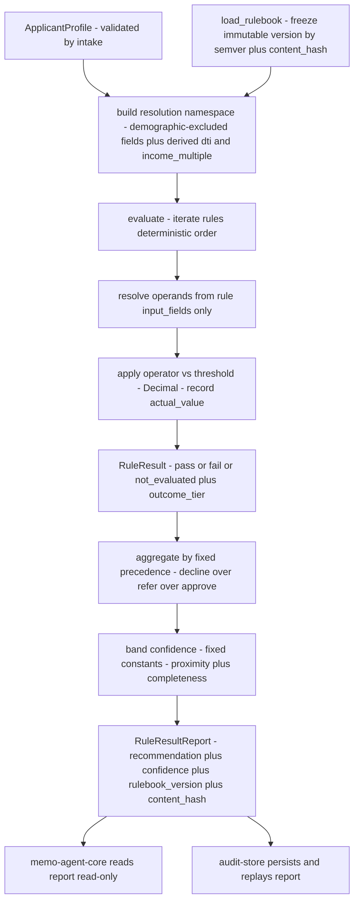

# Business Logic Model — `rules-engine` (C2)

**Stage**: BUILD → Functional Design (per-unit) · cluster-FD-first unit 2 of 4
**Unit**: U3 `rules-engine`
**Date**: 2026-07-03
**Scope**: The `evaluate(profile, rulebook_version)` pure-function logic (deterministic,
order-independent, no LLM); `load_rulebook` + immutable-version freeze; the replay ownership
boundary with `audit-store` ReplayService; CON-BR1 structural exclusion; CON-BR2 sole-origin.
Technology-agnostic.

---

## 1. Pipeline overview — `load_rulebook → evaluate → RuleResultReport`

Frozen contracts (`component-methods.md` C2): `load_rulebook(version) -> Rulebook`,
`evaluate(profile, rulebook_version) -> RuleResultReport`, `recommend(rule_results) ->
Recommendation` (internal to `evaluate`). **Pure Python, zero LLM** (CON-BR2).

Mermaid validated before write (alphanumeric node IDs; labels quoted where punctuated; **no
parentheses, no semicolons, no second colon** in labels; balanced brackets; no reserved-word `end`
node). Text alternative follows.



### Text alternative (always included)

1. **`load_rulebook(version)`** loads the **immutable** rulebook for that semver and **freezes** it,
   recording its `content_hash` (tamper-evidence). Load-time schema validation rejects any rule
   whose `input_fields` names an unknown or demographic field (§4).
2. **Build the resolution namespace** from the `ApplicantProfile` — **only** the non-demographic
   fields, plus the engine-derived `dti_ratio` / `income_multiple` (`Decimal`). The `demographics`
   sub-object is **never** placed in this namespace (CON-BR1, §4).
3. **`evaluate`** iterates the rules in a **deterministic order**; for each rule it resolves operands
   **only from that rule's `input_fields`**, applies `operator` vs `threshold` in `Decimal`, records
   the exact `actual_value`, and emits a **`RuleResult`** with a tri-state `status`
   (`pass`/`fail`/`not_evaluated`) and its `outcome_tier`.
4. **Aggregate** the `outcome_tier` set by **fixed precedence** (DECLINE > REFER > APPROVE,
   order-independent — `business-rules.md §3`), producing the `Recommendation`.
5. **Band `confidence`** deterministically from value-proximity + completeness using the fixed
   `ConfidenceBands` constants (`business-rules.md §4`).
6. Emit the **`RuleResultReport`** (all rule results + recommendation + confidence +
   `rulebook_version` + `content_hash` + `engine_version` + decline/refer reasons). It flows
   **read-only** to `memo-agent-core` and is persisted/replayed by `audit-store`.

---

## 2. `evaluate` logic (pure function, deterministic)

```
INPUT:  profile: ApplicantProfile, rulebook_version: str
OUTPUT: RuleResultReport

rulebook   = load_rulebook(rulebook_version)          # immutable, hash-frozen (section 3)
namespace  = build_namespace(profile)                 # demographic-excluded (section 4)
namespace += derive(profile)                          # dti_ratio, income_multiple in Decimal

results = []
for rule in rulebook.rules in deterministic_order:    # e.g. sorted by rule_id
    operands = { f: namespace.resolve(f) for f in rule.input_fields }   # only named fields
    if any operand missing/uncomputable:
        results.append(RuleResult(status=not_evaluated, outcome_tier=refer_trigger,
                                  actual_value=null, ...))               # never silent
        continue
    actual = operands.primary
    passed = compare(actual, rule.operator, rule.threshold)             # Decimal, explicit op
    tier   = pass_only if passed else rule.outcome                      # fail -> its outcome tier
    results.append(RuleResult(status = pass if passed else fail,
                              actual_value=actual, operator=rule.operator,
                              threshold=rule.threshold, outcome_tier=tier, ...))

if profile.incomplete:                                # intake's flag -> insufficient-info REFER
    add an incomplete refer_trigger to the refer_reasons set           # distinct, not a rule

recommendation = aggregate(results, incomplete=profile.incomplete)     # fixed precedence
confidence     = band_confidence(results, profile, rulebook.confidence_bands)  # fixed constants
return RuleResultReport(results, recommendation, confidence,
                        rulebook_version, rulebook.content_hash, engine_version, reasons...)
```

- **No LLM, no I/O, no wall-clock, no unseeded randomness** anywhere in this function (CON-BR2 /
  CON-DET-1). `evaluate` is a **pure function** of `(profile, rulebook_version)`.
- **Order-independent result**: aggregation depends on the **set** of `outcome_tier`s, not iteration
  order; iteration order is fixed only so the `rule_results` **list** is byte-stable for replay.
- **Decimal throughout** — no float on any threshold-compared value (intake Q4 carry-forward).

---

## 3. `load_rulebook` + immutable-version freeze (Q2, FR-RULES-6, CON-AUDIT-1)

- `load_rulebook(version)` resolves a **semver** to exactly one **immutable** rule set and computes
  / verifies its **`content_hash`**. A published version is **never edited in place**; a change is a
  **new version** (append-only). Old versions are retained and remain loadable.
- The `content_hash` is the **byte-identity** of the canonicalized rule set — recorded on the report
  and in the audit tuple so replay can **verify** it loaded the identical bytes (note 5), not just
  trust the semver name (tamper-evidence).
- `rulebook_version` (semver) + `content_hash` together are **sufficient and verifiable** to
  reconstruct the exact ruleset for any past decision (CON-AUDIT-1).

---

## 4. CON-BR1 structural exclusion (Q1 + Q12 — by construction)

> **INVARIANT (CON-BR1-STRUCTURAL).** The engine can read applicant data **only** through a rule's
> `input_fields`, and the operand-resolution namespace is built **without** the `demographics`
> sub-object. Therefore no rule — and no code path — can read name / gender / city. This holds **by
> construction**, not by author discipline.

Two enforcement points:
1. **Namespace exclusion (runtime)** — `build_namespace(profile)` includes only the non-demographic
   fields (+ derived `dti_ratio` / `income_multiple`). `demographics` is never a resolvable target.
2. **Load-time schema validation** — `load_rulebook` **rejects** any `Rule` whose `input_fields`
   names a field outside the allowlist (unknown **or** demographic path). An adversarial or typo'd
   rulebook **fails to load** — it does not silently resolve to nothing.

Occupation & income are in the namespace but each is the operand of exactly **one** sanctioned rule
(occupation-risk / affordability), never a back-door proxy (US-RULES-5). **Verification** of the
invariant (bias-swap delta = 0, blocking) stays single-sourced in `quality-gates` (U13) — this model
makes the **enforcement** structural.

---

## 5. Replay boundary — rules-engine ↔ `audit-store` ReplayService (Q11)

> **Clean split.** `rules-engine` owns **pure, stateless re-evaluation**; `audit-store` owns
> **replay orchestration + comparison**. `rules-engine` has no concept of "replay" — replay simply
> **uses** `evaluate`.

- **rules-engine owns**: `load_rulebook(original_version)` + `evaluate(profile, original_version)` →
  a fresh `RuleResultReport`. Deterministic, no knowledge of history, no stored state.
- **`audit-store` ReplayService owns** (designed in unit 3's FD, named here for the boundary):
  fetching the `AuditRecord`, invoking `evaluate` against the **original** `rulebook_version`, and
  the **match/mismatch comparison** + blocking-failure flag (`services.md §4`).
- `engine_version` (git SHA) on the report lets the comparison distinguish **engine code drift**
  from a real regression. `content_hash` lets it verify the **rulebook** bytes are identical.

---

## 6. Flows

### 6.1 Happy path — APPROVE
All rules `pass`, profile complete → aggregation tier 3 → **APPROVE**; wide margins + complete →
**High** confidence.

### 6.2 Boundary case (US-RULES-2 AC)
`age = 65`, `bmi = 25.00`, `dti = 0.40` → age **eligible** (`<= 65`), BMI **overweight**
(`25 <= bmi`), DTI **pass** (`<= 0.40`). Each `RuleResult` records the exact value + operator; the
boundary values land on the intended side; near-boundary proximity → **Medium**/**Low** confidence
per the fixed bands.

### 6.3 Incomplete / thin-file → REFER
`profile.incomplete == true` and/or a missing operand (`existing_debt_obligations_annual` absent →
DTI `not_evaluated`) → tier 2 `refer_trigger`(s), no `decline_fail` → **REFER** (never DECLINE on
incompleteness alone; thin-file preserved). `refer_reasons` name the insufficient-info trigger(s).

### 6.4 Multi-fail → DECLINE-RECOMMEND
Any rule with `outcome_tier == decline_fail` (e.g. age out of band, DTI computable and over ceiling)
→ tier 1 → **DECLINE-RECOMMEND** (decline dominates even if also incomplete). `decline_reasons` name
every driving rule.

---

## 7. Invariant compliance (self-check)

| Invariant | How this model holds it |
|---|---|
| **CON-BR2** | Recommendation **and** confidence produced entirely by pure Python here; **no LLM in the path**; QA-5 (in `quality-gates`) asserts the LLM cannot change the recommendation. |
| **CON-DET-1** | `evaluate` is a pure function of `(profile, rulebook_version)`; order-independent aggregation; Decimal not float; fixed confidence constants; no wall-clock / unseeded randomness. |
| **CON-BR1** | §4 structural exclusion — `input_fields` + demographic-excluded namespace + load-time rejection; occupation/income only via their sanctioned rule; verification single-sourced in `quality-gates`. |
| **CON-AUDIT-1 / FR-RULES-6** | Immutable append-only versions; `rulebook_version` + `content_hash` are the verifiable replay handle; replay re-evaluates against the **original** version. |
| **FR-RULES-3/4/5** | Each `RuleResult` reports exact value + operator + threshold; report stamped `rulebook_version`; recommendation is exactly the enum with mandatory `-RECOMMEND`. |
| **Advisory-only** | "recommendation" vocabulary throughout; "decision" reserved for the human-committed record (not produced here). |

---

*End of business-logic-model.md. Schema → `domain-entities.md`; evaluation/boundary/derivation/
aggregation rules → `business-rules.md`.*
