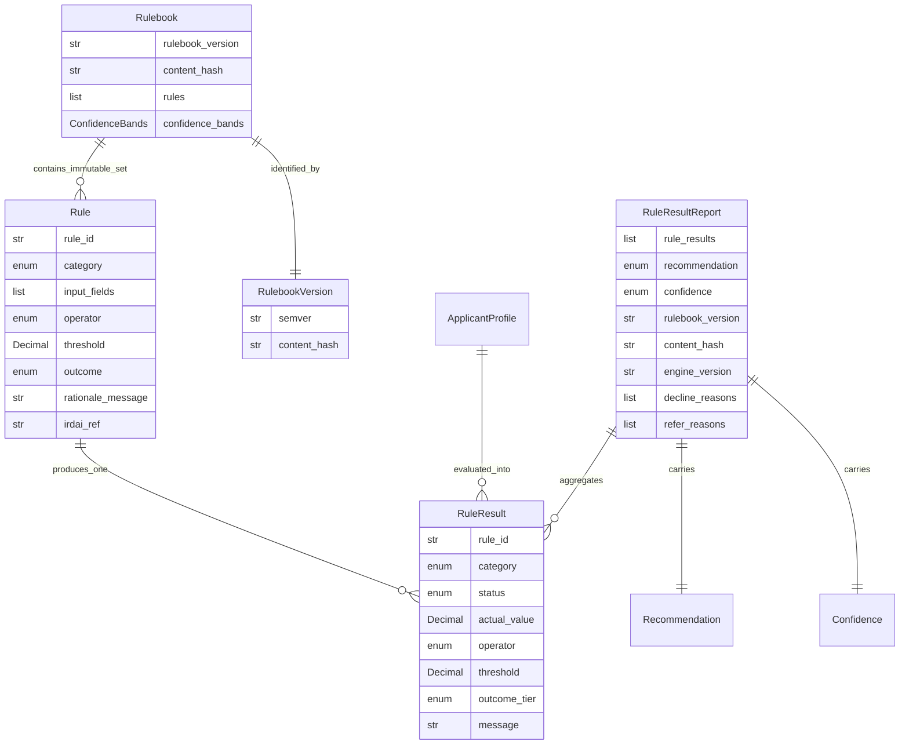

# Domain Entities — `rules-engine` (C2)

**Stage**: BUILD → Functional Design (per-unit) · cluster-FD-first unit 2 of 4
**Unit**: U3 `rules-engine` (owns the versioned YAML `Rulebook`, `Rule` schema, `RuleResultReport`,
`RuleResult`, `Recommendation` + deterministic `Confidence`)
**Date**: 2026-07-03
**Scope**: Field-by-field **internals** of the frozen C2 contracts (`component-methods.md`): the
**rulebook YAML rule-definition schema** (the source of truth), the immutable-versioning model, and
the field-by-field `RuleResultReport`. The contract **shapes** are frozen; this defines their fields.

Technology-agnostic. Types are logical (`Decimal`, `int`, `str`, `enum`, `bool`, `list`); the
Pydantic v2 / YAML-loader realization is a Code-Generation concern. **No bulk rule *data* is
authored here** — this FD designs the **schema** and the **canonical boundary conventions**; the
populated 25–40-rule rulebook is Code-Gen (§7).

---

## 1. Entity-relationship / schema view

Mermaid validated before write (alphanumeric entity IDs; relationship labels quoted, no special
characters; **no parentheses, no semicolons, no second colon** in labels; balanced blocks). Text
alternative follows.

### Text alternative (always included)

- A **`Rulebook`** is an **immutable, versioned** collection of **`Rule`** objects, identified by a
  **`RulebookVersion`** (`semver` + `content_hash`). It also carries the **`ConfidenceBands`**
  constants (fixed cut-points, §5) so confidence replays exactly under a given version.
- A **`Rule`** is a fully declarative object — the engine interprets it generically (no per-rule
  Python). Its **`input_fields`** is the **only** set of profile fields the rule may read
  (**CON-BR1 structural** — §4.1).
- Evaluating an **`ApplicantProfile`** against a `Rulebook` produces one **`RuleResult`** per rule.
- A **`RuleResultReport`** aggregates all `RuleResult` rows and carries the **`Recommendation`**,
  the deterministic **`Confidence`**, the `rulebook_version` + `content_hash` (the immutable replay
  handle), the `engine_version` (code-drift hook), and structured decline/refer reasons. **This is
  the sole object the memo grounds on and `audit-store` persists/replays.**

---

## 2. `Rule` — the YAML rule-definition schema (source of truth)

Each rule is one YAML object. The engine reads `operand(s)` from `input_fields`, applies `operator`
against `threshold`, and records the exact value + comparison (FR-RULES-3). **Rules are DATA, not
code** (Q1).

| Field | Type | Required | Values / validity | Notes |
|---|---|:--:|---|---|
| `rule_id` | `str` | **R** | unique within a rulebook version; stable across versions | The citation handle — the memo cites by this ID; hallucination guard validates against it. |
| `category` | `enum` | **R** | `age_eligibility \| medical_bmi \| medical_health \| financial_dti \| financial_income_multiple \| document_completeness \| lifestyle_smoking \| lifestyle_occupation \| compliance_irdai` | Underwriting-domain grouping (Q3). **Reporting/grouping only — does not change evaluation semantics.** Covers lifestyle (smoking, occupation-risk) — note 7. |
| `input_fields` | `list[str]` | **R** | non-empty; **each entry must resolve in the demographic-EXCLUDED field namespace** (§4.1); a demographic path is **rejected at load** | **The ONLY profile fields this rule may read.** This is the CON-BR1 structural mechanism (Q1/Q12): a rule cannot read a field it does not name, and it cannot name a demographic field. |
| `operator` | `enum` | **R** | `lte \| lt \| gte \| gt \| eq \| in \| between` | Explicit comparison — **never implicit in code** (Q4). Each operator binds to exactly one `threshold` shape — see **§2.1**. |
| `threshold` | `Decimal \| DecimalRange \| set \| ScalarLiteral` | **R** | `Decimal` for `lte`/`lt`/`gte`/`gt`; `DecimalRange {low, low_inclusive, high, high_inclusive}` for `between`; `set` for `in`; a typed `ScalarLiteral` for `eq` (§2.1) | **`Decimal`, never float** for every numeric bound (Q4, carry-forward from intake). Inclusivity is explicit per threshold (§ business-rules boundary table). |
| `outcome` | `enum` | **R** | `pass_only \| refer_trigger \| decline_fail` | The **on-fire outcome-tier** (Q1/Q5). Unified vocabulary: `decline_fail` = a hard fail (→ DECLINE precedence); `refer_trigger` = a soft/borderline fail (→ REFER precedence); `pass_only` = informational, never escalates. |
| `rationale_message` | `str` | **R** | human-readable template; may reference `{actual_value}` / `{threshold}` | The audit/memo explanation (FR-RULES-3, explainability). **Advisory-only vocabulary** — no "decision". |
| `irdai_ref` | `str` | **O** | regulatory citation (e.g. IRDAI 2024 clause) or empty | **Inline per rule** (Q3) — the regulatory basis travels with the rule for audit tracing (FR-RULES-2). |

> **Operand resolution & `input_fields` (CON-BR1 structural):** the evaluator resolves each name in
> `input_fields` against a **fixed allowlist namespace** built from the non-demographic profile
> fields only (`age_years_derived`, `bmi_derived`, `verifiable_income_annual`,
> `existing_debt_obligations_annual`, `requested_cover_amount`, `employment_type`, `smoking_status`,
> `occupation`, `health_flags`, `documents`, plus the engine-derived `dti_ratio` /
> `income_multiple` / `health_flag_count` / `documents_missing_count` — §4.2). The `demographics`
> sub-object is **not in this namespace**. A rule naming an
> unknown or demographic field is **rejected at rulebook load** (§ business-logic-model §4). See §4.1.

### 2.1 Operator ↔ threshold-type mapping (no operator-threshold mismatch)

Each `operator` binds to **exactly one** `threshold` shape; the loader rejects any rule whose
`threshold` shape does not match its `operator`:

| `operator` | Valid `threshold` shape | Example | Notes |
|---|---|---|---|
| `lte` / `lt` / `gte` / `gt` | single `Decimal` bound | `dti_ratio lte 0.40` | numeric bounds only; `Decimal`, never float |
| `between` | `DecimalRange {low, low_inclusive, high, high_inclusive}` | age `between {18,true,65,true}` | inclusivity explicit on **both** ends |
| `in` | `set` of typed literals (categorical/enum membership) | `smoking_status in {smoker}`, `employment_type in {self_employed, contract}` | the canonical form for **categorical** operands |
| `eq` | a single typed `ScalarLiteral` matching the operand type | `smoking_status eq smoker` (or numeric `eq`) | for a categorical operand, `eq x` is equivalent to `in {x}`; prefer `in` for categoricals |

- **Numeric** operands (`age_years_derived`, `bmi_derived`, `dti_ratio`, `income_multiple`, incomes,
  debt, cover) use `lte`/`lt`/`gte`/`gt`/`between` with `Decimal`/`DecimalRange` — the boundary
  discipline of `business-rules.md §1`.
- **Categorical** operands (`smoking_status`, `employment_type`, `occupation`, `health_flags`) use
  `in` (set membership) — or `eq` with a typed literal. **No categorical operand ever binds a
  `Decimal` threshold**, and **no numeric bound is expressed as a bare `eq`** — removing the prior
  looseness where `eq`'s threshold type was unpinned.

---

## 3. `Rulebook` + versioning (Q2 — immutable, append-only)

| `Rulebook` field | Type | Notes |
|---|---|---|
| `rulebook_version` | `str` | **Semver** (human-readable, e.g. `1.2.0`). The `evaluate` / `load_rulebook` handle. |
| `content_hash` | `str` | Hash of the canonicalized rule set — **tamper-evidence** + the byte-identity replay check (Q2↔Q11, note 5). |
| `rules` | `list[Rule]` | The immutable rule set for this version. |
| `confidence_bands` | `ConfidenceBands` | Fixed cut-point constants for deterministic confidence (§5); versioned **with** the rulebook so confidence replays exactly. |

**Immutability model**: a published version is **never edited in place**. A change is a **new
version** (new semver + new `content_hash`); old versions are **retained**. `load_rulebook(version)`
resolves to exactly one immutable rule set. `RulebookVersion` = `{semver, content_hash}` is the
**sufficient + verifiable** identity that lets replay reconstruct the exact ruleset (FR-RULES-6,
CON-AUDIT-1).

| `ConfidenceBands` field | Type | Notes |
|---|---|---|
| `high_margin` | `Decimal` | Minimum normalized distance-to-nearest-threshold for **High** (§5). Fixed constant. |
| `low_margin` | `Decimal` | At/under this proximity ⇒ **Low** band contribution (§5). Fixed constant. |

> These are **declared constants** (not data-dependent, not wall-clock) — the CON-DET-1 guarantee
> that identical inputs + `rulebook_version` reproduce the same `confidence` on replay (note 4).

---

## 4. Enforcement & determinism boundaries (schema-level)

### 4.1 CON-BR1 structural exclusion (Q1 + Q12 — by construction, not convention)

Two guarantees make demographics **unreachable**, not merely un-referenced:

1. **Namespace exclusion** — the evaluator is handed operands drawn **only** from the
   demographic-excluded field namespace (§2 note). The `demographics` sub-object is never part of
   the namespace the evaluator can resolve. Even a rule that *tried* to name `demographics.gender`
   has no resolvable target.
2. **Load-time schema validation** — `load_rulebook` **rejects** any `Rule` whose `input_fields`
   names a field outside the allowlist (unknown field **or** a demographic path). A malformed or
   adversarial rulebook fails to load; it does not silently read nothing.

Occupation & income are in the namespace but each is the operand of exactly **one** sanctioned rule
(`lifestyle_occupation` occupation-risk / `financial_dti`+`financial_income_multiple` affordability),
never a back-door proxy (US-RULES-5). CON-BR1 **verification** stays single-sourced in
`quality-gates` bias-swap (delta = 0, blocking) — this schema makes enforcement structural.

### 4.2 Engine-derived operands (Q5 ownership — Decimal)

`dti_ratio` and `income_multiple` are **not** stored on `ApplicantProfile`; the engine derives them
in `Decimal` from intake-supplied operands and exposes them in the resolution namespace so a rule
can name them in `input_fields`. Derivation rules → `business-rules.md §2`. **intake owns the
applicant facts (age, BMI); rules-engine owns these rule-interpretation derivations** — no field is
double-owned.

> **BACK-ANNOTATION (pinned at Code-Gen 2026-07-05 — same discipline as intake's BR-GATE-REASON).**
> Two more **derived SCALAR operands** are added here so the `medical_health` and
> `document_completeness` categories (whose raw operands `health_flags` / `documents` are a **list** /
> an **object**) can be authored under the frozen **scalar/enum** evaluator **without extending the
> evaluator** and **without a §2.1 change** — resolving the non-scalar-operand gap flagged at Code-Gen
> Step 13. Like `dti_ratio` / `income_multiple`, both are **derived per-evaluation and exposed in the
> resolution namespace, never stored on the profile** (facts stay single-sourced in intake), and both
> are **NON-demographic (CON-BR1 clean)**:
>
> | Derived operand | Type | Derivation | Why `int` (not `bool`) |
> |---|---|---|---|
> | `health_flag_count` | `int` | `len(health_flags)` | authors `medical_health` cleanly as a numeric acceptability rule — e.g. acceptable `health_flag_count <= 0` (no flags → PASS; any flag → its tier). |
> | `documents_missing_count` | `int` | `max(expected_count − satisfied_count, 0)` from the `DocumentManifest` | **self-normalized to a fixed `0` threshold** (robust across applicants — unlike a bare `satisfied_count`, which needs a per-applicant `expected`). Acceptable `documents_missing_count <= 0` (complete → PASS; any missing → REFER, thin-file never DECLINE). |
>
> **`int` over `bool`** because an `int` authors directly with the frozen numeric operators
> (`lte`/`eq` + `Decimal` threshold); a `bool` would require either changing §2.1 (`eq` currently binds
> `Decimal | str`) or the awkward `in {true}` set idiom. The evaluator's scalar-only comparison is
> **unchanged**; these are pure, deterministic `int` derivations with **no new divide path**. Added to
> the single-sourced `ALLOWED_INPUT_FIELDS` allowlist (so BR1-1 load-reject + BR1-2 namespace-exclusion
> both still hold — a demographic path still rejects; these two in-allowlist scalars resolve).

---

## 5. `Confidence` — deterministic band (Q7 — produced HERE, read-only to the memo)

`Confidence` = `enum { High, Medium, Low }`. Derived by a **pure function** of (a) the normalized
**proximity** of each driving value to its nearest threshold and (b) profile completeness — using
the fixed `ConfidenceBands` constants (§3). Wide margins on all rules + complete ⇒ **High**;
near-boundary (within a versioned margin) or a single incompleteness ⇒ **Medium**; multiple
borderline hits or material incompleteness ⇒ **Low**. **No randomness, no wall-clock** (CON-DET-1).
Banding algorithm → `business-rules.md §4`. **Produced in rules-engine, never by the LLM** (CON-BR2,
reviewer G2).

---

## 6. `RuleResult` + `RuleResultReport` — field-by-field (Q10 — the cluster-stable contract)

### 6.1 `RuleResult` (one per evaluated rule) — **status is TRI-STATE** (note 2)

| Field | Type | Values | Notes |
|---|---|---|---|
| `rule_id` | `str` | the rule's ID | Citation handle. |
| `category` | `enum` | the rule's category | Carried for grouping + memo. |
| `status` | `enum` | `pass \| fail \| not_evaluated` | **Tri-state.** `not_evaluated` = a required operand was missing (§ business-rules §2/§3); it is **never** a silent pass/fail/skip and **always** emits a `refer_trigger` contribution. |
| `actual_value` | `Decimal \| str \| null` | the exact triggering value; `null` when `not_evaluated` | FR-RULES-3 exact-value reporting; `Decimal` for numerics. |
| `operator` | `enum` | the comparison applied | FR-RULES-3 — the memo/audit sees `<=` vs `<`. |
| `threshold` | `Decimal \| DecimalRange \| set` | the bound compared against | From the rulebook version. |
| `outcome_tier` | `enum` | `pass_only \| refer_trigger \| decline_fail` | The tier this result contributes to aggregation (§ business-rules §3). |
| `message` | `str` | rendered `rationale_message` | Explainability; advisory-only vocabulary. |

### 6.2 `RuleResultReport` (top-level)

| Field | Type | Notes |
|---|---|---|
| `rule_results` | `list[RuleResult]` | **All** rules (passes included) — not just fired ones — so replay is fully comparable and the memo can cite completely. |
| `recommendation` | `enum` | `APPROVE \| REFER \| DECLINE-RECOMMEND` — the `-RECOMMEND` suffix is mandatory (FR-RULES-5). **Originates here** (CON-BR2). |
| `confidence` | `enum` | `High \| Medium \| Low` — deterministic (§5). |
| `rulebook_version` | `str` | Semver — the immutable replay handle (CON-AUDIT-1). |
| `content_hash` | `str` | The rulebook byte-identity — replay **verifies** it matches the recorded hash (note 5). |
| `engine_version` | `str` | Git SHA of the rules engine — audit 6-tuple code-drift hook; distinguishes engine drift from a real regression on replay. |
| `decline_reasons` | `list[str]` | Structured references (rule_ids + messages) to every `decline_fail` that drove a DECLINE-RECOMMEND. |
| `refer_reasons` | `list[str]` | Structured references to every `refer_trigger` (incl. the `incomplete`/`not_evaluated` insufficient-info triggers) that drove a REFER. |

> **Cross-consumer**: `memo-agent-core` cites **strictly** from this report (every `rule_id`,
> `actual_value`, `confidence`) — it never re-derives what fired (G6). `audit-store` persists
> `rule_results` in the audit 6-tuple and replays them (match/mismatch). Field set is designed to be
> **serializable + replay-comparable** before either unit's Code-Gen (§ cluster-FD-first).

---

## 7. Schema-vs-data boundary (greenfield — Q1.6 / plan §1.6)

This FD designs the **`Rule` schema**, the **versioning model**, the **canonical boundary
conventions** (`business-rules.md §1`), and a **representative handful** of rule shapes to prove the
schema. The **bulk 25–40-rule population** (concrete rule instances, full IRDAI clause set,
occupation-risk table, health-flag catalogue) is a **Code-Generation / data-authoring** concern —
**not authored here** (per the plan and the user's instruction). The schema + boundary conventions
below are sufficient to author that rulebook deterministically in Code-Gen.

**Category-population coverage (every `category` is profile-backed — no orphan slots).** Each of the
9 `category` values maps to at least one operand that **exists on intake's `ApplicantProfile`**
(`intake/functional-design/domain-entities.md §2`). No category names a field intake does not
provide; none is a dead slot:

| `category` | Intake-backed operand(s) | Concrete rule specified in this FD? |
|---|---|---|
| `age_eligibility` | `age_years_derived` | **Yes** — `business-rules.md §1` |
| `medical_bmi` | `bmi_derived` | **Yes** — `business-rules.md §1` |
| `financial_dti` | `existing_debt_obligations_annual`, `verifiable_income_annual` | **Yes** — `business-rules.md §2` DR-DTI |
| `financial_income_multiple` | `requested_cover_amount`, `verifiable_income_annual` | **Yes** — `business-rules.md §2` DR-INCM |
| `medical_health` | `health_flags` → derived `health_flag_count` (§4.2) | **Yes** — authored in Code-Gen (2026-07-05) via the `health_flag_count` scalar operand |
| `document_completeness` | `documents` (`DocumentManifest`) → derived `documents_missing_count` (§4.2) | **Yes** — authored in Code-Gen (2026-07-05) via the `documents_missing_count` scalar operand |
| `lifestyle_smoking` | `smoking_status` | **Deferred to Code-Gen** (profile-backed) |
| `lifestyle_occupation` | `occupation` (US-RULES-5 sanctioned rule only; CON-BR1) | **Deferred to Code-Gen** (profile-backed) |
| `compliance_irdai` | financial/medical operands above + inline `irdai_ref` | **Deferred to Code-Gen** (profile-backed) |

The four boundary rules (`business-rules.md §1`) are the schema-proving representatives; the other
five categories are **profile-backed** — each names only fields present on intake's `ApplicantProfile`
(directly, or via a §4.2 derived scalar). **Back-annotation 2026-07-05:** `medical_health` and
`document_completeness` are now authored in Code-Gen via the derived `health_flag_count` /
`documents_missing_count` scalar operands (§4.2), so **all nine categories are rule-exercised** in the
minimal representative rulebook. The full 25–40-rule population remains the deferred data-authoring pass.

---

## 8. Cross-consumer field-need check (P6 — cluster stability)

| Consumer | Needs | Covered by |
|---|---|---|
| `audit-store` (U12) | persist `rule_results`; replay-compare against original version | `rule_results` (all rules, tri-state), `rulebook_version` + `content_hash`, `engine_version` ✓ |
| `memo-agent-core` (U4) | cite every fired rule ID + exact value + comparison + confidence; ground ONLY on the report | `rule_results` (id/actual_value/operator/threshold/message), `recommendation`, `confidence`, `decline_reasons`/`refer_reasons` ✓ |
| `outlier-model` (U18, P2) | independent (reads profile); consumes deterministic `confidence` half of borderline trigger | `confidence` produced here (FR-MEMO-6 borderline input) ✓ |
| replay (`ReplayService`) | reconstruct exact ruleset; verify byte-identity | `rulebook_version` + `content_hash` (Q2↔Q11) ✓ |

No downstream need is un-covered; no field is double-owned (facts in intake, derivations here).

---

*End of domain-entities.md. Evaluation, boundary, derivation & aggregation rules →
`business-rules.md`; pipeline / replay / determinism logic → `business-logic-model.md`.*
