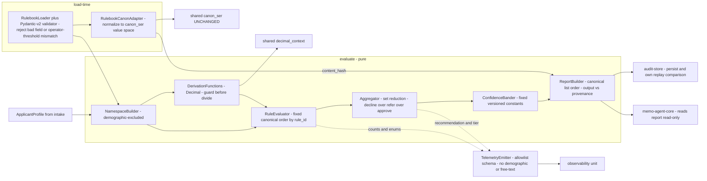

# Logical Components — `rules-engine` (C2)

**Stage**: BUILD → NFR Design (per-unit) · cluster unit 2
**Unit**: U3 `rules-engine` — the deterministic rulebook engine (pure Python, **zero LLM**)
**Date**: 2026-07-05 · **Runtime**: Python **3.12 pinned** (D6)
**Scope**: The **logical components** the NFR-Design patterns introduce (`nfr-design-patterns.md`) —
responsibilities + relationships, **consistent with the FD's entities**. **Logical only — no code**
(module split is a Code-Gen concern). Components realize the FD's `load_rulebook → evaluate →
RuleResultReport` pipeline; they realize the quality patterns, they do **not** re-open the FD, the C2
contract, or the NFR targets. The **25–40-rule data authoring stays deferred to Code-Gen** (FD §7).

---

## 1. Component inventory

| Component | Responsibility | Realizes pattern |
|---|---|---|
| **`RulebookLoader`** (+ Pydantic-v2 validator) | `load_rulebook(version)` — `pyyaml` `safe_load`, **validate every rule at load** (reject a demographic/unknown `input_fields` entry and an operator↔threshold-shape mismatch), and **freeze** an immutable `Rulebook` for that semver. A bad rulebook **fails to load**. | §4 load-reject, §5 frozen versioning |
| **`RulebookCanonAdapter`** | Normalize the frozen `Rulebook` into **`canon_ser`'s EXISTING value space** (`set` → declared-sorted `list` by canonical string form, `DecimalRange` → dict of `Decimal`+`bool`, enum → `.value`, `ScalarLiteral` → native), then call the **UNCHANGED** shared `backend/common/canon_ser.py`; compute `content_hash = sha256(bytes)`. **No shared-spec change.** | §3 canonicalization, §5 `content_hash` |
| **`NamespaceBuilder`** | Build the operand-resolution namespace from **only** the demographic-excluded profile fields + the engine-derived `dti_ratio` / `income_multiple`. The `demographics` sub-object is **never** placed in it (independent structural guard). | §4 namespace exclusion |
| **`DerivationFunctions`** (DR-DTI / DR-INCM) | **Pure `Decimal`** derivations via the shared `backend/common/decimal_context` (4dp `ROUND_HALF_UP`); a **precondition guard runs before any division** → operand-missing/zero-income emits `not_evaluated` + `refer_trigger` (`actual_value == null`), no divide path. | §2 Decimal-derivation |
| **`RuleEvaluator`** (the `evaluate()` interpreter) | **Pure**, no I/O / wall-clock / randomness; iterate rules in the **fixed canonical order (by `rule_id`)**; resolve operands **only** from each rule's `input_fields`; apply `operator` vs `threshold` in `Decimal`; emit tri-state `RuleResult` (`pass`/`fail`/`not_evaluated`) + `outcome_tier`. | §1 determinism |
| **`Aggregator`** | **Pure reduction over the `outcome_tier` set** under fixed precedence (DECLINE > REFER > APPROVE); `incomplete` / `not_evaluated` contribute **only** `refer_trigger` (thin-file → REFER-never-DECLINE); collect `decline_reasons` / `refer_reasons`. Order-independent. | §6 aggregation |
| **`ConfidenceBander`** | **Pure** banding of `confidence ∈ {High, Medium, Low}` from value-proximity + completeness using the **fixed versioned `ConfidenceBands` constants**. No randomness/wall-clock; never LLM. | §7 confidence |
| **`ReportBuilder`** | Assemble the `RuleResultReport` — **all order-derived list fields (`rule_results`, `decline_reasons`, `refer_reasons`) in the one canonical order** (DET-2), and a **clean output-vs-provenance separation** (evaluation-output = equality set; `rulebook_version`/`content_hash`/`engine_version` = provenance). **Does not compare** — `audit-store` owns replay. | §1 DET-2, §6 forensic-not-equality |
| **`TelemetryEmitter`** | Emit through an **allowlist Pydantic schema** of typed non-text fields only (`rule_id`, enums, int counts, int timing) — **no applicant-profile-derived / demographic / free-text field**; demographic content is **structurally unrepresentable**. Emit-only. | §8 telemetry / perf |

> **Consistency with the FD**: these components realize the FD's frozen pipeline — `RulebookLoader`
> (+`RulebookCanonAdapter`) implements `load_rulebook`; `NamespaceBuilder`+`DerivationFunctions`+
> `RuleEvaluator`+`Aggregator`+`ConfidenceBander`+`ReportBuilder` implement `evaluate` /
> `recommend` (producing `RuleResult` rows + `RuleResultReport`). **No FD entity is changed** — these
> are the *how*, not new *what*. The **25–40-rule data** is authored at Code-Gen, not here.

---

## 2. Ownership boundaries (reference-not-own)

| Concern | Owner | This unit |
|---|---|---|
| CANON-SER spec + shared implementation | `audit-store` (§2.1) / `backend/common/canon_ser.py` | **references** via `RulebookCanonAdapter` (unchanged; no fork) |
| Single `Decimal` context | `backend/common/decimal_context` | **references** via `DerivationFunctions` |
| Observability stack (Langfuse/Prometheus/Grafana) | `observability` unit | **emits** via `TelemetryEmitter` (emit-only) |
| Replay orchestration + match/mismatch comparison | `audit-store` `ReplayService` | provides pure `evaluate` + a **separable** report; **no concept of replay** |
| Bias-swap + reproducibility **verification** | `quality-gates` | authors its own unit tests; targets feed the gates |
| Secrets | `secrets-config` / SEC-3 | out of scope |
| Persistence (PostgreSQL, DATA-5) | `audit-store` / `database` | commits only to CANON-SER serializability of the report |
| Cloud infra / deployment | `deploy-config` / `database` | **Infrastructure Design likely SKIPPED** (no untrusted parsing → no sandbox NFR) |

**No component owns a reference-not-own concern**: `RulebookCanonAdapter` references (never edits) the
shared CANON-SER; `DerivationFunctions` references the shared `decimal_context`; `TelemetryEmitter`
emits only (stack is `observability`'s); `ReportBuilder` separates fields only (comparison is
`audit-store`'s); none owns the `quality-gates` verification harness.

---

## 3. Component-relationship view

Mermaid validated before write (alphanumeric node + subgraph IDs; double-quoted labels; **no colons, no
semicolons, no parentheses, no special chars** in labels — hyphens / "plus" / "then" / "over" only;
balanced brackets; subgraph terminators only; no node named `end`). Text alternative follows.

### Text alternative (always included)

- **load-time** — `RulebookLoader` (+ Pydantic-v2 validator) loads/validates/freezes the immutable
  `Rulebook`; `RulebookCanonAdapter` canonicalizes it through the **unchanged** shared `canon_ser` to
  produce `content_hash`.
- **evaluate (pure)** — `NamespaceBuilder` builds the demographic-excluded namespace from the
  `ApplicantProfile` (+ derived operands from `DerivationFunctions`, which uses the shared
  `decimal_context` and **guards before dividing**); `RuleEvaluator` iterates rules in the **fixed
  canonical order**; `Aggregator` reduces the `outcome_tier` set (DECLINE over REFER over APPROVE;
  incomplete → REFER); `ConfidenceBander` bands confidence on fixed versioned constants; `ReportBuilder`
  emits the report with **all list fields in canonical order** and **output-vs-provenance separation**.
- **downstream** — the report flows read-only to `memo-agent-core` and to `audit-store` (which
  **owns** persistence + the replay comparison). The `TelemetryEmitter` emits **only** counts / enums to
  the `observability` unit. Shared `canon_ser` and `decimal_context` are **referenced, not owned**.

---

## 4. Consistency + ownership check (P5)

- **Builds on the frozen FD** — every component maps to a frozen FD method (`load_rulebook` /
  `evaluate` / `recommend`) and the FD entities (`Rulebook`, `Rule`, `RuleResult`, `RuleResultReport`,
  `ConfidenceBands`); **no FD entity/contract re-opened**.
- **Builds on the approved NFR targets** — every component realizes a pattern that makes an
  `NFR-RULES-*` assertion structurally achievable at Code-Gen; **no NFR target re-opened**.
- **Reference-not-own held** — CANON-SER (audit-store §2.1, via the unchanged adapter), `decimal_context`,
  observability stack, replay-orchestration, quality-gates verification, secrets, persistence all owned
  elsewhere; this unit references / emits / provides a separable report.
- **Schema-vs-data boundary** — the **25–40-rule population is Code-Gen**, not designed here.
- **No LLM anywhere** (CON-BR2). **Infrastructure Design likely SKIPPED** for this unit (confirmed +
  logged when reached).

---

*End of logical-components.md. Design patterns → `nfr-design-patterns.md`.*
