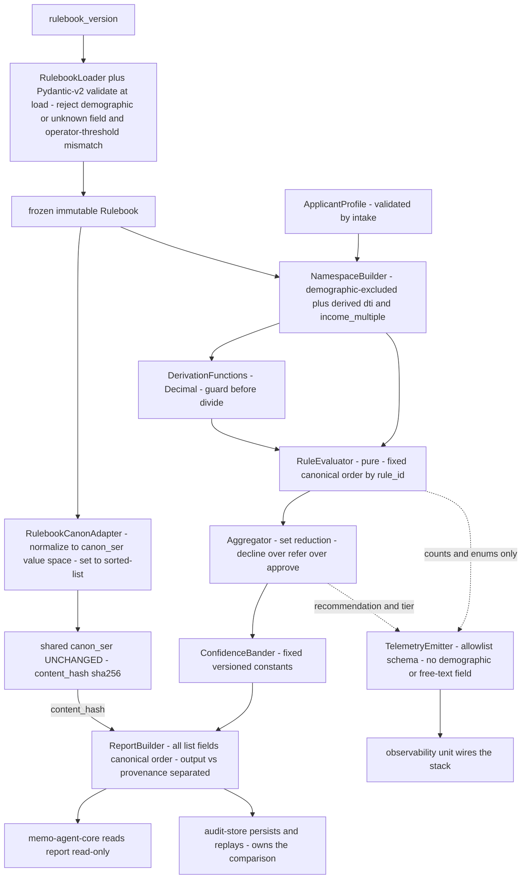

# NFR Design Patterns — `rules-engine` (C2)

**Stage**: BUILD → NFR Design (per-unit) · cluster unit 2
**Unit**: U3 `rules-engine` — the deterministic rulebook engine (pure Python, **zero LLM**)
**Depth**: comprehensive (invariant-bearing deterministic-core unit)
**Date**: 2026-07-05 · **Runtime**: Python **3.12 pinned** (D6)
**Scope**: The **design pattern (the "how")** for each approved `NFR-RULES-*` target — built **ON the
frozen FD + the approved NFR Requirements, re-opening neither.** Each pattern states **how the target's
assertion is structurally met**; the components that realize it are in `logical-components.md`. No code
(that is Code-Gen). The **25–40-rule data authoring stays deferred to Code-Gen** (FD §7); this designs
the **engine + loader/validator/adapter** patterns.

---

## 1. Determinism pattern — `NFR-RULES-DET-1` / `NFR-RULES-DET-2`

**Pattern**: a **pure `evaluate()`** with a **single fixed canonical order** applied to **every
order-derived list field**, plus a **set-based aggregation** — so *same-order determinism* and
*permuted-order invariance* are two structurally-separate guarantees.

- **Pure function (DET-1)** — `evaluate(profile, rulebook_version)` has **no I/O, no wall-clock, no
  unseeded randomness, no dict-order reliance**. Rules are iterated in a **fixed canonical order —
  sorted by `rule_id`** — so the emitted `rule_results` **list** is byte-stable. Same input, same order,
  run ×N≥10 → **byte-identical `RuleResultReport`** (NFR-RULES-DET-1).
- **Order-independence (DET-2)** — the outcome does **not** depend on iteration order because
  aggregation (§6) is a **pure reduction over the multiset/set of `outcome_tier` contributions**, not a
  sequence. To make the *whole report* byte-identical under a **permuted** evaluation order, the report
  is re-sorted to the **one canonical order** before it is built.
- **DET-2 completeness — EVERY order-derived list field is canonically ordered (the binding
  sharpening).** `canon_ser` sorts **dict keys** but **preserves list order** — so any list built in
  *iteration* order would make a permuted run byte-different even when `recommendation` / `confidence`
  match, breaking DET-2. Therefore **all** order-derived list fields of the `RuleResultReport` are
  emitted in the **same fixed canonical order (by `rule_id` / declared key)**, not iteration order:
  - **`rule_results`** — sorted by `rule_id`;
  - **`decline_reasons`** — sorted by the driving `rule_id` (then a declared tiebreak);
  - **`refer_reasons`** — sorted by the driving `rule_id` (then a declared tiebreak).
  With every list on the one canonical order, a permuted evaluation → a **byte-identical whole report**.
- **Structurally meets**: NFR-RULES-DET-1 (same-order ×N byte-identical) **and** NFR-RULES-DET-2
  (permuted-order → identical), as **two distinct** guarantees.

---

## 2. Decimal-derivation pattern — `NFR-RULES-DEC-1`

**Pattern**: **pure `Decimal` derivations under the single shared context**, with a **precondition
guard *before* any division** — the divide path is structurally unreachable when an operand is missing.

- **Pure + single context** — `dti_ratio` = `existing_debt_obligations_annual / verifiable_income_annual`
  and `income_multiple` = `requested_cover_amount / verifiable_income_annual` are **pure functions**
  computed via the shared `backend/common/decimal_context` (**4dp `ROUND_HALF_UP`, `Decimal` never
  float**), so boundaries (`0.40`, the income-multiple ceiling) are exact and replayable.
- **Guard-before-divide (by construction, not try/except)** — a **precondition guard** checks operand
  presence and **non-zero income *before* any division**. If it fails, the rule is emitted
  **`not_evaluated` + `refer_trigger`** with `actual_value == null` and **no division is ever
  attempted** — there is **no divide-by-zero path** in the code, not a caught exception around one.
- Derived operands are **exposed in the resolution namespace** (§4) so a rule may name `dti_ratio` /
  `income_multiple` in `input_fields`; they are derived per-evaluation, never stored on the profile
  (facts stay single-sourced in intake).
- **Structurally meets**: NFR-RULES-DEC-1 (boundary-exact `Decimal`; operand-missing → `not_evaluated`
  → `refer_trigger`, never a divide error / silent pass).

---

## 3. Rulebook-canonicalization pattern — `NFR-RULES-CANON-1`

**Pattern**: a rules-engine **`RulebookCanonAdapter`** that **normalizes the `Rulebook` into
`canon_ser`'s EXISTING value space**, then calls the **UNCHANGED** shared utility — the `CanonSerAdapter`
precedent (intake). **One canonicalization convention; no fork; no §2.1 / `canon_ser.py` change.**

- **Shape → normalization** (into canon_ser's existing value space):
  - **`set`-threshold → a declared-sorted `list`** — sorted by **canonical string form** (a
    deterministic total order), so the **same set → the same bytes** regardless of authoring order;
  - **`DecimalRange {low, low_inclusive, high, high_inclusive}` → a dict of `Decimal` + `bool`**;
  - **enum (`operator` / `category` / `outcome`) → `.value`**; **`ScalarLiteral` → native scalar**.
- **Then the unchanged shared util** — the adapter passes the normalized structure to
  `backend/common/canon_ser.py`; `content_hash = sha256(canonical bytes)` (§5). **`canon_ser.py` and
  audit-store §2.1 are unchanged; audit-store is unaffected** (it never canonicalizes a rulebook and
  never passes a `set`). *(If a native-`set` branch on the shared util were ever preferred, that is a
  conscious backward-compatible shared-code decision to LOG — the adapter path avoids it; any future
  rule shape not expressible under the four §2.1 properties is flagged as a cross-unit change with
  audit-store, never a silent fork.)*
- **Structurally meets**: NFR-RULES-CANON-1 (one convention, adapter-level, byte-stable + set-order
  invariant, no shared-spec change).

---

## 4. Load-time rejection + independent namespace-exclusion — `NFR-RULES-BR1-1` / `-BR1-2` / `-SCHEMA-1`

**Pattern**: **two independent structural guards** (belt-and-suspenders) — a **Pydantic-v2
load-validation gate** and a **demographic-excluded resolution namespace**.

- **Guard 1 — load-time validation (the single structural gate)** — `load_rulebook` validates **every**
  rule at load against the `Rule`/`Rulebook` Pydantic-v2 schema:
  - **(i)** each `input_fields` entry **must resolve in the single-sourced allowlist namespace** — a
    **demographic path** (`demographics.*`, name/gender/city) **or any unknown/out-of-allowlist field**
    → **reject** (NFR-RULES-BR1-1);
  - **(ii)** the `threshold` **shape must match the `operator`** (§2.1) → mismatch **reject**
    (NFR-RULES-SCHEMA-1).
  - A malformed/adversarial rulebook **fails to load** (raises a load error) — it **never reaches
    `evaluate`**.
- **Guard 2 — namespace exclusion (independent of Guard 1)** — the operand-resolution namespace is
  built (§ `NamespaceBuilder`) from **only** the demographic-excluded profile fields + the derived
  `dti_ratio` / `income_multiple`. The `demographics` sub-object is **never** placed in it. So **even a
  hypothetically-loaded bad rule** (Guard 1 bypassed) **could not resolve a demographic** — there is **no
  resolvable target**. A demographic name would resolve as *missing* → the §2 guard-before-divide /
  missing-operand path → **`not_evaluated` → `refer_trigger`**, so the demographic value is **never
  read** and never influences the outcome, even in the bypass scenario.
- **Independently tested** — Guard 1 by the load-rejection universal-quantifier (BR1-1/SCHEMA-1), Guard 2
  by the namespace-exclusion assertion (BR1-2). Neither is a single point.
- **Structurally meets**: NFR-RULES-BR1-1 (load reject), NFR-RULES-SCHEMA-1 (operator↔threshold reject),
  NFR-RULES-BR1-2 (independent namespace exclusion).

---

## 5. Deterministic `content_hash` + append-only immutable versioning — `NFR-RULES-AUDIT-1` / `-AUDIT-2`

**Pattern**: a **frozen immutable `Rulebook`** hashed over its **canonical bytes** (§3), stored in an
**append-only versioned store** with **load-time verification**.

- **Deterministic hash** — `content_hash = sha256(RulebookCanonAdapter bytes)` (§3). **Same rules → same
  hash; any rule change → a different hash** (tamper-evidence). `rulebook_version` (semver) +
  `content_hash` are the **replay handle** — sufficient + verifiable to reconstruct the exact ruleset.
- **Frozen + append-only** — `load_rulebook(version)` builds an **immutable (frozen) `Rulebook`**; a
  published version's source is **never mutated** — a change is a **new semver + new entry**; old
  versions **remain loadable**. Because the version is immutable and the adapter is deterministic, the
  **same version always canonicalizes to the same bytes → the same hash**.
- **Load-time verification** — on load, the recomputed `content_hash` is compared against the recorded
  hash (tamper-evidence); on replay, `audit-store` compares the recorded hash to verify the identical
  rulebook bytes were loaded.
- **Structurally meets**: NFR-RULES-AUDIT-1 (deterministic hash), NFR-RULES-AUDIT-2 (append-only immutable).

---

## 6. Fixed-precedence aggregation + forensic-not-equality report — `NFR-RULES-AGG-1` / `-AUDIT-3`

**Pattern**: a **pure set-reduction** for the recommendation, and a **report that cleanly separates
evaluation-output from provenance** so `audit-store` owns the replay comparison.

- **Fixed-precedence aggregation (AGG-1)** — `recommend(results, incomplete)` is a **pure reduction over
  the `outcome_tier` set** under fixed precedence:
  1. **any** `decline_fail` ⇒ **`DECLINE-RECOMMEND`** (decline dominates, even if also incomplete);
  2. else **any** `refer_trigger` — including the **`incomplete`** insufficient-info trigger and **every
     `not_evaluated` → `refer_trigger`** ⇒ **`REFER`**;
  3. else all pass ⇒ **`APPROVE`**.
  **`incomplete` / `not_evaluated` contribute only `refer_trigger`, never `decline_fail`** → **thin-file
  → REFER, never DECLINE**. The `-RECOMMEND` suffix is mandatory (FR-RULES-5). Order-independent (feeds
  DET-2). `decline_reasons` / `refer_reasons` collect the driving `rule_id`s — **emitted in the canonical
  order (§1)**.
- **Forensic-not-equality report separation (AUDIT-3)** — the `RuleResultReport` **cleanly separates**:
  - **evaluation-output** (the replay **equality set**): per-rule rows (`rule_id` / `status` /
    `actual_value` / `operator` / `threshold` / `outcome_tier`) + `recommendation` + `confidence`;
  - **provenance** (forensic/verification, **excluded** from the equality set): `rulebook_version` +
    `content_hash` + `engine_version`.
  `audit-store`'s `ReplayService` **owns the match/mismatch comparison** and applies the projection
  (excluding provenance) — **exactly its §2.1/§3.1 projection**, so an `engine_version` (git-SHA) change
  alone is **not** a false mismatch. **rules-engine performs only pure re-evaluation + the separable
  report shape; it has no concept of replay** (reference-not-own).
- **Structurally meets**: NFR-RULES-AGG-1 (order-independent precedence, thin-file→REFER),
  NFR-RULES-AUDIT-3 (forensic-not-equality, matching audit-store field-for-field).

---

## 7. Deterministic confidence-banding pattern — `NFR-RULES-CONF-1`

**Pattern**: a **pure `ConfidenceBander`** over the **fixed versioned `ConfidenceBands` constants**.

- **Pure function of proximity + completeness** — `confidence ∈ {High, Medium, Low}` from (a) the
  **normalized proximity** of each numeric `actual_value` to its nearest threshold and (b) profile
  completeness, banded via the **fixed `high_margin` / `low_margin` constants carried in the versioned
  rulebook**. Wide margins on all rules + complete ⇒ **High**; near-boundary or a single incompleteness
  ⇒ **Medium**; multiple borderline hits or material incompleteness ⇒ **Low**.
- **Replay-stable** — **no randomness, no wall-clock**; same input + `rulebook_version` → **identical
  `confidence` ×N**. A margin change is itself a **new rulebook version** (replay under the original
  stays exact).
- **Sole-origin** — produced in rules-engine, **never by the LLM** (CON-BR2); read-only input to the memo.
- **Structurally meets**: NFR-RULES-CONF-1 (deterministic, replay-stable, never LLM).

---

## 8. Allowlist telemetry + observed-only performance — `NFR-RULES-OBS-1` / `-PERF-1`

**Pattern**: an **allowlist `TelemetryEmitter`** whose schema **structurally cannot carry demographic /
profile / free-text content**, emitting timing **observed-only**.

- **Allowlist schema (structural, not filter-based)** — the emitter accepts a **Pydantic allowlist
  schema of typed non-text fields only**: `rule_id` (rulebook metadata), enums (`recommendation` /
  `confidence` / aggregation-tier / per-rule `status`), **int** counts (per-`recommendation`, fired /
  `not_evaluated`), and **int** timing. There is **NO applicant-profile-derived field and NO free-text /
  `str` field** through which a demographic value could be emitted — demographic content is
  **structurally unrepresentable** (no field to hold it). A **schema-level assertion** proves no
  profile/demographic/free-text field exists (mirrors intake NFR-INT-FORENSIC(b)). CON-BR1 extends to
  telemetry **by construction**, not by an omit-convention.
- **Emit-only** — the unit emits through this seam; the `observability` unit wires it to
  Langfuse/Prometheus/Grafana. **Reference-not-own** — this unit does not configure the stack.
- **Observed-only performance (PERF-1)** — the `evaluate()` duration is emitted (int timing) so the
  dashboard tracks the **soft budget**; there is **no hard bound** (no untrusted parsing here, unlike
  intake's sandbox) and **no latency-failing check**. Correctness / determinism / explainability take
  precedence over speed.
- **Structurally meets**: NFR-RULES-OBS-1 (allowlist, demographic-free), NFR-RULES-PERF-1 (observed,
  not gated).

---

## 9. Pattern → target traceability

| Pattern (§) | Target(s) | Assertion made structurally achievable |
|---|---|---|
| §1 determinism | NFR-RULES-DET-1 / -DET-2 | byte-identical ×N; permuted-order → identical **whole** report (all list fields canonically ordered) |
| §2 Decimal-derivation | NFR-RULES-DEC-1 | boundary-exact `Decimal`; guard-before-divide → `not_evaluated`/`refer_trigger` |
| §3 RulebookCanonAdapter | NFR-RULES-CANON-1 | one convention; unchanged shared util; set-order-invariant |
| §4 load-reject + namespace | NFR-RULES-BR1-1 / -BR1-2 / -SCHEMA-1 | fails-to-load on bad field/mismatch; demographic unresolvable independently |
| §5 content_hash + versioning | NFR-RULES-AUDIT-1 / -2 | deterministic hash; frozen append-only immutability |
| §6 aggregation + report split | NFR-RULES-AGG-1 / -AUDIT-3 | order-independent precedence, thin-file→REFER; forensic-not-equality (matches audit-store) |
| §7 confidence-banding | NFR-RULES-CONF-1 | deterministic, replay-stable, never LLM |
| §8 telemetry + perf | NFR-RULES-OBS-1 / -PERF-1 | demographic-free allowlist schema; observed-only timing |

**Held**: frozen FD + approved NFR targets not re-opened; **schema-vs-data 25–40-rule authoring deferred
to Code-Gen**; ownership reference-not-own (shared CANON-SER via the **unchanged** `RulebookCanonAdapter`;
shared `decimal_context`; observability stack; `quality-gates` verification; `audit-store`
replay-orchestration; secrets). **No LLM anywhere** (CON-BR2). **Infrastructure Design likely SKIPPED**
for this unit (no untrusted parsing → no sandbox NFR; no independent cloud topology) — confirmed + logged
when reached.

---

## 10. Pattern-integration diagram

Mermaid validated before write (alphanumeric node IDs; double-quoted labels; **no colons, no
semicolons, no parentheses** in labels — hyphens / "plus" / "then" only; balanced brackets; no reserved
`end` node). Text alternative follows.

### Text alternative (always included)

1. **`RulebookLoader`** loads a version and **validates every rule at load** (Pydantic-v2) — a
   demographic/unknown `input_fields` entry or an operator↔threshold mismatch **fails to load** — then
   **freezes** an immutable `Rulebook`.
2. The **`RulebookCanonAdapter`** normalizes the frozen rulebook into the **unchanged** shared
   `canon_ser`'s value space (`set` → declared-sorted list, etc.) and computes `content_hash`.
3. The **`NamespaceBuilder`** builds a **demographic-excluded** operand namespace from the
   `ApplicantProfile` (+ derived `dti_ratio` / `income_multiple` from **`DerivationFunctions`**, which
   **guards before dividing**).
4. **`RuleEvaluator`** iterates the rules in the **fixed canonical order (by `rule_id`)**, resolving
   operands **only** from each rule's `input_fields`, emitting tri-state `RuleResult`s.
5. **`Aggregator`** reduces the `outcome_tier` **set** under fixed precedence (DECLINE > REFER > APPROVE;
   incomplete → REFER-never-DECLINE); **`ConfidenceBander`** bands confidence on fixed versioned constants.
6. **`ReportBuilder`** emits the `RuleResultReport` with **all order-derived list fields in the one
   canonical order** and **output-vs-provenance separation**; it flows read-only to `memo-agent-core`
   and is persisted/replayed by `audit-store` (which **owns the comparison**).
7. The **`TelemetryEmitter`** emits **only** counts / enums / timing (no demographic or free-text field)
   to the **`observability`** unit. The stack is referenced, not owned.

---

*End of nfr-design-patterns.md. Logical components + their relationships → `logical-components.md`.*
