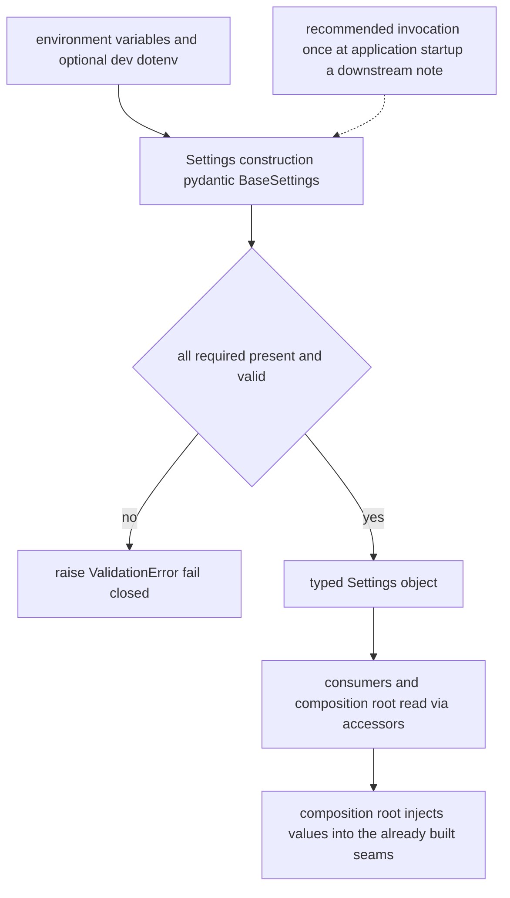

# Business Logic Model — `secrets-config` (EPIC-6 / U16)

**Stage**: BUILD → Functional Design (per-unit) · pure-wiring/config unit · **Depth**: standard
**Unit**: U16 `secrets-config` · **Date**: 2026-07-07 · owns **SEC-3**.
**Scope**: The **load/validation flow**, the **consumer access surface**, the **FD ↔ later-stage boundary**, a
**consumer/dependency map**, and an **invariant self-check**. **No credential/URL VALUE appears here** (SEC-3). **No LLM.**

---

## 1. Load / validation flow (fail-closed at construction — fold 2)

The fail-closed behavior is **intrinsic to `Settings()` construction** — a missing/invalid required var **raises at
construction time**, independent of *where* the construction call eventually lives. This makes it **fully testable
standalone** (construct with a cleared/partial env → raises; with a complete valid env → loads) with **no forward
dependency on unbuilt code**. "**At application startup / the composition root**" is the **recommended downstream
invocation point** for a future app-assembly / `deploy-config` unit — a **named integration note, not a build
dependency** of `secrets-config`.

Mermaid validated before write (alphanumeric node IDs + underscore; every label double-quoted; **no semicolons, no bare
colons, no parentheses, no hyphens, no special characters** in labels; balanced blocks). Text alternative follows.

### Text alternative (always included)
1. `Settings` is constructed (Pydantic v2 `BaseSettings`) from **environment variables** (+ an optional dev dotenv).
2. Construction **validates** every required field — scheme for the three URL vars, non-empty for the two passwords +
   `GEMINI_API_KEY` (BR-SEC-2).
3. **Any missing/invalid required var → raises** (`ValidationError`), fail-closed (BR-SEC-1) — no silent default.
4. On success → a **typed `Settings` object**; **consumers / the composition root read** their shape via accessors.
5. The **composition root injects** the value into the **already-built injected seams** (the injected `Engine`, injected
   provider, injected connection). The **dashed** node marks the **recommended once-at-startup invocation** — a
   downstream note for the future app-assembly/`deploy-config` unit, **not built or depended-on here**.

---

## 2. Consumer access surface (reference-not-own, in reverse)

- `secrets-config` exposes a **typed `Settings` object** (+ small typed accessors, e.g. `database_url()`,
  `audit_writer_url()`, `audit_reader_url()`, `gemini_api_key()`). **Consumers / the composition root READ** from it.
- `secrets-config` **imports NONE** of the consumers' production code and **not `database`** — a **dependency leaf**
  (BR-SEC-5, fold 1). The **direction is consumers → `secrets-config`**; never the reverse → **no circular dependency**.
- The values flow into the **already-built injected seams** the completed units exposed for exactly this: audit-store /
  auth-rbac's injected `Engine`, database's injected `DATABASE_URL` (validated by its own `DbUrlGuard` at its config
  load), memo-agent-core's injected `ProviderAbstraction` / Gemini adapter. `secrets-config` supplies the **value**;
  each unit's own seam consumes it — **no consuming code is edited**.

---

## 3. FD ↔ later-stage boundary

| Concern | **Pinned in THIS FD** | **Later (NFR / `deploy-config` / composition root)** |
|---|---|---|
| The six required shapes + per-shape validation | ✅ `domain-entities.md` §1 | — |
| Fail-closed `Settings()` construction behavior | ✅ §1 (BR-SEC-1) | The **structural no-forbidden-imports test** + unit tests land at NFR/Code-Gen |
| `.env.example` + `.gitignore` + no-secret-literal | ✅ the checkable rules (BR-SEC-3/4) | The concrete files + tests generated at Code-Gen |
| **Where** `Settings()` is invoked | ✅ named as once-at-startup (downstream note) | The **actual composition-root call** = app-assembly / `deploy-config` |
| The **actual environment VALUES** per tier | ❌ **never here** (SEC-3) | **`deploy-config`** wires real env per environment (dev/CI/Render) |
| Repo-wide hardcoded-secret sweep | ❌ referenced | **`quality-gates` / CI** aggregation |

---

## 4. Consumer / dependency map

| Party | Relationship | Shape(s) read |
|---|---|---|
| **`database`** (consumer) | reads its connection + grant passwords | `DATABASE_URL`, `AUDIT_WRITER_PASSWORD`, `AUDIT_READER_PASSWORD` |
| **`audit-store`** (consumer) | reads the least-privilege runtime connections | `AUDIT_WRITER_URL`, `AUDIT_READER_URL` |
| **`auth-rbac`** (consumer) | reads the app-owner connection for `app_user` | `DATABASE_URL` (no new var) |
| **`memo-agent-core`** (consumer) | reads the P1 provider key | `GEMINI_API_KEY` |
| **`deploy-config`** (later) | wires the actual env VALUES per environment | all — values, not shapes |
| **`memo-extensions`** (Phase 2 seam owner) | authors its own reserved shapes | `ANTHROPIC_API_KEY` / Ollama / MCP |
| **`observability`** (Phase 2 seam owner) | authors its own reserved shapes | `LANGFUSE_*` / Prometheus / Grafana |

`secrets-config` **imports none** of the above (reference-not-own, in reverse).

---

## 5. Invariant self-check

| Invariant | Honored by | How |
|---|---|---|
| **SEC-3** (single source; no hardcoded value) | BR-SEC-1/3/4/7; §1 | env-sourced; no value in any artifact/file; `.env` gitignored; no default/literal |
| **Fail-closed** | BR-SEC-1; §1 | `Settings()` construction raises on any missing/invalid required var |
| **DATA-5 consistency** | BR-SEC-2 | the three URL vars validate to `postgresql://` (independent check, DATA-5 spirit) |
| **Reference-not-own (reverse) / no circular dep** | BR-SEC-5; §2 (fold 1) | imports no consumer code / not `database`; a dependency leaf; structurally testable |
| **No forward dependency (fold 2)** | §1 | fail-closed behavior is intrinsic to construction; startup invocation is a named downstream note |
| **One-place extension** | BR-SEC-6 | a new shape = one new `Settings` field; Phase-2 seams reserved-not-authored |
| **Advisory-only** | BR-SEC-7 | a config unit; no recommendation/decision language; finalizes no outcome |
| **No LLM** | BR-SEC-7 | pure config sourcing; no model anywhere |
