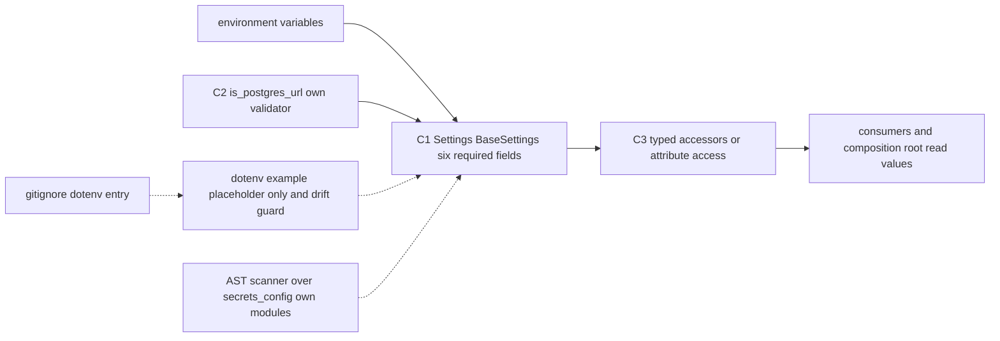

# Logical Components — `secrets-config` (EPIC-6 / U16)

**Stage**: BUILD → NFR Design (per-unit) · pure-wiring/config unit · **Depth**: standard
**Unit**: U16 `secrets-config` · **Date**: 2026-07-07.
The **3 production components** + **governance deliverables** + **test substrate** this unit introduces (under
`backend/secrets_config/`), their responsibilities, ownership, the reference-not-own check, and component→target
coverage. **No credential/URL VALUE** (SEC-3). **No LLM.**

> **No production import of `database` or any consumer anywhere (fold 1 — binding).** `secrets-config` production code
> imports **only** third-party (`pydantic-settings`, `sqlalchemy` for the scheme check) + stdlib. **Structurally
> testable**: no `from backend.database` / `backend.audit_store` / `backend.memo_agent_core` / `backend.auth_rbac` /
> `backend.intake` in `secrets_config` production. **No shared `backend` module coupling** with `database` (both use
> `sqlalchemy` independently — a third-party library, not coupling). No circular dependency.

---

## 1. Components

| ID | Component | Responsibility | Backs |
|---|---|---|---|
| **C1** | **`Settings`** | The Pydantic-v2 `BaseSettings` — six **required, no-default** fields + per-field validators; the **construction-time fail-closed** surface; the typed source consumers read. | FAILCLOSED-1, GOV-1 (no-default), DET-1, PERF-1 |
| **C2** | **`is_postgres_url`** | The **self-contained** `postgresql://` scheme validator (`sqlalchemy.make_url`) — `secrets-config`'s **own**, no `database` import, no shared `backend` module. Used by C1's URL field validators. | SCHEME-1 |
| **C3** | **typed accessors** | Small getters over the validated `Settings` (`database_url()`, `audit_writer_url()`, `audit_reader_url()`, `gemini_api_key()`) — **or plain attribute access** (a realization detail; both delegate to the one validated `Settings`). | consumer access surface |

**Governance deliverables (not code):** `.env.example` (placeholder-only, all six shapes) + a `.gitignore` `.env` entry.

**Test substrate (test-only, not a production component):**
- **Hermetic env fixture** — `monkeypatch.delenv` all six keys (`raising=False`) → set only the case's fields → construct
  with `_env_file=None` (so a real shell var can't leak/mask a case).
- **AST no-forbidden-imports scanner** — dynamic `rglob` over `backend/secrets_config` (excluding `tests/`); **the
  non-vacuous guard names `secrets_config`'s OWN actual production modules (fold 1)** — the `Settings` module, the
  `is_postgres_url` module, etc. — **not** auth-rbac's `authorizer.py`/`api_guard.py`/`pg_repository.py`; + a detector
  self-test.
- **Drift guard** — compares **`{name.upper() for name in Settings.model_fields}`** to the **ACTIVE (uncommented)**
  `.env.example` keys, **excluding commented Phase-2 placeholder lines (fold 2)**.

---

## 2. Component-relationship diagram

Mermaid validated before write (alphanumeric node IDs + underscore; every label double-quoted; **no semicolons, no bare
colons, no parentheses, no hyphens, no special characters** in labels; balanced blocks). Text alternative follows.

### Text alternative (always included)
- **Env** → **C1 `Settings`** (six required fields); **C2 `is_postgres_url`** is C1's URL scheme validator.
- **C1** → **C3 typed accessors** (or attribute access) → **consumers / the composition root** read the values.
- The **`.env.example`** (placeholder-only) + the **drift guard** and the **`.gitignore`** entry (dashed) govern C1's
  shape/hygiene; the **AST scanner** (dashed) proves `secrets_config`'s **own** modules import no consumer/`database`.

---

## 3. Reference-not-own check

| Concern | Owner | This unit? |
|---|---|---|
| The `Settings` schema + validators + scheme check | **`secrets-config`** (C1/C2/C3) | ✅ owns |
| `database`'s `DbUrlGuard` / migrations / schema | **`database`** | ❌ **not imported** — the scheme check is `secrets-config`'s own (spirit reused, code not); no shared `backend` module |
| The actual per-environment VALUES | **`deploy-config`** | ❌ not here (SEC-3) |
| The composition-root `Settings()` invocation | **app-assembly / `deploy-config`** | ❌ named downstream note, not built here |
| Repo-wide `detect-secrets` sweep | **`quality-gates` / CI** | ❌ referenced; this unit owns only its own module/`.env.example`/`.gitignore` hygiene |
| Consumer internals (database / audit-store / memo-agent-core / auth-rbac) | those units | ❌ **no import; no test of their internals** |
| Phase-2 seams (Claude/Ollama/MCP; Langfuse/Prometheus) | **memo-extensions / observability** | ❌ reserved-not-authored |

**No component owns a concern reference-not-own assigns elsewhere. No production import of `database` or any consumer
anywhere in `secrets-config`** — structurally verified (LEAF-1). No circular dependency.

---

## 4. Component → target coverage (no orphan)

| Target | Component(s) / item |
|---|---|
| NFR-SEC-FAILCLOSED-1 | C1 (+ C2, the validators) |
| NFR-SEC-SCHEME-1 | C2 (+ C1 field validator) |
| NFR-SEC-LEAF-1 | test substrate (AST scanner, fold 1) |
| NFR-SEC-GOV-1 | governance deliverables (`.env.example`, `.gitignore`) + C1 (no-default) + drift guard (fold 2) |
| NFR-SEC-DET-1 | C1 + C2 (pure construction) |
| NFR-SEC-SCOPE-1 | **governance / exclusion** — cross-cutting boundary (documented, not an orphan) |
| NFR-SEC-PERF-1 | C1 (construction latency observed) |
| NFR-SEC-OBS-1 | **N/A — observability-owned** (documented boundary, not an orphan) |

**All eight targets covered.** Every component/item backs ≥1 target; SCOPE-1 + OBS-1 are documented boundaries. No orphan.

---

## 5. Settled items held (not re-opened)
- Frozen FD (Settings schema + BR-SEC-1..7) + approved `NFR-SEC-*` targets — components realize them, re-opening neither.
- **No production import of `database` or any consumer (fold 1)** — own scheme validator (spirit, not code); no shared
  `backend` module coupling; structurally verified.
- **`.env.example` ↔ `Settings` drift guard (fold 2)** — uppercased `model_fields` vs active `.env.example` keys,
  excluding commented Phase-2 placeholders (reserved-not-authored, BR-SEC-6).
- **SEC-3** — no value anywhere; fail-closed; `.env` gitignored. **DET-1** purity structural. **Advisory-only. No LLM.**
- **Infrastructure Design** remains **likely a logged SKIP** — decided at that stage. Settled non-edits stay closed:
  `PROJECT-BRIEF.md`, `user-journey.md`, every built unit's code/design (incl. `database`'s `DbUrlGuard`).
