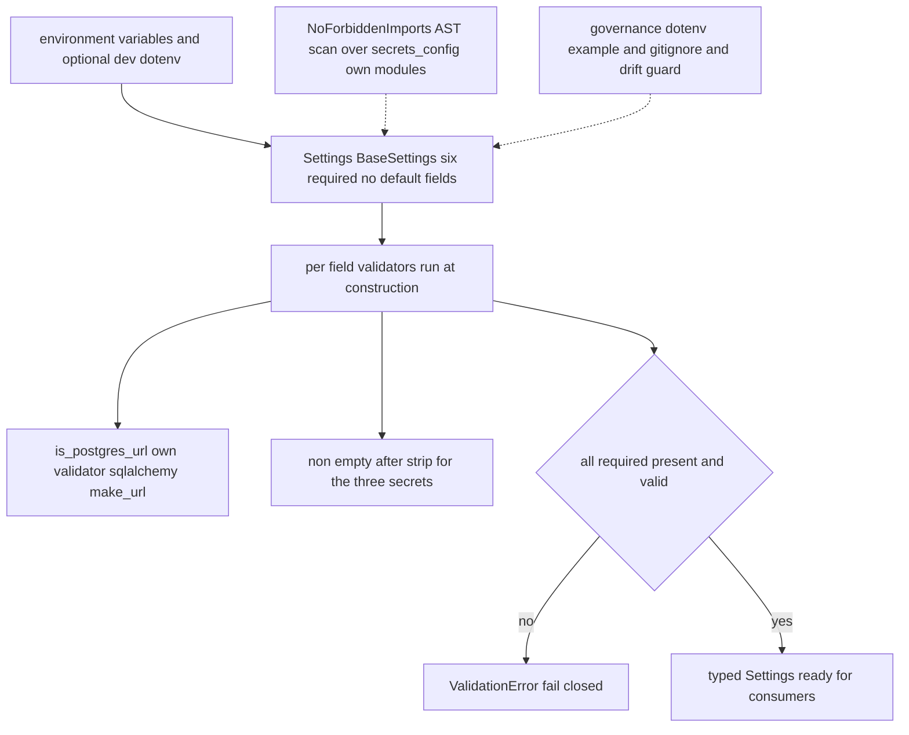

# NFR Design Patterns — `secrets-config` (EPIC-6 / U16)

**Stage**: BUILD → NFR Design (per-unit) · pure-wiring/config unit · **Depth**: standard
**Unit**: U16 `secrets-config` · **Date**: 2026-07-07 · **Runtime**: Python **3.12 pinned** (D6).
**Built ON** the frozen FD (`domain-entities.md` / `business-rules.md` / `business-logic-model.md`) + the approved
`nfr-requirements.md` — **re-opening neither**. One section per pattern, each structurally meeting its `NFR-SEC-*`
target(s) + traced. **No credential/URL VALUE** (SEC-3). **No LLM.**

> **Dependency leaf (stated once, upheld everywhere).** `secrets-config` production code imports **no** consumer /
> `database` module — **structurally proven by NoForbiddenImportsTestPattern (§4)**. The scheme validator is
> `secrets-config`'s **own** (only `sqlalchemy` — a shared *third-party* library, not a shared `backend` module; no
> coupling to `database`'s `DbUrlGuard`). **No circular dependency.**

---

## §1 — SettingsClassPattern → NFR-SEC-FAILCLOSED-1

- **Pattern**: one **Pydantic-v2 `BaseSettings`** with the six fields declared **required (no default)**, typed `str`,
  sourcing from env (+ optional dev `.env`). A **missing** var (no default → Pydantic "field required") and an
  **invalid** var (a field validator, §2) **both raise a single `ValidationError` at `Settings()` construction** — one
  composed fail-closed check, no per-field code path.
- **No bypass**: a missing field raises before its validator runs; a present-but-invalid field (incl. blank/whitespace,
  which the "required" check alone would miss) is caught by its validator. Every field, in **both** its missing and
  invalid case, terminates in a construction-time `ValidationError`.
- **Tier**: unit (hermetic — `delenv`-all-six + `_env_file=None`).

## §2 — FieldValidatorPattern → NFR-SEC-FAILCLOSED-1, NFR-SEC-SCHEME-1

- **Pattern**: per-field Pydantic validators — the three URL fields (`DATABASE_URL`, `AUDIT_WRITER_URL`,
  `AUDIT_READER_URL`) → **`is_postgres_url`** (§3); the three secret fields (`AUDIT_WRITER_PASSWORD`,
  `AUDIT_READER_PASSWORD`, `GEMINI_API_KEY`) → **non-empty-after-strip** (reject `""`/whitespace). All six are
  **required (no default)**, so absence is caught before the validator even runs.
- **Tier**: unit.

## §3 — IndependentSchemeValidatorPattern → NFR-SEC-SCHEME-1

- **Pattern**: a **self-contained** `is_postgres_url(value) -> bool` in `secrets-config`'s **own** module, using
  **`sqlalchemy.make_url(value).get_backend_name() == "postgresql"`** (third-party, already in stack) — accepts driver
  variants (`postgresql+psycopg2://`), rejects `sqlite://` / other scheme / malformed.
- **Independence**: lives **only** in `secrets_config` (no shared `backend` helper with `database`); **does not import**
  `database`'s `DbUrlGuard`. It shares only the **third-party `sqlalchemy`** library (both units import it
  independently — not coupling). Reuses the DATA-5 **spirit**, not the code. **Enforced by §4.**
- **Tier**: unit.

## §4 — NoForbiddenImportsTestPattern → NFR-SEC-LEAF-1 (fold 1)

- **Pattern**: the **auth-rbac AST-scan**, adapted — **dynamic `pathlib.rglob`** over **`backend/secrets_config`**
  (excluding `tests/`), asserting **no** production `.py` imports `backend.database`, `backend.audit_store`,
  `backend.memo_agent_core`, `backend.auth_rbac`, or `backend.intake` (prefix-matched, `import` + `from`).
- **Non-vacuous guard names THIS unit's own modules (fold 1)**: the guard asserts the scan sees **`secrets_config`'s own
  actual production modules** (whatever they are named at Code-Gen — the `Settings` class module, the `is_postgres_url`
  validator module, etc.) — **NOT** a copy-pasted reference to auth-rbac's `authorizer.py` / `api_guard.py` /
  `pg_repository.py`. Plus a **detector self-test** (proves it flags a synthetic `from backend.database` /
  `import backend.audit_store`).
- **Tier**: structural (unit).

## §5 — GovernanceArtifactPattern → NFR-SEC-GOV-1 (fold 2)

- **Pattern**: a committed **`.env.example`** naming **all six** shapes with **placeholder-only** values; a
  **`.gitignore`** entry for `.env`; and structural checks — (i) required `Settings` fields have **no default**
  (`model_fields`); (ii) **no secret literal** in the module; (iii) `.env` **not git-tracked**.
- **Drift guard, precise (fold 2)**: a test comparing **`{name.upper() for name in Settings.model_fields}`** against the
  **ACTIVE (uncommented) keys** parsed from `.env.example` — **explicitly EXCLUDING commented-out Phase-2 placeholder
  lines** (the `ANTHROPIC_API_KEY` / Ollama / MCP / `LANGFUSE_*` / Prometheus seams are **reserved-not-authored** per
  BR-SEC-6 and **must not be flagged as drift**). Bidirectional set-equality catches a `Settings` field added without a
  `.env.example` entry **and** a `.env.example` active key without a field.
- The repo-wide `detect-secrets` sweep = `quality-gates`/CI (referenced, not owned).
- **Tier**: unit / structural (repo-state).

## §6 — PureConstructionPattern → NFR-SEC-DET-1

- **Pattern**: the validators are **pure functions** of (the field value, the static schema); the **only input source**
  is env / the optional `_env_file`; the module imports **no** `requests`/`httpx`/`socket`/`time`/`random` and has **no
  wall-clock or random branch**. Construction performs **no network I/O**. Purity is **structurally guaranteed** (the
  design avoids introducing I/O/nondeterminism); DET-1 asserts the **absence** (same-env→identical + import-absence).
- **Tier**: unit (behavioral + light structural).

## §7 — ReferencedBoundaryPattern → NFR-SEC-SCOPE-1, NFR-SEC-PERF-1, NFR-SEC-OBS-1

- **SCOPE-1** — a **governance/exclusion statement (not a runtime test)**: targets test only `secrets-config`'s own
  schema/validation/governance/leaf property; **not** any consumer's internals, `deploy-config`'s value wiring, or
  `quality-gates`' repo sweep.
- **PERF-1** — construction latency **observed, non-gating**. **OBS-1** — **N/A** (observability-owned).
- **Tier**: governance / observed / N/A.

---

## §8 — Pattern-integration diagram

Mermaid validated before write (alphanumeric node IDs + underscore; every label double-quoted; **no semicolons, no bare
colons, no parentheses, no hyphens, no special characters** in labels; balanced blocks). Text alternative follows.

### Text alternative (always included)
- **Env** → **`Settings`** (six required no-default fields) → **per-field validators** at construction:
  **`is_postgres_url`** (the three URL fields, own validator via `sqlalchemy.make_url`) and **non-empty-after-strip**
  (the three secrets).
- **All required present and valid?** No → **`ValidationError`** (fail-closed, FAILCLOSED-1); Yes → a **typed
  `Settings`** ready for consumers.
- **NoForbiddenImports AST scan** (dashed) verifies `secrets_config`'s **own** modules import no consumer/`database`
  (LEAF-1, fold 1). **Governance** (dashed) — `.env.example` + `.gitignore` + the drift guard (GOV-1, fold 2).

---

## §9 — Traceability (pattern → target → tier)

| Pattern | Target(s) | Tier |
|---|---|---|
| SettingsClassPattern | FAILCLOSED-1 | unit |
| FieldValidatorPattern | FAILCLOSED-1, SCHEME-1 | unit |
| IndependentSchemeValidatorPattern | SCHEME-1 | unit |
| NoForbiddenImportsTestPattern (fold 1) | LEAF-1 | structural |
| GovernanceArtifactPattern (fold 2) | GOV-1 | unit / structural |
| PureConstructionPattern | DET-1 | unit |
| ReferencedBoundaryPattern | SCOPE-1, PERF-1, OBS-1 | governance / observed / N/A |

All eight approved `NFR-SEC-*` targets covered; no orphan.
