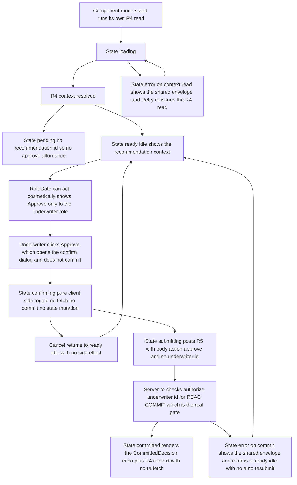
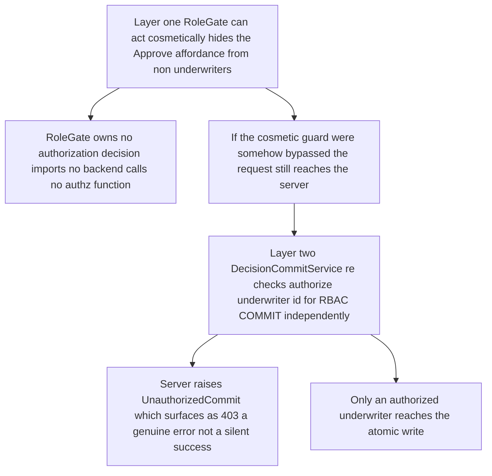

# `ui-approval-gate` (U7) — Functional Design · Business Logic Model

**Stage**: BUILD → per-unit loop → Functional Design → Part 2 · **Depth**: COMPREHENSIVE
**Date**: 2026-07-09
**Scope**: the confirm→commit flow of the first UI write path — R4 read for context, an explicit human confirm step, then the R5 write — with the AUTHZ-1 defense-in-depth relationship made structural, not just prose.

---

## 1. Flow — R4 read then confirm then R5 write (validated Mermaid)

Mermaid validated against this project's 7 rules: alphanumeric node IDs, quoted labels, no hyphens/semicolons/colons/parentheses/special characters in labels, balanced blocks, rectangle-only.

Both error states render the same shared envelope discipline of BR-AG-6 message visible code hidden detail never. They differ only in recovery per BR-AG-11.

### 1.1 Text alternative (equivalent to the diagram)
1. The component mounts and runs its **own** R4 read (`GET /applications/{id}/memo`) → **loading**.
2. On R4 reject → **error on context read** (shared envelope); its `Retry` **re-issues the R4 read** for the same `applicationId` (back to **loading**) — BR-AG-11(a). On R4 resolve, branch on the `status` discriminator:
   - `pending` / `recommendation_id = null` → **pending**: there is nothing to approve, so **no approve affordance renders** (AG-Fold-5).
   - `ready` → **ready(idle)**: the recommendation context (recommendation + confidence via the frozen badges) is shown.
3. The approve affordance is wrapped in `RoleGate can="act"` — cosmetically visible **only** to the `underwriter` role.
4. Clicking **Approve** opens `CommitConfirmDialog` and **does not commit** (BR-AG-2) → **confirming**.
5. **confirming is a pure client-side toggle** (AG-Fold-1): rendering or canceling it issues **no fetch, no commit, and no state mutation** beyond the local `confirming` flag. **Cancel** → back to **ready(idle)**, unchanged.
6. **Confirm** → **submitting**: post R5 with body `{ action: "approve" }` — **no `underwriter_id`, no `reason`** in the body.
7. The server **independently re-checks** `authorize(underwriter_id, RBAC_COMMIT)` (AUTHZ-1) — the real gate:
   - success (200) → **committed**: render the `CommittedDecision` echo + R4 context already in hand — **no re-fetch** (AG-Fold-2).
   - 403 / 409 / 400 / 422 → **error on commit**: the distinct-per-status render, all through the one shared envelope (BR-AG-6); the state then **returns to `ready(idle)`** — **never an automatic resubmit** — so the underwriter must re-open the confirm dialog and re-confirm before any retry of the commit (BR-AG-11(b)).
8. **committed** is terminal for this unit (no re-approve; the recommendation is committed).

---

## 2. The confirm dialog as a pure toggle (the load-bearing behavioral invariant)

The single most important behavior of this unit: **the R5 commit fires only on the confirm dialog's `Confirm` action — never on the initial Approve click, never on dialog open, never on Cancel.**

- `Approve` click → sets `confirming = true` → renders `CommitConfirmDialog`. **Zero** transport calls.
- Dialog `Cancel` → sets `confirming = false` → returns to `ready(idle)`. **Zero** transport calls; the rendered context is byte-identical to before.
- Dialog `Confirm` → sets `submitting = true` → **exactly one** R5 POST via `submitApprove(recommendationId)`.

This is what makes the commit "deliberate" (Q2-A) and is the concrete realization of the human-in-the-loop constraint. It is checkable (BR-AG-2 / BR-AG-3): an injected transport double receives **no** call across Approve→open→Cancel, and **exactly one** POST on Confirm.

---

## 3. AUTHZ-1 defense-in-depth (structural note, not just prose)

Two layers exist, and only one of them is authoritative:

**Text alternative**: Layer one (`RoleGate can="act"`) is **cosmetic** — it hides the affordance from non-underwriters but makes no authorization decision, imports no backend, and calls no authz function. Layer two (`DecisionCommitService`, AUTHZ-1) is the **real gate** — it independently re-checks `authorize(underwriter_id, RBAC_COMMIT)` and raises `UnauthorizedCommit` (→ 403) even if layer one were bypassed. The client renders a 403 as a **genuine not-permitted error**, never a silent success (Q3-A). A client cannot self-elevate because `underwriter_id` is session-derived server-side (BR-AG-5), not client-sent.

---

## 4. Consumer / dependency map

**Consumes (frozen — by value / by shape / by convention; none edited):**

| Dependency | Kind | Consumed as |
|---|---|---|
| ui-shell `RoleGate` / `AppFrame` / `Panel` / `ReadOnlyRegion` / `RecommendationBadge` / `ConfidenceBadge` / `shell/copy` / `shell/tokens` / `shell/session` | frozen import | composed directly (React import) |
| WIRE-1 R4 `MemoView`, R5 request/response, §4 error envelope, §1 enum wire map | contract | shapes/values (no re-case, no remap) |
| ui-queue / ui-memo-view `fetchSeam` + `StructuralGuard` conventions | frozen sibling | **convention only — NOT imported** (own-local re-realization) |
| auth-rbac `Role` / `PERMISSION_MATRIX` / `RBAC_COMMIT` | frozen backend | semantic source `RoleGate` mirrors as value shapes; **not imported** (cross-language) |
| audit-store `DecisionCommitService` / `CommittedDecision` / `CommitAction` / `BR-COMMIT-GATE` | frozen backend | the real server-side enforcement this action triggers; `CommittedDecision` is R5's response shape |

**Consumed by (downstream):** none yet at Phase-1 UI. This unit is mounted by the composition root (WIRE-1, deferred) for a given application. **ui-override-form** (U8) will be its sibling for the `override` action; **ui-history** (U9) surfaces the persisted `AuditRecord` (`decision_id` / `timestamp`) this commit produces.

**Owns:** own-local `commitFetchSeam.js` (R4 read + R5 write, injected duck-typed transport), `copy.js`, and the `ApprovalGateView` + `CommitStateView` + `RecommendationContext` + `ApproveAffordance` + `CommitConfirmDialog` + `CommittedConfirmation` components.

---

## 5. Invariant self-check (hard constraint → concrete mechanism in this unit)

| Hard constraint | Mechanism in `ui-approval-gate` | Rule |
|---|---|---|
| **Advisory-only** | No client finalize; a `CommittedDecision` exists only via an explicit human confirm→R5 commit; copy says "recommendation" for system output, reserves "decision" for the human action | BR-AG-1, BR-AG-7 |
| **Human-in-the-loop** | Approve opens a confirm dialog (never commits); the R5 POST fires only on `Confirm`; the dialog is cancelable with zero side effects; a commit failure never auto-resubmits — it returns to `ready(idle)` and requires a fresh Approve→Confirm cycle | BR-AG-2, BR-AG-3, BR-AG-11 |
| **RoleGate cosmetic ≠ authorization** | `RoleGate can="act"` only shows/hides the affordance (no authz call, no backend import); AUTHZ-1 `DecisionCommitService` re-check is the real gate; 403 surfaces as a genuine error; `underwriter_id` is session-derived server-side | BR-AG-4, BR-AG-5 |
| **Namespace-distinctness** | The human `approve` (lowercase, `CommitAction`) is never rendered/serialized as the system `APPROVE` (uppercase, `Recommendation`); `override` ≠ `DECLINE-RECOMMEND` (deferred to U8) | BR-AG-7, BR-AG-8 |
| **No LLM** | The unit issues no model call and renders no model output on the write path; it only reads typed WIRE-1 context and posts a fixed constant action | (whole unit — no LLM code path) |

**Reference-not-own**: no backend import, no sibling-UI import; own-local seam + copy; error-shape consistency via the shared WIRE-1 §4 contract, not shared code (BR-AG-10). Enforced by StructuralGuard tests at NFR/Code-Gen.
