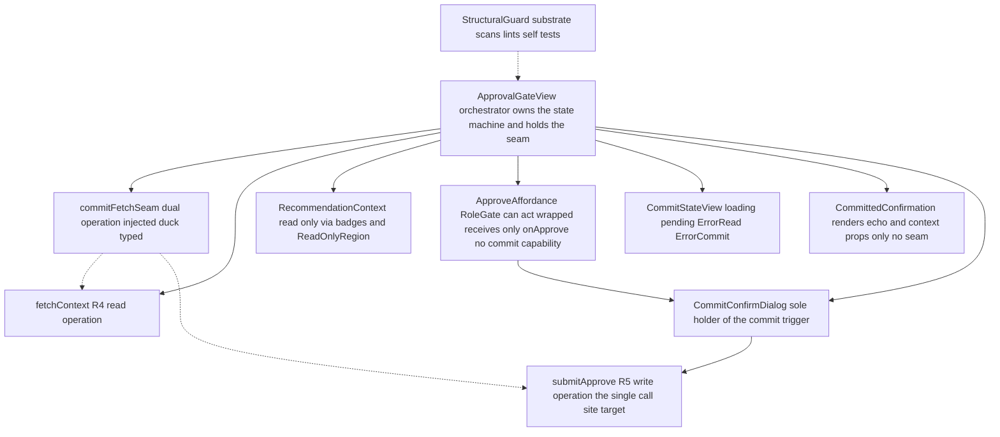

# Logical Components — `ui-approval-gate` (U7)

**Stage**: BUILD → NFR Design (per-unit) · **Unit**: U7 `ui-approval-gate` · C-cluster UI · Phase 1 · **Depth**: COMPREHENSIVE · **Date**: 2026-07-09
**Built ON** the frozen FD inventory + the approved NFR Requirements (nineteen `NFR-AG-*`; Fold-1..4) + the NFR-Design patterns (§P1..§P10) — **re-opening none**. The **exact prop shapes** below are what enforce the by-construction guarantees (Q2/Q3/Q4-A). **Q1–Q4 all A.**

---

## 1. Components C1–C9 (responsibilities · ownership · prop shapes)

### C1 — `ApprovalGateView` (stateful orchestrator; the ONLY stateful component)
- **Responsibility**: owns the state machine (P8) `loading → ready(idle) → confirming → submitting → {committed | ErrorCommit}` + `pending` + `ErrorRead`; runs the initial R4 read; constructs the callbacks and passes state + callbacks to presentational children.
- **Owns / holds**: the injected `commitFetchSeam` instance (the **sole** holder of the transport-bearing seam) and the machine. Constructs `onApprove = () => setConfirming(true)` and `onConfirm = () => { setSubmitting(); seam.submitApprove(recommendationId)… }`, and passes **`onConfirm` ONLY to `CommitConfirmDialog`**.
- **Props**: `{ commitFetchSeam, applicationId, testid = 'approval-gate' }` — the seam **injected** as a prop (sibling convention).

### C2 — `commitFetchSeam` (own-local dual-operation seam)
- **Responsibility**: build + normalize R4/R5; `createCommitFetch(transport)` → `{ fetchContext(applicationId), submitApprove(recommendationId) }` (both reject with a WIRE-1 envelope); `buildMemoRequest` / `buildCommitRequest` (P3) + `normalizeError` (P4).
- **Owns**: request builders. Makes **no** real network call (transport injected). **Imports no sibling seam** (REFNOTOWN-1).

### C3 — `CommitStateView` (presentational)
- **Responsibility**: the non-`ready`/non-`committed` renders — `loading`, `pending` (no affordance), and the `ErrorRead`/`ErrorCommit` envelope render (P4: `message` visible / `code` testid-hidden / `detail` never); `Retry` invokes an `onRetry` callback (re-runs R4 read, P6).
- **Props**: `{ state, error = null, onRetry = null }`. No seam; presentational.

### C4 — `RecommendationContext` (presentational)
- **Responsibility**: read-only display of the recommendation being approved via `RecommendationBadge` + `ConfidenceBadge` inside the frozen `ReadOnlyRegion` (engine-attributed, advisory).
- **Props**: `{ recommendation, confidence }`. No seam; presentational.

### C5 — `ApproveAffordance` (presentational; **no commit capability** — Q2-A / ND-Fold-1)
- **Responsibility**: the approve button, wrapped in `<RoleGate can="act">` (P2); `onClick` → `onApprove()` (opens the confirm dialog).
- **Props**: **`{ onApprove }`** plus purely-cosmetic display props (the recommendation label it names the button with). **DOES NOT include** `submitApprove`, any seam instance, `onConfirm`, or a transport — so it **cannot** issue a commit. Carries a **header comment** (self-evidence-in-isolation, ND-Fold-1): "props `{ onApprove }` (+ cosmetic) only — no `submitApprove`/seam/`onConfirm`; opens the dialog, cannot commit."

### C6 — `CommitConfirmDialog` (presentational; **sole commit-trigger holder** — Q2-A / ND-Fold-2)
- **Responsibility**: the confirm step; its `Confirm` handler is the **single** `submitApprove` call site; `Cancel` → `ready(idle)`; rendering/canceling is a **pure client-side toggle** with no side effect (BR-AG-3 / AG-Fold-1).
- **Props**: **`{ onConfirm, onCancel, ...display }`** — `onConfirm` is the wired `submitApprove` invocation, supplied **only** here by `ApprovalGateView`. Carries a **header comment** marking it the sole commit-trigger holder / single call site.

### C7 — `CommittedConfirmation` (presentational; **no seam access** — Q3-A / ND-Fold-3)
- **Responsibility**: the success state; renders `action=approve` + `recommendation_id` + `underwriter_id` (echo) + the recommendation value (context in hand).
- **Props**: **`{ decision, context }` ONLY** — the `CommittedDecision` echo + the R4 context. **No seam reference**; a re-fetch is structurally impossible (ND-Fold-3). Carries a header comment stating "props `{ decision, context }` only — no seam; renders from the echo, never re-fetches."

### C8 — `StructuralGuard` (test substrate)
- **Responsibility**: one substrate grouping the structural/lint checks + detector self-tests (P9): testid convention, no-`.ts`/`.tsx`, no-backend-import, no-`ui-queue`/`ui-memo-view`-import, no-router-import, **no-`createCommitFetch`-import in presentational components** (ND-Fold-3), bounded-fetch, single-call-site scan (P1), `FORBIDDEN_TERMS` reuse lints (advisory-vocabulary **unmodified**, Q4-A).
- **Owns**: the guard suite.

### C9 — `approvalGate/copy.js` (approval-local UI strings)
- **Responsibility**: local UI chrome; **advisory-clean** (all 14 strings, NFR-AG-Fold-2 — no literal `decision`/`approved`/`declined`/bare `DECLINE`); LINT-SUBJECT.
- **Owns**: the local copy. No display-enum labels (those are looked up by value via the reused badges).

---

## 2. Component-relationship Mermaid — single-call-site as a visible graph property

Validated against the 7 rules (alphanumeric node IDs; every label double-quoted; **no hyphens, semicolons, colons, parentheses, special characters**; balanced blocks; **rectangle-only**). **Solid = invokes / data-flow; dashed = provides / scans.** The **only solid inbound edge into `SubmitApprove` originates from `Dialog`** — the single-call-site guarantee, structural.

### Text alternative (always included)
- `ApprovalGateView` (C1) holds the injected `commitFetchSeam` (C2) and **invokes `fetchContext`** for the initial R4 read (and for `ErrorRead` Retry — both View-owned).
- The **only solid inbound edge into `submitApprove` is `Dialog --> SubmitApprove`** — `CommitConfirmDialog` (C6) is the **sole** commit-trigger holder; its `Confirm` handler is the single call site.
- `ApproveAffordance` (C5) is rendered by the View and **only opens the dialog** (`Affordance --> Dialog`); it has **no edge to `SubmitApprove`** — a premature commit is structurally unwritable there.
- `CommittedConfirmation` (C7) is rendered by the View from props only — **no edge to the seam**.
- Dashed = the seam **provides** both operations; the **StructuralGuard** (C8) scans the source tree (single-call-site scan, no-import guards, lints).

---

## 3. Reference-not-own check (three relationships kept distinct — the ui-memo-view precedent)

| Relationship | Dependency | Evidence |
|---|---|---|
| **REUSED (composed, not modified)** | ui-shell `RoleGate` / `AppFrame` / `Panel` / `ReadOnlyRegion` / `RecommendationBadge` / `ConfidenceBadge` / `shell/copy`+`FORBIDDEN_TERMS` / `shell/session` (`RoleContext`/`useCurrentRole`) / testid convention | imported + composed; **no `src/shell` edit**; `RoleContext` stub is RBAC-1's injection point; `ReadOnlyRegion` + badges compose in C4; `RoleGate` composes in C5 (first real use) |
| **MIRRORED (convention, NOT imported)** | ui-queue / ui-memo-view `fetchSeam` + `StructuralGuard` + testid-lint conventions | C2/C8 re-realize the pattern locally; REFNOTOWN-1 `noUiQueueImport`/`noMemoViewImport` guards enforce the non-import |
| **CONSUMED BY SHAPE (values, not code)** | WIRE-1 R4 `MemoView` + R5 request/`CommittedDecision` + §4 envelope; auth-rbac `Role`/`RBAC_COMMIT`; audit-store `CommittedDecision`/`CommitAction` | seam builders (C2) + confirmation (C7) key on the exact wire values; route impl deferred to Build & Test (SCOPE-1); the real gate is the server's (AUTHZ-1) |

**None modified.** The unit owns **no** authorization decision, **no** override (U8), **no** persistence (audit-store's).

---

## 4. Component → target coverage (no orphan)

| Target | Component(s) | Pattern |
|---|---|---|
| NFR-AG-NOFINAL-1 / CONFIRM-1 / CANCEL-1 | C1, C5, C6 | P1 |
| NFR-AG-RBAC-1 | C5 (+ ui-shell `RoleGate`) | P2 |
| NFR-AG-BODY-1 / SCOPE-APPROVE-1 | C2, C5 | P3 |
| NFR-AG-ERROR-1 | C3 | P4 |
| NFR-AG-NOREFETCH-1 | C7 | P5 |
| NFR-AG-RECOVERY-1 | C1, C3 | P6 |
| NFR-AG-FETCH-1 | C1, C2 | P7 + P8 |
| NFR-AG-COPY-1 / ADVISORY-1 / NAMESPACE-1 / TESTID-1 / NOTS-1 / REFNOTOWN-1 | C8 (+ C9) | P9 |
| NFR-AG-PERF-1 / A11Y-1 / SCOPE-1 | C1..C9 (observed / governance) | P10 |

**All nineteen `NFR-AG-*` targets covered; no orphan.**

---

## 5. Settled items held (not re-opened)
- The **frozen FD** (BR-AG-1..11 + inventory + state machine incl. split `ErrorRead`/`ErrorCommit` + AUTHZ-1 note) and the approved NFR Requirements (19 `NFR-AG-*` + Fold-1..4) are the substrate.
- **The by-construction trio (Q2/Q3/Q4-A)** is realized by **prop shape**: C5 `{ onApprove }` only · C6 sole `onConfirm` holder · C7 `{ decision, context }` only · C2 `buildCommitRequest(recommendationId)` only — each backed by a header comment (self-evidence) + a StructuralGuard/teeth regression guard.
- **ui-shell (frozen)** reused, not modified; **ui-queue / ui-memo-view (frozen)** mirrored, not imported; **WIRE-1** consumed by shape, route impl deferred to Build & Test.
- **Deferred**: aesthetic token values; confirm-dialog a11y polish (focus-trap / Escape — Q6-A recorded for Code-Gen); state-holding mechanics (hook/reducer); bundler/deploy topology → NFR-Design realization at Code-Gen / `deploy-config` (P2). **Infrastructure Design** for `ui-approval-gate` **not pre-committed** (likely a logged SKIP — source-level view; Vercel topology is `deploy-config` P2) — assessed at that stage.
