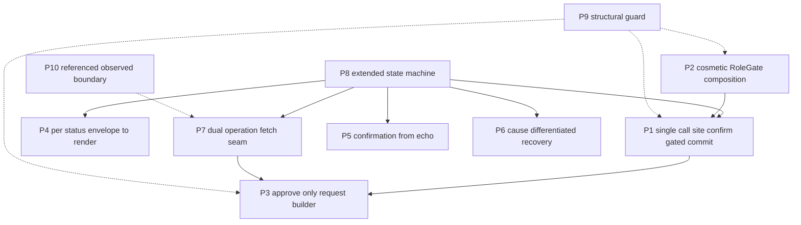

# NFR Design Patterns — `ui-approval-gate` (U7)

**Stage**: BUILD → NFR Design (per-unit) · **Unit**: U7 `ui-approval-gate` · C-cluster UI · Phase 1 · **Depth**: COMPREHENSIVE · **Date**: 2026-07-09
**Built ON** the frozen FD (**BR-AG-1..11**, inventory, the full state machine incl. split `ErrorRead`/`ErrorCommit`, the AUTHZ-1 defense-in-depth note) **and** the approved NFR Requirements (**nineteen `NFR-AG-*` targets**; dual-operation single-double; **NFR-AG-Fold-1..4**) — **re-opening neither**. One section per pattern, each **structurally** meeting its target(s) + traced. **Advisory-only; no LLM; no live backend** (R4/R5 doubled). Tier convention inherited (Vitest + RTL + jsdom · ESLint over the one `FORBIDDEN_TERMS` · file/import scans · detector self-tests). **Q1–Q4 all A.**

> **Reference-not-own (stated once, upheld everywhere).** No `ui-approval-gate` component **modifies** `ui-shell` (frozen — copy/`FORBIDDEN_TERMS`/`RoleGate`/`ReadOnlyRegion`/badges/`RoleContext`/testid **reused**), **imports** `ui-queue`/`ui-memo-view` (frozen — their fetchSeam/StructuralGuard/testid-lint **mirrored, not imported**), or authors the wire (WIRE-1 R4+R5 **by shape**; real wiring is the composition root's). The unit owns **no** authorization decision (`RoleGate` cosmetic; AUTHZ-1 is the server's), **no** override (U8), **no** persistence (audit-store's).

> **ND-D-Fold.** `commitFetchSeam` is a **duck-typed injected seam** (no-TS React, no interface construct) — contract self-documented via JSDoc (`fetchContext(applicationId)`→`MemoView`; `submitApprove(recommendationId)`→`CommittedDecision`; both reject with `{error:{code,message,detail}}`) **plus the single capturing double** as the worked example.

---

## §P1 — SingleCallSiteConfirmGatedCommitPattern → NFR-AG-NOFINAL-1 + NFR-AG-CONFIRM-1 + NFR-AG-CANCEL-1 — **THE LOAD-BEARING PATTERN**

**The by-construction guarantee (Q2-A) — the actual prop mechanism, not just "single call site":**

- **`ApproveAffordance` — what its props DO and DO NOT include.** Its prop set is **`{ onApprove }`** plus purely-cosmetic display props (the recommendation value/label it labels the button with). It receives **no `submitApprove`, no seam instance, no `onConfirm`, no transport** — nothing that can issue a commit. Its `onClick` calls **`onApprove()`**, whose only effect (wired by `ApprovalGateView`) is `setConfirming(true)` — it **opens the confirm dialog**. Because the commit-triggering capability is **absent from its props**, a developer **cannot write** a premature commit inside `ApproveAffordance` without first **adding a new prop** — an obvious, reviewable change that would not pass review silently. **(ND-Fold-1)** `ApproveAffordance` carries a **header comment** (the frozen `NarrativeRegion`/`ReadOnlyRegion` self-evidence convention) stating "props `{ onApprove }` (+ cosmetic) only — no `submitApprove`/seam/`onConfirm`; opens the dialog, cannot commit", so the guarantee is **self-evident when reading the component in isolation**.
- **`CommitConfirmDialog` — the SOLE commit-trigger holder.** Its prop set is **`{ onConfirm, onCancel, ...display }`**, where **`onConfirm`** is the wired `submitApprove` invocation (supplied only here by `ApprovalGateView`). Its `Confirm` handler is the **single call site** of the commit; `Cancel` calls `onCancel()` (→ `ready(idle)`), and rendering/canceling the dialog is a **pure client-side toggle** with **no** fetch/commit/mutation beyond the local flag (BR-AG-3 / AG-Fold-1). **(ND-Fold-2)** it carries a **header comment** marking it the **sole commit-trigger holder** — its `onConfirm` is the single call site. `ApprovalGateView` constructs the `onConfirm` handler (which sets `submitting` and calls `seam.submitApprove`) and passes it **only** to this dialog.
- **The result** is a **visible graph property** (§11 + `logical-components.md §5`): the only inbound invocation edge into `submitApprove` originates from `CommitConfirmDialog`. Mirrors ui-memo-view's `StructuralIsolationCompositionPattern` — the design is the guarantee; the tests are the regression guard on top.

**Meets the targets** — (NOFINAL-1) a StructuralGuard scan confirms `submitApprove` has **exactly one** call site (the confirm handler); mount / R4 read / `confirming`-toggle issue no POST; detector self-test. (CONFIRM-1, teeth) `Approve`-click → **`submitApprove.calls.length === 0` AND `fetchContext.calls.length === 1`** (Fold-1 cross-guard); only `Confirm` → `=== 1`. (CANCEL-1, teeth) open + `Cancel` → **both** counts unchanged, context identical, state `ready(idle)`.
**Tier**: structural + component (teeth). **Rigor**: **full (highest)**.

## §P2 — CosmeticRoleGateCompositionPattern → NFR-AG-RBAC-1
**Pattern (first real `RoleGate` use).** `ApproveAffordance` is wrapped in `<RoleGate can="act">` (frozen ui-shell), which reads the current Role **internally** via `useCurrentRole()` (no `role` prop) and renders children for `underwriter` (`act:true`), else the `fallback` for `auditor`/`admin`/`null`. **Cosmetic only** — imports no backend, calls no authz function; AUTHZ-1 (`DecisionCommitService`) is the real gate. Explicit contrast with ui-queue/ui-memo-view (no `RoleGate` — `RoleInvariantRenderingPattern`).
**Meets the target** (RBAC-1): (a) structural — no backend import / no authz call (StructuralGuard); (b) RTL stub `RoleProvider` over **all three roles + null (Fold-3)** — `underwriter` → affordance present; `auditor`/`admin`/`null` → absent.
**Tier**: structural + component. **Rigor**: full.

## §P3 — ApproveOnlyRequestBuilderPattern → NFR-AG-BODY-1 + NFR-AG-SCOPE-APPROVE-1
**Pattern (by-construction — Q4-A).** `buildCommitRequest(recommendationId)` takes **only** `recommendationId` and returns the literal `{ method:'POST', path:'/recommendations/${recommendationId}/commit', body:{ action:'approve' } }`. It has **no `reason` and no `underwriter_id` parameter**, so it **structurally cannot** emit either. Approve-only + session-derived-committer (WIRE1-Fold-1 / AG-Fold-3) are enforced by the **signature**, not discipline.
**Meets the targets**: (BODY-1) the body **deep-equals** `{ action:'approve' }` (no `underwriter_id`, no `reason`); `recommendation_id` in the path. (SCOPE-APPROVE-1) no override control / no reason input in the tree.
**Tier**: unit + structural. **Rigor**: full.

## §P4 — PerStatusEnvelopeToRenderPattern → NFR-AG-ERROR-1
**Pattern.** Extends the sibling `ErrorEnvelopeToRenderPattern` for the **four-status table**. `CommitStateView` maps the WIRE-1 envelope `{error:{code,message,detail}}` to the correct state — **200** → committed (via `CommittedConfirmation`); **403** → not-permitted; **409** → already-committed/conflict; **400 & 422** → generic invalid — with uniform discipline: `message` visible (`approval-error-message`), `code` testid-only hidden (`approval-error-code`), `detail` **never** rendered.
**Meets the target** (ERROR-1): table-driven RTL, each status programmed on the double; DOM scan finds `detail` nowhere.
**Tier**: component (table-driven) + structural. **Rigor**: full.

## §P5 — ConfirmationFromEchoPattern → NFR-AG-NOREFETCH-1
**Pattern (by-construction — Q3-A).** `CommittedConfirmation`'s props are **`{ decision, context }` ONLY** — the R5 `CommittedDecision` echo + the R4 context. It holds **no** seam reference, so a re-fetch is **structurally impossible** (ND-Fold-3: the transport-bearing seam is held only by `ApprovalGateView`; the pure builders perform no I/O; a StructuralGuard confirms presentational components don't import `createCommitFetch`). It renders `action=approve` + `recommendation_id` + `underwriter_id` (echo) + the recommendation value (context in hand).
**Meets the target** (NOREFETCH-1, teeth): after a successful commit, **both** `fetchContext.calls.length` and `submitApprove.calls.length` stay unchanged (`1` and `1`); no further transport call.
**Tier**: component (teeth). **Rigor**: full.

## §P6 — CauseDifferentiatedRecoveryPattern → NFR-AG-RECOVERY-1
**Pattern.** Distinct from the sibling single-cause retry. `ErrorRead`'s `Retry` re-issues `fetchContext(same applicationId)`; `ErrorCommit` returns the machine to `ready(idle)` with **no** automatic `submitApprove` — a fresh `Approve → Confirm` cycle is required. Two separate recovery legs (the FD split `ErrorRead`/`ErrorCommit`).
**Meets the target** (RECOVERY-1, teeth): (a) `ErrorRead` Retry → exactly one further `fetchContext`, recorded arg === X (`fetchContext.calls.length === 2`); (b) `ErrorCommit` → `ready(idle)`, `submitApprove.calls.length` stays `1`.
**Tier**: component (teeth). **Rigor**: full.

## §P7 — DualOperationFetchSeamPattern → NFR-AG-FETCH-1 (seam) + NFR-AG-BODY-1 (builder) + NFR-AG-PERF-1 (bounded)
**Pattern.** An **own-local thin module `approvalGate/commitFetchSeam`** with **two** operations — `fetchContext` (R4 read) + `submitApprove` (R5 write) — created by `createCommitFetch(transport)`; both **injected** (the factory closes over the injected `transport`), duck-typed (ND-D-Fold). Production wires the real transport at the composition root; tests inject the **single capturing double** with **two independently-counted spies** (Fold-1, under the exact seam names — never a shared generic `calls`). **Mirrors** the sibling `fetchSeam` pattern **without importing** it. Bounded: R4 one resource, R5 one commit (no list path).
**Meets the target** (FETCH-1): the seam is injected, never hard-wired; per-operation counting supports the teeth. (BODY-1) contains the P3 builder. (PERF-1) structural bounded-fetch scan.
**Tier**: component + structural.

## §P8 — ExtendedStateMachinePattern → NFR-AG-FETCH-1 (states + transitions) *(ND-Fold-A)*
**Pattern.** `ApprovalGateView` **owns** the machine (a responsibility; hook/reducer mechanics → Code-Gen, mirroring the sibling `FourStateMachinePattern`): `loading → ready(idle) → confirming → submitting → {committed | ErrorCommit}`, plus `pending` and `ErrorRead`. Sub-components are **presentational**, receiving state + callbacks as props — the View is the single source of transition truth, and the sole holder of the transport-bearing seam.
**Meets the target** (FETCH-1): per-state renders + **ONE consolidated transition test (Fold-4)** on the same dual-operation double covering all legs incl. both split-error recovery paths.
**Tier**: component.

## §P9 — StructuralGuardPattern → NFR-AG-COPY-1 + ADVISORY-1 + NAMESPACE-1 + TESTID-1 + NOTS-1 + REFNOTOWN-1 *(one substrate; ND-Fold-B)*
**Pattern.** **One `StructuralGuard` substrate** grouping independent structural checks, each with a **detector self-test** (non-vacuous), mirroring the sibling single-substrate convention: **testid** convention (`approval-<element>-<purpose>`); **no-`.ts`/`.tsx`**; **no-backend-import**; **no-`ui-queue`-import**; **no-`ui-memo-view`-import**; **no-router-import**; **no-`createCommitFetch`-import in presentational components** (ND-Fold-3); **bounded-fetch** (P7); the **single-call-site scan** (P1 / NOFINAL-1); the **`FORBIDDEN_TERMS` reuse** lints (`no-inline-label` + `advisory-vocabulary`). **Q4-A property (named)**: the `advisory-vocabulary` lint is applied **UNMODIFIED** (single `FORBIDDEN_TERMS`, no carve-out) because the copy honors the reserved-word constraint **semantically** — no literal `decision` token (NFR-AG-Fold-2).
**Meets the targets**: COPY-1 (no-inline-label), ADVISORY-1 (advisory-vocabulary unmodified + `LINT_FORBIDDEN_TERMS === FORBIDDEN_TERMS`), NAMESPACE-1 (`FORBIDDEN_TERMS` collision guard + `COMMIT_ACTION_LABELS`), TESTID-1, NOTS-1, REFNOTOWN-1 — each + self-test.
**Tier**: structural / lint.

## §P10 — ReferencedObservedBoundaryPattern → NFR-AG-PERF-1 + NFR-AG-A11Y-1 + NFR-AG-SCOPE-1 *(soft / governance)*
- **PERF-1** — bounded (R4 one resource, R5 one commit; structural via P7/P9); latency/bundle observed, non-gating.
- **A11Y-1** — semantic markup + focusable `Approve`/`Confirm`/`Cancel`/`Retry`; **soft** (Q6-A of NFR-Req). The confirm-dialog **focus-trap** + **Escape-to-cancel** are **recorded NFR-Design→Code-Gen targets**, not Phase-1 gates. **Note**: the BR-AG-3 "cancelable" invariant stays **gated** as full-rigor teeth via CANCEL-1 (P1) — only the a11y polish is soft.
- **SCOPE-1** — governance/exclusion: patterns realize only `ui-approval-gate`'s behavior; **not** other UI units, backend internals, or the WIRE-1 route implementation; ui-shell mechanisms **reused, not modified**; the siblings' **mirrored, not imported**.
**Tier**: observed / soft / governance.

---

## §11 — Pattern-integration diagram

Validated before write (alphanumeric node IDs; every label double-quoted; **no hyphens, semicolons, colons, parentheses, special characters**; balanced blocks; **rectangle-only, no decision diamonds**). **Solid = depends-on / composes; dashed = scans / observes.** Text alternative follows.

### Text alternative (always included)
- The **extended state machine (P8)** is the hub: it depends on the **dual-operation fetch seam (P7)**, renders failures via the **per-status envelope pattern (P4)**, governs the commit via the **single-call-site confirm-gated pattern (P1)**, renders success via **confirmation-from-echo (P5)**, and recovers via **cause-differentiated recovery (P6)**.
- The **cosmetic RoleGate composition (P2)** wraps the approve affordance that **P1** governs (P2 → P1).
- Both **P1**'s confirm handler and **P7**'s seam use the **approve-only request builder (P3)** (P1 → P3, P7 → P3).
- Dashed = substrate/boundary: the **StructuralGuard (P9)** scans/lints P1 (single call site), P2 (no authz), P3 (builder); the **referenced/observed boundary (P10)** observes the bounded seam (P7).

---

## §12 — Traceability (pattern → target → tier → rigor)

| Pattern | Target(s) | Tier | Rigor |
|---|---|---|---|
| **SingleCallSiteConfirmGatedCommitPattern** | **NOFINAL-1, CONFIRM-1, CANCEL-1** | structural + component (teeth) | **full (highest)** |
| CosmeticRoleGateCompositionPattern | RBAC-1 | structural + component | full |
| ApproveOnlyRequestBuilderPattern | BODY-1, SCOPE-APPROVE-1 | unit + structural | full |
| PerStatusEnvelopeToRenderPattern | ERROR-1 | component + structural | full |
| ConfirmationFromEchoPattern | NOREFETCH-1 | component (teeth) | full |
| CauseDifferentiatedRecoveryPattern | RECOVERY-1 | component (teeth) | full |
| DualOperationFetchSeamPattern | FETCH-1, BODY-1, PERF-1 | component + structural | full / soft |
| ExtendedStateMachinePattern | FETCH-1 | component | full |
| StructuralGuardPattern | COPY-1, ADVISORY-1, NAMESPACE-1, TESTID-1, NOTS-1, REFNOTOWN-1 | structural / lint | full / medium |
| ReferencedObservedBoundaryPattern | PERF-1, A11Y-1, SCOPE-1 | observed / soft / governance | soft / governance |

**All nineteen `NFR-AG-*` targets covered; no orphan.** (NOFINAL/CONFIRM/CANCEL→P1, RBAC→P2, BODY→P3+P7, SCOPE-APPROVE→P3, ERROR→P4, NOREFETCH→P5, RECOVERY→P6, FETCH→P7+P8, COPY/ADVISORY/NAMESPACE/TESTID/NOTS/REFNOTOWN→P9, PERF/A11Y/SCOPE→P10.)
