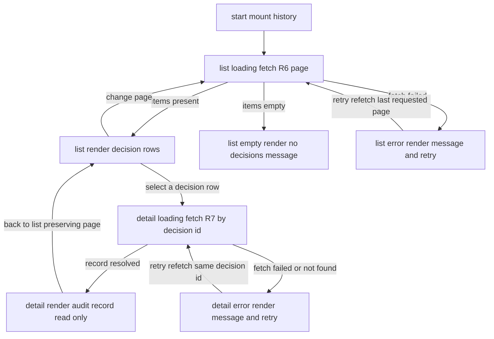
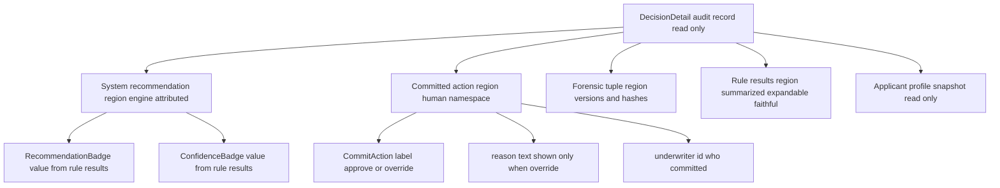

# Business Logic Model — `ui-history` (U9)

**Stage**: BUILD → Functional Design (per-unit) · **Unit**: U9 `ui-history` · **Date**: 2026-07-14 · Story **US-UI-6**.
**Nature**: `ui-history` has **no domain logic** — its only "logic" is a **master-detail presentation/fetch lifecycle** over WIRE-1 **R6** (paged list) and **R7** (by-id detail), plus the **namespace-distinct composition** of the `AuditRecord` detail (system recommendation vs human committed action). This model pins two technology-agnostic flows: **(1)** the list↔detail fetch/render-state machine (with page-position preserved across the detail excursion, HIST-Fold-1), and **(2)** the detail composition (with the system region and the human region as **structurally isolated** nodes, BR-HIST-2). All mechanics (fetch-hook shape, expand/collapse widget, token values, field layout) are deferred to NFR-Design / Code-Gen.

---

## 1. List / detail fetch-render-state machine (the master-detail addendum)

`HistoryView` owns a render state `∈ {listLoading, list, listEmpty, listError, detailLoading, detail, detailError}` (`domain-entities.md §3`). An R6 fetch (list) and an R7 fetch (detail-by-id) are the transition triggers. The list `page` and `items` live in `HistoryView` state and are **preserved across the detail excursion** — **Back** returns to the same list page **without a refetch** (HIST-Fold-1, the position-preserving discipline the frozen `QueueView.jsx` established). **404 on R7 is surfaced through the generic `detailError`** (HIST-Fold-3) — no special not-found state.



**Text alternative (always included)** — the state machine, node by node:

- **Start → List loading**: on mount, `HistoryView` sets `state = listLoading` and fetches R6 for page 1 (`GET /decisions?page=1&size=DEFAULT`) via the injected local `historyFetchSeam.fetchList`.
- **List loading → List / List empty (items branch)**: the fetch resolves 2xx with a list wrapper; `items.length` selects the edge — `items` non-empty → `state = list` (render `HistoryList` + `HistoryPagination`); `items: []` → `state = listEmpty` (the page-level "no decisions yet" message, BR-HIST-8). This is the `ui-queue` `empty` derivation (array length), not `ui-memo-view`'s `status` discriminator.
- **List loading → List error**: the R6 fetch fails (any non-2xx per WIRE-1 §4, or a transport error) → `state = listError`; render `error.message` (visible) + `error.code` (testid-only) + a **Retry**. The local `fetchSeam` guarantees a well-formed `{error:{code,message,detail}}` envelope (the mirrored `normalizeError` convention) so `HistoryStateView` never unpacks a raw exception.
- **List error → List loading (Retry)**: activating Retry re-enters `listLoading` and re-fetches R6 for the **last-requested page** — position-preserving (HIST-Fold-1 / BR-HIST-9), the `QueueView.jsx` Fold-B discipline.
- **List → List loading (change page)**: a pagination control issues a bounded single-page R6 fetch for the chosen page (PERF-1) — never an all-rows path.
- **List → Detail loading (select a row)**: activating a `DecisionSummary` row calls `onSelect(decision_id)` and fetches R7 by that id (`GET /decisions/{decision_id}`) — the single-resource-by-id shape `ui-memo-view` established (mirror-not-import). The list `page` and `items` are **retained** in `HistoryView` state.
- **Detail loading → Detail**: the R7 fetch resolves 2xx with an `AuditRecord` → `state = detail`; render the **read-only** detail composition (§2) + a **Back** control.
- **Detail loading → Detail error (incl. 404)**: the R7 fetch fails — any non-2xx **including 404 `not_found`** (an invalid/non-existent `decision_id`), or a transport error → `state = detailError`; render `error.message` + a Retry. 404 is handled **generically** — no dedicated not-found branch (HIST-Fold-3).
- **Detail error → Detail loading (Retry)**: activating Retry re-enters `detailLoading` and re-fetches R7 for the **same `decision_id`** (BR-HIST-9).
- **Detail → List (Back, preserving page)**: activating **Back** returns to `state = list` at the **same page** with the **same items** — **no refetch** — because `HistoryView` holds `{ page, items }` (HIST-Fold-1).

> Only `listLoading` / `detailLoading` perform I/O. `list` / `listEmpty` / `listError` / `detail` / `detailError` are terminal until an explicit user action (Retry, page change, row select, Back). There is **no** auto-refresh/polling in Phase 1, and **no** outward action is emitted from any state (view-only). There is **no write path** from any state (INV-FAITHFUL).

---

## 2. Detail composition (the namespace-distinct read-only-separation addendum)

On `detail`, `HistoryView` renders `DecisionDetail`, which composes **five structurally separate read-only regions**. The **system-recommendation region and the human-committed-action region are distinct, isolated nodes** — never nested or interleaved — the visual/structural expression of the advisory namespace-distinctness (BR-HIST-2). Each region reads **only** its own slice of the `AuditRecord`.



**Text alternative (always included)** — the composition, node by node:

- **`DecisionDetail` (read-only)** renders five sibling regions from the one `AuditRecord`, with **no** edit affordance and **no** mutation seam (INV-FAITHFUL / BR-HIST-3).
- **`SystemRecommendationRegion` (engine-attributed)** composes the **frozen `ReadOnlyRegion`** (`aria-readonly`, `testid = history-detail-system-region`) around a **`RecommendationBadge`** (`value = audit_tuple.rule_results.recommendation`) + **`ConfidenceBadge`** (`value = audit_tuple.rule_results.confidence`), framed via history-local chrome as **attributable to the deterministic engine** (the **system**, advisory namespace). These values render **only here** (BR-HIST-2).
- **`CommittedActionRegion` (human namespace)** is a **sibling of** — never a descendant of — the system region. It renders the human `committed_decision.action` via `COMMIT_ACTION_LABELS` (`Approve`/`Override`), the `reason` **only when `action === 'override'`** (present/non-blank), and `underwriter_id` (WHO). The human `override` is **never** rendered as the system `DECLINE-RECOMMEND` (BR-HIST-2/6). Its heading realizes the CON-BR4 "decision" concept per HIST-Fold-4 (system-output-scoped advisory lint).
- **`ForensicTupleRegion`** renders the forensic/replay fields read-only: `rulebook_version`, `model_version`, `engine_version`, `memo_hash`, `content_hash`, the tuple `timestamp`, and `status` (display-only). `status` gets **no** superseded branch and `supersedes_decision_id` **no** dereference (write-once `active`; always `null` in Phase 1/2 — BR-HIST-11 / HIST-Fold-3).
- **`RuleResultsRegion`** renders `audit_tuple.rule_results` **faithfully** — every entry preserved, backend order preserved — at a **summarized/expandable** (progressive-disclosure) level; the concrete expand/collapse widget is deferred to NFR-Design (HIST-Fold-2 / BR-HIST-5). **Nothing is dropped** (faithfulness forbids lossy truncation).
- **`ProfileSnapshotRegion`** renders `applicant_profile_snapshot.profile` (the verbatim persisted input) **read-only**; its demographic fields are **displayed forensic input, not a scored feature** (no bias-swap concern).

> **Namespace-distinctness invariant (testable, BR-HIST-2)**: `history-detail-system-region` and `history-detail-human-region` are **distinct DOM nodes**, neither an ancestor of the other; the recommendation/confidence badges appear inside `history-detail-system-region` and the human `action`/`reason` inside `history-detail-human-region`, never crossed. This is the concrete display-context expression of the advisory-vs-committed namespace separation.

---

## 3. Data-flow summary (read-only, one direction, two reads)

```text
WIRE-1 R6  (mocked in tests, via the injected local historyFetchSeam.fetchList)
   -> { items: DecisionSummary[], page: { page, size, total } } | { error:{code,message,detail?} }
   -> HistoryView (state machine section 1; items.length branch; page preserved in state)
      -> list      : HistoryList (rows: human action label + timestamp; onSelect(decision_id)) + HistoryPagination
      -> listEmpty : "no decisions yet" page-level message
      -> listError : error.message + Retry (re-fetch last-requested page, section 1)

  (select a row) -> WIRE-1 R7 (mocked, via historyFetchSeam.fetchDetail(decision_id))
   -> AuditRecord | { error:{code,message,detail?} }
   -> HistoryView
      -> detail      : DecisionDetail (section 2)
                       + SystemRecommendationRegion  (rule_results.recommendation / .confidence, read-only, engine-attributed)
                       + CommittedActionRegion        (committed_decision.action / reason / underwriter_id, human namespace)
                       + ForensicTupleRegion          (rulebook / model / engine version + memo_hash / content_hash + status)
                       + RuleResultsRegion            (rule_results, faithful, summarized/expandable, order preserved)
                       + ProfileSnapshotRegion        (applicant_profile_snapshot.profile, read-only)
      -> detailError : error.message + Retry (re-fetch same decision_id; 404 generic, section 1)

  (Back) -> list at preserved page (no refetch)
   -> (no outward action emitted; NO write path — view only)
```

No write path, no mutation, no commit — the history view is a **pure read view** over an immutable audit trail (advisory-only + INV-FAITHFUL upheld: it **displays** both a system `Recommendation` and a human `CommittedDecision` in structurally distinct read-only regions, and finalizes / alters nothing; a `CommittedDecision` is created only by the underwriter commit path in U7/U8, never here). The namespace-distinct region separation is the UI's direct respect for the advisory-vs-committed boundary (WIRE-1 §1 / CON-BR4).

---

## 4. Deferred to later stages (named, not designed here)

- **Fetch-hook mechanics** (which hook/store holds `{state, page, items, pageInfo, record, error}`), Retry debounce, request cancellation on rapid row switches, the real transport wiring behind the injected `fetchSeam` → NFR-Design / Code-Gen (mirrors the siblings' Fold; the real wiring is the composition root's concern).
- **The `rule_results` expand/collapse interaction** (the concrete progressive-disclosure widget, any windowing) → NFR-Design / Code-Gen; the FD pins only the **faithfulness rule + shape** (HIST-Fold-2 / BR-HIST-5) — no lossy truncation.
- **The advisory-lint scoping + final human-region heading wording** (system-output-scoped lint block for `src/history/**`, or a namespace-distinct heading avoiding the bare "decision" lexical token, **without** modifying frozen `shell`) → NFR-Design / Code-Gen (HIST-Fold-4 / BR-HIST-2).
- **Loading placeholder markup**, region layout, token/color values, the exact profile-snapshot field subset, the exact `history-testid-convention` regex (queue-family) → NFR-Design / Code-Gen (`ui-shell` tokens; values themselves deferred).
- **R6/R7 route implementation** (`backend/app/main.py`) → Build & Test integration (WIRE-1 §, not this unit); the view consumes the R6/R7 **contract shapes**, fetching mocked R6/R7 in tests.
- **Superseded/versioned decisions** (`status = superseded`, `supersedes_decision_id` dereference/linking) → the OOS-7 / Phase-3 seam, **named-not-designed** (BR-HIST-11 / HIST-Fold-3) — no premature handling for a state that cannot occur in Phase 1/2.
