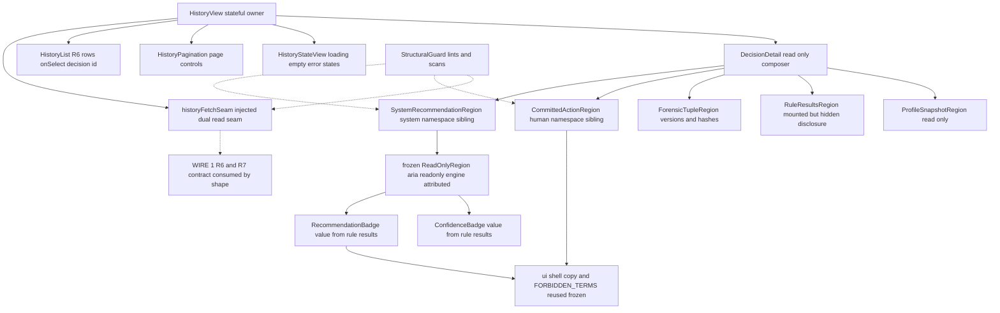

# Logical Components — `ui-history` (U9)

**Stage**: BUILD → NFR Design (per-unit) · **Unit**: U9 `ui-history` · C5 · Phase 1 · **Depth**: lighter (display) + INV-FAITHFUL + INV-NAMESPACE via StructuralGuard + focused teeth · **Date**: 2026-07-14.
**Built ON** the frozen FD (`domain-entities.md §4` / `frontend-components.md` inventory) **and** the approved NFR Requirements (seventeen `NFR-HIST-*` targets) + the NFR-Design patterns P1–P13 — **re-opening none**. Components live at `frontend/src/history/`; the StructuralGuard is a **test/lint substrate** (not a production component). **React + Tailwind, NO TypeScript.** Q1–Q4 all **A**.

> **Self-evidence convention (Q1-A / Q2-A / NFR-DESIGN-Fold-1)**: each namespace region **and** the fetch seam carry a **header comment** stating their by-construction restriction (the frozen `ReadOnlyRegion.jsx` / `queue/fetchSeam.js` precedent), so the isolation + no-write guarantees are legible **reading each module in isolation**, not only by tracing `HistoryView`/`DecisionDetail` or the StructuralGuard.

---

## 1. Components (responsibilities · ownership · by-construction prop/export shapes)

### C1 — `HistoryView` *(the only stateful component)*
- **Responsibility**: injects `historyFetchSeam`; holds `{state, page, items, pageInfo, record, error}`; **owns the master-detail machine** (P5) as a responsibility (Q4-A; hook/reducer → Code-Gen); **retains `{page, items}` across the detail excursion** so Back needs no refetch (P6); derives `listEmpty` from `items.length` (P7). Composes `HistoryList`+`HistoryPagination` (list) and `DecisionDetail` (detail); routes non-content states to `HistoryStateView`. Reads **no** Role, composes **no** `RoleGate`, imports **no** router (P11). Holds **no** write/commit reference (P3).
- **Prop shape**: `{ fetchSeam }` where `fetchSeam = { fetchList, fetchDetail }`.
- **Ownership**: owns.
- **Backs**: DUALREAD-1, STATEMACHINE-1, BACKPRESERVE-1, EMPTY-1, VIEWONLY-1(render).

### C2 — `historyFetchSeam` *(own local thin module; P3/P4)*
- **Responsibility**: the **read-only dual-read** seam. `createHistoryFetch(transport) → { fetchList(page,size), fetchDetail(decision_id) }`; `buildHistoryListRequest(page,size)` + `buildHistoryDetailRequest(decision_id)` emit **only** `{ method:'GET', path }`; `normalizeError(cause)` → `{error:{code,message,detail}}`. **Injected** into `HistoryView` via prop; tests inject a **capturing dual-read double** (Fold-A). **Duck-typed, no formal interface** (D-Fold). **Carries a header comment** (NFR-DESIGN-Fold-1) stating: READ-ONLY dual-read seam; exported surface is exactly the four read members; both builders emit only GET; **no request-body builder, no `submit*` — write structurally absent**. **Mirrors the sibling read seams WITHOUT importing.**
- **Export shape (by-construction, Q2-A)**: **exactly** `{ createHistoryFetch, buildHistoryListRequest, buildHistoryDetailRequest, normalizeError }` — **no** `buildCommitRequest`/`buildOverrideRequest`-analog, **no** `submit*`, **no** non-GET path.
- **Ownership**: owns the **seam interface**; real transport wiring deferred (composition root / Build & Test).
- **Backs**: FAITHFUL-1, DUALREAD-1, ERROR-1(retry), PERF-1(bounded).

### C3 — `HistoryList` *(presentational)*
- **Responsibility**: renders each `DecisionSummary` as a row (`history-row-<decision_id>`) showing the **human** `COMMIT_ACTION_LABELS[action]` + `timestamp`; a row calls `onSelect(decision_id)`. Preserves delivered order. **No** system recommendation in a row (R6 omits it — Q4-A of FD).
- **Prop shape**: `{ items, onSelect, testid }`.
- **Ownership**: owns. **Backs**: DUALREAD-1(select), TESTID-1.

### C4 — `HistoryPagination` *(presentational)*
- **Responsibility**: prev/next/page controls over `page.total`; a page change calls `onPageChange(next)` → bounded single-page R6 (PERF-1). Local history component (ui-shell frozen).
- **Prop shape**: `{ page, size, total, onPageChange, testid }`.
- **Ownership**: owns. **Backs**: PERF-1, TESTID-1.

### C5 — `HistoryStateView` *(presentational)*
- **Responsibility**: the non-content states — `listLoading`/`detailLoading` (placeholder), `listEmpty` ("no decisions yet", P7), `listError`/`detailError` (`message` visible / `code` testid-only / `detail` never; Retry per P8; 404 generic).
- **Prop shape**: `{ state, error, onRetry, testid }`.
- **Ownership**: owns. **Backs**: STATEMACHINE-1(states), EMPTY-1(render), ERROR-1, A11Y-1.

### C6 — `DecisionDetail` *(presentational read-only composer)*
- **Responsibility**: composes the five detail regions **as siblings** (the P2 sibling-composition point); passes each region **only** its own slice of the `AuditRecord`; **no edit affordance, no mutation seam** (FAITHFUL-1). **Header comment**: read-only composer; the five regions are siblings; system + human regions are distinct.
- **Prop shape**: `{ record, testid }`.
- **Ownership**: owns. **Backs**: SEPARATION-1(sibling composition), FAITHFUL-1(no edit).

### C7 — `SystemRecommendationRegion` *(presentational — SYSTEM namespace)*
- **Responsibility**: composes the **frozen `ReadOnlyRegion`** (`aria-readonly`) + `RecommendationBadge`/`ConfidenceBadge`, engine-attributed; the **sole** render site for `recommendation`/`confidence`. **Header comment (Q1-A)**: props `{recommendation, confidence, testid}` only — **no** action/reason/underwriterId prop or path; sole holder of the system recommendation.
- **Prop shape (by-construction)**: `{ recommendation, confidence, testid }` — **no human-namespace path**.
- **Ownership**: owns. **Backs**: SEPARATION-1(system node), COPY-1, TESTID-1.

### C8 — `CommittedActionRegion` *(presentational — HUMAN namespace)*
- **Responsibility**: renders `COMMIT_ACTION_LABELS[action]` + `underwriter_id`, and `reason` **iff** `action === 'override'` (P10); token-avoiding heading ("Underwriter's committed action" / "Committed outcome", Fold-D). **Header comment (Q1-A)**: props `{action, reason, underwriterId, testid}` only — **no** recommendation/confidence prop or path; sole holder of the human committed action.
- **Prop shape (by-construction)**: `{ action, reason, underwriterId, testid }` — **no system-namespace path**.
- **Ownership**: owns. **Backs**: SEPARATION-1(human node), REASON-1, COPY-1, TESTID-1.

### C9 — `ForensicTupleRegion` *(presentational)*
- **Responsibility**: read-only forensic/replay fields — `rulebook_version`, `model_version`, `engine_version`, `memo_hash`, `content_hash`, tuple `timestamp`, `status`. **`status` display-only**; **no** superseded branch, **no** `supersedes_decision_id` dereference (NOSUPERSEDE-1). Frames the record as immutable audit metadata.
- **Prop shape**: `{ auditTuple, contentHash, status, testid }` — **no** supersede path.
- **Ownership**: owns. **Backs**: NOSUPERSEDE-1, TESTID-1.

### C10 — `RuleResultsRegion` *(presentational)*
- **Responsibility**: faithful disclosure (P9) — renders **every** `rule_results` entry **mounted** (order preserved); collapse via `hidden`/`display:none` (a11y-tree-removing, no `aria-hidden`); keyboard-focusable `history-detail-ruleresults-toggle`. Owns its **local disclosure state** (view-local; mechanics → Code-Gen).
- **Prop shape**: `{ ruleResults, testid }`.
- **Ownership**: owns. **Backs**: RULERESULTS-1, A11Y-1, TESTID-1.

### C11 — `ProfileSnapshotRegion` *(presentational)*
- **Responsibility**: read-only `ApplicantProfileSnapshot` render (verbatim persisted input; demographics = displayed forensic input, **not** a scored feature — no bias-swap concern). Field subset → Code-Gen.
- **Prop shape**: `{ profile, applicationId, contentHash, testid }`.
- **Ownership**: owns. **Backs**: FAITHFUL-1(read-only), TESTID-1.

### C12 — `StructuralGuard` *(test/lint substrate — NOT a production component; Q3-A: one substrate)*
- **Responsibility**: groups independent checks, **each with a detector self-test**: `FORBIDDEN_TERMS` reuse lints (COPY-1 no-inline + ADVISORY-1 vocabulary); `history-testid-convention` lint incl. rows + the **two region testids** (TESTID-1); **no-`.ts`/`.tsx`** scan (NOTS-1); **no-router-import** + **no-`RoleGate`-import** scans (P11); the **NEW no-write-seam** scan (FAITHFUL-1 — zero `submit*`/non-GET builders, seam exports exactly the four read members); the **NEW no-superseded-branch** scan (NOSUPERSEDE-1); **bounded-fetch** scan (PERF-1). Mirrors the siblings' single substrate (convention, not imported).
- **Ownership**: owns (test/lint). **Backs**: COPY-1, ADVISORY-1, TESTID-1, NOTS-1, FAITHFUL-1(scan), NOSUPERSEDE-1, VIEWONLY-1(structural), PERF-1(bounding).

---

## 2. Component-relationship diagram (validated Mermaid — 7 rules, rectangle-only)

Validated before write: alphanumeric node IDs; every label double-quoted; **no hyphens, no semicolons, no bare colons, no parentheses, no other special characters** (underscore per the established convention); balanced blocks; **rectangle-only**. The **namespace separation is a visible graph property**: `SYS` and `HUM` are **sibling children of `DD`** with **no edge between them**; the recommendation/confidence nodes are descendants of `SYS` only.

### Text alternative (always included)
- **HistoryView** injects **historyFetchSeam** (the dual-read R6/R7 seam) and composes **HistoryList** + **HistoryPagination** (list), **HistoryStateView** (states), and **DecisionDetail** (detail).
- **DecisionDetail** renders **five siblings**: **SystemRecommendationRegion**, **CommittedActionRegion**, **ForensicTupleRegion**, **RuleResultsRegion**, **ProfileSnapshotRegion**.
- **Namespace separation (visible)**: **SystemRecommendationRegion** and **CommittedActionRegion** are **siblings** under DecisionDetail with **no edge between them**; SystemRecommendationRegion wraps the **frozen ReadOnlyRegion** holding **RecommendationBadge** + **ConfidenceBadge** — so recommendation/confidence are descendants of the **system** region only, never the human region.
- **RecommendationBadge** + **CommittedActionRegion** look up labels from the **reused frozen ui-shell copy / `FORBIDDEN_TERMS`** (never inlined).
- Dashed = substrate/boundary: **StructuralGuard** scans the two regions + the seam (incl. the no-write-seam + no-superseded scans); **WIRE-1 R6/R7** (external, real wiring deferred) is what **historyFetchSeam** consumes by shape.

---

## 3. Reference-not-own check (reused vs mirrored-not-imported vs consumed-by-shape — kept distinct)

| Concern | Owner | Relationship (this unit) |
|---|---|---|
| The history view behavior (dual read / master-detail / namespace-distinct detail / faithful disclosure) | **`ui-history`** (C1–C12) | ✅ **owns** |
| Shell primitives / copy / `FORBIDDEN_TERMS` / `RoleContext` / **`ReadOnlyRegion`** / `RecommendationBadge` / `ConfidenceBadge` / testid convention | **`ui-shell`** (frozen U10) | **REUSED** (imported + composed, **not modified**) |
| The fetchSeam / StructuralGuard / testid-lint **convention** | **all five sibling UI units** (frozen U5–U8) | **MIRRORED, NOT imported** (a convention re-expressed locally) |
| The frontend↔backend **wire** (R6/R7 routes, `DecisionSummary`, `AuditRecord`, session) | **WIRE-1** (composition-root) | **CONSUMED BY SHAPE**; the **real `historyFetchSeam` wiring** deferred (composition root / Build & Test) |
| The persisted **`AuditRecord`/`AuditTuple`/`CommittedDecision`** schemas | **`audit-store`** (frozen) | **CONSUMED BY SHAPE** (read); never re-declared |
| **R6/R7 route implementation** (`backend/app/main.py`) | Build & Test | not authored here |
| Authorization **decision** | **`auth-rbac`** (SEC-4) | gates nothing (VIEWONLY-1); no `RoleGate`, no authz call |
| Human commit / gate (the **write** path) | **`ui-approval-gate` (U7)** / **`ui-override-form` (U8)** | **no write path** (FAITHFUL-1); `ui-history` **reads** their records |
| Replay / superseded-versioning | rules-engine / CLI; **OOS-7 Phase-3 seam** | not done here (no route; NOSUPERSEDE-1) |
| Aesthetic token **values**, profile-snapshot field subset, `rule_results` disclosure widget markup, state hook mechanics | **Code-Gen** | direction/shape only; values + mechanics deferred |

## 4. Component → target coverage (no orphan)

| Target | Component(s) / item |
|---|---|
| NFR-HIST-COPY-1 | C7/C8 (label look-up) + copy.js + C12 (no-inline lint) |
| NFR-HIST-SEPARATION-1 | C6 (sibling composition) + C7 (system node, no human path) + C8 (human node, no system path) |
| NFR-HIST-ADVISORY-1 | C8/copy.js (token-avoiding wording) + C12 (advisory lint) |
| NFR-HIST-FAITHFUL-1 | C2 (read-only seam export shape) + C6/C11 (read-only, no edit) + C12 (no-write-seam scan) |
| NFR-HIST-DUALREAD-1 | C1 (owns both reads) + C2 (dual-read seam) + C3 (select) + C12 (no sibling/router import) |
| NFR-HIST-RULERESULTS-1 | C10 (mounted-but-hidden disclosure) |
| NFR-HIST-REASON-1 | C8 (conditional reason within the human region) |
| NFR-HIST-VIEWONLY-1 | C1 (render) + C12 (no-`RoleGate`/no-router scans) |
| NFR-HIST-EMPTY-1 | C1 (`items.length`) + C5 (empty render) |
| NFR-HIST-ERROR-1 | C5 (envelope render) + C1/C2 (per-op retry targeting) + C12 (detail-never structural) |
| NFR-HIST-TESTID-1 | C3–C11 + C12 (testid lint incl. two region testids) |
| NFR-HIST-NOSUPERSEDE-1 | C9 (status display-only) + C12 (no-superseded-branch scan) |
| NFR-HIST-NOTS-1 | whole unit + C12 (file scan) |
| NFR-HIST-STATEMACHINE-1 | C1 (machine) + C2 (seam) + C5 + C6 (renders) |
| NFR-HIST-BACKPRESERVE-1 | C1 (`{page, items}` retention, no refetch) |
| NFR-HIST-PERF-1 | C2 (bounded reads) + C4 (single page) + C12 (scan) — observed |
| NFR-HIST-A11Y-1 | C5/C7/C10 (semantic regions + `aria-readonly` + focusable controls) — soft |
| NFR-HIST-SCOPE-1 | governance / boundary (documented) |

**All seventeen targets + SCOPE covered; every component backs ≥1 target; no orphan.**

## 5. Settled items held (not re-opened)
- The **frozen FD** (BR-HIST-1..11 + inventory + flows) + the approved **NFR Requirements** (the seventeen `NFR-HIST-*` targets; Fold-A/B/C/D) are the substrate — components realize them.
- **ui-shell (frozen)** — copy/`FORBIDDEN_TERMS`/`RoleContext`/`ReadOnlyRegion`/badges/testid convention **REUSED, not modified**; `RoleContext` stub is the VIEWONLY-1 injection point; `ReadOnlyRegion`+badges composed in the system region.
- **The five sibling UI units (frozen)** — fetchSeam/StructuralGuard/testid-lint **MIRRORED as a convention, NOT imported**.
- **WIRE-1 / `audit-store`** — R6/R7 + `DecisionSummary`/`AuditRecord` **consumed by shape**; the **route implementation** stays deferred to Build & Test.
- **By-construction guarantees (Q1-A/Q2-A + NFR-DESIGN-Fold-1)** — the region prop signatures + the seam export shape + the region/seam **header comments** make mis-nesting and writes **unwritable-without-an-obvious-change**; the SEPARATION-1 DOM-containment test and the FAITHFUL-1 no-write-seam scan are **regression guards on design-level guarantees**.
- **Deferred to Code-Gen**: aesthetic token values, the exact profile-snapshot field subset, the `rule_results` disclosure widget markup + local disclosure-state mechanics, the state hook/reducer, request cancellation on rapid row switches, bundler/deploy topology → NFR-Design done; values/mechanics at Code-Gen. **Infrastructure Design** for `ui-history` not pre-committed (likely a logged SKIP — source-level view; Vercel topology is `deploy-config` P2) — confirmed at that stage.
