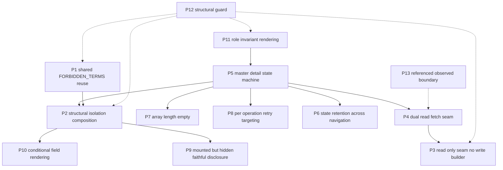

# NFR Design Patterns — `ui-history` (U9)

**Stage**: BUILD → NFR Design (per-unit) · **Unit**: U9 `ui-history` · C5 · Phase 1 · **Depth**: lighter (display) + INV-FAITHFUL + INV-NAMESPACE via StructuralGuard + focused teeth · **Date**: 2026-07-14.
**Built ON** the frozen FD (**BR-HIST-1..11**, inventory, `HISTORY_STATE` master-detail machine with position-preserving Back, namespace-distinct detail composition, region-level testid inventory) **and** the approved NFR Requirements (seventeen `NFR-HIST-*` targets; the single injected/capturing **dual-read** double; **NFR-HIST-Fold-A/B/C/D**) — **re-opening neither**. One section per pattern, each structurally meeting its target(s) + traced. **Advisory-only; no LLM; no live backend** (R6/R7 doubled); **no write path** (INV-FAITHFUL). **Tier convention** inherited from ui-shell/the sibling units (Vitest + RTL + jsdom · ESLint over the one `FORBIDDEN_TERMS` · file/import/AST scan · detector self-tests). Q1–Q4 all **A**.

> **Reference-not-own (stated once, upheld everywhere).** No `ui-history` component modifies `ui-shell` (frozen — its copy/`FORBIDDEN_TERMS`/`RoleContext`/`ReadOnlyRegion`/badges/testid convention are **reused**), **imports** any sibling UI unit (frozen — their fetchSeam/StructuralGuard/testid-lint are **mirrored as a convention**), or authors the wire: WIRE-1 **R6/R7** + the `audit-store` `AuditRecord` schemas are consumed **by shape**; the **real `historyFetchSeam` wiring** is the composition root's / Build & Test's, not designed here. The view **owns no authorization decision** (no `RoleGate`), and — the defining property of this unit — **no write path** (INV-FAITHFUL; the commit path is U7/U8, whose records `ui-history` **reads**).

> **NFR-HIST-D-Fold (from ui-queue's D-Fold-1 precedent).** `historyFetchSeam` is a **duck-typed injected seam with no formal Protocol/interface** — in a **no-TS** React codebase no interface construct is available, so the same reasoning holds *a fortiori*. Its contract is self-documenting via a **header comment + JSDoc** (per NFR-DESIGN-Fold-1) **plus the capturing dual-read double** as the worked example.

---

## §P1 — SharedForbiddenTermsReusePattern → NFR-HIST-COPY-1 + NFR-HIST-ADVISORY-1
- **Pattern**: `ui-history` **reuses ui-shell's ONE `FORBIDDEN_TERMS` source + ESLint** — **no new word-list**. Enum labels come from `shell/copy` (`RECOMMENDATION_LABELS` / `CONFIDENCE_LABELS` / `COMMIT_ACTION_LABELS`), rendered **by value look-up** via the reused badges + direct lookups; history-specific chrome + forensic field labels live in the **history-local `copy.js`** (lint-subject). The `no-inline-label` + `advisory-vocabulary` lints are registered on `src/history/**` (a new `eslint.config.js` block mirroring the sibling blocks; **no `src/shell` edit**). **HIST-Fold-4 / Fold-D resolution (binding)**: the **human-committed region's wording avoids the standalone singular "decision" lexical token** ("Underwriter's committed action" / "Committed outcome"), so the reused **blanket** `advisory-vocabulary` lint stays **unmodified** — verified against the **real** word-boundary detector (`/\bdecision\b/i`): plural "decisions" and `decision_id` pass, only standalone singular "decision"/`approved`/bare-`decline`/`declined` are flagged.
- **Meets the target**: (COPY-1) a **build-failing lint** flags any label literal in `src/history/`; the system region given `recommendation="DECLINE-RECOMMEND"` renders the sourced label (never bare `DECLINE`); the human region renders `action` via `COMMIT_ACTION_LABELS`. (ADVISORY-1) the history-local copy + components carry no `FORBIDDEN_TERMS.systemOutput` token in system-output copy; **detector self-test** (a synthetic "Underwriter's decision" heading fails).
- **Tier**: structural / lint.

## §P2 — StructuralIsolationCompositionPattern → NFR-HIST-SEPARATION-1 — **THE LOAD-BEARING PATTERN (namespace)**
- **Pattern (by-construction guarantee, Q1-A)**: the two namespace regions are **siblings by construction**, not merely tested to be non-nested. `DecisionDetail` renders `SystemRecommendationRegion`, `CommittedActionRegion`, `ForensicTupleRegion`, `RuleResultsRegion`, `ProfileSnapshotRegion` as **sibling children** at the same tree level. The isolation is enforced by the **exact prop signatures**, not by discipline:
  - **`SystemRecommendationRegion`'s props are `{recommendation, confidence, testid}` ONLY** — it composes the frozen `ReadOnlyRegion` (`aria-readonly`) + `RecommendationBadge`/`ConfidenceBadge`, engine-attributed, and is the **sole** holder of `recommendation`/`confidence`. It has **no `action`/`reason`/`underwriterId` prop and no path** by which the human namespace could reach it.
  - **`CommittedActionRegion`'s props are `{action, reason, underwriterId, testid}` ONLY** — it is the **sole** holder of the human committed action, and has **no `recommendation`/`confidence` prop and no path** by which the system namespace could reach it.
  - A developer therefore has **no wired way** to render the system recommendation inside the human region (or the human action inside the system region) **without first adding a new prop to the wrong component** — an obvious, reviewable change that would not pass review silently. **(Q1-A, both directions)** Each region also carries a **header comment** (the project's frozen convention — cf. `ReadOnlyRegion.jsx` / `NarrativeRegion` self-evidence) stating its **prop restriction** ("`SystemRecommendationRegion` — props `{recommendation, confidence, testid}` only, no human-namespace path; sole holder of the system recommendation" and the mirror on `CommittedActionRegion`), so the guarantee is **self-evident when reading each region in isolation**, not only by tracing `DecisionDetail`.
  - This is the direct structural expression of **advisory namespace-distinctness (WIRE-1 §1 / CON-BR4)**: the **system** advisory `Recommendation` and the **human** committed `CommitAction` are structurally separated — the human `override` can never render as, or inside, the system `DECLINE-RECOMMEND`.
- **Meets the target** (SEPARATION-1, DOM-containment teeth / NFR-HIST-Fold-B): the by-construction design is **confirmed** by the RTL/jsdom test — obtain `history-detail-system-region` + `history-detail-human-region`; assert `!system.contains(human) && !human.contains(system)`; `within(system).getByTestId('history-detail-recommendation')` (+ `history-detail-confidence`) present and `within(human).queryByTestId('history-detail-recommendation')` **null**; `within(human).getByTestId('history-detail-action')` present and `within(system).queryByTestId('history-detail-action')` **null**; the system region carries `aria-readonly`. The test is the **regression guard on top of the design-level guarantee**, not the only safeguard.
- **Tier**: component (RTL + jsdom). **Rigor**: **full (highest)**.

## §P3 — ReadOnlySeamPattern → NFR-HIST-FAITHFUL-1 — **THE LOAD-BEARING PATTERN (no-write)**
- **Pattern (by-construction guarantee, Q2-A)**: `historyFetchSeam`'s **exported surface is exactly** `{ createHistoryFetch, buildHistoryListRequest, buildHistoryDetailRequest, normalizeError }`. Concretely:
  - `buildHistoryListRequest(page, size)` returns **only** `{ method: 'GET', path: '/decisions?page=…&size=…' }`;
  - `buildHistoryDetailRequest(decision_id)` returns **only** `{ method: 'GET', path: '/decisions/' + decision_id }`;
  - `createHistoryFetch(transport)` returns `{ fetchList, fetchDetail }` — each calls `transport(buildHistory…Request(...))` and normalizes failures;
  - there is **no** `buildCommitRequest`/`buildOverrideRequest`-analog, **no** `submit*` function, and **no** non-GET method **anywhere** in the module.
  A view component thus has **no wired way** to issue a write — a POST/PUT/PATCH/DELETE would require **adding an entirely new builder + a body**, an obvious, reviewable change. **A write capability is structurally absent by construction**, not merely linted-against. Each region + `HistoryList` is `{...}`-only presentational (holds **no** seam reference), extending the guarantee to the whole unit. **(NFR-DESIGN-Fold-1)** `historyFetchSeam.js` carries a **header comment** (the frozen `queue/fetchSeam.js` JSDoc precedent) stating it is a **READ-ONLY dual-read seam** whose exported surface is exactly the four read members, both builders emit **only** `{ method:'GET', path }`, and there is **deliberately NO request-body builder / NO `submit*` — a write capability is structurally absent** — so the no-write guarantee is **self-evident reading the seam module in isolation**.
- **Meets the target** (FAITHFUL-1): the by-construction design is **confirmed** by the StructuralGuard **no-write-seam scan** (C12) — an AST/structural scan asserts **zero** `submit`-prefixed functions, **zero** `buildCommitRequest`/`buildOverrideRequest`-analogs, and **zero** non-GET request builders anywhere under `frontend/src/history/`, and that `historyFetchSeam`'s exports are exactly the four read members. This is the write-path units' single-call-site guard **inverted to zero call sites**; a **detector self-test** (a synthetic `submitOverride(` or a non-GET builder) is flagged (non-vacuous). No edit affordance/mutation seam exists in any region (C6/C11 read-only).
- **Tier**: structural / AST. **Rigor**: **full (highest)**.

## §P4 — DualReadFetchSeamPattern → NFR-HIST-DUALREAD-1 + NFR-HIST-STATEMACHINE-1 (fetch) + NFR-HIST-PERF-1 (bounded)
- **Pattern**: **one** own-local injected seam (`historyFetchSeam`, P3) exposing **two independently-capturing reads** — `fetchList(page,size)` (R6) and `fetchDetail(decision_id)` (R7) — injected into `HistoryView` via prop; production wires the real transport at the composition root, tests inject a **capturing dual-read double** with two spies (`fetchList.calls[i]=[page,size]`, `fetchDetail.calls[i]=[decision_id]`). **One construction** per suite, **fresh instance per test** (Fold-A). **Explicitly contrasted with U7/U8's asymmetric read+write double**: `ui-history` has **no write op**, so there is **no "zero write calls before Confirm" gate** — the cross-guards are **read-attribution + call-count** teeth. Fetches are **bounded** (one R6 page; one R7 record — no N+1 per-row enrichment, PERF-1). Mirrors the sibling read seams **without importing** them.
- **Meets the target**: (DUALREAD-1) a row select records **one** `fetchDetail(decision_id)` and **zero** `fetchList`; a page change records **one** `fetchList(page,size)` and **zero** `fetchDetail` (teeth: fails on cross-attribution). (STATEMACHINE-1 fetch) `HistoryView` never imports a hard-wired fetch — it calls the injected seam. (PERF-1) a structural scan confirms the bounded single-page / single-record paths, no all-rows/per-row path.
- **Tier**: component (RTL) + capturing double + structural (bounded).

## §P5 — MasterDetailStateMachinePattern → NFR-HIST-STATEMACHINE-1 (states) + NFR-HIST-ERROR-1 (transitions)
- **Pattern**: `HistoryView` **owns** the seven-state machine (Q4-A — a responsibility, not a separate component; hook/reducer mechanics → Code-Gen): `listLoading → list | listEmpty | listError`; `list --select--> detailLoading → detail | detailError`; `detailError --retry--> detailLoading`; `listError --retry--> listLoading`; `list --page--> listLoading`; `detail --back--> list` (P6). Built **on** `historyFetchSeam` (P4); renders via `HistoryStateView` (non-content states) / `DecisionDetail` (detail).
- **Meets the target**: per-state renders (each of the seven states renders its pinned testid, no foreign content) **plus one consolidated transition test** (Fold-A) exercising `listLoading→list`/`listEmpty`/`listError`, `list→detailLoading→detail`/`detailError`, `detailError→detailLoading` (Retry), `detail→list` (Back), on the **same** injected double.
- **Tier**: component (RTL).

## §P6 — StateRetentionAcrossNavigationPattern → NFR-HIST-BACKPRESERVE-1 *(NEW)*
- **Pattern**: `HistoryView` holds the list `{page, items}` in orchestrator state; entering `detail` is a **sub-state**, not a remount, so the list state **survives the detail excursion**. **Back returns to `list` at the same page with the same items — no refetch** (the frozen `QueueView.jsx` position-preserving discipline — its Retry re-fetches the last-requested page, `load(page)`/`setPage(targetPage)` — extended to a master-detail navigation).
- **Meets the target**: from `list` at page *k*, open a row → `detail` → Back; assert (a) `fetchList.calls.length` **unchanged** by Back (a **before/after snapshot** — zero refetch; NFR-HIST-Fold-2, no double-side discrimination needed), and (b) the rendered list `page` == *k* and `items` are the **same rows in the same order**. Teeth: fails if Back reset to page 1 or refetched.
- **Tier**: component (RTL) + capturing double.

## §P7 — ArrayLengthEmptyPattern → NFR-HIST-EMPTY-1
- **Pattern**: `listEmpty` is derived from **`items.length === 0`** (an array-length check — the same as `ui-queue`, and the **explicit contrast** to `ui-memo-view`'s `status`-discriminator, which keys on a `status` field). A non-empty page renders the list; an empty page renders the page-level "no decisions yet" state.
- **Meets the target**: an R6 body with `items: []` renders `history-state-empty` and **none** of `history-list`/`history-pagination`; a non-empty body renders the list; the selection reads `items.length`. Teeth: fails if a non-empty list rendered empty or vice-versa.
- **Tier**: component (RTL).

## §P8 — PerOperationRetryTargetingPattern → NFR-HIST-ERROR-1
- **Pattern**: the WIRE-1 error envelope `{error:{code,message,detail}}` maps to the error state — **`message` visible** (`history-error-message`), **`code` testid-only** (`history-error-code`, not visible text), **`detail` never rendered**. Retry is **per-operation**: a `listError` Retry re-fetches the **last-requested page** (position-preserving, P6); a `detailError` Retry re-fetches the **same `decision_id`**. The R7 **404 `not_found`** is surfaced through the **generic** `detailError` path — **no special-casing** (HIST-Fold-3).
- **Meets the target**: RTL + capturing double — message-visible / code-in-testid-not-text / a DOM scan finds `detail` nowhere; a `listError` Retry issues `fetchList(lastPage)`; a `detailError` Retry issues `fetchDetail(sameId)`; a 404 renders `history-state-error-detail` with `error.code==='not_found'` via the same generic path (asserts no dedicated not-found branch).
- **Tier**: component (RTL) + capturing double.

## §P9 — MountedButHiddenFaithfulDisclosurePattern → NFR-HIST-RULERESULTS-1 *(NEW)*
- **Pattern**: `RuleResultsRegion` renders **every** `audit_tuple.rule_results.rule_results[]` entry **mounted** in the DOM, in the delivered order, **none dropped**. The disclosure **collapses via the HTML `hidden` attribute / `display:none`** — which **removes collapsed entries from the accessibility tree** (a screen reader does not announce them; **no separate `aria-hidden` needed**) — while keeping every entry **mounted** (INV-FAITHFUL). The faithfulness assertion uses a **DOM-level query** (`getAllByTestId`/`querySelectorAll`) that finds mounted-but-hidden nodes, **not** a visibility-filtering role/text query (Fold-C). The keyboard-focusable `history-detail-ruleresults-toggle` switches the state.
- **Meets the target**: render a detail whose report has **N deliberately-unsorted** entries — a DOM-level query finds **all N** (count == input length, input order) **in both collapsed and expanded states** (collapse is visibility-only, never unmount); a large-N and a length-1 fixture both pass. Teeth: fails if any entry were dropped/truncated or re-sorted.
- **Tier**: component (RTL + jsdom).

## §P10 — ConditionalFieldRenderingPattern → NFR-HIST-REASON-1
- **Pattern**: **within** `CommittedActionRegion` (the human namespace, P2), `reason` renders **iff** `action === 'override'` (present/non-blank per the frozen gate), and is **absent** on `approve`; `action` (via `COMMIT_ACTION_LABELS`) and `underwriter_id` always render. Confined to the human region — **never leaks into the system namespace** (P2's by-construction guarantee).
- **Meets the target**: an `override` record renders `history-detail-reason` (== `committed_decision.reason`) **within** `history-detail-human-region`; an `approve` record renders **no** `history-detail-reason` node; `history-detail-action` == `COMMIT_ACTION_LABELS[action]`, `history-detail-underwriter` == `underwriter_id`. Teeth: fails if reason appeared on approve or was absent on override.
- **Tier**: component (RTL).

## §P11 — RoleInvariantRenderingPattern → NFR-HIST-VIEWONLY-1
- **Pattern**: `ui-history` composes **no `RoleGate`**, imports **no router**, and gates nothing by Role — render is **role-invariant** (R6/R7 are authenticated any-role). `can="read"` is deliberately **not** used (it would cosmetically exclude `admin`). Contrast: `ui-approval-gate` (U7) / `ui-override-form` (U8) compose `RoleGate can="act"` for the underwriter-only **write** path; `ui-history` — a pure read surface — has **no act-affordance to gate**.
- **Meets the target**: (a) **structural** (StructuralGuard) — no `RoleGate` import, no router import in `src/history/` + self-test; (b) RTL — output is **identical** with a stub `RoleContext.Provider` set to `underwriter` / `auditor` / `admin` / `null`.
- **Tier**: structural + component.

## §P12 — StructuralGuardPattern → NFR-HIST-TESTID-1 + NFR-HIST-NOTS-1 + NFR-HIST-NOSUPERSEDE-1 (+ structural halves)
- **Pattern**: **one `StructuralGuard` substrate** (Q3-A) grouping independent structural checks, each with a **detector self-test** (non-vacuous): the **`FORBIDDEN_TERMS` reuse** lints (P1); the **testid** convention (`history-<element>-<purpose>`, regex `^history-[a-z]+(-[a-z0-9]+)+$`) **incl. every row (`history-row-<decision_id>`) and the two region testids** (`history-detail-system-region`/`-human-region`); **no-`.ts`/`.tsx`** file scan (NOTS-1); **no-router-import** + **no-`RoleGate`-import** scans (P11); the **NEW no-write-seam** scan (P3 / FAITHFUL-1 — zero `submit*`/non-GET builders); the **NEW no-superseded-branch** scan (NOSUPERSEDE-1 — no `status === 'superseded'` branch / no `supersedes_decision_id` dereference / no supersede affordance); the **bounded-fetch** scan (P4/PERF-1). Mirrors the siblings' single StructuralGuard substrate (convention, not imported); the two NEW scans slot in as additional independent checks.
- **Meets the target**: (TESTID-1) a `history-testid-convention` lint asserts the convention incl. rows + the two region testids + self-test flags a missing/misnamed testid; (NOTS-1) a file scan finds zero `.ts`/`.tsx` and no `tsconfig`; (NOSUPERSEDE-1) an AST scan finds no `'superseded'` branch / no `supersedes_decision_id` deref + self-test flags a synthetic one.
- **Tier**: structural / lint.

## §P13 — ReferencedObservedBoundaryPattern → NFR-HIST-PERF-1, NFR-HIST-A11Y-1, NFR-HIST-SCOPE-1 *(soft / governance)*
- **PERF-1** — bounded reads (one R6 page + one R7 record, no N+1 per-row enrichment; structural, via P4/P12); render latency/bundle **observed, non-gating** (ui-shell / sibling PERF precedent).
- **A11Y-1** — semantic region markup + headings; the system region's `aria-readonly` (frozen `ReadOnlyRegion`); keyboard-focusable row / pagination / Back / Retry / rule-results-toggle controls; accessible labels; collapsed `rule_results` entries removed from the a11y tree via `hidden`/`display:none` (P9). **Soft**, recorded target, not gating in Phase 1.
- **SCOPE-1** — **governance/exclusion**: patterns realize only `ui-history`'s view behavior; **not** other UI units, backend internals, or the WIRE-1 **route implementation**; ui-shell mechanisms **reused, not modified**; the sibling units' **mirrored, not imported**; `audit-store` schemas **consumed by shape**; **no write path is introduced** (INV-FAITHFUL / P3).
- **Tier**: observed / soft / governance.

---

## §14 — Pattern-integration diagram

Validated before write (alphanumeric node IDs; every label double-quoted; **no hyphens, no semicolons, no bare colons, no parentheses, no special characters**; underscore per the established convention; balanced blocks; **rectangle-only, no decision diamonds**). Text alternative follows.

### Text alternative (always included)
- The **master-detail state machine (P5)** is the hub: it depends on the **dual-read fetch seam (P4)** — which is itself built on the **read-only seam guarantee (P3)** — derives `listEmpty` via the **array-length empty (P7)**, renders errors + per-operation retry via **P8**, retains list state across navigation via **P6**, and renders the detail's **structural isolation composition (P2)**.
- The **structural isolation composition (P2)** contains the **conditional field rendering (P10)** in the human region and the **mounted-but-hidden faithful disclosure (P9)**, and draws its labels from the **shared FORBIDDEN_TERMS reuse (P1)**.
- The **role-invariant rendering (P11)** wraps how P5 renders (no `RoleGate`, no router).
- Dashed = substrate/boundary: the **StructuralGuard (P12)** lints/scans P1 (copy), P2 (regions), **P3 (the no-write-seam scan)**, and P11 (no-`RoleGate`); the **referenced/observed boundary (P13)** observes the bounded reads (P4).

---

## §15 — Traceability (pattern → target → tier → rigor)

| Pattern | Target(s) | Tier | Rigor |
|---|---|---|---|
| SharedForbiddenTermsReusePattern | COPY-1, ADVISORY-1 | lint / structural | full |
| **StructuralIsolationCompositionPattern** | **SEPARATION-1** | component | **full (highest)** |
| **ReadOnlySeamPattern** | **FAITHFUL-1** | structural / AST | **full (highest)** |
| DualReadFetchSeamPattern | DUALREAD-1, STATEMACHINE-1 (fetch), PERF-1 (bounded) | component + capturing double + structural | full |
| MasterDetailStateMachinePattern | STATEMACHINE-1 (states), ERROR-1 (transitions) | component | full |
| StateRetentionAcrossNavigationPattern | BACKPRESERVE-1 | component + capturing double | full |
| ArrayLengthEmptyPattern | EMPTY-1 | component | full |
| PerOperationRetryTargetingPattern | ERROR-1 | component + capturing double | full |
| MountedButHiddenFaithfulDisclosurePattern | RULERESULTS-1 | component | full |
| ConditionalFieldRenderingPattern | REASON-1 | component | full |
| RoleInvariantRenderingPattern | VIEWONLY-1 | structural + component | full |
| StructuralGuardPattern | TESTID-1, NOTS-1, NOSUPERSEDE-1 (+ structural halves) | structural / lint | full |
| ReferencedObservedBoundaryPattern | PERF-1, A11Y-1, SCOPE-1 | observed / soft / governance | soft / governance |

**All seventeen `NFR-HIST-*` targets + SCOPE covered; no orphan.** (COPY→P1, ADVISORY→P1, **SEPARATION→P2**, **FAITHFUL→P3(+P12)**, DUALREAD→P4, STATEMACHINE→P5(+P4), ERROR→P5+P8, BACKPRESERVE→P6, EMPTY→P7, RULERESULTS→P9, REASON→P10, VIEWONLY→P11(+P12), TESTID→P12, NOTS→P12, NOSUPERSEDE→P12, PERF→P4+P13, A11Y→P9+P13, SCOPE→P13.)
