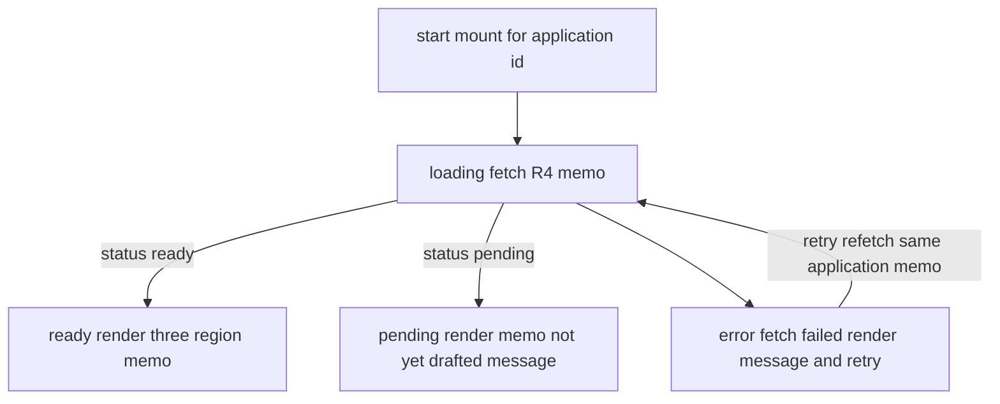
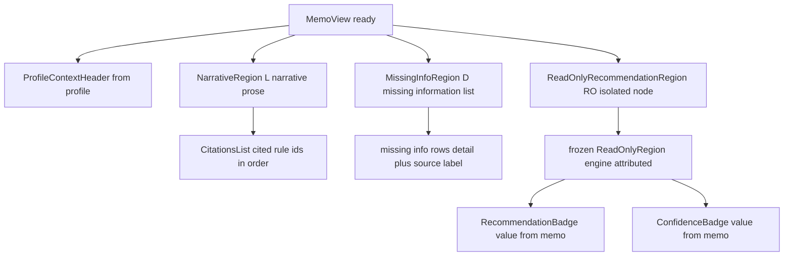

# Business Logic Model — `ui-memo-view` (U6)

**Stage**: BUILD → Functional Design (per-unit) · **Unit**: U6 `ui-memo-view` · **Date**: 2026-07-09 · Story **US-UI-2**.
**Nature**: `ui-memo-view` has **no domain logic** — its only "logic" is a **presentation/fetch lifecycle** over WIRE-1 R4
plus the **structural composition** of the DecisionMemo three regions. This model pins two technology-agnostic flows:
**(1)** the fetch/render-state machine (with `pending` derived from the R4 `status` discriminator, N1), and **(2)** the
ready-state three-region composition (with the RO region shown as a **structurally isolated** node). All values/mechanics
(fetch hook shape, placeholder markup, token values) are deferred to NFR-Design / Code-Gen.

---

## 1. Fetch / render-state machine (the fetch-lifecycle addendum)

`MemoView` owns a render state `∈ {loading, ready, pending, error}` (`domain-entities.md §3`). An R4 fetch for the given
`applicationId` is the only transition trigger; the resolved body's **`status` discriminator** — not an array length —
selects between `ready` and `pending`.



**Text alternative (always included)** — the state machine, node by node:

- **Start → Loading**: on mount, `MemoView` sets `state = loading` and fetches R4 for the given `applicationId`
  (`GET /applications/{application_id}/memo`) via the injected local memo `fetchSeam`.
- **Loading → Ready / Pending (status branch)**: the fetch resolves 2xx with a `MemoView` body; the **`status` field** on
  the resolved body selects the outgoing edge — this is the pinned twist vs ui-queue, whose `empty` is derived from
  `items.length` — here the branch is on the explicit **`status` discriminator**, not an array length (N1).
- **Loading → Ready**: `status === "ready"` → `state = ready`; `report`/`memo`/`profile` are all present → render the
  three-region memo (§2).
- **Loading → Pending**: `status === "pending"` → `state = pending`; `report`/`memo` are null → render the single
  page-level **"memo not yet drafted for this application"** message (`memo-state-pending`), **no** memo regions
  (BR-MEMO-8 / Q2-A).
- **Loading → Error**: the fetch fails (any non-2xx per WIRE-1 §4, or a transport error) → `state = error`; render
  `error.message` (visible) + `error.code` (testid-only) + a **Retry** control (BR-MEMO-6). The local memo `fetchSeam`
  guarantees the failure is a well-formed `{error:{code,message,detail}}` envelope (mirrors ui-queue `normalizeError`
  CG-Fold-1, as a convention — Q6-A) so `MemoStateView` never unpacks a raw exception.
- **Error → Loading (Retry)**: activating Retry re-enters `loading` and re-fetches R4 for the **same `applicationId`**
  (BR-MEMO-6) — a single resource, so there is **no page position** to preserve (contrast ui-queue's last-page Retry).

> Only `loading` performs I/O. `ready`/`pending`/`error` are terminal until an explicit user action (Retry) re-enters
> `loading`. There is **no** auto-refresh/polling in Phase 1, and **no** outward action is emitted from any state (N2).

---

## 2. Ready-state three-region composition (the read-only-separation addendum)

On `ready`, `MemoView` renders the DecisionMemo as **three structurally separate regions** plus a minimal context header.
The **RO region is a distinct, isolated node** — never nested inside the L narrative — the visual/structural expression of
CON-BR2-TYPE (BR-MEMO-3/4/5). Each region reads **only** its own slice of the memo.



**Text alternative (always included)** — the composition, node by node:

- **`MemoView` (ready)** renders four children in order: the context header, then the three memo regions. The **RO region
  is a sibling of** — never a descendant of — the L `NarrativeRegion` (the concrete BR-MEMO-3 structural separation).
- **`ProfileContextHeader`** renders a minimal identifying subset of `profile` (`application_id`, applicant name, derived
  age, requested cover), read-only, no affordance (N3).
- **`NarrativeRegion` (L)** renders the LLM-authored `narrative_prose` as read-only body text; it composes
  **`CitationsList`**, which renders `cited_rule_ids` as a local presentational list **in the delivered order** (BR-MEMO-9,
  Q3-A). The view does **not** lint or rewrite this runtime prose (MEMO-Fold-1 scope boundary).
- **`MissingInfoRegion` (D)** renders `missing_information` as a local presentational list, **preserving the backend
  deterministic order** (MISSINGINFO-1); each row shows `detail` as primary text + the `source` via the memo-local
  `MISSING_INFO_SOURCE_LABELS` (Q4-A).
- **`ReadOnlyRecommendationRegion` (RO)** composes the **frozen `ReadOnlyRegion`** wrapper (`aria-readonly`,
  `testid="memo-region-readonly"`), framed by memo-local chrome as **engine-attributed** (advisory, not a decision), and
  places inside it exactly the **`RecommendationBadge`** (`value = memo.recommendation`) + **`ConfidenceBadge`**
  (`value = memo.confidence`). These values render **only here** (BR-MEMO-5) — the UI never implies the LLM produced them.

> **Structural isolation invariant (testable, MEMO-Fold-2)**: `memo-region-readonly` and `memo-region-narrative` are
> distinct DOM nodes, neither an ancestor of the other; the recommendation/confidence badges appear inside
> `memo-region-readonly` and never inside `memo-region-narrative`. This is the concrete CON-BR2 structural check.

---

## 3. Data-flow summary (read-only, one direction)

```text
WIRE-1 R4 (mocked in tests, via the injected local memo fetchSeam)
   → { application_id, recommendation_id|null, status, profile|null, report|null, memo|null }
     | { error:{code,message,detail?} }
   → MemoView (state machine section 1; status discriminator, not array length)
      → ready   : ProfileContextHeader
                  + NarrativeRegion (narrative_prose) → CitationsList (cited_rule_ids, in order)
                  + MissingInfoRegion (missing_information, deterministic order; detail + source label)
                  + ReadOnlyRecommendationRegion → frozen ReadOnlyRegion → RecommendationBadge / ConfidenceBadge
      → pending : "memo not yet drafted" page-level message (from status, N1)
      → error   : error.message + Retry (re-fetch same application memo, section 1)
   → (no outward action emitted — view only, N2)
```

No write path, no mutation, no commit — the memo view is a pure read view (advisory-only invariant upheld: it displays a
system `Recommendation` in a structurally read-only region, never finalizes anything; a `CommittedDecision` is created only
by the underwriter commit path in U7/U8, not here). The RO region's structural isolation is the UI's direct respect for
CON-BR2-TYPE.

---

## 4. Deferred to later stages (named, not designed here)

- **Fetch-hook mechanics** (which hook/store holds `{state, view, error}`), Retry debounce, request cancellation, the real
  transport wiring behind the injected `fetchSeam` → NFR-Design / Code-Gen (mirrors ui-queue's Fold-B mechanics; the real
  wiring is the composition root's concern).
- **Loading placeholder markup**, region layout, token/color values, the exact minimal profile-header field set →
  NFR-Design / Code-Gen (N3; ui-shell tokens, values themselves deferred).
- **R4 route implementation** (`backend/app/main.py`) → Build & Test integration (WIRE-1 §, not this unit); the view
  consumes the R4 **contract shape**, fetching a mocked R4 in tests.
- **Navigation** from the memo view to the commit path (R5 / U7) → a later shell/router integration (BR-MEMO-7 — no router
  import here, no outward action in Phase 1).
