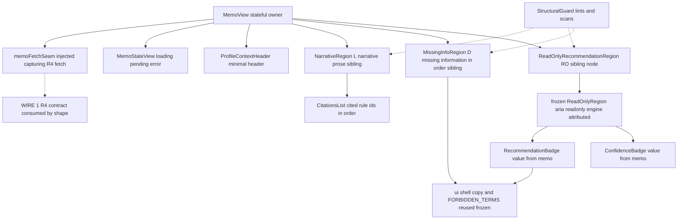

# Logical Components — `ui-memo-view` (U6)

**Stage**: BUILD → NFR Design (per-unit) · **Unit**: U6 `ui-memo-view` · C5 · Phase 1 · **Depth**: lighter (display) +
fetch-lifecycle addendum + three-region read-only-separation addendum · **Date**: 2026-07-09.
The **8 production components** (under `frontend/src/memoView/`) + the **test/lint substrate**, their responsibilities,
ownership, a **reference-not-own check**, and **component→target coverage**. **React + Tailwind, NO TypeScript.
Advisory-only; no LLM; no live backend** (R4 doubled via the injected `memoFetchSeam`). Q1–Q5 all **A**.

> **No production import of any backend module, the real wire, or `ui-queue` anywhere (binding).** `ui-memo-view` imports
> **only** React / Tailwind + `ui-shell`'s frozen modules (primitives/copy/session/**`ReadOnlyRegion`**, **consumed not
> modified**) + its own modules. **No component imports a backend path, a router, `RoleGate`, or `ui-queue`, and none
> issues a real fetch** — the real `memoFetchSeam` wiring is the composition root's (structurally verified by
> StructuralGuard). WIRE-1 **R4** is consumed **by shape**; ui-queue's fetchSeam/StructuralGuard/testid-lint are
> **mirrored as a convention, not imported**.

---

## 1. Components

| ID | Component | Responsibility | Ownership | Backs |
|---|---|---|---|---|
| **C1** | **MemoView** | The **only stateful** component: calls **memoFetchSeam** for `applicationId`, holds `{state, view, error}`, **owns the four-state machine** (Q3-A — a responsibility, not a separate component; hook/reducer mechanics → Code-Gen) + the **status-discriminator** selection (P6), and **composes `NarrativeRegion` / `MissingInfoRegion` / `ReadOnlyRecommendationRegion` as SIBLING children** — the **structural isolation is established here** (P2). Selects `MemoStateView` vs the ready composition. **Emits nothing** (view-only). | owns | FETCH-1, ERROR-1(transition), PENDING-1(discriminator), VIEWONLY-1(render), SEPARATION-1(sibling composition) |
| **C2** | **memoFetchSeam** *(own local thin module, Q2-A)* | Builds the R4 request (**by `applicationId`** → path) and returns the `MemoView` body / error envelope; **injected** into `MemoView` via **prop**. **Duck-typed, no formal interface** (D-Fold) — JSDoc-documented; tests inject a **capturing double** that records the requested `applicationId` (single construction, Fold-A). **Mirrors ui-queue's `fetchSeam` pattern, NOT imported.** **Real wiring deferred** to the composition root / Build & Test. | owns the **seam interface**; real wiring deferred | FETCH-1, ERROR-1(retry), PERF-1(bounded) |
| **C3** | **MemoStateView** | Presentational non-ready states: `loading` (placeholder — **no memo region while loading**), `pending` ("memo not yet drafted", from the `status` discriminator P6), `error` (message visible / code testid-only / detail never — uniform incl. 401, Q5-A). | owns | ERROR-1, FETCH-1(states), PENDING-1(render), A11Y-1 |
| **C4** | **ProfileContextHeader** | Minimal identifying context header from `profile` (which fields → Code-Gen, deferred); **read-only**, no affordance. | owns | A11Y-1, TESTID-1 |
| **C5** | **NarrativeRegion** *(L)* | Renders the LLM-authored `narrative_prose` as read-only body text; composes `CitationsList`. **Props are `{narrative, testid}` ONLY — no `recommendation`/`confidence` prop or path** (P2 by-construction). Carries a **header comment** documenting that guarantee in isolation (**NFR-DESIGN-Fold-1**, the frozen `ReadOnlyRegion.jsx`/`fetchSeam.js` comment convention). Runtime prose is **not** linted (BR-MEMO-2 governance). | owns | SEPARATION-1(L node), TESTID-1 |
| **C6** | **CitationsList** *(L sub-list)* | Renders `cited_rule_ids` as a local presentational list **in delivered order** (P8); empty → neutral copy (`noCitationsLabel`). | owns | LISTORDER-1, TESTID-1 |
| **C7** | **MissingInfoRegion** *(D)* | Renders `missing_information` as a local list **in delivered order** (P8); each row = `detail` + `MISSING_INFO_SOURCE_LABELS[source]` (memo-local copy, P1); empty → neutral copy (`noMissingInfoLabel`). | owns | LISTORDER-1, COPY-1, TESTID-1 |
| **C8** | **ReadOnlyRecommendationRegion** *(RO)* | **Composes the frozen `ReadOnlyRegion`** (`aria-readonly`, first use) + `RecommendationBadge`/`ConfidenceBadge`, engine-attributed via memo-local chrome; the **SOLE component receiving `{recommendation, confidence}`** and the **sole** render site for them (P2/N3). Renders only **system** `Recommendation`, never a human `CommitAction` (P1/NAMESPACE-1). | owns | SEPARATION-1(RO node), COPY-1, NAMESPACE-1, TESTID-1 |

**Test / lint substrate (test-only, not a production component):**
- **C9 StructuralGuard** *(one substrate, Q4-A)* — grouping independent checks, **each with a detector self-test**:
  ESLint reuse over ui-shell's **one `FORBIDDEN_TERMS`** (COPY-1 no-inline + ADVISORY-1 vocabulary + NAMESPACE-1
  collision), **testid** convention lint **incl. the region-level testids** (TESTID-1), **no-`.ts`/`.tsx`** file scan
  (NOTS-1), **no-router-import** scan (VIEWONLY-1), **no-`RoleGate`-import** scan (VIEWONLY-1), **bounded-fetch** scan
  (PERF-1). Mirrors ui-queue's single StructuralGuard substrate (convention, not imported).
- **Vitest + React Testing Library + jsdom** — SEPARATION-1 (DOM-containment teeth, Fold-B), ERROR-1, PENDING-1
  (discriminator teeth, Fold-C), LISTORDER-1, VIEWONLY-1(render across stub roles), and FETCH-1's four per-state renders +
  the **one consolidated transition test** (Q5-A) — all on the **single injected capturing double** (Fold-A). Two distinct
  ready fixtures (Fold-C): an empty-lists ready memo + a populated non-sorted ready memo.

---

## 2. Component-relationship diagram

Validated before write (alphanumeric node IDs; every label double-quoted; **no hyphens, no semicolons, no bare colons, no
parentheses, no special characters**; underscore per the established convention; balanced blocks; **rectangle-only, no
decision diamonds**). The **RO-region-as-sibling-not-descendant isolation is a VISIBLE GRAPH PROPERTY**: `MemoView` has
**sibling** edges to `NarrativeRegion`, `MissingInfoRegion`, and `ReadOnlyRecommendationRegion`; the recommendation /
confidence nodes are **descendants of the RO region only** (via the frozen `ReadOnlyRegion`), never of the narrative.
Text alternative follows.

### Text alternative (always included)
- **MemoView** calls **memoFetchSeam** (R4 by `applicationId`), and selects **MemoStateView** (loading/pending/error) or
  the ready composition.
- The ready composition renders **four siblings** under MemoView: **ProfileContextHeader**, **NarrativeRegion** (L),
  **MissingInfoRegion** (D), and **ReadOnlyRecommendationRegion** (RO). NarrativeRegion composes **CitationsList**.
- **Structural isolation (visible)**: **ReadOnlyRecommendationRegion** is a **sibling** of NarrativeRegion, not a child;
  it wraps the **frozen ReadOnlyRegion** which holds **RecommendationBadge** + **ConfidenceBadge** — so the recommendation/
  confidence nodes are descendants of **RO only**, never of the narrative.
- **RecommendationBadge** + **MissingInfoRegion** look up labels from the **reused frozen ui-shell copy / `FORBIDDEN_TERMS`**
  (never inlined).
- Dashed = substrate/boundary: **StructuralGuard** lints/scans the regions; **WIRE-1 R4** (external, real wiring deferred
  to the composition root) is what **memoFetchSeam** consumes by shape.

---

## 3. Reference-not-own check (reused vs mirrored-not-imported vs consumed-by-shape — kept distinct)

| Concern | Owner | This unit? | Relationship |
|---|---|---|---|
| The memo view behavior (fetch/state/three-region render/lists) | **`ui-memo-view`** (C1–C9) | ✅ owns | — |
| Shell primitives / copy / `FORBIDDEN_TERMS` / `RoleContext` / **`ReadOnlyRegion`** | **`ui-shell`** (frozen U10) | ❌ | **REUSED** — consumed by import, **not modified** (`ReadOnlyRegion` composed, first use) |
| fetchSeam / StructuralGuard / testid-lint **convention** | **`ui-queue`** (frozen U5) | ❌ | **MIRRORED, NOT IMPORTED** — the pattern is copied in spirit; **no `ui-queue` module is imported** |
| Frontend↔backend **wire/serialization** (R4 route, `MemoView`, session) | **WIRE-1** (composition-root) | ❌ | **CONSUMED BY SHAPE** — the **real `memoFetchSeam` wiring** is deferred (composition root / Build & Test) |
| **R4 route implementation** (`backend/app/main.py`) | Build & Test | ❌ | not authored here |
| Authorization **decision** | **`auth-rbac`** (SEC-4) | ❌ | the view gates nothing (VIEWONLY-1); no `RoleGate`, no authz call |
| Navigation / routing to the commit path | later shell/router integration | ❌ | **emits nothing**; no router import (VIEWONLY-1) |
| Human commit / gate (`approve`/`override`) | **`ui-approval-gate` (U7)** / **`ui-override-form` (U8)** | ❌ | no write path; the view never renders a `CommitAction` (NAMESPACE-1) |
| **`narrative_prose` advisory conformance** | **`memo-agent-core`** (CON-BR2, backend) | ❌ | **CONSUMED BY SHAPE** — rendered as-is; the view lints only its **static** code (BR-MEMO-2 governance) |
| Aesthetic token **values**, minimal profile-header field set, loading-placeholder markup, state hook/reducer mechanics | **Code-Gen** | ❌ | direction/shape only; values + mechanics deferred |

**No component owns a concern reference-not-own assigns elsewhere. No backend import, no router import, no `RoleGate`
import, no `ui-queue` import, and no real fetch anywhere in `ui-memo-view`** — structurally verified (StructuralGuard).
`memoFetchSeam` is a duck-typed injected seam (D-Fold, ui-queue/admin-cli precedent).

---

## 4. Component → target coverage (no orphan)

| Target | Component(s) / item |
|---|---|
| NFR-MEMO-COPY-1 | C7/C8 (label look-up) + C9 (no-inline lint, `FORBIDDEN_TERMS` reuse) |
| NFR-MEMO-ADVISORY-1 | C7/C8 + memo-local copy + C9 (advisory-vocabulary lint, static-scope) |
| NFR-MEMO-SEPARATION-1 | C1 (sibling composition) + C8 (RO node, sole rec/conf holder) + C5 (L node, no rec/conf path + header comment) |
| NFR-MEMO-ERROR-1 | C3 (error-envelope render) + C2 (capturing double, same id) + C9 (detail-never structural) |
| NFR-MEMO-VIEWONLY-1 | C1 (render) + C9 (no-`RoleGate` / no-router scans) |
| NFR-MEMO-PENDING-1 | C1 (discriminator) + C3 (pending render) |
| NFR-MEMO-LISTORDER-1 | C6 (citations order) + C7 (missing-info order) |
| NFR-MEMO-TESTID-1 | C3–C8 + C9 (testid lint incl. region testids) |
| NFR-MEMO-NOTS-1 | whole unit + C9 (file scan) |
| NFR-MEMO-FETCH-1 | C1 (state machine) + C2 (seam) + C3 + the three regions (renders) |
| NFR-MEMO-NAMESPACE-1 | C8 + C9 (collision guard) |
| NFR-MEMO-PERF-1 | C2 (single-resource bounded fetch) + C9 (scan) — observed |
| NFR-MEMO-A11Y-1 | C3/C4/C8 (semantic regions + `aria-readonly` + focusable Retry) — soft |
| NFR-MEMO-SCOPE-1 | governance / boundary (documented, not an orphan) |

**All fourteen targets covered.** Every component/item backs ≥1 target; SCOPE-1 is a documented boundary. No orphan.

---

## 5. Settled items held (not re-opened)
- Frozen FD (BR-MEMO-1..11 + inventory + flows) + approved `NFR-MEMO-*` targets — components realize them, re-opening
  neither.
- **ui-shell (frozen)** — primitives/copy/`FORBIDDEN_TERMS`/`RoleContext`/`ReadOnlyRegion`/testid convention **reused, not
  modified**; the stub `RoleContext.Provider` is the injection point for VIEWONLY-1; `ReadOnlyRegion` is composed by C8
  (first use).
- **ui-queue (frozen)** — its fetchSeam/StructuralGuard/testid-lint are **mirrored as a convention, NOT imported**.
- **WIRE-1** — R4 + `MemoView` + `DecisionMemo` + envelopes consumed **by shape**; the **route implementation** and the
  **real `memoFetchSeam` wiring** stay deferred to the composition root / Build & Test.
- **Q1-A by-construction guarantee** — realized in C1's sibling composition + C8's sole-holder prop + C5's
  `{narrative, testid}`-only signature and **header comment** (NFR-DESIGN-Fold-1); the SEPARATION-1 DOM-containment test is
  the regression guard. **D-Fold** — `memoFetchSeam` duck-typed, no formal interface (ui-queue/admin-cli precedent).
- **BR-MEMO-2 scope exclusion** — no component lints/rewrites `narrative_prose`; the lints cover static code only.
- **Deferred values**: aesthetic token values, the minimal profile-header field set, loading-placeholder markup, state
  hook/reducer mechanics → Code-Gen. **Infrastructure Design** for `ui-memo-view` **not pre-committed** — likely a logged
  SKIP (source-level view; Vercel topology is `deploy-config` P2) — confirmed at that stage.
