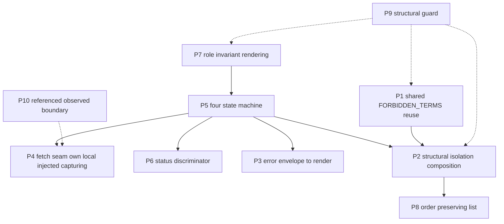

# NFR Design Patterns — `ui-memo-view` (U6)

**Stage**: BUILD → NFR Design (per-unit) · **Unit**: U6 `ui-memo-view` · C5 · Phase 1 · **Depth**: lighter (display) +
fetch-lifecycle addendum + three-region read-only-separation addendum · **Date**: 2026-07-09.
**Built ON** the frozen FD (**BR-MEMO-1..11**, inventory, four-state enum, region-level testid inventory, fetch/state +
three-region composition flows) **and** the approved NFR Requirements (fourteen `NFR-MEMO-*` targets; single
injected/capturing fetch-double D6; **NFR-MEMO-Fold-A/B/C**) — **re-opening neither**. One section per pattern, each
structurally meeting its target(s) + traced. **Advisory-only; no LLM; no live backend** (R4 doubled). **Tier convention**
inherited from ui-shell/ui-queue (Vitest + RTL + jsdom · ESLint over the one `FORBIDDEN_TERMS` · file/import scan ·
detector self-tests). Q1–Q5 all **A**.

> **Reference-not-own (stated once, upheld everywhere).** No `ui-memo-view` component modifies `ui-shell` (frozen — its
> copy/`FORBIDDEN_TERMS`/`RoleContext`/`ReadOnlyRegion`/testid convention are **reused**), **imports** `ui-queue` (frozen —
> its fetchSeam/StructuralGuard/testid-lint are **mirrored as a convention**), or authors the wire: WIRE-1 **R4** is
> consumed **by shape**; the **real `memoFetchSeam` wiring** is the composition root's / Build & Test's, not designed here.
> The view **owns no authorization decision** (no `RoleGate`), **no write path** (commit is U7/U8), and **does not lint or
> rewrite `narrative_prose`** (CON-BR2 conformance of the prose is memo-agent-core's, BR-MEMO-2 governance).

> **NFR-MEMO-D-Fold (from ui-queue's D-Fold-1 precedent).** `memoFetchSeam` is a **duck-typed injected seam with no formal
> Protocol/interface** — in a **no-TS** React codebase no interface construct is available, so the same reasoning holds *a
> fortiori*. Its contract is self-documenting via a **JSDoc comment** (`memoFetchSeam(applicationId)` → resolves the
> `MemoView` body / surfaces `{error:{code,message,detail}}`) **plus the capturing double** as the worked example.

---

## §P1 — SharedForbiddenTermsReusePattern → NFR-MEMO-COPY-1 + NFR-MEMO-ADVISORY-1 + NFR-MEMO-NAMESPACE-1
- **Pattern**: `ui-memo-view` **reuses ui-shell's ONE `FORBIDDEN_TERMS` source + ESLint** — **no new word-list**. Enum
  labels come from `shell/copy` (`RECOMMENDATION_LABELS` / `CONFIDENCE_LABELS`), rendered **by value look-up** via the
  reused badges; memo-specific chrome + `MissingInfoSource` labels live in the **memo-local copy module** (lint-subject).
  The `no-inline-label` + `advisory-vocabulary` lints are registered on `src/memoView/**` (a new `eslint.config.js` block
  mirroring the queue block; **no `src/shell` edit**). **Scope (binding, Q6-A of NFR-Req)**: the lints assert the view's
  **static code only** — the runtime **`narrative_prose` is out of scope** (memo-agent-core's CON-BR2 concern).
- **Meets the target**: (COPY-1) a **build-failing lint** flags any label literal in `src/memoView/`; the RO region given
  `recommendation="DECLINE-RECOMMEND"` renders the sourced label (never bare `DECLINE`). (ADVISORY-1) the memo-local copy +
  components carry no `FORBIDDEN_TERMS.systemOutput` token; detector self-test. (NAMESPACE-1) the reused `FORBIDDEN_TERMS`
  **collision guard** flags any memo string equal to a `CommitAction` label; detector self-test.
- **Tier**: structural / lint.

## §P2 — StructuralIsolationCompositionPattern → NFR-MEMO-SEPARATION-1 — **THE LOAD-BEARING PATTERN**
- **Pattern (by-construction guarantee, Q1-A)**: the three regions are **siblings by construction**, not merely tested to
  be non-nested. `MemoView` renders `NarrativeRegion`, `MissingInfoRegion`, `ReadOnlyRecommendationRegion` as **sibling
  children** at the same tree level. The isolation is enforced by the **prop signatures**, not by discipline:
  - **`ReadOnlyRecommendationRegion` is the SOLE component that receives `{recommendation, confidence}`** — it composes the
    frozen `ReadOnlyRegion` (`aria-readonly`) + `RecommendationBadge`/`ConfidenceBadge`, engine-attributed.
  - **`NarrativeRegion`'s props are `{narrative, testid}` ONLY** — it has **no `recommendation`/`confidence` prop and no
    path** by which either value could reach it. A developer therefore has **no wired way** to render the recommendation
    inside the narrative **without first adding a new prop to `NarrativeRegion`** — an obvious, reviewable change that
    would not pass review silently. **(NFR-DESIGN-Fold-1)** `NarrativeRegion` also carries a **header comment** (the
    project's frozen convention — cf. `ReadOnlyRegion.jsx` / `fetchSeam.js` JSDoc) stating "props `{narrative, testid}`
    only — **no** recommendation/confidence prop or path; the RO region is the sole holder", so the guarantee is
    **self-evident when reading `NarrativeRegion` in isolation**, not only by tracing `MemoView`.
  - This is the direct structural expression of **CON-BR2-TYPE**: the LLM's `MemoDraftOutput` has no recommendation/
    confidence field, and the UI mirrors that — the recommendation is **structurally** attributable to the deterministic
    engine (RO region), never to the L narrative.
- **Meets the target** (SEPARATION-1, Q2-A DOM-containment teeth / NFR-MEMO-Fold-B): the by-construction design is
  **confirmed** by the RTL/jsdom test — obtain `memo-region-readonly` + `memo-region-narrative`; assert
  `!narrative.contains(readonly) && !readonly.contains(narrative)`; `within(readonly).getByTestId('memo-recommendation')`
  (+ `memo-confidence`) present; `within(narrative).queryByTestId('memo-recommendation')` **null**; RO carries
  `aria-readonly`. The test is the **regression guard on top of the design-level guarantee**, not the only safeguard.
- **Tier**: component (RTL + jsdom). **Rigor**: **full (highest)**.

## §P3 — ErrorEnvelopeToRenderPattern → NFR-MEMO-ERROR-1
- **Pattern**: `MemoStateView` maps the WIRE-1 error envelope `{error:{code,message,detail}}` to the error state —
  **`message` visible** (`memo-error-message`), **`code` testid-only** (`memo-error-code`, not visible text), **`detail`
  never rendered**. **Uniform for every non-2xx incl. 401** (Q5-A); auth-handshake/redirect deferred (WIRE-1 §6).
- **Meets the target**: an RTL render with a mocked error body asserts message-visible, code-in-testid-not-text, and a DOM
  scan finds `detail`'s content nowhere.
- **Tier**: component (RTL) + structural.

## §P4 — FetchSeamPattern → NFR-MEMO-ERROR-1 (Retry) + NFR-MEMO-FETCH-1 (fetch) + NFR-MEMO-PERF-1 (bounded)
- **Pattern**: an **own local thin module `memoView/memoFetchSeam`** (Q2-A) builds the R4 request (**by `applicationId` →
  path**) and is **injected** into `MemoView` via prop; production wires the real fetch at the composition root, tests
  inject a **capturing double** that records the requested `applicationId`. **One construction** for the suite (Fold-A);
  no formal interface (D-Fold). **Mirrors ui-queue's `fetchSeam` pattern WITHOUT importing it** (ui-queue frozen). It
  fetches **a single bounded resource** (one memo; no list path) — PERF-1 bounded.
- **Meets the target**: (ERROR-1 Retry, Q4-A) the double is failed for `applicationId = X`; Retry re-fetches — the
  **captured request targets the same `applicationId = X`**, the assertion `requestedId === X` **failing if a
  different/absent id is fetched** (teeth; single-resource — no page position to preserve). (FETCH-1 fetch) `MemoView`
  never imports a hard-wired fetch — it calls the injected seam. (PERF-1) a structural scan confirms no unbounded/list
  fetch path.
- **Tier**: component (RTL) + capturing double + structural (bounded).

## §P5 — FourStateMachinePattern → NFR-MEMO-FETCH-1 (states) + NFR-MEMO-ERROR-1 (retry transition)
- **Pattern**: `MemoView` **owns** the state machine (Q3-A — a responsibility, not a separate component; hook/reducer
  mechanics → Code-Gen): `loading → ready | pending | error`; `error --retry--> loading` (re-fetch **same
  `applicationId`**). **No page transition** (single resource; contrast ui-queue's `ready--page-->loading`). Built **on**
  `memoFetchSeam` (P4); renders via `MemoStateView` (non-ready) / the three-region composition (ready).
- **Meets the target**: per-state renders (`loading` shows `memo-state-loading` **and no memo region while loading**;
  `ready`→the three regions; `pending`→`memo-state-pending` per P6; `error`→P3) **plus one consolidated transition test**
  (Q5-A) exercising `loading→ready`, `loading→pending`, `loading→error`, `error--retry-->loading` on the **same** injected
  double (Fold-A).
- **Tier**: component (RTL).

## §P6 — StatusDiscriminatorPattern → NFR-MEMO-PENDING-1
- **Pattern**: `pending` is derived from the R4 **`status`** discriminator (`view.status === "pending"`), **not** from an
  array-length check — the explicit contrast to ui-queue's `empty` (derived from `items.length`). A `status:"ready"` memo
  with **empty** `missing_information`/`cited_rule_ids` renders **ready, not pending** (Fold-C teeth). The reverse
  (`status:"pending"` with a non-null memo) is a WIRE-1 contract violation and is **not** fabricated.
- **Meets the target**: (a) a `status:"pending"` body renders `memo-state-pending` and **none** of the three regions;
  (b) a `status:"ready"` body with empty lists renders the memo (not pending), proving the derivation keys on `status`;
  (c) the selection reads `view.status`, not `memo`/`report` contents.
- **Tier**: component (RTL).

## §P7 — RoleInvariantRenderingPattern → NFR-MEMO-VIEWONLY-1
- **Pattern**: the memo view composes **no `RoleGate`**, imports **no router**, exposes **no commit affordance**, and gates
  nothing by Role — render is **role-invariant** (R4 is authenticated any-role). Contrast: `ui-approval-gate` (U7) /
  `ui-override-form` (U8) **will** compose `RoleGate` for the underwriter-only act path; the memo view deliberately does not.
- **Meets the target**: (a) **structural** (StructuralGuard) — no `RoleGate` import, no router import, no commit affordance
  in `src/memoView/`; (b) RTL — output is **identical** with a stub `RoleContext.Provider` set to `underwriter` /
  `auditor` / `admin`.
- **Tier**: structural + component.

## §P8 — OrderPreservingListPattern → NFR-MEMO-LISTORDER-1
- **Pattern**: `MissingInfoRegion` and `CitationsList` render `missing_information` / `cited_rule_ids` **in the delivered
  order** — the view **re-sorts nothing** (the backend's MISSINGINFO-1 deterministic order is preserved as-is). Each
  missing-info row = `detail` (primary) + `MISSING_INFO_SOURCE_LABELS[source]` (memo-local copy, P1). Empty arrays →
  neutral empty copy (`noCitationsLabel` / `noMissingInfoLabel`).
- **Meets the target**: RTL over a **populated, deliberately non-sorted** ready memo (Fold-C's second fixture) — the
  rendered `memo-missinginfo-*` / `memo-citation-*` order equals the input order (**teeth**: fails if a client sort were
  introduced); the empty-list branch is exercised by the empty-lists fixture (shared with PENDING-1).
- **Tier**: component (RTL).

## §P9 — StructuralGuardPattern → NFR-MEMO-TESTID-1 + NFR-MEMO-NOTS-1 (+ structural halves)
- **Pattern**: **one `StructuralGuard` substrate** (Q4-A) grouping independent structural checks, each with a **detector
  self-test** (non-vacuous): **testid** convention (`memo-<element>-<purpose>`) **incl. the region-level testids**
  (`memo-region-narrative`/`-citations`/`-missinginfo`/`-readonly` + `memo-recommendation`/`memo-confidence`),
  **no-`.ts`/`.tsx`** file scan, **no-router-import** scan (P7), **no-`RoleGate`-import** scan (P7), **bounded-fetch** scan
  (P4/PERF-1), and the **`FORBIDDEN_TERMS` reuse** lint (P1). Mirrors ui-queue's single StructuralGuard substrate
  (convention, not imported).
- **Meets the target**: (TESTID-1) a lint asserts the convention across memo elements incl. region testids + self-test
  flags a missing/misnamed testid; (NOTS-1) a file scan finds zero `.ts`/`.tsx` and no `tsconfig`.
- **Tier**: structural / lint.

## §P10 — ReferencedObservedBoundaryPattern → NFR-MEMO-PERF-1, NFR-MEMO-A11Y-1, NFR-MEMO-SCOPE-1 *(soft / governance)*
- **PERF-1** — single-resource bounded (fetches one memo by `applicationId`; structural, via P4/P9); render latency/bundle
  **observed, non-gating** (ui-shell / ui-queue PERF precedent).
- **A11Y-1** — semantic region markup + headings + the RO region's `aria-readonly` (frozen `ReadOnlyRegion`) +
  keyboard-focusable Retry + accessible labels; **soft**, recorded target, not gating in Phase 1 (Q7-A of NFR-Req).
- **SCOPE-1** — **governance/exclusion**: patterns realize only `ui-memo-view`'s view behavior; **not** other UI units,
  backend internals, or the WIRE-1 **route implementation**; ui-shell mechanisms **reused, not modified**; ui-queue's
  **mirrored, not imported**; **no pattern touches `narrative_prose` content** (BR-MEMO-2 governance).
- **Tier**: observed / soft / governance.

---

## §11 — Pattern-integration diagram

Validated before write (alphanumeric node IDs; every label double-quoted; **no hyphens, no semicolons, no bare colons, no
parentheses, no special characters**; underscore per the established convention; balanced blocks; **rectangle-only, no
decision diamonds**). Text alternative follows.

### Text alternative (always included)
- The **four-state machine (P5)** is the hub: it depends on the **fetch seam (P4)**, selects `pending` via the **status
  discriminator (P6)**, renders errors via the **error-envelope pattern (P3)**, and renders the ready state's **structural
  isolation composition (P2)**.
- The **structural isolation composition (P2)** contains the **order-preserving lists (P8)** and draws its labels from the
  **shared FORBIDDEN_TERMS reuse (P1)**.
- The **role-invariant rendering (P7)** wraps how P5 renders (no `RoleGate`, no router).
- Dashed = substrate/boundary: the **StructuralGuard (P9)** lints/scans P1/P2/P7; the **referenced/observed boundary
  (P10)** observes the bounded fetch (P4).

---

## §12 — Traceability (pattern → target → tier → rigor)

| Pattern | Target(s) | Tier | Rigor |
|---|---|---|---|
| SharedForbiddenTermsReusePattern | COPY-1, ADVISORY-1, NAMESPACE-1 | lint / structural | full / full / medium |
| **StructuralIsolationCompositionPattern** | **SEPARATION-1** | component | **full (highest)** |
| ErrorEnvelopeToRenderPattern | ERROR-1 | component + structural | full |
| FetchSeamPattern | ERROR-1 (Retry), FETCH-1 (fetch), PERF-1 (bounded) | component + capturing double + structural | full |
| FourStateMachinePattern | FETCH-1 (states), ERROR-1 (transition) | component | full |
| StatusDiscriminatorPattern | PENDING-1 | component | full |
| RoleInvariantRenderingPattern | VIEWONLY-1 | structural + component | full |
| OrderPreservingListPattern | LISTORDER-1 | component | full |
| StructuralGuardPattern | TESTID-1, NOTS-1 (+ structural halves) | structural / lint | full |
| ReferencedObservedBoundaryPattern | PERF-1, A11Y-1, SCOPE-1 | observed / soft / governance | soft / governance |

**All fourteen `NFR-MEMO-*` targets covered; no orphan.** (COPY→P1, ADVISORY→P1, SEPARATION→P2, ERROR→P3+P4+P5,
VIEWONLY→P7, PENDING→P6, LISTORDER→P8, TESTID→P9, NOTS→P9, FETCH→P4+P5, NAMESPACE→P1, PERF→P4+P10, A11Y→P10, SCOPE→P10.)
