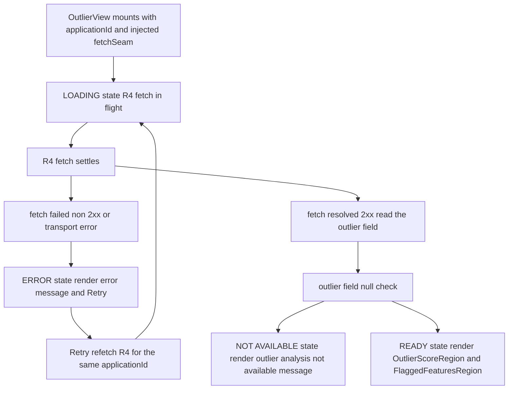

# Business Logic Model — `ui-outlier-view` (U20, C5, Phase 2)

**Stage**: BUILD → Functional Design (per-unit) · **Unit**: U20 `ui-outlier-view` · C5 · **Phase 2** · **Depth**: lighter (display) · **Date**: 2026-07-17 · Story **US-UI-3**.
**Scope**: the **fetch + render-state lifecycle** of the standalone outlier view — from mount through the R4 fetch to one of the four render states (`LOADING` / `READY` / `NOT_AVAILABLE` / `ERROR`), plus the advisory-only argument and the reference-not-own boundary. Built on **Q1–Q5 (A/A/A/B/A)** + **OUTV-FD-Fold-1..3**, re-opening none. **NO code in this stage.** The view owns **no** business logic — it is a faithful renderer of R4's `outlier` slice.

---

## 1. The fetch + render-state lifecycle (Q4-B / OUTV-FD-Fold-1)

`OutlierView` (the only stateful component) mounts with `{ applicationId, fetchSeam }`, fetches WIRE-1 **R4** once, and resolves to exactly one of four **mutually exclusive** states:

1. **`LOADING`** — the R4 fetch is in flight → a loading placeholder.
2. On settle:
   - **fetch failed** (any non-2xx or transport error) → **`ERROR`** → `error.message` + a **Retry** that re-fetches R4 for the **same** `applicationId` (BR-OUTV-7).
   - **fetch resolved 2xx** → read the **`outlier` field**:
     - **`outlier === null`** → **`NOT_AVAILABLE`** — the neutral "outlier analysis not available" message. Covers **both** null-causes (`status: pending` **and** Phase-1 `status: ready` with `outlier: null`); derived off the **field**, not `status` (BR-OUTV-3).
     - **`outlier` present** → **`READY`** — render `OutlierScoreRegion` (`outlier_score` + `is_outlier`) + `FlaggedFeaturesRegion` (the `flagged_features` rows, **in the delivered order**, BR-OUTV-6).

**Key invariant (OUTV-FD-Fold-1)**: `NOT_AVAILABLE` is reached **only** on a successful (2xx) resolution — a fetch failure always routes to `ERROR`, so the "not available" state **never masks a genuine error**.

---

## 2. Flow diagram (validated — rectangle-only, alphanumeric IDs, quoted labels, no special characters)

### Text alternative (always included)
- **Mount → fetch**: `OutlierView` mounts with `applicationId` + the injected `fetchSeam` and enters **`LOADING`** while the R4 fetch is in flight.
- **Settle → two branches**: when the fetch settles, either it **failed** (non-2xx or transport) → **`ERROR`** (render `error.message` + a Retry that re-fetches R4 for the same `applicationId`), or it **resolved 2xx** → read the `outlier` field.
- **`outlier` field branch**: if `outlier` is **null** → **`NOT_AVAILABLE`** (the neutral "outlier analysis not available" message, covering both `pending` and Phase-1-`ready`-null); if `outlier` is **present** → **`READY`** (render the score region + the flagged-features rows, in the delivered order).
- **Retry loop**: the `ERROR` state's Retry returns to **`LOADING`** (a fresh R4 fetch for the same `applicationId`). The `NOT_AVAILABLE` branch is reached only from a successful resolution, never from a failure — so it cannot mask an error.

---

## 3. Advisory-only argument (BR-OUTV-2 / OUTV-FD-Fold-2)

The outlier signals are **advisory input** for the underwriter, never a verdict:
- **No verdict field to render**: `OutlierResult` carries a score + flags + provenance only — no `Recommendation` (U18 `NFR-OUT-ADVISORY-1`, by construction). The view therefore **cannot** accidentally render a decision from the data.
- **Renders no `Recommendation` namespace**: the view imports/renders **no** `RecommendationBadge`/`ConfidenceBadge` and no `Recommendation` wire value — isolation from the system verdict is **structural-by-absence** (nothing within the unit to separate from).
- **Statistical framing of `direction`**: `high`/`low` are rendered via `FLAG_DIRECTION_LABELS` as **statistical positions** relative to the corpus distribution (above / below the typical range), never as severity/verdict words (OUTV-FD-Fold-3) — advisory-vocabulary-lint-subject.
- **Forward-looking (OUTV-FD-Fold-2)**: on a future combined memo + outlier screen (Q1-deferred), the **cross-panel** separation from `ui-memo-view`'s RO `Recommendation` region is the **integrator's** responsibility; this unit's contribution is a no-`Recommendation`, advisory-framed panel — a **documented** note, not a silent assumption.

## 4. Reference-not-own boundary (BR-OUTV-1 / BR-OUTV-10)

- **Depends on (by value / by shape)**: WIRE-1 R4 `outlier` slice (`OutlierResult`/`FlaggedFeature`/`OutlierProvenance`/`FlagDirection`); frozen `ui-shell` primitives + copy + session + tokens (composed, never edited).
- **Reached only `(orchestrated)`**: `outlier-model` (U18) — via R4, **never imported** (`unit-of-work-dependency.md:49`; the reciprocal of U18's `StructuralGuard` forbidding `ui_outlier_view`).
- **Imports no**: backend Python (cross-language boundary); sibling view unit (`ui-memo-view`/`ui-queue` — mirror the convention, not the module); router; write/commit path.
- **Edits nothing frozen**: WIRE-1, `ui-shell`, `ui-memo-view`, `outlier-model`, the closed composition root — all untouched.

## 5. FD ↔ later-stage boundary

- **FD pins**: the composition boundary (standalone `frontend/src/outlierView/`, own fetchSeam), the consumed R4 shapes (by value), the four-state render model (Q4-B), the component/prop inventory, the advisory-statistical framing + the `direction` statistical-position copy, the `data-testid` convention, the provenance-not-rendered rule.
- **NFR Requirements / NFR Design / Code-Gen own**: the `NFR-OUTV-*` targets (the RTL/jsdom teeth, the advisory-vocabulary/no-inline-label/testid lints on `src/outlierView/**`, the four-state coverage, the fetch-double), the `shell/tokens` aesthetic values, the exact outlier-local copy strings, the fetchSeam realization.
- **Out of scope (named-not-designed)**: the R4 route implementation (`backend/app/main.py`, Build & Test); the future combined memo + outlier screen composition (the deferred shell/router/app integration, OUTV-FD-Fold-2).

## 6. Invariant self-check

| Invariant | Holds because | Rule |
|---|---|---|
| Never renders a verdict/recommendation | no `Recommendation` namespace rendered; `OutlierResult` has no verdict field | BR-OUTV-2 |
| A null outlier never masks an error | `NOT_AVAILABLE` reached only on a 2xx resolution; failures route to `ERROR` | BR-OUTV-3 / OUTV-FD-Fold-1 |
| `direction` never reads as severity | rendered via `FLAG_DIRECTION_LABELS` statistical-position copy, lint-subject | BR-OUTV-5 / OUTV-FD-Fold-3 |
| No write / no gating | view-only, no `RoleGate`, no router, no commit | BR-OUTV-4 |
| Faithful order | `flagged_features` rendered in the delivered order, no re-sort | BR-OUTV-6 |
| Provenance stays audit-scoped | `seed`/`corpus_version` never rendered; at most a `model_version` footnote | BR-OUTV-9 |
| Edits nothing frozen | R4 shapes by value; `ui-shell` composed; `outlier-model` via R4 only | BR-OUTV-10 |
