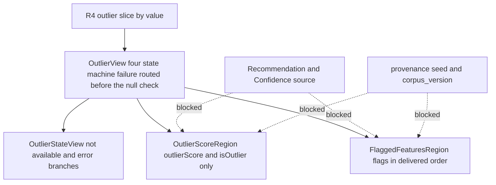

# Logical Components — `ui-outlier-view` (U20, C5, Phase 2)

**Stage**: BUILD → NFR Design (per-unit) · **Unit**: U20 `ui-outlier-view` · C5 · **Phase 2** · **Depth**: lighter (display) · **Date**: 2026-07-17.
**Built ON** the frozen FD + the thirteen `NFR-OUTV-*` + the patterns `P-OUTV-1..10` (`nfr-design-patterns.md`) — re-opening none. The **six logical components** (five owned + the `StructuralGuard` substrate) with responsibilities, ownership, and the **exact prop shapes that enforce each by-construction guarantee** (Q1–Q3 all **A — structural**). Folds **NFR-ND-OUTV-Fold-1** (mandatory header comments).

> **Self-evidence convention (NFR-ND-OUTV-Fold-1 — MANDATORY, not a candidate)**: `OutlierView`, `OutlierScoreRegion`, `FlaggedFeaturesRegion`, and `fetchSeam` each carry a **header comment** stating their by-construction restriction (the frozen `ui-history` NFR-DESIGN-Fold-1 / `ui-approval-gate` precedent), so the guarantees are legible **reading each module in isolation** — **documentation only, NOT enforcement** (the prop signatures + the branch ordering + the `StructuralGuard` scans are the enforcement).

---

## 1. Components + prop shapes (the by-construction surface)

### C-OUTV-1 `OutlierView` (`outlierView/OutlierView.jsx`) — P-OUTV-1, P-OUTV-6, P-OUTV-8
- **Responsibility**: the **only** stateful component — fetches R4 via the injected `fetchSeam`, owns the **four-state machine** with **failure-first ordering** (P-OUTV-1), and selects `OutlierStateView` vs the ready composition (`OutlierScoreRegion` + `FlaggedFeaturesRegion`). Emits nothing upward.
- **Prop shape (by construction)**: `{ applicationId, fetchSeam }` — **no outward mutating event** (view-only, P-OUTV-8).
- **Header comment (MANDATORY)**: state derivation is failure-first (`REJECTED → ERROR` before the `outlier`-null check), so `NOT_AVAILABLE` is **unwritable from a failure path**; the discriminator is the **`outlier` field** on a resolved response, not R4 `status`.
- **Ownership**: owns the fetch + state machine. **Backs**: STATE-1, FETCH-1, VIEWONLY-1.

### C-OUTV-2 `fetchSeam` (`outlierView/fetchSeam.js`) — P-OUTV-6, P-OUTV-7 (build/normalize)
- **Responsibility**: the **own local thin, read-only** R4 request seam — `createOutlierFetch(transport) → { fetchOutlier(applicationId) }`; `buildOutlierRequest(applicationId)` emits **only** `{ method: 'GET', path }`; `normalizeError(cause) → { error: { code, message, detail } }`. **Injected** into `OutlierView`; tests inject a **single capturing double** (Fold-A). Duck-typed, no formal interface.
- **Header comment (MANDATORY)**: READ-ONLY R4 seam; builder emits only GET; **no request-body builder, no `submit*` — write structurally absent**; **mirrors the sibling read seams WITHOUT importing** them.
- **Ownership**: owns. **Backs**: FETCH-1, ERROR-1 (build/normalize), SCOPE-1 (mirror-not-import).

### C-OUTV-3 `OutlierStateView` (`outlierView/OutlierStateView.jsx`) — P-OUTV-4, P-OUTV-7
- **Responsibility**: presentational **loading / not-available / error** states. `not_available` renders the neutral "outlier analysis not available" message (`outlier-state-notavailable`) — a **distinct branch** from the empty-`flagged_features` "no anomalies" message (P-OUTV-4); `error` renders `error.message` (`outlier-error-message`) + hidden `error.code` (`outlier-error-code`) + a Retry (`outlier-error-retry`), never `error.detail` raw (P-OUTV-7).
- **Prop shape**: `{ state, error, onRetry, testid }` — `state ∈ {loading, not_available, error}`.
- **Ownership**: owns. **Backs**: EMPTY-1 (not-available branch), ERROR-1.

### C-OUTV-4 `OutlierScoreRegion` (`outlierView/OutlierScoreRegion.jsx`) — P-OUTV-2, P-OUTV-3 (**no-verdict / no-provenance by prop signature**)
- **Responsibility**: presentational `outlier_score` + `is_outlier` under advisory chrome — the score is a **statistical anomaly score**, not a verdict.
- **Prop shape (by construction)**: `{ outlierScore, isOutlier, testid }` — **NO `recommendation`/`confidence` prop or path (P-OUTV-2); NO `provenance`/`seed`/`corpus_version` prop or path (P-OUTV-3).** A verdict and applicant/audit provenance are **structurally unnameable** here.
- **Header comment (MANDATORY)**: props are `{outlierScore,isOutlier,testid}` only — no recommendation/confidence/provenance/seed/corpus_version prop; renders no system verdict, no provenance.
- **Ownership**: owns. **Backs**: NOVERDICT-1, PROV-1.

### C-OUTV-5 `FlaggedFeaturesRegion` (`outlierView/FlaggedFeaturesRegion.jsx`) — P-OUTV-2, P-OUTV-3, P-OUTV-4, P-OUTV-5
- **Responsibility**: presentational flag rows — `feature` label + `direction` via `FLAG_DIRECTION_LABELS` (statistical position, no severity word) + `z_score` + `shap_value` — **in the delivered order** (P-OUTV-5, no re-sort); empty array → a neutral "no anomalous features" message (P-OUTV-4, distinct from not-available).
- **Prop shape (by construction)**: `{ flaggedFeatures, testid }` — **NO `recommendation`/`confidence` prop (P-OUTV-2); NO `provenance`/`seed`/`corpus_version` prop (P-OUTV-3).**
- **Header comment (MANDATORY)**: props are `{flaggedFeatures,testid}` only — no verdict/provenance prop; renders flags as statistical signals in delivered order; empty ⇒ no-anomalies branch.
- **Ownership**: owns. **Backs**: NOVERDICT-1, PROV-1, EMPTY-1, LISTORDER-1.

### C-OUTV-6 `StructuralGuard` substrate (`outlierView/__tests__/*` + scans) — P-OUTV-9, P-OUTV-10 (test-only)
- **Responsibility**: the single substrate of scans, each with a **detector self-test** (non-vacuous): no-sibling/backend-import (SCOPE-1); no-`RecommendationBadge`/`ConfidenceBadge`-import (the structural half of NOVERDICT-1); testid-convention (TESTID-1); no-`.ts`/`.tsx` (NOTS-1); the reused frozen `advisory-vocabulary`/`no-inline-label` lints (ADVISORY-1/COPY-1).

---

## 2. Component-relationship diagram (validated — rectangle-only, alphanumeric IDs, quoted labels, no special characters; the no-verdict / no-provenance guarantee as a VISIBLE blocked edge)

### Text alternative (always included)
- **The no-verdict guarantee is a visible graph property**: `R4` flows into `OutlierView`, which composes `OutlierScoreRegion` + `FlaggedFeaturesRegion`. The dashed **blocked** edges from **`Recommendation and Confidence source`** into both regions show there is **no prop path** by which a system verdict could enter this unit's render tree — it is excluded by the prop signatures (P-OUTV-2), mirroring `ui-history`'s namespace isolation.
- **The no-provenance guarantee is likewise visible**: the dashed **blocked** edges from **`provenance seed and corpus_version`** into both regions show the rendering regions **never receive** provenance as props (P-OUTV-3) — `seed`/`corpus_version` are structurally absent from the render.
- **The state machine**: `OutlierView` routes a failure to `ERROR` **before** the `outlier`-null check, so `NOT_AVAILABLE` (via `OutlierStateView`) is reachable only on a resolved response (P-OUTV-1).

---

## 3. Reference-not-own check (two distinct categories, kept separate)

| Category | Modules | Discipline |
|---|---|---|
| **Consumed, NOT modified** (frozen `ui-shell`, imported + composed) | `AppFrame` / `Panel` / `Region` / `ReadOnlyRegion`; `shell/copy` (`ADVISORY_VOCABULARY` + the one `FORBIDDEN_TERMS`); `shell/session` (`RoleContext`/`useCurrentRole()`); `shell/tokens` | import the frozen primitive, never edit, never promote-into; **not** `RecommendationBadge`/`ConfidenceBadge` (P-OUTV-2), **not** `RoleGate` (P-OUTV-8) |
| **NOT imported — reached only via R4 orchestration / mirrored** | `outlier-model` (U18 — `(orchestrated)`, cross-language boundary; reached only through R4); `ui-memo-view` / `ui-queue` (sibling views — **mirror** the fetchSeam/StructuralGuard convention, never import); any backend module | U20 has **no code edge** to these; the only cross-unit surface is the WIRE-1 R4 `outlier` shape (by value) |

**Edits nothing frozen; imports no consumer/sibling/backend.** The reciprocal boundary holds: U18's `StructuralGuard` forbids importing `ui_outlier_view`, and U20 imports no `outlier-model`.

## 4. Component → target coverage (no orphan)

| Component | NFR-OUTV-* targets met | Patterns |
|---|---|---|
| `OutlierView` | STATE-1, FETCH-1, VIEWONLY-1 | P-OUTV-1/6/8 |
| `fetchSeam` | FETCH-1, ERROR-1 (build/normalize) | P-OUTV-6/7 |
| `OutlierStateView` | ERROR-1, EMPTY-1 (not-available branch) | P-OUTV-4/7 |
| `OutlierScoreRegion` | NOVERDICT-1, PROV-1 | P-OUTV-2/3 |
| `FlaggedFeaturesRegion` | NOVERDICT-1, PROV-1, EMPTY-1, LISTORDER-1 | P-OUTV-2/3/4/5 |
| `StructuralGuard` + `copy.js` | SCOPE-1, ADVISORY-1, COPY-1, TESTID-1, NOTS-1 (+ NOVERDICT-1 import half) | P-OUTV-9/10 |

**All thirteen `NFR-OUTV-*` covered; no orphan.**

## 5. Settled items held (not re-opened)
- The **frozen FD** (BR-OUTV-1..10 + the four-state model) + the **thirteen NFR-OUTV-*** + folds Fold-A..D are the substrate.
- **Q1-A** (structural failure-first state ordering) — `NOT_AVAILABLE` unwritable from a failure path.
- **Q2-A** (structural prop-signature exclusion of `recommendation`/`confidence`) — a verdict is structurally unnameable in the render tree.
- **Q3-A** (structural prop-signature exclusion of `provenance`/`seed`/`corpus_version`) — nothing to render, not a rendering choice.
- **NFR-ND-OUTV-Fold-1**: header comments **mandatory** on `OutlierView` / `OutlierScoreRegion` / `FlaggedFeaturesRegion` / `fetchSeam` — documentation only.
- **Deferred to Infrastructure Design / Code-Gen**: the exact `FLAG_DIRECTION_LABELS`/copy strings, the `shell/tokens` values, the `fetchSeam` transport realization, whether the `outlier_model_version` footnote is included (a distinct footnote slot, never `seed`/`corpus_version`). **tier-B N/A** (a UI unit never touches the corpus).
