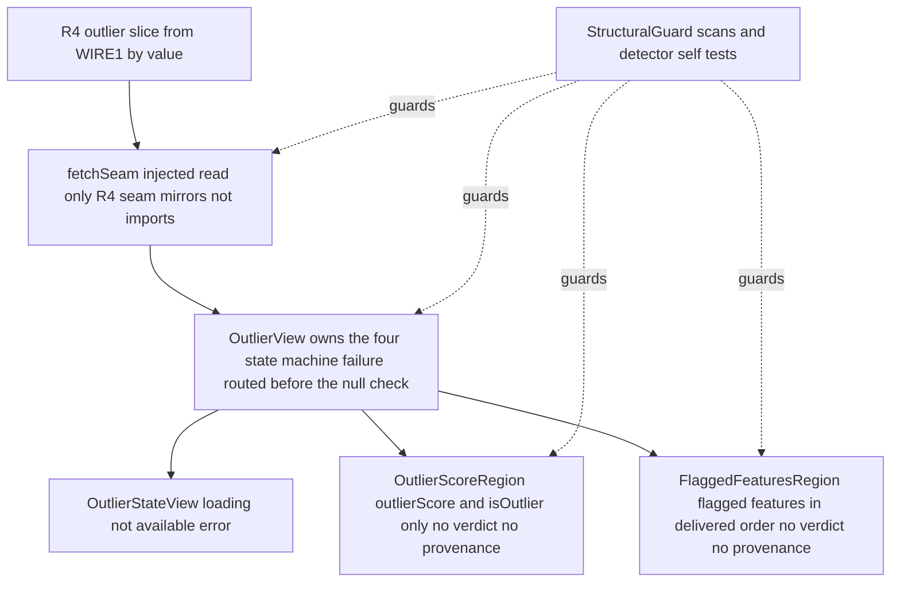

# NFR Design Patterns — `ui-outlier-view` (U20, C5, Phase 2)

**Stage**: BUILD → NFR Design (per-unit) · **Unit**: U20 `ui-outlier-view` · C5 · **Phase 2** · **Depth**: lighter (display) · **Date**: 2026-07-17.
**Built ON** the frozen FD (**BR-OUTV-1..10**; the four-component inventory; the four-state render model) **and** the approved NFR Requirements (**thirteen `NFR-OUTV-*`**; the load-bearing **STATE-1 / NOVERDICT-1** pair; folds **Fold-A..D**) — **re-opening neither.** Each pattern **structurally** meets its `NFR-OUTV-*` target(s) + is traced. **Advisory-only; no LLM; no live backend** (R4 doubled). Answers **Q1–Q3 (all A — structural)** + fold **NFR-ND-OUTV-Fold-1** (mandatory header comments).

> **By-construction mechanism (Q1/Q2/Q3 all A).** A "by-construction" guarantee here is realized through: **(i) prop signatures where the forbidden thing has no path** (a region whose props carry no `recommendation`/`confidence`/`provenance` cannot render one); **(ii) state-transition ordering where the forbidden state is unreachable on a branch** (failure routed to `ERROR` before the `outlier`-null check); **(iii) the `StructuralGuard` substrate** (lint/AST/import scans + detector self-tests) as the **regression layer**; **(iv) header comments as documentation only — NOT enforcement** (NFR-ND-OUTV-Fold-1, mandatory on the four named modules). This mirrors the frozen `ui-memo-view` (`StructuralIsolationCompositionPattern`) + `ui-history` (`CommittedActionRegion` prop-exclusion), not a runtime check.

---

## §P-OUTV-1 — FieldDerivedStateMachinePattern → NFR-OUTV-STATE-1 — **LOAD-BEARING (state-derivation)**
- **Pattern (by construction, Q1-A)**: `OutlierView` derives its render state by **ordered branches**, failure-first, so `NOT_AVAILABLE` is **unwritable from a failure path**. The mechanism spelled out:
  ```text
  // OutlierView render-state derivation (the failure-before-null-check ordering)
  if (fetchState === REJECTED)  return ERROR          // (1) failure routed FIRST, before any field read
  if (fetchState === PENDING)   return LOADING
  if (view.outlier === null)    return NOT_AVAILABLE   // (2) reachable ONLY on the resolved (2xx) branch
  return READY                                         // (3) outlier present
  ```
  Branch (2) — the `outlier`-null check — is **only reached after** branch (1) has already returned on a rejection, so a fetch failure **can never** yield `NOT_AVAILABLE`. The discriminator is the **`outlier` field** on a **resolved** response (not R4 `status`), so a Phase-1 `ready`+`outlier:null` body still ⇒ `NOT_AVAILABLE`. **Contrast** `ui-memo-view`'s `StatusDiscriminatorPattern` (`pending` off `view.status`) — U20 reads the field, because `status:"ready"` can still carry a null outlier in Phase 1.
- **Meets the target**: (STATE-1) the four states render correctly; the failure-first ordering makes "`NOT_AVAILABLE` never from an error" a **structural** property; the field-derived teeth (a `pending` body **and** a `ready`+null body both ⇒ `NOT_AVAILABLE`; a failure ⇒ `ERROR`) are the **regression layer** (Fold-C fixtures). **Header comment mandatory** (NFR-ND-OUTV-Fold-1).
- **Tier**: component (RTL). **Rigor**: full (highest).

## §P-OUTV-2 — NamespaceExclusionByPropSignaturePattern → NFR-OUTV-NOVERDICT-1 — **LOAD-BEARING (no verdict)**
- **Pattern (by construction, Q2-A)**: the two rendering regions' **prop signatures carry no `recommendation`/`confidence` prop or path**, so a system verdict is **structurally unnameable** in this unit's render tree — mirroring `ui-history` `CommittedActionRegion` (`{action,reason,underwriterId,testid}` only, no system-namespace path). The exact shapes:
  ```text
  OutlierScoreRegion   props = { outlierScore, isOutlier, testid }        // no recommendation, no confidence
  FlaggedFeaturesRegion props = { flaggedFeatures, testid }               // no recommendation, no confidence
  ```
  There is **no prop** through which a `Recommendation`/`Confidence` value could enter these regions, and the unit imports **no** `RecommendationBadge`/`ConfidenceBadge` (P-OUTV-10 scan). A verdict cannot be rendered because there is nothing to render it from.
- **Meets the target**: (NOVERDICT-1) the prop-signature exclusion is the **structural guarantee**; the **import-absence scan** (no badge imported → none can render — the primary robust half) + the **rendered `queryBy*`-null teeth** over the enumerated finite verdict set (Fold-B) are the **regression layer, not the guarantee itself**. **Header comment mandatory** (NFR-ND-OUTV-Fold-1). **Forward-looking (OUTV-FD-Fold-2)**: cross-panel separation on a future combined screen is the integrator's responsibility.
- **Tier**: structural + component. **Rigor**: full (highest).

## §P-OUTV-3 — ProvenanceExclusionByPropSignaturePattern → NFR-OUTV-PROV-1
- **Pattern (by construction, Q3-A)**: the rendering regions **never receive `provenance`/`seed`/`corpus_version` as props at all** — the negative guarantee holds because **there is nothing to render**, not because of a rendering choice a future edit could silently regress. `OutlierScoreRegion`/`FlaggedFeaturesRegion` props (above) contain **no** provenance path. Any `outlier_model_version` footnote (single Code-Gen realization, NFR-Req Q3-A) is passed to a **distinct footnote slot**, **never** carrying `seed`/`corpus_version`.
- **Meets the target**: (PROV-1) the prop-exclusion is structural; the **distinctive collision-proof sentinel** negative teeth (Fold-D — `seed`=a large tagged integer, `corpus_version`=a tagged string, asserted absent from the render) are the regression layer. **Header comment mandatory** on the regions.
- **Tier**: component (negative). **Rigor**: full.

## §P-OUTV-4 — DistinctBranchEmptyVsAbsentPattern → NFR-OUTV-EMPTY-1
- **Pattern**: "analyzed, no anomalies" and "not analyzed" are **two structurally distinct render branches** — `READY` with `flagged_features: []` routes to `FlaggedFeaturesRegion` (which renders a neutral "no anomalous features" message, testid `outlier-region-flags`), whereas `NOT_AVAILABLE` routes to `OutlierStateView` (testid `outlier-state-notavailable`). Different components, different testids — not two messages in one branch.
- **Meets the target**: (EMPTY-1) the two are asserted distinct (different container/testid + message); a present-but-empty `outlier` ⇒ `READY`+"no anomalies", never `NOT_AVAILABLE`.
- **Tier**: component (RTL). **Rigor**: full.

## §P-OUTV-5 — OrderPreservingListPattern → NFR-OUTV-LISTORDER-1
- **Pattern**: `FlaggedFeaturesRegion` renders `flagged_features` **in the delivered order** — no comparator, no `.sort()`; a faithful map over the array as given (the frozen `ui-memo-view` `OrderPreservingListPattern` precedent).
- **Meets the target**: (LISTORDER-1) a deliberately non-sorted fixture renders in input order; no sort in source.
- **Tier**: component + structural. **Rigor**: full.

## §P-OUTV-6 — FetchSeamPattern → NFR-OUTV-FETCH-1 (+ ERROR-1 Retry)
- **Pattern**: an **own local thin `outlierView/fetchSeam`** builds the R4 request by `applicationId` and is **injected** into `OutlierView`; tests inject a **single capturing double** (Fold-A). It **mirrors** the sibling read seams **without importing** them. **Header comment mandatory** (read-only R4 seam; no write; mirrors-not-imports).
- **Meets the target**: (FETCH-1) the four-state machine is driven end-to-end through the one double; Retry re-fetches the captured same `applicationId`.
- **Tier**: component. **Rigor**: full.

## §P-OUTV-7 — ErrorEnvelopeToRenderPattern → NFR-OUTV-ERROR-1
- **Pattern**: `OutlierStateView` maps the WIRE-1 error envelope `{error:{code,message,detail}}` — `message` visible (`outlier-error-message`), `code` a hidden testid (`outlier-error-code`), `detail` **never** rendered raw; Retry (`outlier-error-retry`) re-fetches the same `applicationId`.
- **Meets the target**: (ERROR-1) message-only + code-via-testid + detail-never-raw + same-resource Retry.
- **Tier**: component. **Rigor**: full.

## §P-OUTV-8 — RoleInvariantRenderingPattern → NFR-OUTV-VIEWONLY-1
- **Pattern**: `OutlierView` composes **no `RoleGate`**, imports **no router**, exposes **no commit affordance**, and gates on nothing (`shell/session` available but not gated). Rendering is invariant to Role.
- **Meets the target**: (VIEWONLY-1) no gating primitive, no router, no write path, no outward mutating event.
- **Tier**: structural + component. **Rigor**: full.

## §P-OUTV-9 — SharedForbiddenTermsReusePattern → NFR-OUTV-ADVISORY-1 + NFR-OUTV-COPY-1
- **Pattern**: **reuse `ui-shell`'s ONE `FORBIDDEN_TERMS` + ESLint** (`advisory-vocabulary` / `no-inline-label`) registered on `src/outlierView/**` — **no new word-list**. Enum/chrome labels live in `outlierView/copy.js`; `FLAG_DIRECTION_LABELS` frames `direction` (`high`/`low`) as a **statistical position** (above/below the typical range), keyed by value, **no severity/verdict word** (OUTV-FD-Fold-3).
- **Meets the target**: (ADVISORY-1) lints green + a synthetic forbidden-term insertion fails (non-vacuity); (COPY-1) no inlined shell label, direction labels statistical-position, no value collision.
- **Tier**: structural (lint) + component. **Rigor**: full.

## §P-OUTV-10 — StructuralGuardPattern → NFR-OUTV-SCOPE-1 + NFR-OUTV-TESTID-1 + NFR-OUTV-NOTS-1 (+ the structural halves of NOVERDICT / ADVISORY)
- **Pattern (single substrate)**: one `StructuralGuard` substrate of independent scans, **each with a detector self-test** (non-vacuous): **no-sibling/backend-import** (SCOPE-1 — no `outlier-model`/`ui-memo-view`/`ui-queue`/backend); **no-`RecommendationBadge`/`ConfidenceBadge`-import** (the structural half of NOVERDICT-1); **testid-convention** `outlier-<element>-<purpose>` (TESTID-1); **no-`.ts`/`.tsx`** (NOTS-1); the reused advisory lints (ADVISORY-1).
- **Meets the target**: (SCOPE-1/TESTID-1/NOTS-1) the scans pass over `src/outlierView/**` + each self-test flags a synthetic violation.
- **Tier**: structural. **Rigor**: full.

---

## §11 — Pattern-integration diagram (validated — rectangle-only, alphanumeric IDs, quoted labels, no special characters)



### Text alternative (always included)
- **`R4`** delivers the `outlier` slice by value into **`fetchSeam`** (a read-only, injected R4 seam that mirrors the sibling read seams without importing them).
- **`OutlierView`** owns the **four-state machine** and routes a **fetch failure to `ERROR` before the `outlier`-null check** (P-OUTV-1), then selects **`OutlierStateView`** (loading / not-available / error) or the ready composition — **`OutlierScoreRegion`** (`outlierScore`+`isOutlier` only) and **`FlaggedFeaturesRegion`** (flags in delivered order) — **neither region carries a `recommendation`/`confidence`/`provenance` prop** (P-OUTV-2/3).
- **`StructuralGuard`** (dashed, test-only) guards `OutlierView`, `fetchSeam`, and the two regions via scans + detector self-tests — it is not a runtime dependency.

---

## §12 — Traceability (pattern → target → tier)

| Pattern | Target(s) | Tier |
|---|---|---|
| **P-OUTV-1 FieldDerivedStateMachinePattern** | **NFR-OUTV-STATE-1** | component | 
| **P-OUTV-2 NamespaceExclusionByPropSignaturePattern** | **NFR-OUTV-NOVERDICT-1** | structural + component |
| P-OUTV-3 ProvenanceExclusionByPropSignaturePattern | NFR-OUTV-PROV-1 | component (negative) |
| P-OUTV-4 DistinctBranchEmptyVsAbsentPattern | NFR-OUTV-EMPTY-1 | component |
| P-OUTV-5 OrderPreservingListPattern | NFR-OUTV-LISTORDER-1 | component + structural |
| P-OUTV-6 FetchSeamPattern | NFR-OUTV-FETCH-1 | component |
| P-OUTV-7 ErrorEnvelopeToRenderPattern | NFR-OUTV-ERROR-1 | component |
| P-OUTV-8 RoleInvariantRenderingPattern | NFR-OUTV-VIEWONLY-1 | structural + component |
| P-OUTV-9 SharedForbiddenTermsReusePattern | NFR-OUTV-ADVISORY-1, NFR-OUTV-COPY-1 | structural + component |
| P-OUTV-10 StructuralGuardPattern | NFR-OUTV-SCOPE-1, NFR-OUTV-TESTID-1, NFR-OUTV-NOTS-1 | structural |

**All thirteen `NFR-OUTV-*` covered; no orphan.** **Load-bearing pair**: **P-OUTV-1** (field-derived state machine, failure-first ordering) + **P-OUTV-2** (namespace exclusion by prop signature).
