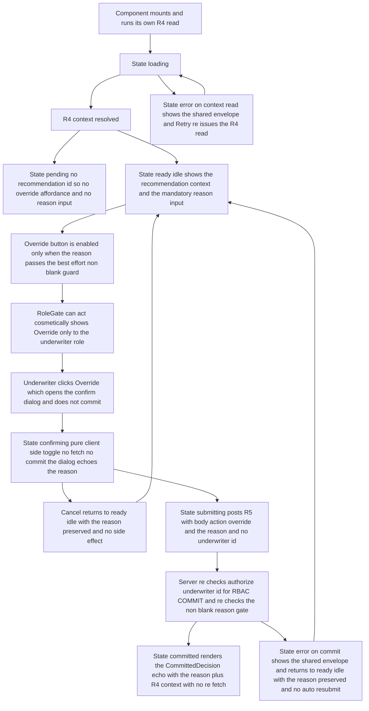
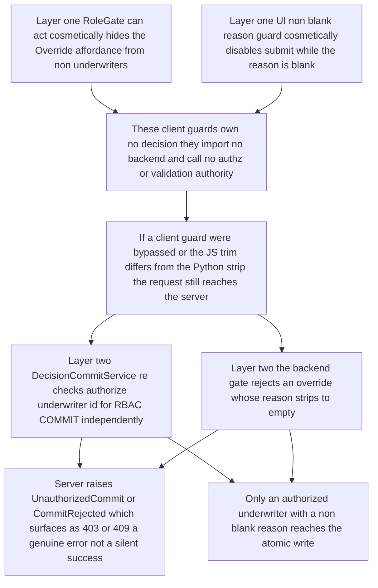

# `ui-override-form` (U8) — Functional Design · Business Logic Model

**Stage**: BUILD → per-unit loop → Functional Design → Part 2 · **Depth**: COMPREHENSIVE
**Date**: 2026-07-09
**Scope**: the reason→confirm→override flow of the second UI write path — R4 read for context, a **mandatory reason** entry, an explicit human confirm step (with the reason echoed for review), then the R5 override write — with **two** defense-in-depth relationships made structural: the authz gate (AUTHZ-1) **and** the mandatory-reason gate (BR-COMMIT-GATE), both server-authoritative.

---

## 1. Flow — R4 read then reason then confirm then R5 override write (validated Mermaid)

Mermaid validated against this project's 7 rules: alphanumeric node IDs, quoted labels, no hyphens/semicolons/colons/parentheses/special characters in labels, balanced blocks, rectangle-only.

### 1.1 Text alternative (equivalent to the diagram)
1. The component mounts and runs its **own** R4 read (`GET /applications/{id}/memo`) → **loading**.
2. On R4 reject → **error on context read** (shared envelope); its `Retry` **re-issues the R4 read** for the same `applicationId` (back to **loading**) — BR-OVR-11(a). On R4 resolve, branch on the `status` discriminator:
   - `pending` / `recommendation_id = null` → **pending**: there is nothing to override, so **no override affordance and no reason input render** (OVR-Fold-5).
   - `ready` → **ready(idle)**: the recommendation context (recommendation + confidence via the frozen badges) is shown **alongside the mandatory reason input** (`OverrideReasonInput`, a controlled, capability-free textarea whose text lives in the orchestrator's `reason` state).
3. The Override affordance is **enabled only when the `reason` passes the best-effort non-blank guard** (`String.prototype.trim()` is non-empty) — BR-OVR-8, a **non-authoritative** UX gate.
4. The override affordance is wrapped in `RoleGate can="act"` — cosmetically visible **only** to the `underwriter` role.
5. Clicking **Override** (reason non-blank) opens `OverrideConfirmDialog` and **does not commit** (BR-OVR-2) → **confirming**. The dialog **echoes the reason** (read-only) so the human reviews exactly what will be recorded (BR-OVR-12).
6. **confirming is a pure client-side toggle** (BR-OVR-3): rendering or canceling it issues **no fetch, no commit, and no state mutation** beyond the local `confirming` flag. **Cancel** → back to **ready(idle)** with the **reason preserved** (BR-OVR-12).
7. **Confirm** → **submitting**: post R5 with body `{ action: "override", reason }` via `submitOverride(recommendationId, reason)` — **no `underwriter_id`** in the body.
8. The server **independently re-checks two gates** — `authorize(underwriter_id, RBAC_COMMIT)` (AUTHZ-1) **and** the non-blank reason gate (`_gate`: `reason.strip()==""` → reject, BR-COMMIT-GATE) — both authoritative:
   - success (200) → **committed**: render the `CommittedDecision` echo (incl. the committed `reason`) + R4 context already in hand — **no re-fetch** (OVR-Fold-2).
   - 403 / 409 / 400 / 422 → **error on commit**: the distinct-per-status render, all through the one shared envelope (BR-OVR-6); the state then **returns to `ready(idle)` with the reason preserved** — **never an automatic resubmit** — so the underwriter must re-open the confirm dialog and re-confirm before any retry (BR-OVR-11(b)).
9. **committed** is terminal for this unit (no re-override; the recommendation is committed).

Both error states render the same shared envelope discipline of BR-OVR-6 — message visible, code hidden, detail never; they differ only in recovery per BR-OVR-11.

---

## 2. The confirm dialog as a pure toggle + the reason as human-reviewed payload

The two load-bearing behaviors of this unit:

**(a) The R5 override fires only on the confirm dialog's `Confirm` action** — never on the Override click, never on dialog open, never on Cancel, and never while the reason is blank.
- `Override` click → sets `confirming = true` → renders `OverrideConfirmDialog`. **Zero** transport calls.
- Dialog `Cancel` → sets `confirming = false` → returns to `ready(idle)`, reason preserved. **Zero** transport calls; the rendered context is byte-identical to before.
- Dialog `Confirm` → sets `submitting = true` → **exactly one** R5 POST via `submitOverride(recommendationId, reason)`.

**(b) The reason is a human-authored, human-reviewed payload** (Q3-A). The `reason` text lives in `OverrideFormView` (the orchestrator); `OverrideReasonInput` is a **controlled, capability-free** textarea (holds text, **holds no seam reference**). The **refined invariant**: "no commit capability" means holding **no seam/trigger reference** — it is about the **trigger**, not the **payload**. Holding reason *text* is not a commit capability; the single-call-site discipline is **unchanged**, merely **parameterized by `reason`** — `submitOverride` is invoked in exactly one place (this view's `onConfirm`, closing over the current `reason`), passed only to `OverrideConfirmDialog`. Checkable (BR-OVR-2 / BR-OVR-3 / BR-OVR-8): an injected transport double receives **no** call across Override→open→Cancel and while the reason is blank, and **exactly one** POST (carrying the reason) on Confirm.

---

## 3. Two server-authoritative gates — defense-in-depth (structural note, not just prose)

This unit has **two** client-side guards and **two** authoritative server gates. The client guards decide nothing; the server is the single source of truth for **both** authorization **and** the mandatory reason.

**Text alternative**: There are **two** client-side layer-one guards — (1) `RoleGate can="act"` cosmetically hides the Override affordance from non-underwriters, and (2) the UI non-blank reason guard cosmetically disables submit while the reason is blank. **Both are cosmetic** — they own no decision, import no backend, and call no authz-or-validation authority. If either guard were bypassed — **or** the JS `String.prototype.trim()` disagrees with the backend Python `str.strip()` on exotic Unicode whitespace (FD-OVR-Fold-1: U+001C–U+001F / U+0085 pass the UI but the backend strips them to empty) — the request still reaches the server. Layer two is authoritative on **both** axes: `DecisionCommitService` independently re-checks `authorize(underwriter_id, RBAC_COMMIT)` (raises `UnauthorizedCommit` → 403) **and** the backend `_gate` rejects an override whose reason strips to empty (raises `CommitRejected` → 409). Either rejection surfaces as a **genuine error**, never a silent success. Only an authorized underwriter with a genuinely non-blank reason reaches the atomic write. A client cannot self-elevate (`underwriter_id` is session-derived server-side, BR-OVR-5) and cannot smuggle a blank reason past the backend (the server strips-and-checks independently, BR-OVR-8).

---

## 4. Consumer / dependency map

**Consumes (frozen — by value / by shape / by convention; none edited):**

| Dependency | Kind | Consumed as |
|---|---|---|
| ui-shell `RoleGate` / `AppFrame` / `Panel` / `ReadOnlyRegion` / `RecommendationBadge` / `ConfidenceBadge` / `shell/copy` (incl. `COMMIT_ACTION_LABELS.override`) / `shell/tokens` / `shell/session` | frozen import | composed directly (React import) |
| WIRE-1 R4 `MemoView`, R5 override request/response, §4 error envelope, §1 enum wire map | contract | shapes/values (no re-case, no remap) |
| ui-queue / ui-memo-view / **ui-approval-gate** `fetchSeam` + by-construction + `StructuralGuard` conventions | frozen sibling | **convention only — NOT imported** (own-local re-realization; mirror-not-import) |
| auth-rbac `Role` / `PERMISSION_MATRIX` / `RBAC_COMMIT` | frozen backend | semantic source `RoleGate` mirrors as value shapes; **not imported** (cross-language) |
| audit-store `DecisionCommitService` / `_gate` / `CommittedDecision` / `CommitAction` / `BR-COMMIT-GATE` | frozen backend | the real server-side enforcement (authz **and** non-blank reason) this action triggers; `CommittedDecision` is R5's response shape; `_gate`'s `reason.strip()==""` rule is the authoritative reason gate |

**Consumed by (downstream):** none yet at Phase-1 UI. This unit is mounted by the composition root (WIRE-1, deferred) for a given application. A future **combined approve+override screen** is a deferred composition-root concern that would mount `OverrideFormView` alongside the frozen `ApprovalGateView` (Q6-A / OVR-Fold-3) — **no** speculative composition prop is added now. **ui-history** (U9) surfaces the persisted `AuditRecord` (`decision_id` / `timestamp` / the committed `reason`) this override produces.

**Owns:** own-local `overrideFetchSeam.js` (R4 read + R5 override write, injected duck-typed transport, `buildOverrideRequest(recommendationId, reason)`), `copy.js`, and the `OverrideFormView` + `CommitStateView` + `RecommendationContext` + `OverrideReasonInput` + `OverrideAffordance` + `OverrideConfirmDialog` + `CommittedConfirmation` components.

---

## 5. Invariant self-check (hard constraint → concrete mechanism in this unit)

| Hard constraint | Mechanism in `ui-override-form` | Rule |
|---|---|---|
| **Advisory-only** | No client finalize; a `CommittedDecision` exists only via an explicit human confirm→R5 override; copy says "recommendation" for system output, reserves "decision" for the human action; the human `override` is never rendered as the system `DECLINE-RECOMMEND` | BR-OVR-1, BR-OVR-7 |
| **Human-in-the-loop with mandatory reason** | Override opens a confirm dialog (never commits); a **mandatory non-blank reason** is required before submit is enabled; the dialog echoes the reason for final review; the R5 POST fires only on `Confirm`; the dialog is cancelable with zero side effects and preserves the reason; a commit failure never auto-resubmits — it returns to `ready(idle)` (reason preserved) and requires a fresh Override→Confirm cycle | BR-OVR-2, BR-OVR-3, BR-OVR-8, BR-OVR-11, BR-OVR-12 |
| **RoleGate cosmetic ≠ authorization** | `RoleGate can="act"` only shows/hides the affordance (no authz call, no backend import); AUTHZ-1 `DecisionCommitService` re-check is the real gate; 403 surfaces as a genuine error; `underwriter_id` is session-derived server-side | BR-OVR-4, BR-OVR-5 |
| **UI reason guard cosmetic ≠ authoritative validation** | The UI non-blank guard is best-effort `trim()`-based and **non-authoritative**; the backend `_gate` (`reason.strip()==""` → reject → 409) is the single source of truth; any UI↔backend trim divergence resolves to the backend via the generic 409 | BR-OVR-8, BR-OVR-6 |
| **Namespace-distinctness** | The human `override` (lowercase, `CommitAction`) is never rendered/serialized as the system `DECLINE-RECOMMEND` (uppercase, `Recommendation`); the label is the frozen `COMMIT_ACTION_LABELS.override` | BR-OVR-7 |
| **No LLM** | The unit issues no model call and renders no model output on the write path; it reads typed WIRE-1 context and posts a fixed action + a human-authored reason; the reason never enters an LLM path | (whole unit — no LLM code path) |

**Reference-not-own**: no backend import, no sibling-UI import (incl. frozen `ui-approval-gate`); own-local seam + copy; error-shape consistency via the shared WIRE-1 §4 contract, not shared code (BR-OVR-10). The by-construction guarantees (capability-free `OverrideAffordance` / `OverrideReasonInput`; sole-`onConfirm` `OverrideConfirmDialog`; single `submitOverride` call site) are enforced by StructuralGuard tests at NFR/Code-Gen, mirroring U7 and growing by one for `OverrideReasonInput` (FD-OVR-Fold-2).
