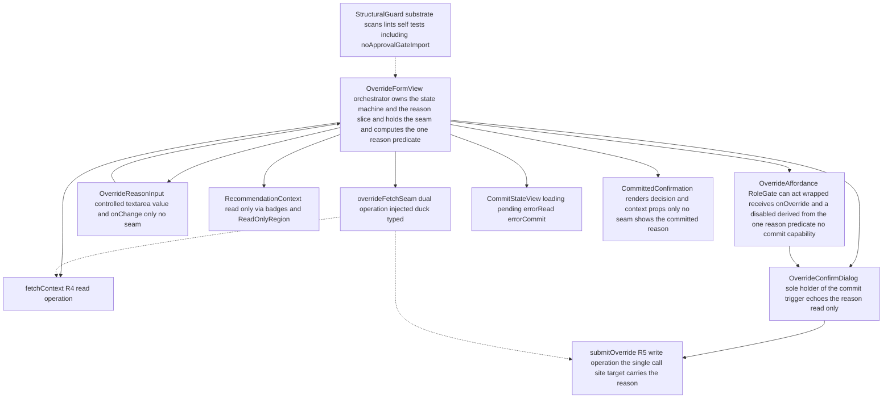

# Logical Components — `ui-override-form` (U8)

**Stage**: BUILD → NFR Design (per-unit) · **Unit**: U8 `ui-override-form` · C-cluster UI · Phase 1 · **Depth**: COMPREHENSIVE · **Date**: 2026-07-09
**Built ON** the frozen FD (**BR-OVR-1..12**, inventory, state machine incl. reason preservation, two-server-gate note) **and** the approved NFR Requirements (**twenty `NFR-OVR-*`**; Fold-A/1/2/3) + NFR-Design patterns (§P1..§P12, ND-OVR-Fold-i/ii/iii) — **re-opening none**. **Q1–Q4 all A.** The **exact prop shapes** below are what enforce the by-construction guarantees (not just prose "capability-free").

---

## 1. Components (C1–C10) — responsibility · ownership · exact prop shape

### C1 — `OverrideFormView` (the ONLY stateful component; orchestrator)
- **Responsibility**: owns the state machine (P10) **and the `reason` state slice** (P8, independent of the phase slice); holds the injected `overrideFetchSeam`; runs the initial R4 read; computes the **single** `isReasonPresent(reason) = reason.trim() !== ''` predicate (P2); passes state + callbacks to presentational children; constructs the `onConfirm` handler (sets `submitting`, invokes `seam.submitOverride(recommendationId, reason)`, re-applies `isReasonPresent` as optional belt-and-suspenders — ND-OVR-Fold-i) and passes it **ONLY** to `OverrideConfirmDialog` (P1).
- **Prop shape**: `{ overrideFetchSeam, applicationId, testid }` — the seam is **injected as a prop** (never hard-wired), mirroring the sibling convention.
- **Owns / holds**: the seam ref; the machine (phase slice); the **`reason` slice**; the predicate; the sole `onConfirm` handler.

### C2 — `overrideFetchSeam` (own-local dual-operation seam)
- **Responsibility**: `createOverrideFetch(transport) → { fetchContext, submitOverride }` (P10) + `buildMemoRequest(applicationId)` + `buildOverrideRequest(recommendationId, reason)` (P4) + `normalizeError(cause)` (P5 envelope). Makes **no** real network call — the transport is injected.
- **By-construction shape (P4)**: `buildOverrideRequest(recommendationId, reason)` — `reason` a **required positional**, **no `underwriter_id` param** → body `{ action:'override', reason }` (reason as-entered, no trim in the builder — ND-OVR-Fold-iii).
- **Owns / holds**: request builders; no real network.

### C3 — `CommitStateView` (presentational)
- **Responsibility**: the non-`ready`/non-`committed` renders: `loading`, `pending` (no affordance / no reason input), `errorRead`/`errorCommit` envelope render (P5 — `message` visible, `code` testid-hidden, `detail` never); `Retry` re-runs the R4 read (P7).
- **Prop shape**: `{ state, error, onRetry, onBack, testid }`.
- **Owns / holds**: none (presentational).

### C4 — `RecommendationContext` (presentational)
- **Responsibility**: read-only display of the recommendation being overridden via `RecommendationBadge`/`ConfidenceBadge` inside `ReadOnlyRegion` (frozen ui-shell primitives).
- **Prop shape**: `{ recommendation, confidence, testid }`.
- **Owns / holds**: none (presentational).

### C5 — `OverrideReasonInput` (**NEW** controlled, capability-free — P9)
- **Responsibility**: the mandatory-reason `<textarea>`; a **controlled** input that displays `value` and reports edits via `onChange`. Holds **no** seam reference — holding reason *text* is not a commit capability (the refined invariant). Rendered in `ready(idle)`; **not editable during `confirming`** (ND-OVR-Fold-i).
- **Prop shape (by-construction)**: **`{ value, onChange, testid }`** — nothing else; **no seam, no `submitOverride`**.
- **Header comment (self-evidence)**: "controlled textarea, `{ value, onChange }` only, no seam reference, holds text not a commit capability."
- **Owns / holds**: none; **no commit capability**.

### C6 — `OverrideAffordance` (presentational; RoleGate-wrapped)
- **Responsibility**: the override button, wrapped in `RoleGate can="act"` (P3); its `onClick` calls `onOverride()` (opens the dialog — **does not commit**, P1); it is **`disabled`** while the reason is blank, the flag **derived from C1's single predicate** (P2).
- **Prop shape (by-construction)**: **`{ onOverride, disabled, testid }`** — **no `submitOverride`, no seam, no `onConfirm`**.
- **Header comment (self-evidence)**: "props `{ onOverride, disabled }` only — no `submitOverride`/seam/`onConfirm`; opens the dialog, cannot commit; disabled derived from the one reason predicate."
- **Owns / holds**: none; **no commit capability**.

### C7 — `OverrideConfirmDialog` (presentational; SOLE commit-trigger holder)
- **Responsibility**: the confirm step (pure client-side toggle); its `Confirm` handler is the **single `submitOverride` call site** (P1); it **echoes the `reason` read-only** (`override-confirm-reason-echo`, P8); `Cancel` → `ready(idle)`, reason preserved.
- **Prop shape (by-construction)**: **`{ onConfirm, onCancel, reason, testid }`** — `onConfirm` is the wired `submitOverride` invocation (supplied only here by C1, closing over the current reason); `reason` is rendered read-only (echo), **not** an editable input.
- **Header comment (self-evidence)**: "sole commit-trigger holder — `onConfirm` is the single call site; echoes the reason read-only; open/cancel is a pure client-side toggle."
- **Owns / holds**: the commit trigger.

### C8 — `CommittedConfirmation` (presentational; `{ decision, context }`-only — P6)
- **Responsibility**: the success state; renders from the R5 `CommittedDecision` echo + the R4 context — **no re-fetch** (structurally: no seam prop). Shows `action=override` + the **committed `reason`** (sourced from `decision.reason`, the echo — **not** the client slice, ND-OVR-Fold-ii) + `recommendation_id` + `underwriter_id` + the recommendation value.
- **Prop shape (by-construction)**: **`{ decision, context, testid }`** — **no seam**.
- **Header comment (self-evidence)**: "props `{ decision, context }` only — no seam; renders the committed echo, cannot re-fetch."
- **Owns / holds**: none; **no fetch capability**.

### C9 — `StructuralGuard` (one substrate — P11)
- **Responsibility**: one substrate grouping the structural/lint checks + detector self-tests: single-call-site scan (P1), `no*Import` guards (backend / ui-queue / ui-memo-view / **ui-approval-gate** / router / `createOverrideFetch`-in-presentational), bounded-fetch, testid convention (`override-<element>-<purpose>`), no-`.ts`/`.tsx`, and the reused `FORBIDDEN_TERMS` lints (`no-inline-label` + `advisory-vocabulary`).
- **Owns / holds**: the guard test suite.

### C10 — `overrideForm/copy.js` (LINT-SUBJECT)
- **Responsibility**: override-local UI strings (`OVERRIDE_COPY`), advisory-clean (all 21 strings verified against the real detector — NFR-OVR-Fold-3); NOT domain-enum labels (those come from `shell/copy` badges + `COMMIT_ACTION_LABELS.override`).
- **Owns / holds**: the local copy.

---

## 2. Component-relationship diagram — single-call-site AND reason-state flow as visible graph properties

Validated against the 7 rules (alphanumeric node IDs; every label double-quoted; **no hyphens, semicolons, colons, parentheses, special characters**; balanced blocks; **rectangle-only**). **Solid = invokes / data-flow; dashed = provides / scans.** Two guarantees are shown structurally: (1) the **only solid inbound edge into `SubmitOverride` originates from `Dialog`** (single call site); (2) the **reason flows `ReasonInput → View → {Affordance disabled, Dialog echo, SubmitOverride arg}`** (the reason-state flow).

### Text alternative (always included)
- `OverrideFormView` (C1) holds the injected `overrideFetchSeam` (C2), **invokes `fetchContext`** for the initial R4 read (and for `errorRead` Retry, both View-owned), owns the `reason` slice, and computes the **one** `isReasonPresent` predicate.
- **Reason-state flow (visible)**: `ReasonInput --> View` (the controlled `<textarea>` reports edits up via `onChange`); the View then feeds the reason downward — the `Affordance`'s `disabled` is **derived from the one predicate** (`View --> Affordance`), the `Dialog` **echoes the reason read-only** (`View --> Dialog`), and the single call site carries the reason into `submitOverride` (`Dialog --> SubmitOverride`).
- **Single-call-site (visible)**: the **only solid inbound edge into `submitOverride` is `Dialog --> SubmitOverride`** — `OverrideConfirmDialog` (C7) is the **sole** commit-trigger holder; its `Confirm` handler is the single call site, closing over the current reason (P1).
- `OverrideAffordance` (C6) is rendered by the View and **only opens the dialog** (`Affordance --> Dialog`); it has **no edge to `SubmitOverride`** — a premature commit is structurally unwritable there — and it is `disabled` while the reason is blank (P2).
- `OverrideReasonInput` (C5) has **no edge to the seam** — it is a controlled input holding text only.
- `CommittedConfirmation` (C8) is rendered by the View from props only — **no edge to the seam** (P6).
- Dashed = the seam **provides** both operations, and the **StructuralGuard** (C9) scans the source tree (the single-call-site scan, no-import guards incl. `noApprovalGateImport`, lints).

---

## 3. Reference-not-own check (reused vs mirrored-not-imported vs consumed-by-shape — kept distinct)

| Dependency | Relationship | Evidence |
|---|---|---|
| ui-shell `RoleGate`/`AppFrame`/`Panel`/`ReadOnlyRegion`/`RecommendationBadge`/`ConfidenceBadge`/`shell/copy`+`FORBIDDEN_TERMS`+`COMMIT_ACTION_LABELS.override`/`shell/session` | **REUSED (imported, not modified)** | composed as imports; no `src/shell` edit; `RoleContext` stub is RBAC-1's injection point (P3) |
| ui-queue / ui-memo-view / **ui-approval-gate** `fetchSeam` + `StructuralGuard` + by-construction conventions | **MIRRORED, NOT IMPORTED** | REFNOTOWN-1 `noUiQueueImport`/`noMemoViewImport`/**`noApprovalGateImport`**/`noRouterImport` + `no-createOverrideFetch-in-presentational` guards (P11) — each non-vacuous |
| auth-rbac `Role`/`PERMISSION_MATRIX`/`RBAC_COMMIT` | **CONSUMED BY VALUE SHAPE (not imported)** | `RoleGate` cosmetic capability mirrors the semantics; cross-language (Python enum → React value shape) |
| audit-store `DecisionCommitService`/`_gate`/`CommittedDecision`/`CommitAction` | **CONSUMED BY SHAPE** | `CommittedDecision` is R5's response shape (P6); the real gate (authz + non-blank reason) is the server's — CON-BR4 single-sourced |
| WIRE-1 R4 + R5 + envelope | **CONSUMED BY SHAPE** | seam builders (P4/P10); route impl deferred to Build & Test (SCOPE-1) |

The three relationships are **distinct**: **reused** = imported unchanged (ui-shell); **mirrored-not-imported** = re-realized locally with a structural guard forbidding the import (the sibling UI units, incl. the **NEW `noApprovalGateImport`** — U8 is the first sibling that must also not import the frozen U7); **consumed-by-shape** = the wire/backend contracts the client keys on without importing code.

---

## 4. Component → target coverage (no orphan)

| Target | Pattern(s) | Component(s) |
|---|---|---|
| NFR-OVR-NOFINAL-1 / CONFIRM-1 / CANCEL-1 | P1 | C1, C6, C7 |
| NFR-OVR-REASONGATE-1 | P2 | C1, C5, C6, C7 |
| NFR-OVR-RBAC-1 | P3 | C6 (+ ui-shell `RoleGate`) |
| NFR-OVR-BODY-1 | P4 | C2 |
| NFR-OVR-ERROR-1 | P5 | C3 |
| NFR-OVR-NOREFETCH-1 | P6 | C8 |
| NFR-OVR-RECOVERY-1 | P7 | C1, C3 |
| NFR-OVR-REASONKEEP-1 | P8 | C1, C5, C7 |
| NFR-OVR-CAPFREE-1 | P9 | C5, C6, C8 |
| NFR-OVR-FETCH-1 | P10 | C1, C2 |
| NFR-OVR-COPY-1 / ADVISORY-1 / NAMESPACE-1 / TESTID-1 / NOTS-1 / REFNOTOWN-1 | P11 | C9 (+ C10) |
| NFR-OVR-PERF-1 / A11Y-1 / SCOPE-1 | P12 | C1..C10 (observed / governance) |

**All twenty `NFR-OVR-*` targets covered; no orphan.**

---

## 5. Settled items held (not re-opened)
- The **frozen FD** (BR-OVR-1..12 + inventory + state machine incl. reason preservation + two-server-gate note) and the **approved NFR Requirements** (20 `NFR-OVR-*` + Fold-A/1/2/3) are the substrate — NFR-Design assigns patterns/components **on** them, re-opening neither.
- **ui-shell (frozen)** — `RoleGate`/`ReadOnlyRegion`/badges/`Panel`/`AppFrame`/`shell/copy`+`FORBIDDEN_TERMS`+`COMMIT_ACTION_LABELS.override`/`RoleContext`/testid mechanisms **reused, not modified**.
- **ui-queue / ui-memo-view / ui-approval-gate (frozen)** — fetchSeam/StructuralGuard/by-construction/testid-lint conventions **mirrored, not imported** (P11 guards, incl. the NEW `noApprovalGateImport`).
- **WIRE-1** — R4 + R5 + `MemoView` + `CommittedDecision` + envelopes consumed **by shape**; the route implementation stays deferred to Build & Test (SCOPE-1).
- **By-construction guarantees crystallized** (ND-OVR-Fold-i/ii/iii): the belt-and-suspenders `onConfirm` re-check stays optional (reason frozen during `confirming`); the committed display sources the reason from `decision.reason` (echo), not the client slice; the predicate and the builder read the same single `reason` slice (`trim()` transient in the predicate, verbatim in the builder).
- **Deferred to later stages**: state-holding mechanics (hook vs reducer) → Code-Gen; confirm-dialog a11y polish (focus-trap / Escape) + reason-input label association → NFR-Design-recorded → Code-Gen; aesthetic token values / bundler / deploy topology → `deploy-config` (P2). Infrastructure Design for `ui-override-form` not pre-committed — likely a logged SKIP (source-level view; Vercel topology is `deploy-config` P2) — assessed at that stage.
