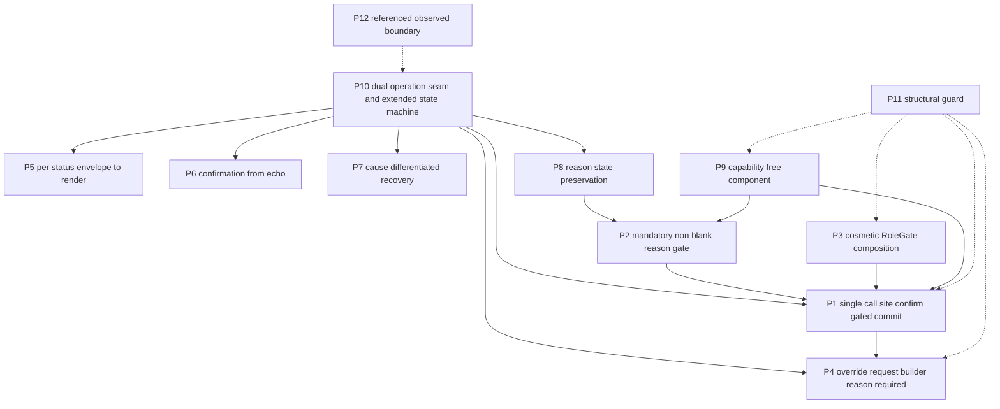

# NFR Design Patterns — `ui-override-form` (U8)

**Stage**: BUILD → NFR Design (per-unit) · **Unit**: U8 `ui-override-form` · C-cluster UI · Phase 1 · **Depth**: COMPREHENSIVE · **Date**: 2026-07-09
**Built ON** the frozen FD (**BR-OVR-1..12**, inventory incl. the capability-free `OverrideReasonInput`, the full state machine incl. reason preservation, the two-server-gate defense-in-depth note) **and** the approved NFR Requirements (**twenty `NFR-OVR-*` targets**; dual-operation reason-carrying single-double; **NFR-OVR-Fold-A/1/2/3**) — **re-opening neither**. One section per pattern, each **structurally** meeting its target(s) + traced. **Advisory-only; no LLM; no live backend** (R4/R5 doubled). Tier convention inherited (Vitest + RTL + jsdom · ESLint over the one `FORBIDDEN_TERMS` · file/import scans · detector self-tests). **Q1–Q4 all A.**

> **Reference-not-own (stated once, upheld everywhere).** No `ui-override-form` component **modifies** `ui-shell` (frozen — copy/`FORBIDDEN_TERMS`/`RoleGate`/`ReadOnlyRegion`/badges/`RoleContext`/`COMMIT_ACTION_LABELS.override`/testid **reused**), **imports** `ui-queue`/`ui-memo-view`/**`ui-approval-gate`** (all frozen — their fetchSeam/StructuralGuard/by-construction/testid-lint **mirrored, not imported** — incl. the **NEW `noApprovalGateImport`**), or authors the wire (WIRE-1 R4+R5 **by shape**; real wiring is the composition root's). The unit owns **no** authorization decision (`RoleGate` cosmetic; AUTHZ-1 is the server's), **no** authoritative reason validation (the UI guard is non-authoritative; the backend `_gate` is the server's — CON-BR4 single-sourced), **no** persistence (audit-store's).

> **ND-D-Fold.** `overrideFetchSeam` is a **duck-typed injected seam** (no-TS React, no interface construct) — contract self-documented via JSDoc (`fetchContext(applicationId)`→`MemoView`; `submitOverride(recommendationId, reason)`→`CommittedDecision`; both reject with `{error:{code,message,detail}}`) **plus the single capturing double** as the worked example.

---

## §P1 — SingleCallSiteConfirmGatedCommitPattern → NFR-OVR-NOFINAL-1 + CONFIRM-1 + CANCEL-1 — **LOAD-BEARING (mirror of U7, extended for the reason)**

**The by-construction guarantee — the actual prop mechanism, not just "single call site":**

- **`OverrideAffordance` — what its props DO and DO NOT include.** Its prop set is **`{ onOverride, disabled, testid }`**. It receives **no `submitOverride`, no seam instance, no `onConfirm`, no transport** — nothing that can issue a commit. Its `onClick` calls **`onOverride()`**, whose only effect (wired by `OverrideFormView`) is `setPhase('confirming')` — it **opens the confirm dialog**. Because the commit-triggering capability is **absent from its props**, a developer **cannot write** a premature commit inside `OverrideAffordance` without first **adding a new prop** — an obvious, reviewable change. **(header comment)** it states "props `{ onOverride, disabled }` only — no `submitOverride`/seam/`onConfirm`; opens the dialog, cannot commit", so the guarantee is **self-evident in isolation**.
- **`OverrideConfirmDialog` — the SOLE commit-trigger holder.** Its prop set is **`{ onConfirm, onCancel, reason, testid }`**, where **`onConfirm`** is the wired `submitOverride` invocation (supplied only here by `OverrideFormView`) and **closes over the current `reason`** (it invokes `submitOverride(recommendationId, reason)`). Its `Confirm` handler is the **single call site**; `Cancel` calls `onCancel()` (→ `ready(idle)`, reason preserved); rendering/canceling is a **pure client-side toggle** with **no** fetch/commit/mutation beyond the local flag. It also **echoes the `reason` read-only** (P8). **(header comment)** it is marked the **sole commit-trigger holder** — its `onConfirm` is the single call site.
- **The result** is a **visible graph property** (`logical-components.md §5`): the only inbound invocation edge into `submitOverride` originates from `OverrideConfirmDialog`. Re-derived **locally** (mirror-not-import U7's frozen pattern). The design is the guarantee; the tests are the regression guard on top.

**Meets the targets** — (NOFINAL-1) a StructuralGuard scan confirms `submitOverride` has **exactly one** call site (the confirm handler) + **no seam import** in the non-dialog components (U7's invocation/import refinement — header comments naming `submitOverride` do not trip it); mount / R4 read / reason-typing / `confirming`-toggle issue no POST; detector self-test. (CONFIRM-1, teeth) `Override`-click → **`submitOverride.calls.length === 0` AND `fetchContext.calls.length === 1`** (Fold-A cross-guard); only `Confirm` → `=== 1`. (CANCEL-1, teeth) open + `Cancel` → **both** counts unchanged, context identical, state `ready(idle)`, **reason preserved**.
**Tier**: structural + component (teeth). **Rigor**: **full (highest)**.

## §P2 — MandatoryNonBlankReasonGatePattern → NFR-OVR-REASONGATE-1 — **THE NEW LOAD-BEARING PATTERN (by-construction — Q2-A)**

**The by-construction guarantee — one predicate, derived enablement:**

- **Single-sourced predicate.** `isReasonPresent(reason) = reason.trim() !== ''` is computed in **one** place (`OverrideFormView`). The `trim()` is the **non-authoritative** UX guard (FD-OVR-Fold-1); the backend `_gate` remains the single source of truth (CON-BR4).
- **Derived enablement (no second predicate).** `OverrideAffordance` receives **`disabled={ !isReasonPresent(reason) }`** — its enablement is **derived directly** from that one predicate, **never independently recomputed**. So it is **structurally impossible** for the affordance to be enabled while the reason is blank (there is no second predicate that could drift due to a bug elsewhere). Because the affordance is `disabled` when blank, the confirm dialog **cannot open** with a blank reason, and P1's single call site is never reached blank.
- **Belt-and-suspenders (optional, retained — ND-OVR-Fold-i).** The `onConfirm` handler **re-applies the same one `isReasonPresent` predicate** before invoking `submitOverride`. This is **documented optional insurance**: because the reason is **frozen during `confirming`** (the `confirming` state renders the read-only echo, not an editable input — the editable `OverrideReasonInput` belongs to `ready(idle)`), a blank reason cannot arise between dialog-open and `Confirm`, so REASONGATE-1's teeth already cover every **reachable** failure mode. The re-check guards **only a future-refactor hazard** (someone later making the reason editable during `confirming`); its **presence** is lightly asserted (a unit check) to stay non-vacuous, but it is **not** elevated to a hard gate.

**Meets the target** (REASONGATE-1): the whitespace fixture set `{ "", " ", "\t", "\n", " \t\n " }` each keeps the affordance `disabled`, and driving the full `Override → Confirm` attempt yields **zero** `submitOverride` (a broken predicate→`disabled` wiring would let a POST through and fail the teeth); a non-blank control → exactly one POST carrying the reason **verbatim/as-entered**; the divergence-documentation test records the non-byte-identical `trim()` vs `str.strip()` relationship.
**Tier**: structural (single-predicate derivation) + component (teeth) + unit (doc). **Rigor**: **full (highest)**.

## §P3 — CosmeticRoleGateCompositionPattern → NFR-OVR-RBAC-1 *(mirror of U7)*
**Pattern.** `OverrideAffordance` is wrapped in `<RoleGate can="act">` (frozen ui-shell), which reads the current Role **internally** via `useCurrentRole()` (no `role` prop) and renders children for `underwriter` (`act:true`), else the `fallback` for `auditor`/`admin`/`null`. **Cosmetic only** — imports no backend, calls no authz function; AUTHZ-1 (`DecisionCommitService`) is the real gate.
**Meets the target** (RBAC-1): (a) structural — no backend import / no authz call (StructuralGuard); (b) RTL stub `RoleProvider` over **all three roles + null** — `underwriter` → affordance present; `auditor`/`admin`/`null` → absent.
**Tier**: structural + component. **Rigor**: full.

## §P4 — OverrideRequestBuilderPattern (reason-required) → NFR-OVR-BODY-1 — **by-construction (Q3-A)**
**Pattern (the inverse of U7's narrow-signature).** `buildOverrideRequest(recommendationId, reason)` takes `reason` as a **required positional parameter** and returns `{ method:'POST', path:'/recommendations/${recommendationId}/commit', body:{ action:'override', reason } }`. It has **no `underwriter_id` parameter** (so it structurally cannot emit one — session-derived committer) and **structurally cannot omit the `reason` key**. Where U7's builder enforced *excluding* a field by having no parameter, U8's enforces *requiring* a field by making it a required positional. The `reason` is serialized **as-entered** (no trim in the builder; non-blankness is P2's runtime gate — ND-OVR-Fold-iii: the builder and P2's predicate read the **same** single `reason` slice, the `trim()` applied only transiently in the predicate).
**Meets the target** (BODY-1): the body **deep-equals** `{ action:'override', reason }` (has `action` + `reason`, **no** `underwriter_id`); `recommendation_id` in the path.
**Tier**: unit + structural. **Rigor**: full.

## §P5 — PerStatusEnvelopeToRenderPattern (dual-cause 409) → NFR-OVR-ERROR-1
**Pattern.** `CommitStateView` maps the WIRE-1 envelope `{error:{code,message,detail}}` to the correct state — **200** → committed (via `CommittedConfirmation`); **403** → not-permitted; **409** → conflict (**one** rendered state for **both** already-committed **and** the blank-reason race/bypass tail — same `commit_conflict` code, no special-casing beyond copy); **400 & 422** → generic invalid — with uniform discipline: `message` visible (`override-error-message`), `code` testid-only hidden (`override-error-code`), `detail` **never** rendered.
**Meets the target** (ERROR-1): table-driven RTL, each status programmed on the double; DOM scan finds `detail` nowhere; the two 409 causes render identically.
**Tier**: component (table-driven) + structural. **Rigor**: full.

## §P6 — ConfirmationFromEchoPattern (reason in echo) → NFR-OVR-NOREFETCH-1
**Pattern (by-construction).** `CommittedConfirmation`'s props are **`{ decision, context }` ONLY** — the R5 `CommittedDecision` echo (incl. the committed `reason`) + the R4 context. It holds **no** seam reference, so a re-fetch is **structurally impossible** (the transport-bearing seam is held only by `OverrideFormView`; the pure builders perform no I/O; a StructuralGuard confirms presentational components don't import `createOverrideFetch`). It renders `action=override` + the committed `reason` + `recommendation_id` + `underwriter_id` (echo) + the recommendation value (context in hand). **Source-of-truth (ND-OVR-Fold-ii)**: the committed display sources the reason **exclusively** from `decision.reason` (the echo) — **not** the orchestrator's client `reason` slice, which is never passed here. The values coincide (NFR-OVR-Fold-1, verified: the backend does not normalize), and the source is unambiguous.
**Meets the target** (NOREFETCH-1, teeth): after a successful override, **both** `fetchContext.calls.length` and `submitOverride.calls.length` stay unchanged (`1` and `1`); no further transport call.
**Tier**: component (teeth). **Rigor**: full.

## §P7 — CauseDifferentiatedRecoveryPattern (reason preserved) → NFR-OVR-RECOVERY-1
**Pattern.** `errorRead`'s `Retry` re-issues `fetchContext(same applicationId)`; `errorCommit` returns the machine to `ready(idle)` with **no** automatic `submitOverride` — **and the reason is preserved** (part of the recovery contract, coordinating with P8). A fresh `Override → Confirm` cycle is required. Two separate recovery legs (the FD split `errorRead`/`errorCommit`).
**Meets the target** (RECOVERY-1, teeth): (a) `errorRead` Retry → exactly one further `fetchContext`, recorded arg === X (`fetchContext.calls.length === 2`); (b) `errorCommit` → `ready(idle)`, `submitOverride.calls.length` stays `1`, reason input still holds the typed value.
**Tier**: component (teeth). **Rigor**: full.

## §P8 — ReasonStatePreservationPattern → NFR-OVR-REASONKEEP-1 — **NEW (by-construction — Q4-A)**
**Pattern (by-construction).** The `reason` is an **independent state slice** in `OverrideFormView`, **orthogonal** to the phase slice. The `Cancel` and `errorCommit` transitions set **only** the phase — they **structurally do not call `setReason`** — so the reason survives **by-construction** (not by discipline). It is cleared only implicitly by leaving the unit (`committed` is terminal). The confirm dialog renders the current `reason` as a **read-only echo** (`override-confirm-reason-echo`) — a distinct node/state/source from the post-submission committed display (NFR-OVR-Fold-2 / ND-OVR-Fold-ii). The reason is **frozen during `confirming`** (not editable — the editable input belongs to `ready(idle)`), which is what keeps P2's belt-and-suspenders optional (ND-OVR-Fold-i).
**Meets the target** (REASONKEEP-1): (a) preservation teeth — reason survives `Cancel` and `errorCommit` unchanged; (b) dedicated read-only echo DOM assertion in the `confirming` state (distinct from the committed display).
**Tier**: component. **Rigor**: full.

## §P9 — CapabilityFreeComponentPattern (extended to `OverrideReasonInput`) → NFR-OVR-CAPFREE-1
**Pattern (by-construction; header-comment self-evidence).** The presentational components hold no commit capability, each with a **header comment** making the guarantee self-evident in isolation (the frozen ND-Fold precedent):
- `OverrideAffordance` props `{ onOverride, disabled, testid }` — no seam / no `submitOverride` (P1).
- **`OverrideReasonInput` props `{ value, onChange, testid }`** — a controlled `<textarea>` holding **no** seam reference (the NEW capability-free component; header comment: "controlled textarea, `{ value, onChange }` only, no seam reference, holds text not a commit capability" — holding reason *text* is not a commit capability, the refined invariant).
- `CommittedConfirmation` props `{ decision, context, testid }` — no seam (P6).
- The single `submitOverride` call site is `OverrideConfirmDialog` (P1).
**Meets the target** (CAPFREE-1): (a) structural import-scan — `OverrideReasonInput`/`OverrideAffordance` import no seam module (`createOverrideFetch`/`overrideFetchSeam`) and reference no `submitOverride` (U7's invocation/import refinement; each detector non-vacuous, self-test); (b) prop-contract RTL — `OverrideReasonInput` renders from `{ value, onChange }` alone (displays `value`; typing calls `onChange`; no other capability).
**Tier**: structural + component. **Rigor**: full.

## §P10 — DualOperationFetchSeamPattern + ExtendedStateMachinePattern → NFR-OVR-FETCH-1 (+ BODY builder + PERF bounded)
**Pattern.** An **own-local thin module `overrideForm/overrideFetchSeam`** with **two** operations — `fetchContext` (R4 read) + `submitOverride(recommendationId, reason)` (R5 write) — created by `createOverrideFetch(transport)`; both **injected** (the factory closes over the injected `transport`), duck-typed (ND-D-Fold). Tests inject the **single capturing double** with **two independently-counted spies** recording args incl. `reason` (Fold-A, under the exact seam names — never a shared generic `calls`). **Mirrors** the sibling `fetchSeam` pattern **without importing** it. `OverrideFormView` **owns** the machine (a responsibility; hook/reducer mechanics → Code-Gen): `loading → ready(idle) → confirming → submitting → {committed | errorCommit}`, plus `pending` and `errorRead`; the **`reason` slice is orthogonal** (P8). Sub-components are **presentational** — the View is the single source of transition truth and the sole holder of the transport-bearing seam. Bounded: R4 one resource, R5 one commit.
**Meets the target** (FETCH-1): the seam is injected, never hard-wired; per-operation counting supports the teeth; per-state renders + **ONE consolidated transition test** (mirror of U7) covering all legs incl. both split-error recovery paths + the reason-carrying states. (BODY-1) contains the P4 builder. (PERF-1) structural bounded-fetch scan.
**Tier**: component + structural.

## §P11 — StructuralGuardPattern → NFR-OVR-COPY-1 + ADVISORY-1 + NAMESPACE-1 + TESTID-1 + NOTS-1 + REFNOTOWN-1 *(one substrate)*
**Pattern.** **One `StructuralGuard` substrate** grouping independent structural checks, each with a **detector self-test** (non-vacuous), mirroring the sibling single-substrate convention: **testid** convention (`override-<element>-<purpose>`); **no-`.ts`/`.tsx`**; **no-backend-import**; **no-`ui-queue`-import**; **no-`ui-memo-view`-import**; **no-`ui-approval-gate`-import (NEW `noApprovalGateImport`)**; **no-router-import**; **no-`createOverrideFetch`-import in presentational components**; **bounded-fetch** (P10); the **single-call-site scan** (P1 / NOFINAL-1); the **`FORBIDDEN_TERMS` reuse** lints (`no-inline-label` + `advisory-vocabulary`). **Verified property (NFR-OVR-Fold-3)**: the `advisory-vocabulary` lint is applied **UNMODIFIED** because all 21 `OVERRIDE_COPY` strings were audited against the real detector and trip zero — no copy change, no carve-out.
**Meets the targets**: COPY-1 (no-inline-label), ADVISORY-1 (advisory-vocabulary unmodified + `LINT_FORBIDDEN_TERMS === FORBIDDEN_TERMS`), NAMESPACE-1 (`FORBIDDEN_TERMS` collision guard + `COMMIT_ACTION_LABELS.override`; override ≠ DECLINE-RECOMMEND), TESTID-1, NOTS-1, REFNOTOWN-1 (incl. `noApprovalGateImport`) — each + self-test.
**Tier**: structural / lint.

## §P12 — ReferencedObservedBoundaryPattern → NFR-OVR-PERF-1 + NFR-OVR-A11Y-1 + NFR-OVR-SCOPE-1 *(soft / governance)*
- **PERF-1** — bounded (R4 one resource, R5 one commit; structural via P10/P11); latency/bundle observed, non-gating.
- **A11Y-1** — semantic markup + focusable `Override`/`Confirm`/`Cancel`/`Retry` + the reason `<textarea>` label association; **soft**. The confirm-dialog **focus-trap** + **Escape-to-cancel** + the label association are **recorded NFR-Design→Code-Gen targets**, not Phase-1 gates. **Note**: the BR-OVR-3 "cancelable" (CANCEL-1) and BR-OVR-8 "blank blocks submit" (REASONGATE-1) invariants stay **gated** as full-rigor teeth — only the a11y polish is soft.
- **SCOPE-1** — governance/exclusion: patterns realize only `ui-override-form`'s behavior; **not** other UI units, backend internals, or the WIRE-1 route implementation; ui-shell mechanisms **reused, not modified**; the siblings' (incl. frozen `ui-approval-gate`) **mirrored, not imported**.
**Tier**: observed / soft / governance.

---

## §13 — Pattern-integration diagram

Validated before write (alphanumeric node IDs; every label double-quoted; **no hyphens, semicolons, colons, parentheses, special characters**; balanced blocks; **rectangle-only, no decision diamonds**). **Solid = depends-on / composes; dashed = scans / observes.** Text alternative follows.

### Text alternative (always included)
- The **dual-operation seam and extended state machine (P10)** is the hub: it depends on the **dual-operation seam** it owns, renders failures via the **per-status envelope pattern (P5)**, governs the commit via the **single-call-site confirm-gated pattern (P1)**, renders success via **confirmation-from-echo (P6)**, recovers via **cause-differentiated recovery (P7)**, preserves the reason via the **reason-state-preservation pattern (P8)**, and builds requests via the **override request builder (P4)**.
- The **mandatory non-blank reason gate (P2)** gates the affordance that **P1** governs (P2 → P1); its predicate reads the **reason slice** owned by **P8** (P8 → P2).
- The **cosmetic RoleGate composition (P3)** wraps that same affordance (P3 → P1).
- The **capability-free component pattern (P9)** composes the affordance and the reason input that P1/P2 rely on (P9 → P1, P9 → P2).
- Both **P1**'s confirm handler and **P10**'s seam use the **override request builder (P4)** (P1 → P4, P10 → P4).
- Dashed = substrate/boundary: the **StructuralGuard (P11)** scans/lints P1 (single call site + no seam import), P3 (no authz), P4 (builder), P9 (capability-free import scan); the **referenced/observed boundary (P12)** observes the bounded seam (P10).

---

## §14 — Traceability (pattern → target → tier → rigor)

| Pattern | Target(s) | Tier | Rigor |
|---|---|---|---|
| **SingleCallSiteConfirmGatedCommitPattern** | **NOFINAL-1, CONFIRM-1, CANCEL-1** | structural + component (teeth) | **full (highest)** |
| **MandatoryNonBlankReasonGatePattern** | **REASONGATE-1** | structural + component (teeth) + unit | **full (highest)** |
| CosmeticRoleGateCompositionPattern | RBAC-1 | structural + component | full |
| OverrideRequestBuilderPattern (reason-required) | BODY-1 | unit + structural | full |
| PerStatusEnvelopeToRenderPattern | ERROR-1 | component + structural | full |
| ConfirmationFromEchoPattern | NOREFETCH-1 | component (teeth) | full |
| CauseDifferentiatedRecoveryPattern | RECOVERY-1 | component (teeth) | full |
| ReasonStatePreservationPattern | REASONKEEP-1 | component | full |
| CapabilityFreeComponentPattern | CAPFREE-1 | structural + component | full |
| DualOperationFetchSeam + ExtendedStateMachine | FETCH-1, BODY-1, PERF-1 | component + structural | full / soft |
| StructuralGuardPattern | COPY-1, ADVISORY-1, NAMESPACE-1, TESTID-1, NOTS-1, REFNOTOWN-1 | structural / lint | full / medium |
| ReferencedObservedBoundaryPattern | PERF-1, A11Y-1, SCOPE-1 | observed / soft / governance | soft / governance |

**All twenty `NFR-OVR-*` targets covered; no orphan.** (NOFINAL/CONFIRM/CANCEL→P1, REASONGATE→P2, RBAC→P3, BODY→P4+P10, ERROR→P5, NOREFETCH→P6, RECOVERY→P7, REASONKEEP→P8, CAPFREE→P9, FETCH→P10, COPY/ADVISORY/NAMESPACE/TESTID/NOTS/REFNOTOWN→P11, PERF/A11Y/SCOPE→P12.)
