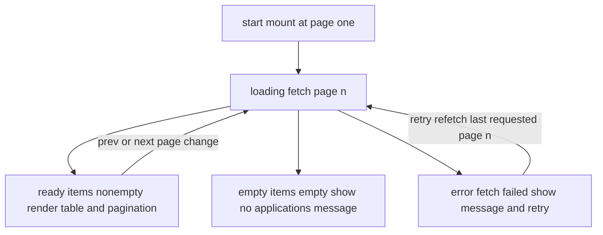

# Business Logic Model — `ui-queue` (U5)

**Stage**: BUILD → Functional Design (per-unit) · **Unit**: U5 `ui-queue` · **Date**: 2026-07-09 · Story **US-UI-1**.
**Nature**: `ui-queue` has **no domain logic** — its only "logic" is a **presentation/fetch lifecycle** over WIRE-1 R2.
This model pins three technology-agnostic flows: **(1)** the fetch/render-state machine, **(2)** the pagination flow over
the R2 `page` wrapper, **(3)** the selection-emission flow. All values/mechanics (page size, hook shapes, debounce) are
deferred to NFR-Design / Code-Gen.

---

## 1. Fetch / render-state machine (the async-state addendum)

`QueueView` owns a render state `∈ {loading, ready, empty, error}` (`domain-entities.md §3`). A page fetch is the only
transition trigger; the response (or failure) resolves the next state.



**Text alternative (always included)** — the state machine, node by node:

- **Start → Loading**: on mount, `QueueView` sets `state = loading` and fetches R2 for **page 1** (`GET /applications?page=1&size=<default>`).
- **Loading → Ready**: the fetch resolves 2xx with `items` **non-empty** → `state = ready`; render `QueueTable` (one
  `QueueRow` per `ApplicationSummary`) + `PaginationControls`.
- **Loading → Empty**: the fetch resolves 2xx with `items: []` / `total: 0` → `state = empty`; render the distinct
  **"No applications in the queue"** message (no table, no pagination).
- **Loading → Error**: the fetch fails (any non-2xx per WIRE-1 §4, or a transport error) → `state = error`; render
  `error.message` (visible) + `error.code` (testid-only, BR-QUEUE-3) + a **Retry** control.
- **Error → Loading (Retry)**: activating Retry re-enters `loading` and re-fetches the **last-requested page *N*** —
  **not** a reset to page 1 (BR-QUEUE-4 / Fold-B). Position is preserved.
- **Ready → Loading (page change)**: a prev/next action (§2) re-enters `loading` for the new page.

> Only `loading` performs I/O. `ready`/`empty`/`error` are terminal until an explicit user action (Retry or a page
> change) re-enters `loading`. There is no auto-refresh/polling in Phase 1.

---

## 2. Pagination flow (over the R2 `page` wrapper)

`PaginationControls` is **derived state only** — it computes nothing about the data, only about the `page:{page,size,total}`
wrapper WIRE-1 R2 returns (1-based).

| Derived value | Formula | Use |
|---|---|---|
| `isFirstPage` | `page <= 1` | disable `queue-pagination-prev` |
| `isLastPage` | `page * size >= total` | disable `queue-pagination-next` |
| current-page display | `page` / `ceil(total / size)` | `queue-page-indicator` text |

**Flow**:
1. User activates `prev` (→ `page - 1`) or `next` (→ `page + 1`); the control calls `onPageChange(nextPage)`.
2. `QueueView` sets `state = loading` and re-fetches R2 for `nextPage` (§1 `Ready → Loading`).
3. On resolve, the new page renders (`ready`/`empty`/`error` per §1). Boundaries are enforced by disabling the controls
   (step above) — the view never requests a page outside `[1, ceil(total/size)]`.

- **Grounded**: WIRE-1 §2 (offset/limit, 1-based, `total`); BR-QUEUE-9; PER-1 (paging keeps the queue bounded per fetch).
- **Deferred**: the default `size` value → NFR-Design / Code-Gen (N2).

---

## 3. Selection-emission flow (Q5-A)

1. A `QueueRow` renders a selection affordance (`queue-row-select-<application_id>`).
2. On activation it calls **`onSelect(summary.application_id)`** — passing only the `application_id` string upward.
3. `ui-queue` **stops there**: it performs no navigation and holds no route. A later shell/router integration will wire
   `onSelect` to the memo view (R4 `GET /applications/{application_id}/memo`), outside this unit.

- **Grounded**: BR-QUEUE-5; WIRE-1 R3/R4 are the eventual consumers, but the wiring is deferred (no router import here).

---

## 4. Data-flow summary (read-only, one direction)

```text
WIRE-1 R2 (mocked in tests)
   → { items: ApplicationSummary[], page:{page,size,total} }  |  { error:{code,message,detail?} }
   → QueueView (state machine §1)
      → ready  : QueueTable → QueueRow → RecommendationBadge / ConfidenceBadge  (or pending placeholder)
                 + PaginationControls (derived from page wrapper §2)
      → empty  : "No applications" message
      → error  : error.message + Retry (re-fetch last page §1)
   → user selects a row → onSelect(application_id)  [emitted, not navigated §3]
```

No write path, no mutation, no commit — the queue is a pure read view (advisory-only invariant upheld: it displays a
system `Recommendation`, never finalizes anything; a `CommittedDecision` is created only by the underwriter commit path in
U7/U8, not here).

---

## 5. Deferred to later stages (named, not designed here)

- **Default page `size`**, skeleton-row count, token/color values → NFR-Design / Code-Gen (N2; ui-shell tokens).
- **State-holding mechanics** (which hook/store holds `{state, page, items, error}`), Retry debounce, request
  cancellation → Code-Gen (Fold-B mechanics).
- **Route wiring** of `onSelect` → memo view (R4) → later shell/router integration (BR-QUEUE-5).
- **R2 route implementation** (`backend/app/main.py`) → Build & Test integration (WIRE-1 §, not this unit).
