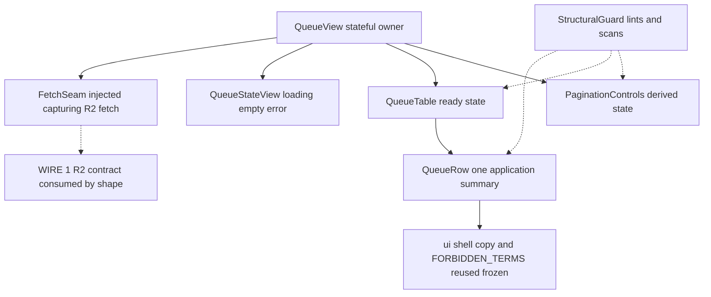

# Logical Components — `ui-queue` (U5)

**Stage**: BUILD → NFR Design (per-unit) · **Unit**: U5 `ui-queue` · C5 · Phase 1 · **Depth**: lighter (display) +
async-state addendum · **Date**: 2026-07-09.
The **6 production components** (under `frontend/src/queue/`) + the **test/lint substrate**, their responsibilities,
ownership, a **reference-not-own check**, and **component→target coverage**. **React + Tailwind, NO TypeScript.
Advisory-only; no LLM; no live backend** (R2 doubled via the injected `fetchSeam`).

> **No production import of any backend module or the real wire anywhere (binding).** `ui-queue` imports **only** React /
> Tailwind + `ui-shell`'s frozen modules (primitives/copy/session, **consumed not modified**) + its own modules. **No
> component imports a backend path, a router, or `RoleGate`, and none issues a real fetch** — the real `fetchSeam` wiring
> is the composition root's (structurally verified by StructuralGuard). WIRE-1 **R2** is consumed **by shape**.

---

## 1. Components

| ID | Component | Responsibility | Ownership | Backs |
|---|---|---|---|---|
| **C1** | **`QueueView`** | The **only stateful** component: calls **`fetchSeam`** for the current page, holds `{state, page, items, error}`, **owns the four-state machine** (Q2-A — a responsibility, not a separate component; hook/reducer mechanics → Code-Gen, Fold-B), selects `QueueStateView` vs `QueueTable`+`PaginationControls`. | owns | FETCH-1, RETRY-1, VIEWONLY-1(render) |
| **C2** | **`fetchSeam`** *(distinct thin module, Q1-A)* | Builds the R2 request (`page`+`size` → URL) and returns the list wrapper / error envelope; **injected** into `QueueView` via prop/context. **Duck-typed, no formal interface** (D-Fold-1) — JSDoc-documented; tests inject a **capturing double** (single construction, Fold-1). **Real wiring deferred** to the composition root / Build & Test. | owns the **seam interface**; real wiring deferred | FETCH-1, RETRY-1, PERF-1(bounded) |
| **C3** | **`QueueStateView`** | Presentational non-ready states: `loading` (skeleton — count deferred, Q2-A; **no table while loading**), `empty` ("no applications"), `error` (message visible / code testid-only / detail never rendered — uniform incl. 401, Q4-A). | owns | ERROR-1, FETCH-1(states), A11Y-1 |
| **C4** | **`QueueTable`** | Ready-state **semantic `<table>`**: header + one `QueueRow` per item; forwards `onSelect`; pure (no fetch/state). | owns | COPY-1(look-up), TESTID-1, A11Y-1(semantic) |
| **C5** | **`QueueRow`** | One `ApplicationSummary`: `RecommendationBadge`/`ConfidenceBadge` **iff** non-null else the **pending placeholder** (P2); the **emission-only** select affordance `onSelect(application_id)` (P6). Renders only **system** `Recommendation`, never a human `CommitAction` (P1/NAMESPACE-1). | owns | PENDING-1, COPY-1, NAMESPACE-1, SELECT-1, TESTID-1 |
| **C6** | **`PaginationControls`** | Derived-state prev/next + `page`/total indicator from the R2 `page` wrapper (P8); boundary disabling. | owns | PAGINATION-1, TESTID-1 |

**Test / lint substrate (test-only, not a production component):**
- **C7 `StructuralGuard`** *(one substrate, Q3-A)* — grouping independent checks, **each with a detector self-test**:
  ESLint reuse over ui-shell's **one `FORBIDDEN_TERMS`** (COPY-1 no-inline + NAMESPACE-1 collision), **testid** convention
  lint (TESTID-1), **no-`.ts`/`.tsx`** file scan (NOTS-1), **no-router-import** scan (SELECT-1), **no-`RoleGate`-import**
  scan (VIEWONLY-1), **bounded-fetch** scan (PERF-1).
- **Vitest + React Testing Library + jsdom** — PENDING-1, ERROR-1, PAGINATION-1, VIEWONLY-1(render across stub roles), and
  FETCH-1's four per-state renders + the **one consolidated transition test** (Q3-A) — all on the **single injected
  capturing double** (Fold-1).

---

## 2. Component-relationship diagram

Validated before write (alphanumeric node IDs; every label double-quoted; **no hyphens, no semicolons, no bare colons, no
parentheses, no special characters**; underscore per the established convention; balanced blocks). Text alternative follows.

### Text alternative (always included)
- **QueueView** calls **FetchSeam** (R2), and selects **QueueStateView** (loading/empty/error) or **QueueTable** +
  **PaginationControls** (ready).
- **QueueTable** renders **QueueRow** per item; **QueueRow** looks up labels from the **reused frozen ui-shell copy /
  `FORBIDDEN_TERMS`** (never inlined).
- Dashed = substrate/boundary: the **StructuralGuard** lints/scans the row/table/pagination; **WIRE-1 R2** (external, real
  wiring deferred to the composition root) is what **FetchSeam** consumes by shape.

---

## 3. Reference-not-own check

| Concern | Owner | This unit? |
|---|---|---|
| The queue view behavior (fetch/state/rows/pagination/selection) | **`ui-queue`** (C1–C7) | ✅ owns |
| Shell primitives / copy / `FORBIDDEN_TERMS` / `RoleContext` | **`ui-shell`** (frozen U10) | ❌ **consumed by import/shape, not modified** (reused) |
| Frontend↔backend **wire/serialization** (R2 route, envelope, session) | **WIRE-1** (composition-root) | ❌ consumed **by shape**; the **real `fetchSeam` wiring** is deferred (composition root / Build & Test) |
| **R2 route implementation** (`backend/app/main.py`) | Build & Test | ❌ not authored here |
| Authorization **decision** | **`auth-rbac`** (SEC-4) | ❌ queue gates nothing (VIEWONLY-1); no `RoleGate`, no authz call |
| Navigation / routing target of `onSelect` | later shell/router integration | ❌ **emission-only**; no router import (SELECT-1) |
| Human commit / gate (`approve`/`override`) | **`ui-approval-gate` (U7)** / **`ui-override-form` (U8)** | ❌ no write path; queue never renders a `CommitAction` (NAMESPACE-1) |
| Aesthetic token **values**, skeleton-row count, default page `size`, state hook/reducer mechanics | **Code-Gen** | ❌ direction/shape only; values + mechanics deferred (Fold-B) |

**No component owns a concern reference-not-own assigns elsewhere. No backend import, no router import, no `RoleGate`
import, no real fetch anywhere in `ui-queue`** — structurally verified (StructuralGuard). The `fetchSeam` is a duck-typed
injected seam (D-Fold-1, admin-cli precedent).

---

## 4. Component → target coverage (no orphan)

| Target | Component(s) / item |
|---|---|
| NFR-QUEUE-COPY-1 | C5 (badge look-up) + C7 (no-inline lint, `FORBIDDEN_TERMS` reuse) |
| NFR-QUEUE-NAMESPACE-1 | C5 + C7 (collision guard) |
| NFR-QUEUE-PENDING-1 | C5 (pending placeholder) |
| NFR-QUEUE-ERROR-1 | C3 (error-envelope render) + C7 (detail-never structural) |
| NFR-QUEUE-RETRY-1 | C1 (transition) + C2 (`fetchSeam` capturing double, page N) |
| NFR-QUEUE-SELECT-1 | C5 (emit) + C7 (no-router scan) |
| NFR-QUEUE-VIEWONLY-1 | C1/C4 (render) + C7 (no-`RoleGate` scan) |
| NFR-QUEUE-TESTID-1 | C4/C5/C6 + C7 (testid lint) |
| NFR-QUEUE-NOTS-1 | whole unit + C7 (file scan) |
| NFR-QUEUE-FETCH-1 | C1 (state machine) + C2 (seam) + C3/C4 (renders) |
| NFR-QUEUE-PAGINATION-1 | C6 (derived state) |
| NFR-QUEUE-PERF-1 | C2 (bounded fetch) + C7 (scan) — observed |
| NFR-QUEUE-A11Y-1 | C3/C4 (semantic + focusable) — soft |
| NFR-QUEUE-SCOPE-1 | governance / boundary (documented, not an orphan) |

**All fourteen targets covered.** Every component/item backs ≥1 target; SCOPE-1 is a documented boundary. No orphan.

---

## 5. Settled items held (not re-opened)
- Frozen FD (BR-QUEUE-1..9 + inventory + flows) + approved `NFR-QUEUE-*` targets — components realize them, re-opening
  neither.
- **ui-shell (frozen)** — primitives/copy/`FORBIDDEN_TERMS`/`RoleContext`/testid convention **reused, not modified**; the
  stub `RoleContext.Provider` is the injection point for VIEWONLY-1.
- **WIRE-1** — R2 + ApplicationSummary + envelopes consumed **by shape**; the **route implementation** and the **real
  `fetchSeam` wiring** stay deferred to the composition root / Build & Test.
- **Fold-B** — Retry position-preserving realized via the state machine (C1); state hook/reducer **mechanics** deferred to
  Code-Gen. **D-Fold-1** — `fetchSeam` duck-typed, no formal interface (admin-cli precedent).
- **Deferred values**: skeleton-row count, default page `size`, aesthetic token values → Code-Gen. **Infrastructure
  Design** for `ui-queue` **not pre-committed** — likely a logged SKIP (source-level view; Vercel topology is
  `deploy-config` P2) — confirmed at that stage.
