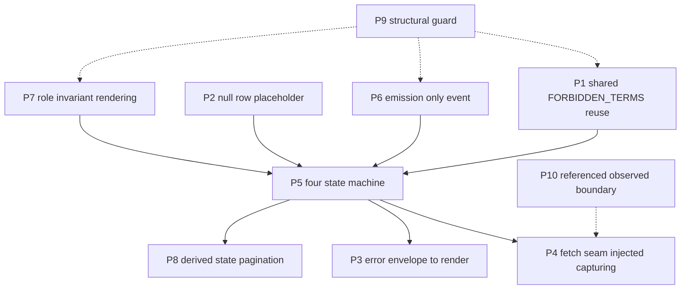

# NFR Design Patterns — `ui-queue` (U5)

**Stage**: BUILD → NFR Design (per-unit) · **Unit**: U5 `ui-queue` · C5 · Phase 1 · **Depth**: lighter (display) +
async-state addendum · **Date**: 2026-07-09.
**Built ON** the frozen FD (**BR-QUEUE-1..9**, inventory, four-state enum, testid inventory, pagination/selection flows)
**and** the approved NFR Requirements (fourteen `NFR-QUEUE-*` targets; single injected/capturing fetch-double D6;
**NFR-QUEUE-Fold-1**) — **re-opening neither**. One section per pattern, each structurally meeting its target(s) + traced.
**Advisory-only; no LLM; no live backend** (R2 doubled). **Tier convention** inherited from ui-shell (Vitest + RTL + jsdom
· ESLint over the one `FORBIDDEN_TERMS` · file/import scan · detector self-tests).

> **Reference-not-own (stated once, upheld everywhere).** No `ui-queue` component modifies `ui-shell` (frozen — its
> copy/`FORBIDDEN_TERMS`/`RoleContext`/testid convention are **reused**), and none authors the wire: WIRE-1 **R2** is
> consumed **by shape**; the **real `fetchSeam` wiring** is the composition root's / Build & Test's, not designed here.
> The queue **owns no authorization decision** (no `RoleGate`) and **no write path** (commit is U7/U8).

> **NFR-QUEUE-D-Fold-1 (from the ambiguity-check).** `fetchSeam` is a **duck-typed injected seam with no formal
> Protocol/interface** — mirroring admin-cli's injected-`Engine` seam; in a **no-TS** React codebase no interface
> construct is even available, so the same reasoning holds *a fortiori*. Its contract is self-documenting via a **JSDoc
> comment** (`fetchSeam(page, size)` → resolves `{items, page:{page,size,total}}` / surfaces `{error:{code,message,detail}}`)
> **plus the capturing double** as the worked example. Prop-vs-Context injection is a Code-Gen mechanic (Fold-B).

---

## §P1 — SharedForbiddenTermsReusePattern → NFR-QUEUE-COPY-1 + NFR-QUEUE-NAMESPACE-1
- **Pattern**: `ui-queue` **reuses ui-shell's ONE `FORBIDDEN_TERMS` source + ESLint** — **no new word-list**. Labels come
  from `shell/copy` (`RECOMMENDATION_LABELS` / `CONFIDENCE_LABELS`); `RecommendationBadge`/`ConfidenceBadge` render **by
  value look-up**; the queue inlines no label and renders only **system** `Recommendation` values, never a human
  `CommitAction`.
- **Meets the target**: (COPY-1) a **build-failing lint** flags any label literal in `frontend/src/queue/`; a `QueueRow`
  given `recommendation="DECLINE-RECOMMEND"` renders the sourced label (never bare `DECLINE`). (NAMESPACE-1) the reused
  `FORBIDDEN_TERMS` **collision guard** flags any queue string equal to a `CommitAction` label; detector self-test.
- **Tier**: structural / lint.

## §P2 — NullRowPlaceholderPattern → NFR-QUEUE-PENDING-1
- **Pattern**: when an `ApplicationSummary`'s `recommendation`/`confidence` are `null` (co-null per N1), `QueueRow` renders
  a neutral **"pending / not yet drafted"** placeholder cell (`queue-row-pending-<id>`), **no badge**, and the row remains
  present (not filtered).
- **Meets the target**: an RTL render of a null-value row asserts the pending testid + absence of both badges + row
  presence.
- **Tier**: component (RTL).

## §P3 — ErrorEnvelopeToRenderPattern → NFR-QUEUE-ERROR-1
- **Pattern**: `QueueStateView` maps the WIRE-1 error envelope `{error:{code,message,detail}}` to the error state —
  **`message` visible** (`queue-error-message`), **`code` testid-only** (`queue-error-code`, not visible text), **`detail`
  never rendered**. Uniform for **every non-2xx incl. 401** (Q4-A); auth-handshake/redirect deferred (WIRE-1 §6).
- **Meets the target**: an RTL render with a mocked error body asserts message-visible, code-in-testid-not-text, and a DOM
  scan finds `detail`'s content nowhere.
- **Tier**: component (RTL) + structural.

## §P4 — FetchSeamPattern → NFR-QUEUE-RETRY-1 + NFR-QUEUE-FETCH-1 (fetch) + NFR-QUEUE-PERF-1 (bounded)
- **Pattern**: a **distinct thin module `queue/fetchSeam`** (Q1-A) builds the R2 request (`page`+`size` → URL) and is
  **injected** into `QueueView` via prop/context; production wires the real fetch at the composition root, tests inject a
  **capturing double** that records the requested page. **One construction** for the suite (Fold-1); no formal interface
  (D-Fold-1). It **only ever fetches one page** (PERF-1 bounded).
- **Meets the target**: (RETRY-1) the double fails page **N**; Retry re-fetches — the **captured request targets page N**,
  the assertion `requestedPage === N` **failing if reset to 1** (teeth). (FETCH-1 fetch) `QueueView` never imports a
  hard-wired fetch — it calls the injected seam. (PERF-1) a structural scan confirms no unbounded/all-rows fetch path.
- **Tier**: component (RTL) + capturing double + structural (bounded).

## §P5 — FourStateMachinePattern → NFR-QUEUE-FETCH-1 (states) + NFR-QUEUE-RETRY-1 (transition)
- **Pattern**: `QueueView` **owns** the state machine (Q2-A — a responsibility, not a separate component; hook/reducer
  mechanics → Code-Gen, Fold-B): `loading → ready | empty | error`; `error --retry--> loading` (re-fetch **last-requested
  page**, Fold-B); `ready --page--> loading`. Built **on** `fetchSeam` (P4); renders via `QueueStateView` (non-ready) /
  `QueueTable`+`PaginationControls` (ready).
- **Meets the target**: per-state renders (`loading` shows `queue-state-loading` **and no table while loading**, Q2-A,
  skeleton count deferred; `ready`→`queue-table`; `empty`→`queue-state-empty`; `error`→P3) **plus one consolidated
  transition test** (Q3-A) exercising all five transitions on the **same** injected double (Fold-1).
- **Tier**: component (RTL).

## §P6 — EmissionOnlyEventPattern → NFR-QUEUE-SELECT-1
- **Pattern**: a row's select affordance calls **`onSelect(application_id)`** and nothing else — **no router coupling**
  (routing target deferred to a later shell/router integration).
- **Meets the target**: (a) RTL — activating `queue-row-select-<id>` calls a spy `onSelect` **once** with that id; (b)
  **structural** (via StructuralGuard) — `queue/` imports **no** router/navigation module (Q4/Q1-A of NFR-Req; here Q4
  a11y unrelated — SELECT-1 mechanism per NFR-Req Q4-A structural).
- **Tier**: component + structural.

## §P7 — RoleInvariantRenderingPattern → NFR-QUEUE-VIEWONLY-1
- **Pattern**: the queue composes **no `RoleGate`** and gates nothing by Role — render is **role-invariant** (all roles
  hold `VIEW_QUEUE`). Contrast: `ui-approval-gate` (U7) / `ui-override-form` (U8) **will** compose `RoleGate` for the
  underwriter-only act path; the queue deliberately does not.
- **Meets the target**: (a) **structural** (StructuralGuard) — no `RoleGate` import in `queue/`; (b) RTL — output is
  **identical** with a stub `RoleContext.Provider` set to `underwriter` / `auditor` / `admin`.
- **Tier**: structural + component.

## §P8 — DerivedStatePaginationPattern → NFR-QUEUE-PAGINATION-1
- **Pattern**: `PaginationControls` is **derived state only** from the R2 `page:{page,size,total}` wrapper —
  `isFirstPage = page ≤ 1`, `isLastPage = page*size ≥ total`, indicator = `page` / `ceil(total/size)`; boundary disabling.
  The queue computes no totals of its own.
- **Meets the target**: RTL over a mocked wrapper — page 1 → `queue-pagination-prev` disabled; last page →
  `queue-pagination-next` disabled; `queue-page-indicator` reflects `page`/derived total.
- **Tier**: component (RTL).

## §P9 — StructuralGuardPattern → NFR-QUEUE-TESTID-1 + NFR-QUEUE-NOTS-1 (+ structural halves)
- **Pattern**: **one `StructuralGuard` substrate** (Q3-A) grouping independent structural checks, each with a **detector
  self-test** (non-vacuous): **testid** convention (`queue-<element>-<purpose>`), **no-`.ts`/`.tsx`** file scan,
  **no-router-import** scan (P6), **no-`RoleGate`-import** scan (P7), **bounded-fetch** scan (P4/PERF-1), and the
  **`FORBIDDEN_TERMS` reuse** lint (P1). Mirrors ui-shell's single test/lint substrate.
- **Meets the target**: (TESTID-1) a lint asserts the convention across queue elements + self-test flags a missing/misnamed
  testid; (NOTS-1) a file scan finds zero `.ts`/`.tsx` and no `tsconfig`.
- **Tier**: structural / lint.

## §P10 — ReferencedObservedBoundaryPattern → NFR-QUEUE-PERF-1, NFR-QUEUE-A11Y-1, NFR-QUEUE-SCOPE-1 *(soft / governance)*
- **PERF-1** — bounded-by-pagination (fetches one page; structural, via P4/P9); render latency/bundle **observed,
  non-gating** (ui-shell PERF-1 precedent).
- **A11Y-1** — semantic `<table>` + keyboard-focusable row-select & pagination controls + accessible labels; **soft**,
  recorded target, not gating in Phase 1 (Q6-A of NFR-Req).
- **SCOPE-1** — **governance/exclusion**: patterns realize only `ui-queue`'s view behavior; **not** other UI units,
  backend internals, or the WIRE-1 **route implementation**; ui-shell mechanisms **reused, not modified**.
- **Tier**: observed / soft / governance.

---

## §11 — Pattern-integration diagram

Validated before write (alphanumeric node IDs; every label double-quoted; **no hyphens, no semicolons, no bare colons, no
parentheses, no special characters**; underscore per the established convention; balanced blocks). Text alternative follows.

### Text alternative (always included)
- The **four-state machine (P5)** is the hub: it depends on the **fetch seam (P4)**, renders errors via the
  **error-envelope pattern (P3)**, and renders the ready state's **pagination (P8)**.
- The row-level patterns — **label reuse (P1)**, **null placeholder (P2)**, **emission-only selection (P6)** — and the
  **role-invariant rendering (P7)** all feed into P5's rendering.
- Dashed = substrate/boundary: the **StructuralGuard (P9)** lints/scans P1/P6/P7; the **referenced/observed boundary
  (P10)** observes the bounded fetch (P4).

---

## §12 — Traceability (pattern → target → tier → rigor)

| Pattern | Target(s) | Tier | Rigor |
|---|---|---|---|
| SharedForbiddenTermsReusePattern | COPY-1, NAMESPACE-1 | lint / structural | full / medium |
| NullRowPlaceholderPattern | PENDING-1 | component | full |
| ErrorEnvelopeToRenderPattern | ERROR-1 | component + structural | full |
| FetchSeamPattern | RETRY-1, FETCH-1 (fetch), PERF-1 (bounded) | component + capturing double + structural | full |
| FourStateMachinePattern | FETCH-1 (states), RETRY-1 (transition) | component | full |
| EmissionOnlyEventPattern | SELECT-1 | component + structural | full |
| RoleInvariantRenderingPattern | VIEWONLY-1 | structural + component | full |
| DerivedStatePaginationPattern | PAGINATION-1 | component | full |
| StructuralGuardPattern | TESTID-1, NOTS-1 (+ structural halves) | structural / lint | full |
| ReferencedObservedBoundaryPattern | PERF-1, A11Y-1, SCOPE-1 | observed / soft / governance | soft / governance |

**All fourteen `NFR-QUEUE-*` targets covered; no orphan.** (COPY→P1, PENDING→P2, ERROR→P3, RETRY→P4+P5, SELECT→P6,
VIEWONLY→P7, NAMESPACE→P1, TESTID→P9, NOTS→P9, FETCH→P4+P5, PAGINATION→P8, PERF→P4+P10, A11Y→P10, SCOPE→P10.)
