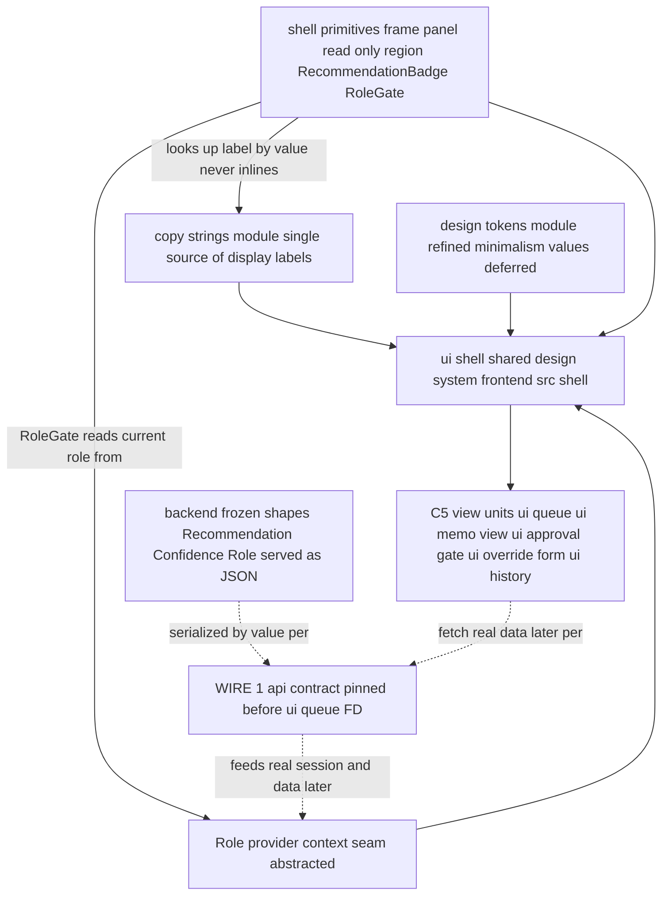

# Business Logic Model — `ui-shell` (`ui-common` / U10)

**Stage**: BUILD → Functional Design (per-unit) · shared shell / design-system unit · **Depth**: standard
**Unit**: U10 `ui-shell` · **Date**: 2026-07-07 · owns **CON-BR4 (language facet)**, FR-UI-3/4/5 · Story **US-UI-7**.
**Scope**: The **consume-and-conform flow**, the **copy-module single source** (badge fold), the **RoleGate seam +
WIRE-1 boundary**, the **Q3+Q2 shared-vocabulary fold**, the **FD ↔ later-stage boundary** (incl. the WIRE-1 hard
checkpoint), a **consumer/dependency map**, and an **invariant self-check**. **Advisory-only; no LLM; no business logic.**

---

## 1. Consume-and-conform flow

`ui-shell` is a **shared design-system** the C5 views compose; it drives no runtime request path of its own. A view
imports the shell primitives + tokens + copy module + RoleGate and thereby **inherits** the app-wide conventions. Real
data reaches a view **later**, over the wire contract **WIRE-1** (not authored here); `ui-shell` itself **fetches
nothing real** and is fed by abstracted seams / test stubs.

Mermaid validated before write (alphanumeric node IDs + underscore; every label double-quoted; **no semicolons, no bare
colons, no parentheses, no hyphens, no special characters** in labels; balanced blocks). Text alternative follows.

### Text alternative (always included)
1. `ui-shell` (at `frontend/src/shell/`) exports four concerns — the **copy module** (single source of display labels),
   the **design tokens** (refined-minimalism, values deferred), the **shell primitives** (frame, panel, read-only-region,
   `RecommendationBadge`, `RoleGate`), and the **Role provider/context seam**.
2. A shell primitive **looks up** its label from the copy module **by domain value** and **never inlines** a string
   (BR-UI-1). `RoleGate` reads the **current Role** from the abstracted provider seam (BR-UI-4).
3. The C5 view units **compose** the shell and thereby inherit the conventions (advisory copy, testid, tokens, cosmetic
   RBAC). No view redefines an app-wide convention.
4. **Dashed = later, not built here**: the backend frozen shapes are serialized **by value** per **WIRE-1**; WIRE-1 feeds
   the real session Role into the provider seam and real data into the views. `ui-shell` fetches nothing real now.

---

## 2. Copy module as the single source (Q1 + Q2 fold)

- A **components library** (primitives) and a **copy module** are **separate concerns that compose cleanly**: the
  primitive owns *how it looks*, the copy module owns *what it says*.
- The `RecommendationBadge` receives the Recommendation **value** as a prop and **looks up** its label from
  `RECOMMENDATION_LABELS`; it **defines no string**. The same "import from `shell/copy`, never inline" rule applies to
  **every** primitive and view. Result: **one** source of recommendation-related strings, never two (BR-UI-1).
- The **status-accent color** for each recommendation lives in `shell/tokens`, keyed by the **same** Recommendation
  value — one value space, two facets (label vs accent), still a single source per facet.

---

## 3. RoleGate seam + WIRE-1 boundary (Q4, reference-not-own, cross-language)

- `RoleGate` reads the current Role from an **abstracted provider/context** (`shell/session`), **not** a hard-wired
  fetch. It renders/hides/disables affordances **cosmetically** and owns **no authorization decision** (BR-UI-4). The
  **real** boundary stays `auth-rbac`'s `authorize` + audit-store's `DecisionCommitService` re-check (SEC-4).
- **First cross-language reference-not-own boundary**: the Role is a **value shape** (`underwriter`/`auditor`/`admin`)
  arriving over API JSON; **no `auth_rbac` Python is imported** into React. **How** the current user's Role reaches the
  provider is **WIRE-1** — authored on the FastAPI composition-root layer, **not here**. Until WIRE-1 is pinned, the
  provider is fed by a **test/stub** only.

---

## 4. Q3 + Q2 — two distinct checks over one vocabulary source (fold)

| | **BR-UI-2 (Q2)** — lexical | **BR-UI-3 (Q3)** — contextual / attribution |
|---|---|---|
| Checks | right **words**, sourced from the copy module | finalization framing only **in the human-gate context**, attributed to the **human** |
| Scope | any system-output string, **anywhere** (incl. in-gate) | the **gate boundary** + human-vs-system attribution |
| Catches what the other can't | a **bare "DECLINE"** even inside the gate | a **correctly-worded** label placed in the **wrong context** (system implied to finalize) |

**Fold**: both are backed by **ONE co-located forbidden/required-vocabulary source** (`FORBIDDEN_TERMS` next to
`shell/copy`) — **no two divergent word-lists**. BR-UI-3 layers the context/attribution assertion on top. Concrete
anchor: the human `CommitAction` values `approve` / `override` (lowercase; `approve` = agree, `override` = disagree with
a mandatory non-blank reason) are a **distinct namespace** from the system `Recommendation` values `APPROVE` / `REFER` /
`DECLINE-RECOMMEND` (uppercase) — in particular the human `override` is **not** the system `DECLINE-RECOMMEND` — the copy
module keeps them separate.

---

## 5. FD ↔ later-stage boundary (incl. the WIRE-1 hard checkpoint)

| Concern | **Pinned in THIS FD** | **Later (NFR / Code-Gen / WIRE-1 / deploy-config)** |
|---|---|---|
| Shared surface: copy module, primitives, tokens shapes, RoleGate seam | ✅ `domain-entities.md` | — |
| Advisory-copy single source + `-RECOMMEND` + human-gate framing | ✅ BR-UI-1/2/3 | the **lint + attribution tests** land at NFR/Code-Gen |
| `data-testid` + no-TS | ✅ BR-UI-5/6 | the concrete lint/CI checks generated at Code-Gen |
| **Aesthetic token VALUES** (fonts/colors/spacing) | ❌ direction only | **NFR-Design / Code-Gen** pin the values (refined-minimalism) |
| **RoleGate wire retrieval** (session-role delivery) | ❌ abstracted seam only | **WIRE-1** (composition-root api-contract) feeds the real session |
| **Frontend↔backend wire/serialization contract** | ❌ **WIRE-1, not here** | **WIRE-1 MUST be authored and pinned BEFORE `ui-queue`'s FD** (see below) |
| Frontend build/deploy topology (Vercel) | ❌ not here | **`deploy-config`** (Phase 2); Infra Design for this unit likely a logged SKIP, confirmed after NFR |

### WIRE-1 — hard checkpoint (cross-unit constraint)
- **What**: the frontend↔backend api-contract — endpoint/route list, response envelope shape, error shape, and how the
  current user's **Role** reaches the client (session/auth response).
- **Owner**: a **to-be-authored `api-contract` artifact on the FastAPI composition-root layer** (named now, even though
  the orchestrator is not a per-unit-loop unit — `unit-of-work.md §2` note).
- **Hard checkpoint**: **WIRE-1 MUST be authored and pinned BEFORE `ui-queue`'s FD begins.** `ui-queue` is the **first
  data-consuming UI unit** and **may not start against an unpinned contract**. `ui-shell` proceeds now **because it
  fetches nothing real** (abstracted seams / stubs only).
- **Serialization invariant to preserve**: enums serialize **by value**; the canonical wire map is
  Recommendation **UPPERCASE** (`APPROVE`/`REFER`/`DECLINE-RECOMMEND`), Confidence **Title-case** (`High`/`Medium`/`Low`),
  Role **lowercase** (`underwriter`/`auditor`/`admin`), CommitAction **lowercase** (`approve`/`override`, a **distinct
  namespace** from system Recommendation — the human `override` is not the system `DECLINE-RECOMMEND`). The copy module
  keys on these values; **WIRE-1 must not remap or re-case them.**
- **Registered**: `guide-docs/guide-state.md` → Deferred Decisions register as **WIRE-1**.

---

## 6. Consumer / dependency map

| Party | Relationship | Consumes from `ui-shell` |
|---|---|---|
| **`ui-queue`** (U5, P1) | composes the shell | frame/panel primitives, testid convention; **blocked on WIRE-1** for real data |
| **`ui-memo-view`** (U6, P1) | composes the shell | read-only-region, `RecommendationBadge`/`ConfidenceBadge`, copy module |
| **`ui-approval-gate`** (U7, P1) | composes the shell | human-gate framing (BR-UI-3), `RoleGate`, copy module |
| **`ui-override-form`** (U8, P1) | composes the shell | advisory copy, `RoleGate`, testid |
| **`ui-history`** (U9, P1) | composes the shell | read display primitives, copy module |
| **`ui-outlier-view`** (U20, P2) | composes the shell | conforms to the same contract (`domain-entities.md`) |
| **WIRE-1 / composition root** (later) | feeds real session + data | — (`ui-shell` fetches nothing real) |

`ui-shell` **imports none** of the above and **no backend production code** (reference-not-own). The direction is
**views → `ui-shell`**; never the reverse.

---

## 7. Invariant self-check

| Invariant | Honored by | How |
|---|---|---|
| **CON-BR4 (language facet)** / advisory-only | BR-UI-1/2/3; §2/§4 | "recommendation" not "decision"; `-RECOMMEND` preserved; finalization framing only in the human-gate context |
| **Human-in-the-loop gate framing** | BR-UI-3; §4 | no copy implies auto-finalization; the human action namespace is distinct from system output |
| **SEC-4 (cosmetic UI facet)** | BR-UI-4; §3 | `RoleGate` is cosmetic; the real boundary is `auth-rbac` + `DecisionCommitService` |
| **Reference-not-own (cross-language)** | BR-UI-4/7; §3 | Role/Recommendation/Confidence consumed as value shapes; no backend import; wire retrieval is WIRE-1 |
| **FR-UI-3 (`data-testid`)** | BR-UI-5; `domain-entities.md §6` | stable testid convention on primitives, checkable |
| **FR-UI-5 (no TypeScript)** | BR-UI-6 | plain JS/JSX + React + Tailwind; no `.ts`/`.tsx` |
| **No business logic / no LLM** | BR-UI-7; §1 | no rule eval / authz decision / commit / memo; no model anywhere |
| **Single source of app-wide conventions** | §1/§2/§6 | views compose the shell; nothing app-wide redefined per view |
