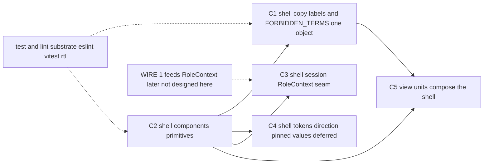

# Logical Components — `ui-shell` (`ui-common` / U10)

**Stage**: BUILD → NFR Design (per-unit) · shared shell / design-system unit
**Depth**: mirror NFR Requirements — lighter overall EXCEPT full rigor on the invariant / AC-bearing facets.
**Unit**: U10 `ui-shell` · **Date**: 2026-07-07.
The **4 production components** (under `frontend/src/shell/`) + the **test/lint substrate** this unit introduces, their
responsibilities, ownership, a **reference-not-own check**, and **component→target coverage**. **React + Tailwind, NO
TypeScript. Advisory-only; no LLM. Reference-not-own + WIRE-1 held.**

> **No production import of any backend module or the real wire anywhere (binding).** `ui-shell` components import
> **only** React / Tailwind + `ui-shell`'s own modules. **No `RoleGate`/component calls an authz function, imports a
> backend path, or issues a real fetch** — structurally verified (REFNOTOWN-1). **No component renders or tests a view or
> gate** — the human-gate render-context attribution is **`ui-approval-gate` (U7)'s** (GATE-1 delegation). `RoleContext`
> population is **WIRE-1**, not designed here.

---

## 1. Components

| ID | Component | Responsibility | Backs |
|---|---|---|---|
| **C1** | **`shell/copy`** (+ `FORBIDDEN_TERMS`) | The **sole label authority**: `RECOMMENDATION_LABELS`, `CONFIDENCE_LABELS`, `ROLE_LABELS`, **`COMMIT_ACTION_LABELS` `{approve, override}`**, `ADVISORY_VOCABULARY`, and the **one `FORBIDDEN_TERMS` object** both the lexical lint and the namespace-distinctness check consume. | COPY-1, ADVISORY-1, GATE-1 |
| **C2** | **`shell/components`** primitives — `AppFrame`, `Panel`, `ReadOnlyRegion`, `RecommendationBadge`, `ConfidenceBadge`, `RoleGate` | Presentational primitives; badges **look up** labels from C1 by value (no inline); every interactive primitive exposes a stable **`data-testid`**; `RoleGate` is cosmetic (reads C3). | COPY-1(b), TESTID-1, RBAC-1 |
| **C3** | **`shell/session`** — `RoleContext` + `useCurrentRole()` | The **abstracted Role seam** `RoleGate` reads. **Populated later by WIRE-1** (not designed here); tests inject via a stub `RoleContext.Provider`. | RBAC-1 |
| **C4** | **`shell/tokens`** | The single aesthetic source (CSS/Tailwind theme variables) — **direction pinned (refined-minimalism), VALUES deferred to Code-Gen**; token **categories/shapes** only. | AESTHETIC-1 |

**Test / lint substrate (test-only, not a production component):**
- **ESLint rule(s)** over C1 — the **no-inline-string** lint (COPY-1) and the **lexical advisory** lint (ADVISORY-1),
  each with a **detector self-test**.
- **Structural set-disjointness test** (GATE-1) — asserts `COMMIT_ACTION_LABELS ∩ RECOMMENDATION_LABELS = ∅`
  (and `override` label ≠ `DECLINE-RECOMMEND`), reading the **same `FORBIDDEN_TERMS` source object** as ADVISORY-1
  (fold 1); + a detector self-test flagging a synthetic collision / second word-list (fold 2).
- **`data-testid` lint** over C2 primitives (TESTID-1) + detector self-test.
- **File/config scan** (NOTS-1) — no `.ts`/`.tsx`, no `tsconfig`.
- **Reference-not-own scan** (REFNOTOWN-1) — no backend import, no real fetch.
- **Vitest + React Testing Library** — COPY-1(b) badge look-up render; RBAC-1 `RoleGate` via a stub `RoleContext.Provider`.

---

## 2. Component-relationship diagram

Mermaid validated before write (alphanumeric node IDs + underscore; every label double-quoted; **no semicolons, no bare
colons, no parentheses, no hyphens, no special characters** in labels; balanced blocks). Text alternative follows.

### Text alternative (always included)
- **C2 primitives** consume **C1 `shell/copy`** (labels by value), **C4 `shell/tokens`** (styling), and **C3
  `shell/session`** (`RoleGate` reads the Role seam).
- **C1** and **C2** are what the **C5 view units** compose (views → shell; never the reverse).
- Dashed = substrate/boundary: the **test/lint substrate** exercises C1 (lints + set-disjointness) and C2 (testid +
  RTL); **WIRE-1** (external, not designed here) feeds **C3 `RoleContext`** later.

---

## 3. Reference-not-own check

| Concern | Owner | This unit? |
|---|---|---|
| The shared conventions: copy single-source, vocabulary, testid, tokens, cosmetic RoleGate | **`ui-shell`** (C1–C4) | ✅ owns |
| Authorization **decision** (underwriter acts / auditor read-only) | **`auth-rbac`** + `DecisionCommitService` (SEC-4) | ❌ **not imported** — `RoleGate` is cosmetic; calls no authz function |
| The human-gate **render-context attribution** (finalization only in-gate) | **`ui-approval-gate` (U7)** | ❌ **not tested here** — `ui-shell` owns only the vocabulary/namespace SOURCE (GATE-1 delegation) |
| The frontend↔backend **wire/serialization contract** (endpoints, envelope, session-role delivery) | **WIRE-1** (composition-root) | ❌ external boundary; `RoleContext` population not designed here; `ui-shell` fetches nothing real |
| The C5 **view** units' internals (queue / memo / gate / override / history) | those units | ❌ **no import; no test of their internals** |
| Backend units' internals (rules-engine / memo-agent-core / audit-store / auth-rbac) | those units | ❌ consumed as **value shapes** only; no import |
| Concrete aesthetic **token values** | **Code-Gen** | ❌ direction pinned, values deferred |

**No component owns a concern reference-not-own assigns elsewhere. No backend import, no real fetch, no view/gate render
anywhere in `ui-shell`** — structurally verified (REFNOTOWN-1). First cross-language boundary (Python enum → React via
API JSON) held.

---

## 4. Component → target coverage (no orphan)

| Target | Component(s) / item |
|---|---|
| NFR-UI-COPY-1 | C1 (sole authority) + C2 (badge look-up) + no-inline-string lint |
| NFR-UI-ADVISORY-1 | C1 (`FORBIDDEN_TERMS`) + lexical lint |
| NFR-UI-GATE-1 | C1 (`COMMIT_ACTION_LABELS` vs `RECOMMENDATION_LABELS`) + set-disjointness test (render-context → U7) |
| NFR-UI-TESTID-1 | C2 primitives + `data-testid` lint |
| NFR-UI-NOTS-1 | whole unit + file/config scan |
| NFR-UI-RBAC-1 | C2 `RoleGate` + C3 `RoleContext` seam + stub-provider RTL |
| NFR-UI-REFNOTOWN-1 | all components + reference-not-own scan |
| NFR-UI-AESTHETIC-1 | C4 `shell/tokens` (direction pinned, values deferred) |
| NFR-UI-PERF-1 | C2 (render latency observed) |
| NFR-UI-A11Y-1 | C2 (semantic + focusable — soft) |
| NFR-UI-SCOPE-1 | **governance / exclusion** — cross-cutting boundary (documented, not an orphan) |

**All 11 targets covered.** Every component/item backs ≥1 target; SCOPE-1 is a documented boundary. No orphan.

---

## 5. Settled items held (not re-opened)
- Frozen FD (BR-UI-1..7 + design-system surface, incl. GATE-1's BR-UI-3 clarification + RoleGate single-mechanism) +
  approved `NFR-UI-*` targets — components realize them, re-opening neither.
- **`COMMIT_ACTION_LABELS` on C1** realizes the frozen GATE-1 requirement (labels `{approve, override}` distinct from
  `RECOMMENDATION_LABELS`; human `override` ≠ system `DECLINE-RECOMMEND`) — a realization, not new scope.
- **Reference-not-own + WIRE-1** — held; `RoleContext` population is WIRE-1's, not designed here; render-context
  attribution is U7's.
- **Aesthetic token VALUES** deferred to Code-Gen. **Advisory-only; no LLM.**
- **Infrastructure Design** for `ui-shell` **not pre-committed** — likely a logged SKIP (source-level shell; Vercel
  topology is `deploy-config` P2) — confirmed at that stage. Settled non-edits stay closed: `PROJECT-BRIEF.md`,
  `user-journey.md`, every built unit's code/design.
