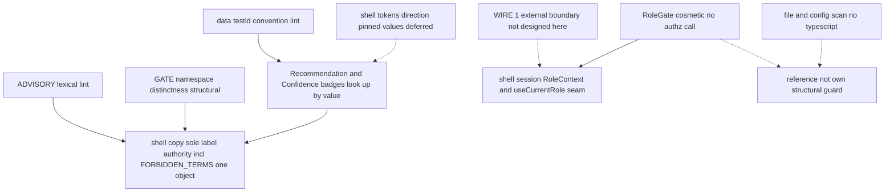

# NFR Design Patterns — `ui-shell` (`ui-common` / U10)

**Stage**: BUILD → NFR Design (per-unit) · shared shell / design-system unit
**Depth**: **mirror NFR Requirements — lighter overall EXCEPT full rigor on the invariant / AC-bearing facets.**
**Unit**: U10 `ui-shell` · **Date**: 2026-07-07 · owns **CON-BR4 (language facet)**, FR-UI-3/4/5.
**Built ON** the frozen FD (incl. GATE-1's BR-UI-3 scope clarification + the RoleGate single-mechanism amendment) + the
approved `nfr-requirements.md` — **re-opening neither**. One section per pattern, each structurally meeting its
`NFR-UI-*` target(s) + traced. **Advisory-only; no LLM. Reference-not-own + WIRE-1 held** (external boundary, **not
designed here**).

> **Reference-not-own (stated once, upheld everywhere).** No `ui-shell` component imports **backend production code** or
> the **real wire**, and **no component renders/tests a view or gate** — the human-gate **render-context attribution is
> `ui-approval-gate` (U7)'s** (GATE-1 delegation). `RoleContext` is a **seam**; **how it is populated is WIRE-1**, not
> designed here.

---

## §1 — SingleSourceCopyModulePattern → NFR-UI-COPY-1

- **Pattern**: `shell/copy` is the **sole label authority** — the one module defining `RECOMMENDATION_LABELS`,
  `CONFIDENCE_LABELS`, `ROLE_LABELS`, `COMMIT_ACTION_LABELS`, `ADVISORY_VOCABULARY`. `RecommendationBadge` /
  `ConfidenceBadge` render **by look-up from the domain value**, never an inlined string; views import labels, never
  inline them.
- **Meets the target**: a **build-failing lint** reads this **one** module and flags any label literal declared outside
  it; a **detector self-test** proves it flags a synthetic inlined label (non-vacuous). COPY-1(b) — the badge look-up —
  is a small **RTL** render assertion.
- **Tier**: structural / lint (+ one RTL render for COPY-1(b)).

## §2 — SharedVocabularySourcePattern → NFR-UI-ADVISORY-1 + NFR-UI-GATE-1  *(fold 1 + fold 2)*

- **Pattern**: **ONE `FORBIDDEN_TERMS` source object** (co-located with `shell/copy`), with **TWO distinct checks layered
  on it** — realizing **fold 1** as *one source object, two consumers*:
  - **ADVISORY-1 (lexical)** — a build-failing lint over `FORBIDDEN_TERMS`: forbids a bare `"DECLINE"` (missing
    `-RECOMMEND`) and "decision"/"approved"/"declined" as **system** output; requires "recommendation".
  - **GATE-1 (namespace-distinctness, structural)** — asserts the human `CommitAction` labels **`{approve, override}` ≠
    `RECOMMENDATION_LABELS`**, and specifically the human **`override` ≠ the system `DECLINE-RECOMMEND`** label. This is a
    **structural set-disjointness check over the copy module** — **NOT a view/gate render** (that render-context
    attribution is **U7's**, delegated).
- **Meets the target**: both checks read the **same `FORBIDDEN_TERMS` source object** (verified structurally — one object,
  both consumers). Each carries a **detector self-test** (**fold 2**) — a synthetic violation (a bare `DECLINE`; or a
  `CommitAction` label equal to a `Recommendation` label; or a **second divergent word-list**) is flagged.
- **Tier**: structural / lint (unit).

## §3 — DataTestidConventionPattern → NFR-UI-TESTID-1

- **Pattern**: every interactive / assertion-relevant `shell/components` primitive exposes a **stable `data-testid`** per
  the documented naming convention (`shell-<primitive>-<purpose>`).
- **Meets the target**: a lint/test asserts the convention across the primitives; a **detector self-test** flags a
  primitive with a missing / misnamed testid (non-vacuous).
- **Tier**: structural / component (unit).

## §4 — StructuralFileScanPattern → NFR-UI-NOTS-1

- **Pattern**: a **file/config scan** over the `ui-shell` tree asserting **zero** `.ts`/`.tsx` files and **no** TS config
  (`tsconfig*.json`) — the unit is plain JS/JSX + React + Tailwind (FR-UI-5).
- **Meets the target**: CI fails if any TS file/config appears. Purely structural; no runtime.
- **Tier**: structural (unit).

## §5 — CosmeticRoleGatePattern → NFR-UI-RBAC-1

- **Pattern**: `RoleGate` (prop shape **`{ can, children, fallback }`**, **no `role` prop** — the FD single-mechanism
  amendment) reads the current Role **internally** via **`useCurrentRole()` from `RoleContext`** and
  **show/hide/disables** an affordance **cosmetically**. It calls **no** authorization function and owns **no** security
  decision — the real boundary is `auth-rbac` `authorize` + `DecisionCommitService` (SEC-4).
- **Meets the target**: an **RTL** test wraps `RoleGate` in a **stub `RoleContext.Provider`** — `underwriter` → an `act`
  affordance renders; `auditor` → hidden/disabled; a static check asserts `RoleGate` imports **no** authz/backend module
  and invokes no `authorize`-style call.
- **Tier**: component + structural (unit).

## §6 — ReferenceNotOwnStructuralGuardPattern → NFR-UI-REFNOTOWN-1

- **Pattern**: a **structural scan** asserting **no** `ui-shell` module imports a backend path and **no** module issues a
  real network `fetch`/`axios` call — the shell **fetches nothing real** (WIRE-1 held); Role / Recommendation /
  Confidence are consumed as **value shapes** only.
- **Meets the target**: realizes the held constraint **checkably**; **designs no wire contract** (WIRE-1 stays the
  external boundary). A detector self-test flags a synthetic backend import / real fetch.
- **Tier**: structural (unit).

## §7 — DesignTokenPattern → NFR-UI-AESTHETIC-1  *(soft; values deferred)*

- **Pattern**: `shell/tokens` is the single aesthetic source expressed as **CSS / Tailwind theme variables**. The
  **direction is pinned** — refined-minimalism (distinctive-but-professional type; restrained palette; **no**
  Inter/Roboto/Arial default, **no** purple-gradient cliché). Only **token categories/shapes** are named here:
  `color` (surface / text / border / status-accent-per-recommendation), `typography`, `spacing`, `radius`, `elevation`.
- **Meets the target**: concrete **VALUES are deferred to Code-Gen** — recorded as shape/target, not specified. The
  status-accent color is keyed by the **same Recommendation values** as `shell/copy` (one value space, two facets).
- **Tier**: N/A (deferred design decision).

## §8 — ReferencedBoundaryPattern → NFR-UI-PERF-1, NFR-UI-A11Y-1, NFR-UI-SCOPE-1  *(soft / governance)*

- **PERF-1** — presentational primitives; **render latency + bundle size observed, non-gating** (no SLO).
- **A11Y-1** — interactive primitives **semantic + keyboard-focusable** with accessible labels (aligned NFR-EXPLAIN-1);
  **soft**, detailed a11y verification lands with the view units / Code-Gen.
- **SCOPE-1** — **governance/exclusion statement**: patterns realize only `ui-shell`'s own conventions; **not** any
  view's or backend unit's internals, and **not** the WIRE-1 api-contract. The human-gate **render-context attribution**
  is **U7-owned** — keeping SCOPE-1 and GATE-1 consistent.
- **Tier**: observed / soft / governance.

---

## §9 — Pattern-integration diagram

Mermaid validated before write (alphanumeric node IDs + underscore; every label double-quoted; **no semicolons, no bare
colons, no parentheses, no hyphens, no special characters** in labels; balanced blocks). Text alternative follows.

### Text alternative (always included)
- **`shell/copy`** is the sole label authority and holds the **one `FORBIDDEN_TERMS` object**; the **ADVISORY lexical
  lint** and the **GATE namespace-distinctness** check both read it (fold 1 — one source, two checks).
- **Recommendation/Confidence badges** look up labels **by value** from `shell/copy` (COPY-1); the **data-testid lint**
  runs over the primitives.
- **`RoleGate`** (cosmetic) reads the **`shell/session` `RoleContext`** seam via `useCurrentRole()` — no authz call.
- Dashed = boundary/deferred: **tokens** (direction pinned, values deferred) style the badges; the **no-TypeScript scan**
  and `RoleGate` sit under the **reference-not-own guard**; **WIRE-1** (external, not designed here) feeds `RoleContext`
  later.

---

## §10 — Traceability (pattern → target → tier → rigor)

| Pattern | Target(s) | Tier | Rigor |
|---|---|---|---|
| SingleSourceCopyModulePattern | COPY-1 | lint (+ RTL for COPY-1(b)) | full |
| SharedVocabularySourcePattern (fold 1 + 2) | ADVISORY-1, GATE-1 | structural / lint | full |
| DataTestidConventionPattern | TESTID-1 | lint / component | full |
| StructuralFileScanPattern | NOTS-1 | structural | full |
| CosmeticRoleGatePattern | RBAC-1 | component / structural | medium |
| ReferenceNotOwnStructuralGuardPattern | REFNOTOWN-1 | structural | soft |
| DesignTokenPattern | AESTHETIC-1 | N/A (values deferred) | soft |
| ReferencedBoundaryPattern | PERF-1, A11Y-1, SCOPE-1 | observed / soft / governance | soft / governance |

All 11 approved `NFR-UI-*` targets covered; no orphan. GATE-1's render-context attribution delegated to U7 (SCOPE-1).
