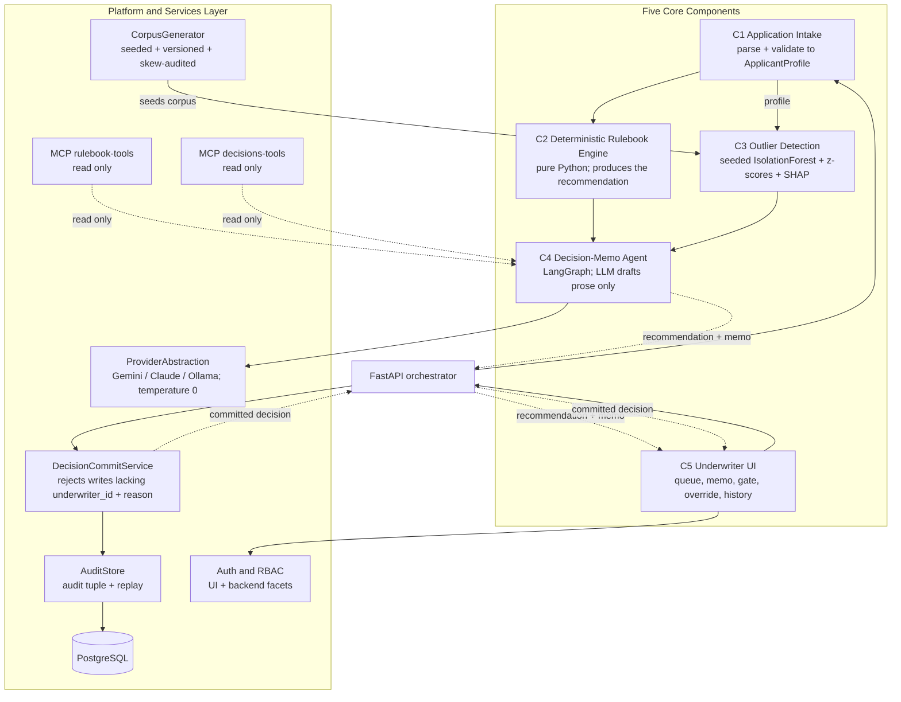

# Application Design — Consolidated

**Stage**: DISCOVER → Application Design
**Date**: 2026-06-19
**Project**: Agentic Underwriting Assistant (Greenfield)
**Depth**: Comprehensive (approved at the Workflow Planning gate)

This document **consolidates** the four Application Design artifacts:
- [`components.md`](components.md) — component definitions + C4-style container diagram
- [`component-methods.md`](component-methods.md) — method signatures + I/O types
- [`services.md`](services.md) — service layer + sequence diagrams
- [`component-dependency.md`](component-dependency.md) — dependency matrix + data-flow

**Scope discipline**: interfaces and **signatures only** — no business logic, no rule
thresholds, no field-by-field schema. Those are deferred to per-unit **Functional Design**
(BUILD).

---

## 1. Planning decisions applied (from `application-design-plan.md`)

| Q | Decision | Effect on design |
|---|---|---|
| Q1 | **B** — LangGraph scoped to C4 only; FastAPI owns intake/rules/persistence | Deterministic pipeline lives outside the LLM-orchestration framework (strongest CON-BR2 guarantee). |
| Q2 | **N/A** (implied by Q1=B) | Recommendation computed **before** the graph, injected as **immutable state**. |
| Q3 | **B** — two read-only MCP servers (`rulebook-tools`, `decisions-tools`) | Per-server read-only scoping; aligns with FR-MEMO-5's plural wording. |
| Q4 | **B** — EPIC-6 as a **services layer** | Five core components stay primary in `components.md`; platform concerns designed in `services.md`. |
| Q5 | **A + note** | Sequence diagrams include the **uniform gate** (Approve / Override-with-reason) for all recommendations incl. REFER — **no escalation branch**. |
| Q6 | **A** | Human approval gate sits **outside** the agent graph; commit via `DecisionCommitService`. |

---

## 2. Component summary (the five core components + services layer)

**Text alternative**: C1 Intake produces the `ApplicantProfile`, which flows **in parallel**
to C2 Rules (**produces the read-only recommendation**) and C3 Outlier (scores the profile,
not rule results); C2 and C3 results both feed C4 Memo. C4 calls ProviderAbstraction
(`temperature=0`) and reads two **read-only** MCP servers. **All C5↔backend flows route
through the `FastAPI orchestrator` node**: the UI entry (`C5 --> API --> C1`), the **commit
request** (`C5 --> API --> DCS`, so the API layer enforces RBAC on the commit path per G7),
and both return paths are mediated by FastAPI — the recommendation + memo returns
`C4 -. recommendation + memo .-> API -. .-> C5`, and the committed decision returns
`DCS -. committed decision .-> API -. .-> C5`. The deterministic-core edges
(`C1 --> C2`, `C1 --> C3`, `C2 --> C4`, `C3 --> C4`) stay direct. C5 authenticates via
Auth/RBAC and commits at the gate through DecisionCommitService → AuditStore → PostgreSQL;
CorpusGenerator feeds C3.

See [`components.md`](components.md) for full per-component purpose, responsibilities, and
interfaces, and [`component-methods.md`](component-methods.md) for signatures.

---

## 3. Service layer & orchestration

FastAPI owns the deterministic pipeline (intake → rules → outlier) + persistence;
LangGraph orchestrates only the C4 memo sub-flow; the human gate is outside the graph.
Four sequence diagrams are in [`services.md`](services.md):
1. **Intake → commit** (happy path; C3 Outlier marked Phase 2)
2. **Decision replay** (auditor, read-only, against the original rulebook version; drawn as a
   **match → ok / mismatch → blocking reproducibility failure** branch)
3. **Uniform approval gate** (Approve / Override-with-reason for **all** recommendations
   incl. REFER — **no REFER escalation branch**; escalation = Phase 3 / OOS-2; commit path
   shows the API-layer + DecisionCommitService RBAC enforcement)
4. **Unhappy paths** (intake rejection / incomplete-package; memo citation-validation
   failure; provider/tool-call error or timeout — flows only, retry/backoff deferred)

Dependency matrix, communication patterns, and the data-flow diagram (with the explicit
**deterministic/LLM line** and the **read-only MCP boundary**) are in
[`component-dependency.md`](component-dependency.md).

---

## 4. Binding-invariant traceability (architectural handling)

| Invariant | How the architecture honors it | Where |
|---|---|---|
| **CON-BR2** — LLM out of the decision path | Recommendation produced by C2 (pure Python) **before** the graph; injected into C4 as a **read-only** field; `DecisionMemo` has **no recommendation-override field**; QA-5 test seam. | C2, C4; `components.md`, `component-methods.md`, `component-dependency.md` |
| **CON-BR1** — bias measured on the decision | Outlier `feature-builder` **excludes demographic identifiers**; occupation/income act only via their sanctioned rule. | C3; `components.md`, `component-methods.md` |
| **CON-BR3** — seeded/versioned/skew-audited corpus | `CorpusGenerator.generate(seed, manifest)`; manifest-stamped, skew-audited before use. | services layer; `services.md` |
| **CON-BR4** — advisory-only enforced in the system | `DecisionCommitService` **rejects any write lacking `underwriter_id` + `reason`**; backend boundary, not UI copy; gate outside the agent graph. | DecisionCommitService; `services.md` §3/§5 |
| **CON-AUDIT-1** — audit tuple + replay | `AuditStore.persist(audit_tuple)`; `ReplayService.replay` re-evaluates against the **original** `rulebook_version`. | services layer; `services.md` §4 |
| **CON-DET-1** — no unseeded/wall-clock/dict-order | Deterministic C2 evaluation + seeded C3; no LLM in the recommendation path. | C2, C3 |

---

## 5. Carried-in items (honored; not re-resolved)

1. **Per-unit "lighter" depth = revisitable recommendation, not a floor.** Bites at BUILD
   per-unit design; Application Design ran comprehensive. Invariant-bearing UI
   (`ui-approval-gate`, `ui-override-form`) stays comprehensive (FR-UI-2 / CON-BR4 / FR-UI-4).
2. **`ui-auth-rbac` (C5/EPIC-5) vs `auth-rbac` (EPIC-6).** Modeled as **one Auth/RBAC
   capability with a UI-enforcement facet + a backend-enforcement facet**; the one-vs-two
   unit boundary is **deferred to Units Generation** and flagged at every RBAC touchpoint.

---

## 6. Phase note

Application Design covers all five components for design completeness. Build phasing is
unchanged (stories.md §8): **Phase 1** = the core deterministic advisory slice (intake →
rules → memo → UI gate/override → RBAC → quality gates → corpus → audit/replay);
**Phase 2** = C3 outlier + SHAP, MCP tool exposure, borderline routing, secondary/showcase
providers, observability, LLM-as-judge, and the validation deploy.

---

*End of consolidated Application Design. The four detailed artifacts are the source of
record; this document consolidates them. Detailed business logic follows in per-unit
Functional Design (BUILD).*
