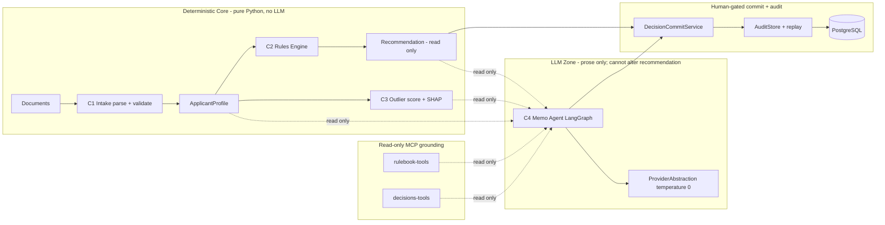

# Application Design — Component Dependencies

**Stage**: DISCOVER → Application Design
**Date**: 2026-06-19
**Scope**: Dependency matrix + communication patterns + data-flow diagram.
**Decisions applied**: Q1=B, Q3=B (two read-only MCP servers), Q4=B, Q6=A.

---

## 1. Dependency matrix

Rows **depend on / call** columns. `R` = read-only dependency. Empty = no direct dependency.

| Depends on → | C1 Intake | C2 Rules | C3 Outlier | C4 Memo | Provider | MCP (RO) | CommitSvc | AuditStore | Auth/RBAC | DB |
|---|:--:|:--:|:--:|:--:|:--:|:--:|:--:|:--:|:--:|:--:|
| **FastAPI (orchestrator)** | ✓ | ✓ | ✓ | ✓ | | | ✓ | ✓ | ✓ | ✓ |
| **C1 Intake** | | | | | | | | | | |
| **C2 Rules** | | | | | | | | ✓ | | ✓ |
| **C3 Outlier** | | | | | | | | | | |
| **C4 Memo** | | R | R | | ✓ | R | | | | |
| **C5 UI** | | | | | | | ✓ | | ✓ | |
| **DecisionCommitService** | | | | | | | | ✓ | | ✓ |
| **ReplayService** | | ✓ | | | | | | ✓ | | ✓ |

Notes:
- **C4 → C2** is **read-only**: C4 consumes the `RuleResultReport` (incl. the recommendation)
  but **cannot change it** (CON-BR2).
- **C4 → C3** is **read-only**: C4 consumes the `OutlierResult` (per
  `MemoAgent.draft(profile, rule_report, outlier_result)`) for memo prose; it does not
  invoke or alter scoring.
- **C4 → MCP** is **read-only** grounding via two servers; **no write path** through MCP.
- **C2/C3 do not depend on C4** — the deterministic pipeline never calls the LLM.
- The **decision write path is `DecisionCommitService` only** (C5 → CommitService → Audit/DB).

## 2. Communication patterns

| Edge | Pattern | Notes |
|---|---|---|
| C5 ↔ FastAPI | HTTPS / REST (JWT/session, RBAC-gated) | Auditor read-only |
| FastAPI → C1/C2/C3 | In-process service calls (deterministic) | Recommendation produced before any graph |
| FastAPI → C4 | Invoke LangGraph memo sub-flow with **immutable** state | Q1=B |
| C4 → ProviderAbstraction | Provider-agnostic call; `temperature=0` | FR-PROV-3 |
| C4 → MCP `rulebook-tools` / `decisions-tools` | **Read-only** tool calls | Two servers (Q3=B) |
| C5 → DecisionCommitService | Commit at the human gate | Rejects missing `underwriter_id`+`reason` |
| DecisionCommitService → AuditStore → DB | Persist audit tuple | CON-AUDIT-1 |
| ReplayService → C2 | Re-evaluate at **original** `rulebook_version` | CON-AUDIT-1 |

---

## 3. Data-flow diagram (deterministic/LLM line + read-only MCP boundary)

Mermaid validated before write (alphanumeric IDs; all labels double-quoted; no bare
parentheses; subgraphs closed; balanced brackets; no `end` node id). Text alternative below.

### Text alternative (always included)

- **Deterministic Core (pure Python, no LLM)**: Documents → C1 Intake (parse + validate)
  → `ApplicantProfile` → C2 Rules Engine → **Recommendation (read-only)**. The profile also
  flows to C3 Outlier (score + SHAP).
- **The deterministic/LLM line — all five inputs into C4 are read-only**: C4 (the LLM Zone)
  has **five inputs**, and **every one is drawn as a dashed read-only edge** to visually
  prove CON-BR2 (the LLM consumes everything, mutates nothing): the **Recommendation**
  (`REC -. read only .-> MEMO`), the **outlier result** (`OUT -. read only .-> MEMO`), the
  **`ApplicantProfile`** (`PROF -. read only .-> MEMO`), and the **two MCP servers**
  (`rulebook-tools`, `decisions-tools`). The LLM Zone is **prose-only and cannot alter any
  of them**. The separate **`REC --> DCS`** edge remains solid: the recommendation also
  flows directly to the human-gated commit, **bypassing the LLM**. C4 calls
  ProviderAbstraction at `temperature=0`.
- **Read-only MCP boundary**: `rulebook-tools` and `decisions-tools` feed C4 as
  **read-only** grounding (dashed edges) — **no write path** through MCP. These are two of
  the five uniformly read-only inputs noted above.
- **Read-only marking is reserved for LLM-zone boundaries**: the dashed read-only edges mark
  **only** edges entering C4. Deterministic-core edges stay **solid** — e.g.
  `PROF --> OUT` (profile into the pure-Python outlier scorer) and the
  `DOC --> INT --> PROF --> RUL --> REC` chain — so the read-only convention keeps its
  meaning: everything crossing into the LLM is read-only.
- **Human-gated commit + audit**: the **Recommendation** and **memo** flow to
  `DecisionCommitService` (the human gate), which commits only with `underwriter_id` +
  `reason` (CON-BR4) and persists the audit tuple to `AuditStore` → PostgreSQL
  (CON-AUDIT-1). Replay re-evaluates against the original rulebook version.

> **RBAC overlap (deferred to Units Generation):** Auth/RBAC spans the C5 (UI-enforcement)
> and backend (API/DB-enforcement) facets; whether `ui-auth-rbac` and `auth-rbac` become
> one unit or two is decided at Units Generation, not here.

---

*End of component dependencies.*
