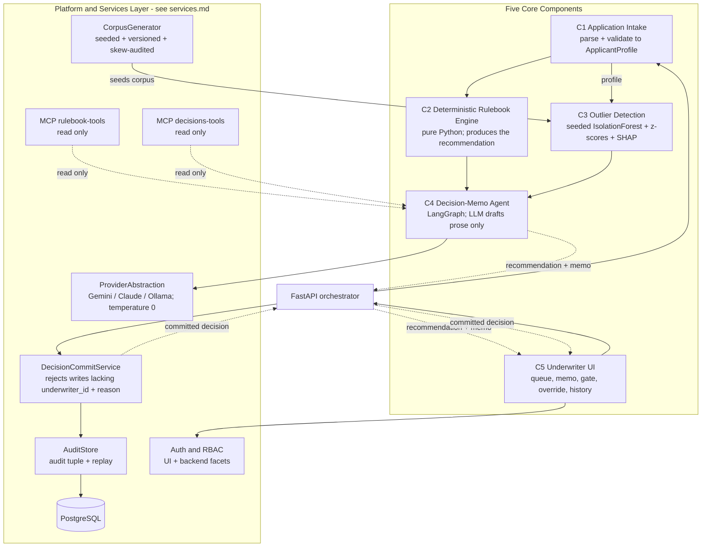

# Application Design — Components

**Stage**: DISCOVER → Application Design
**Date**: 2026-06-19
**Scope**: High-level component identification + interfaces. **No business logic, no
rule thresholds, no field-by-field schema** — those are deferred to per-unit
**Functional Design** (BUILD).
**Decisions applied**: Q1=B (LangGraph scoped to C4 only; FastAPI owns
intake/rules/persistence), Q3=B (two read-only MCP servers), Q4=B (EPIC-6 as a
**services layer** — see `services.md`; the **five core components** are primary here),
Q5=A, Q6=A.

---

## 1. Component overview (C4-style container diagram)

Mermaid validated before write per `common/visual-and-syntax-standards.md`:
alphanumeric/underscore node IDs; all labels double-quoted; no bare parentheses;
subgraphs closed; no reserved-word `end` node id; balanced brackets. Text alternative
follows.

> **Deterministic boundary cue**: **C1, C2, and C3 are the deterministic core** (pure
> Python, no LLM — C2 *produces* the recommendation). **C4 is the LLM zone** (prose only,
> via ProviderAbstraction). This boundary is drawn explicitly as the "Deterministic Core —
> pure Python, no LLM" subgraph in `component-dependency.md`'s data-flow diagram.

### Text alternative (always included)

- **Five core components**: C1 Application Intake produces the `ApplicantProfile`, which
  flows **in parallel** to **C2 Deterministic Rulebook Engine** (rule evaluation) and
  **C3 Outlier Detection** (profile scoring) — C3 scores the profile, **not** rule results.
  C2 and C3 results both feed **C4 Decision-Memo Agent**; the recommendation + memo are then
  surfaced (via the **FastAPI orchestrator**) in **C5 Underwriter UI**.
- **The recommendation is produced by C2** (pure Python) and flows into C4 as a
  **read-only** input; C4 never produces or alters it.
- **C4** calls the **ProviderAbstraction** for LLM completion and reads grounding from
  **two read-only MCP servers** (`rulebook-tools`, `decisions-tools`) — the MCP edges are
  read-only (dashed) and cannot write.
- **C5** authenticates via **Auth/RBAC** and, at the human approval gate, commits through
  **DecisionCommitService**, which persists the audit tuple to **AuditStore** (PostgreSQL).
- **All C5↔backend flows route through the `FastAPI orchestrator` node.** The UI's entry
  is `C5 --> API --> C1` and the **commit request** is `C5 --> API --> DCS` (so the API
  layer enforces RBAC on the commit path, per G7 / `services.md` §5); **both return paths
  are mediated by FastAPI**: the **recommendation + memo** returns
  `C4 -. recommendation + memo .-> API -. .-> C5`, and the **committed decision** returns
  `DCS -. committed decision .-> API -. .-> C5`. The deterministic-core edges
  (`C1 --> C2`, `C1 --> C3`, `C2 --> C4`, `C3 --> C4`) stay direct. This makes the
  request/response symmetry truthful and removes the prior "FastAPI is abstracted out"
  caveat — the node now carries those flows. It matches the `services.md` sequences
  (`API-->>UI: pending recommendation + memo`; `DCS-->>UI: CommittedDecision`).
- **CorpusGenerator** feeds the seeded synthetic corpus into **C3**.
- The Platform & Services layer (right) is fully designed in `services.md` (Q4=B).

---

## 2. Component definitions

### C1 — Application Intake
- **Purpose**: Turn an application form + supporting documents into one validated,
  typed `ApplicantProfile`, or reject the package at a Pydantic gate **before** any
  agent or LLM runs.
- **Responsibilities**: document parsing (pdfplumber); Pydantic v2 typed extraction +
  completeness validation; prompt-injection sanitization/sandboxing of extracted text;
  keep thin-file / single-missing-document cases processable (route toward REFER, not a
  hard failure).
- **Interface (high-level)**: `IntakeService.parse(documents) -> ApplicantProfile`;
  rejects at the validation gate when unrecoverable.
- **Invariants**: SEC-1 (injection defense), SEC-2 (validation gate), FR-INTAKE-1..3,
  DATA-4 (zero real PII).

### C2 — Deterministic Rulebook Engine
- **Purpose**: Evaluate an `ApplicantProfile` against a **versioned** rulebook with
  **pure Python and zero LLM**, and **produce the recommendation**.
- **Responsibilities**: load a specific `rulebook_version`; evaluate all rules; report
  each fired rule's exact triggering value + comparison; emit the exact recommendation
  enum (`APPROVE` / `REFER` / `DECLINE-RECOMMEND`); **produce the `confidence` level
  (Low/Med/High) as a deterministic function of rule-proximity** (Phase 2 also folds in
  C3's outlier score) — confidence originates in the **deterministic core, never in the
  LLM** (preserves reproducibility, AC-1); stamp output with `rulebook_version`;
  keep published versions immutable.
- **Interface (high-level)**:
  `RulesEngine.evaluate(profile, rulebook_version) -> RuleResultReport` (which carries the
  `recommendation`).
- **Invariants**: **CON-BR2** (the recommendation originates here, not in the LLM),
  CON-DET-1 (no unseeded randomness / wall-clock / dict-order), FR-RULES-1..6.

### C3 — Outlier Detection
- **Purpose**: Compare an applicant against the seeded synthetic corpus and explain any
  anomaly, **without** using demographic identifiers.
- **Responsibilities**: build a feature vector that **excludes** demographic identifiers;
  score via IsolationForest + z-scores under a **fixed seed**; produce a SHAP explanation
  for every flag.
- **Interface (high-level)**: `OutlierService.score(profile, corpus_version) ->
  OutlierResult` (score + flagged features + SHAP).
- **Invariants**: **CON-BR1** (no demographic identifiers in the feature vector),
  CON-DET-1 (seeded), FR-OUT-1..3. **Phase 2.**

### C4 — Decision-Memo Agent (LLM)
- **Purpose**: Draft an audit-ready, rule-cited memo **after** the deterministic results
  exist — prose only, never touching the recommendation.
- **Responsibilities**: LangGraph state machine for the memo sub-flow; consume the
  `RuleResultReport` (incl. its read-only `recommendation`) + `OutlierResult`; enforce
  `temperature=0` and structured XML→Pydantic output via the ProviderAbstraction; validate
  every cited rule ID against the YAML (hallucination guard); deterministic borderline
  routing to extended thinking; advisory-only language. **Cite strictly from the handed
  `RuleResultReport`**; the read-only `rulebook-tools` MCP server is consulted for
  **supplementary human-readable rule descriptions only**, never to re-derive or re-fetch
  which rules fired (retrieval-miss guard).
- **Interface (high-level)**: `MemoAgent.draft(profile, rule_report, outlier_result) ->
  DecisionMemo`. **`DecisionMemo` carries no field that can change the recommendation.**
- **Invariants**: **CON-BR2** (read-only recommendation; QA-5 test seam asserts the LLM
  cannot change it), FR-MEMO-1..7, FR-PROV-1..5. MCP + secondary/showcase providers +
  borderline routing are **Phase 2**.

### C5 — Underwriter UI
- **Purpose**: The underwriter (and read-only auditor) surface: review a recommendation
  with its evidence and act at the human approval gate.
- **Responsibilities**: application queue; memo view with rule citations, confidence, and
  the explicit **missing-information list** (and outlier flags in Phase 2); the human
  approval gate; override-with-mandatory-reason form; decision history; advisory-only copy;
  `data-testid` on every interactive element; RBAC-gated views (underwriter acts; auditor
  read-only).
- **Interface (high-level)**: React + Tailwind views calling FastAPI endpoints;
  the gate/override actions call `DecisionCommitService`.
- **Invariants**: FR-UI-1..5, **CON-BR4** (the gate is enforced in the backend commit
  path, not by UI copy — see `DecisionCommitService` in `services.md`), advisory-only
  vocabulary.

---

## 3. Platform & Services layer (modeled in `services.md`, Q4=B)

The five components above are primary. The EPIC-6 cross-cutting concerns —
`ProviderAbstraction`, the two read-only MCP servers, `DecisionCommitService`,
`AuditStore` (+ replay), `Auth/RBAC`, `CorpusGenerator`, PostgreSQL persistence, the
quality/eval suites, observability, the admin CLI, and secrets — are designed as a
**services layer** in `services.md` and mapped in `component-dependency.md`.

> **RBAC overlap note (carried in, deferred):** `ui-auth-rbac` (C5/EPIC-5) and
> `auth-rbac` (EPIC-6) are modeled here as **one Auth/RBAC capability with a
> UI-enforcement facet and a backend-enforcement facet**. Whether this becomes one shared
> unit or two is **deferred to Units Generation**; flagged at every RBAC touchpoint, not
> forced here.

---

*End of components. See `component-methods.md` for signatures, `services.md` for
orchestration + sequences, `component-dependency.md` for the dependency matrix and
data-flow.*
