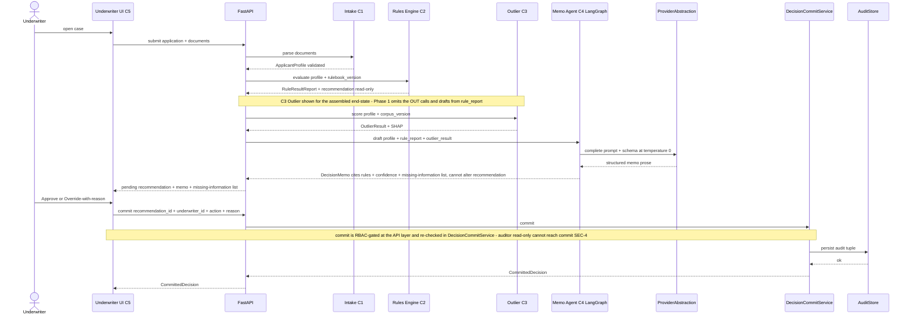
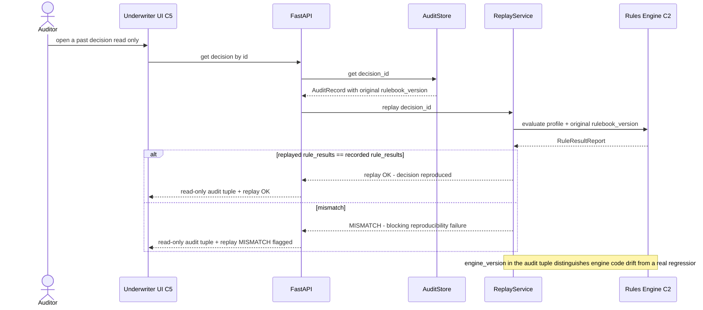
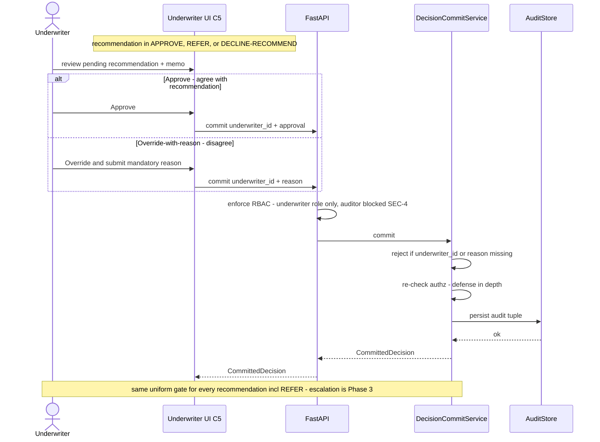

# Application Design — Services

**Stage**: DISCOVER → Application Design
**Date**: 2026-06-19
**Scope**: Service definitions + orchestration patterns + sequence diagrams.
**No business logic / thresholds / schema detail** (deferred to Functional Design).
**Decisions applied**: Q1=B (LangGraph scoped to C4 only; FastAPI owns
intake/rules/persistence; recommendation computed before the graph and injected as
immutable state), Q3=B (two read-only MCP servers), Q4=B (EPIC-6 modeled here as the
services layer), Q5=A+note (gate sequences included), Q6=A (gate outside the agent graph).

> **Vocabulary** (consistent with `user-journey.md`): the system emits a
> **recommendation**; the human makes a committed **decision** by **Approve** (agree) or
> **Override-with-reason** (disagree). The Q5 note's *Accept/Decline* maps to this:
> **Accept ↔ Approve**, **Decline ↔ Override-with-reason**. The **same uniform gate
> applies to ALL recommendations including REFER** — there is **no REFER-specific
> escalation branch** here (escalation = Phase 3 / OOS-2).

---

## 1. Orchestration model (Q1=B)

- **FastAPI** owns the **deterministic pipeline** (intake → rules → outlier) and all
  persistence. The **recommendation is computed here, before any graph runs**, and passed
  onward as **immutable state**.
- **LangGraph** orchestrates **only the C4 memo sub-flow**. No graph node can touch the
  recommendation — the cleanest structural guarantee of **CON-BR2**.
- The **human approval gate sits outside** the agent graph (Q6): the pipeline yields a
  **pending** recommendation + memo; the underwriter commits via `DecisionCommitService`.

> **CorpusGenerator is a build-time/setup step, not a per-request runtime step.**
> `CorpusGenerationService` runs **once** to produce the seeded, versioned, skew-audited
> synthetic corpus, frozen by a manifest (CON-BR3). At scoring time C3 consumes that frozen
> corpus **read-only** via `corpus_version`. This is why the corpus appears in the container
> diagram (`components.md`) but **not** in the per-request sequences below.

## 2. Service definitions (services layer; five core components stay primary)

| Service | Responsibility | Key invariant |
|---|---|---|
| `IntakeService` | Parse + validate documents to `ApplicantProfile`; sanitize injection; gate malformed input. | SEC-1/2, FR-INTAKE-* |
| `RuleEvaluationService` (wraps C2) | Pure-Python evaluation; **produces the recommendation**; stamps `rulebook_version`. | CON-BR2, CON-DET-1 |
| `OutlierService` (C3, Phase 2) | Seeded scoring + SHAP; demographic-free feature vector. | CON-BR1 |
| `MemoOrchestrationService` (C4 / LangGraph) | Drives the memo sub-flow; consumes the read-only recommendation; validates citations. | CON-BR2, FR-MEMO-* |
| `ProviderAbstractionService` | Provider-agnostic LLM calls; central `temperature=0`; per-provider adapters. | FR-PROV-1..5 |
| `MCPToolService` — **`rulebook-tools`** + **`decisions-tools`** (two servers, **read-only**) | Read-only grounding for C4; **neither can write**. `rulebook-tools` provides **supplementary human-readable rule descriptions only** — the memo cites strictly from the handed `RuleResultReport`, never re-deriving what fired via MCP (retrieval-miss guard). | FR-MEMO-5, SEC-4 |
| `DecisionCommitService` | Human-gate backend boundary; **rejects writes lacking `underwriter_id` + `reason`**. | **CON-BR4** |
| `AuditService` / `ReplayService` | Persist audit tuple; replay any decision against its **original** rulebook version. | CON-AUDIT-1, SEC-5 |
| `AuthRBACService` | Underwriter (act) vs auditor (read-only); OIDC-ready. | PER-4..6, SEC-4 |
| `CorpusGenerationService` | Seeded, versioned, skew-audited corpus. | CON-BR3 |
| `ObservabilityService` (Phase 2) | Langfuse traces (100% of steps) + Prometheus/Grafana. | NFR-OBS-1/2 |
| `AdminCLI` | Out-of-band rulebook-version/user/config management (no admin UI). | PER-3/6 |
| `SecretsService` | Provider/service keys via env/secrets; no hardcoding. | SEC-3 |

---

## 3. Sequence — Intake → commit (happy path)

Mermaid validated before write (alphanumeric IDs; no parentheses in participant names;
`alt/else/end` balanced; text alternative below).



**Text alternative**: Underwriter opens a case → FastAPI runs C1 parse → C2 evaluate
(**recommendation + deterministic `confidence` produced here, read-only**) → **C3 score
(Phase 2 — shown for the assembled end-state; Phase 1 omits the OUT calls and drafts from
`rule_report`)** → C4 memo via
ProviderAbstraction at `temperature=0` (prose only; cites rules + confidence + the
**missing-information list**) → UI shows the **pending** recommendation + memo +
missing-information list → underwriter **Approves or Overrides-with-reason** → the commit
routes **UI → FastAPI → DecisionCommitService**, **RBAC-gated at the API layer and re-checked
inside `DecisionCommitService`** (auditor read-only cannot reach commit, SEC-4) and commits
**only** with `underwriter_id` + `reason` → `AuditStore` persists the audit tuple → committed.

> **Audit tuple vs commit payload (two distinct shapes).** The **commit payload** the UI
> sends to `DecisionCommitService` is the 4 fields `{recommendation_id, underwriter_id,
> action, reason}`. The **persisted audit tuple** is the CON-AUDIT-1 **6-tuple**
> `{rulebook_version, rule_results, timestamp, model_version, memo_hash, engine_version}` —
> the replayable record of the decision (`engine_version` = git SHA of the rules engine,
> detecting engine code drift), distinct from the commit payload. (Field-level schema is
> deferred to Functional Design; this note only distinguishes the two record shapes.)

---

## 4. Sequence — Decision replay (auditor, read-only)



**Text alternative**: Auditor opens a past decision (read-only) → FastAPI fetches the
`AuditRecord` from `AuditStore` → `ReplayService` re-evaluates the profile against the
**original** `rulebook_version` (not the latest) → **the replayed `RuleResultReport` is
compared to the recorded `rule_results` as a branch**: **match → replay OK** (decision
reproduced); **mismatch → flagged as a blocking reproducibility failure** (replay is a
**detection** mechanism — it is not assumed to pass). `engine_version` in the audit tuple
lets an investigator distinguish rules-engine **code drift** from a real regression
(incident-handling workflow itself is Phase 3 / OOS-8). UI shows the read-only audit tuple +
replay outcome. **CON-AUDIT-1**. The auditor has **no write capability** (SEC-4). The memo is
**never re-drafted** on replay — only `rule_results` are re-evaluated; memo integrity is
checked via `memo_hash`.

---

## 5. Sequence — Uniform human approval gate (ALL recommendations incl. REFER)

> **No REFER escalation branch.** REFER is just one recommendation value entering the
> same gate. Escalation routing is Phase 3 / OOS-2 (documented, not built/drawn).



**Text alternative**: The pending recommendation may be `APPROVE`, `REFER`, or
`DECLINE-RECOMMEND`. The underwriter either **Approves** (agree → commit with
`underwriter_id` + approval) or **Overrides-with-reason** (disagree → commit with
`underwriter_id` + mandatory reason). The commit is authorized at **two enforcement points
(defense in depth)**: the **API layer** enforces RBAC (underwriter role only; a read-only
auditor is blocked, SEC-4) **and** `DecisionCommitService` **re-checks authz** and **rejects
any write missing `underwriter_id` or `reason`** (CON-BR4); then `AuditStore` persists the
audit tuple. The **same gate handles every recommendation including REFER**; there is **no
REFER-specific escalation path** in this engagement (Phase 3 / OOS-2).

---

## 6. Sequence — Unhappy paths (failure modes)

> The happy paths above are not the whole story. The brief makes **failure analysis a
> first-class deliverable** (Brief §10). This sequence draws three failure **flows**;
> retry/backoff/dead-letter **internals are deferred to NFR Design**.

```mermaid
sequenceDiagram
    actor UW as Underwriter
    participant UI as Underwriter UI C5
    participant API as FastAPI
    participant INT as Intake C1
    participant MEMO as Memo Agent C4 LangGraph
    participant PROV as ProviderAbstraction

    Note over UW,PROV: Scenario 1 - intake rejection / incomplete package
    UI->>API: submit application + documents
    API->>INT: parse then sanitize then validate at the gate
    Note over INT: injection-laden free-text is neutralized by the sanitizer SEC-1 and continues - injection alone is never a rejection trigger
    alt malformed, unparseable, or missing required primitive value
        INT-->>API: RejectedIntake - reasons + missing-items list
        API-->>UI: rejected - show reasons + missing-items to underwriter
    else valid - neutralized-injection and thin-file incomplete included
        INT-->>API: ApplicantProfile validated - incomplete flag maybe true
    end

    Note over UW,PROV: Scenario 2 - citation-validation failure in the memo flow
    API->>MEMO: draft from rule_report
    MEMO->>MEMO: validate every cited rule ID against the YAML rulebook
    alt a cited rule ID is not in the rulebook
        MEMO-->>API: citation failure - memo blocked, not surfaced
        API-->>UI: memo flagged - hallucinated citation blocked
    else all citations valid
        MEMO-->>API: DecisionMemo
    end

    Note over UW,PROV: Scenario 3 - provider / tool-call error or timeout
    MEMO->>PROV: complete prompt at temperature 0
    alt provider error or timeout
        PROV-->>MEMO: error
        MEMO-->>API: memo unavailable - recommendation still stands from C2
        API-->>UI: show recommendation + rule evidence; memo retry pending
    else ok
        PROV-->>MEMO: structured memo prose
    end
    Note over UW,PROV: flows only - retry / backoff / dead-letter internals deferred to NFR Design
```

**Text alternative**: three failure flows. **(1) Intake rejection / incomplete package** — the
C1 pipeline runs **parse → sanitize (SEC-1) → validate gate (SEC-2)**. **Injection-laden
free-text is neutralized by the sanitizer and the pipeline continues** — injection alone is
**never** a rejection trigger. Only **malformed, unparseable, or missing-required-primitive-value**
input returns a `RejectedIntake` (reasons + missing-items list; the UI shows the underwriter what's
missing; no agent runs on rejected input). **Thin-file / single-missing-document** input is **not**
rejected — it yields a valid `ApplicantProfile` flagged `incomplete`, which C2 routes to REFER.
**(2) Citation-validation failure** — C4 validates every cited rule ID against the YAML
rulebook; if any cited ID is not in the rulebook the memo is **blocked, not surfaced**, and
the UI shows it flagged (this is the flagship "how AI fails" guard against hallucinated
citations). **(3) Provider / tool-call error or timeout** — if `ProviderAbstraction` errors
or times out, the **deterministic recommendation from C2 still stands** (the LLM is out of
the decision path, CON-BR2); the UI shows the recommendation + rule evidence with the memo
retry pending. **Flows only — retry/backoff/dead-letter internals are deferred to NFR
Design.**

---

*End of services. Dependency matrix + data-flow in `component-dependency.md`.*
