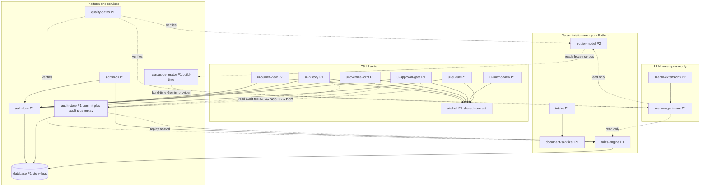

# Unit of Work — Inter-Unit Dependency Matrix

**Phase / Stage**: DISCOVER → Units Generation (Part 2 — Generation)
**Project Type**: Greenfield
**Date**: 2026-07-02
**Status**: Generated at the Units Generation completion gate — awaiting **Request Changes / Approve & Continue → BUILD**.

Inter-unit dependencies for the **23-unit** resolved list (`unit-of-work.md` §3), **consistent
with `component-dependency.md`** (unit edges are the component edges refined to unit
granularity). Applies **F5(a)**: the `document-sanitizer` mid-pipeline edge is pinned in §2.

- **Read-only (`R`) edges** preserve CON-BR2: everything crossing into the LLM zone
  (`memo-agent-core`) is read-only and cannot mutate the recommendation.
- **The only decision-write path** is `ui-approval-gate` / `ui-override-form` → (API RBAC) →
  `audit-store`/DecisionCommitService → `database` — mirroring `component-dependency.md` §1.
- **Phase rule**: every Phase-2 unit depends only "upward" onto Phase-1 units (or other P2
  units); no Phase-1 unit depends on a Phase-2 unit — so the "all P1 before any P2" BUILD loop
  has no back-edge. Verified in §3.

---

## 1. Inter-unit dependency matrix

Rows **depend on / call** the listed units. `R` = read-only. `BT` = build-time (not per-request).
`V` = verifies (test/eval dependency). The **FastAPI orchestrator** is the composition root
(`backend/app/`, not a unit); its in-process routing is shown as the *(orchestrated)* path.

| Unit (Phase) | Depends on → | Type / note |
|---|---|---|
| `intake` (1) | `document-sanitizer` | **calls mid-pipeline** (see §2) |
| `document-sanitizer` (1) | — | leaf (security boundary) |
| `rules-engine` (1) | `database` | persist/load `rulebook_version` store |
| `memo-agent-core` (1) | `rules-engine` `R`; `secrets-config` | consumes `RuleResultReport` **read-only** (CON-BR2); keys via secrets |
| `ui-queue` (1) | `ui-shell`, `auth-rbac`, *(orchestrated)* `rules-engine` `R` | conforms to shell; RBAC-gated; reads recommendation |
| `ui-memo-view` (1) | `ui-shell`, `auth-rbac`, *(orchestrated)* `memo-agent-core` `R` | reads memo + citations + missing-info |
| `ui-approval-gate` (1) | `ui-shell`, `auth-rbac`, `audit-store` | **commit path** via DecisionCommitService |
| `ui-override-form` (1) | `ui-shell`, `auth-rbac`, `audit-store` | **commit path** (reason mandatory) |
| `ui-history` (1) | `ui-shell`, `auth-rbac`, `audit-store` `R` | reads audit tuple read-only |
| `ui-shell` (1) | — | leaf shared contract (advisory copy + data-testid) |
| `auth-rbac` (1) | `database` | user/role store; OIDC-ready seam |
| `audit-store` (1) | `database`; `rules-engine` | persist 6-tuple; **ReplayService re-evaluates via `rules-engine`** |
| `quality-gates` (1) | `intake`, `rules-engine`, `memo-agent-core`, `corpus-generator`, `audit-store` `V`; `outlier-model` `V` (P2) | verifies invariants over pipeline outputs |
| `corpus-generator` (1) | `memo-agent-core`::`provider-abstraction` `BT`; `secrets-config` | **build-time** Gemini doc text; manifest-frozen |
| `database` (1) | — | **story-less** leaf infra (Postgres schema + migrations) |
| `secrets-config` (1) | — | leaf (env/secrets) |
| `admin-cli` (1) | `rules-engine`, `auth-rbac`, `database`, `secrets-config` | publish versions; manage users/provider config |
| `outlier-model` (2) | `corpus-generator` `R`, `secrets-config` | reads **frozen** corpus by `corpus_version` |
| `memo-extensions` (2) | `memo-agent-core`, `rules-engine` `R`, `audit-store` `R` | extends provider module; MCP read-only grounding (supplementary) |
| `ui-outlier-view` (2) | `ui-shell`, `auth-rbac`, *(orchestrated)* `outlier-model` `R` | conforms to shell contract; display only |
| `observability` (2) | `memo-agent-core`, `memo-extensions`, `outlier-model` | traces 100% of agent/tool steps |
| `llm-judge` (2) | `memo-agent-core`, `memo-extensions`, `corpus-generator` `R` | scores memo groundedness (Gemini+Claude) |
| `deploy-config` (2) | `database`, all `backend/*`, all `frontend/*` | packages the validation deploy (Render + Vercel) |

**Consumers of `secrets-config` (SEC-3):** `memo-agent-core`, `memo-extensions`,
`corpus-generator`, `outlier-model`, `database` (connection), `observability` — all read keys
from env/secrets, never hardcoded.

---

## 2. F5(a) — `document-sanitizer` edge pinned (standalone UNIT, not a standalone pipeline stage)

`document-sanitizer` is its **own unit** (Q3 split-out for SEC-1 isolation) but it is **not a
standalone pipeline stage** — it sits **mid-pipeline inside C1 intake**. The direction and
placement are fixed as:

```
C1 intake pipeline:   parse (pdfplumber)  →  SANITIZE (document-sanitizer, SEC-1)  →  Pydantic validation gate (SEC-2)  →  ApplicantProfile
                       [intake unit]          [document-sanitizer unit]                [intake unit]                        [intake unit output]
```

- **Direction: `intake → document-sanitizer`** — the `intake` unit *invokes* the sanitizer;
  the sanitizer does **not** call intake.
- **Placement: sanitization sits BEFORE the Pydantic validation gate** — injection-bearing text
  is neutralised on the extracted text *before* structured extraction/validation, so no
  injected instruction survives into the `ApplicantProfile` or reaches `memo-agent-core`
  (SEC-1, failure mode #4). The validation gate (SEC-2) then runs on **sanitized** text.
- **Invariant boundary stays clean**: `document-sanitizer` owns **SEC-1**; `intake` owns
  **SEC-2** — distinct invariants, single-sourced (`unit-of-work.md §5`), even though they are
  adjacent stages of one pipeline.

This matches the `services.md §6` Scenario-1 unhappy path ("parse + validate + **sanitize** →
`RejectedIntake` on malformed/injection-laden input").

---

## 3. Communication patterns + phase-safety

| Edge | Pattern | Consistent with |
|---|---|---|
| C5 view → `auth-rbac` | RBAC-gated (JWT/session); auditor read-only | `component-dependency.md §2` |
| C5 gate/override → `audit-store` | commit at the human gate; **RBAC at API + re-checked in DecisionCommitService** (SEC-4); rejects missing `underwriter_id`+`reason` (CON-BR4) | `services.md §5` |
| `memo-agent-core` → `rules-engine` | **read-only** consumption of `RuleResultReport` | CON-BR2 |
| `memo-extensions` → MCP `rulebook-tools`/`decisions-tools` | **read-only** grounding, supplementary only | `services.md §2` |
| `audit-store`::Replay → `rules-engine` | re-evaluate at **original** `rulebook_version`; match/mismatch branch | `services.md §4` |
| `outlier-model` → `corpus-generator` | reads **frozen** corpus (`corpus_version`), never regenerates | `services.md §1` note |

**Phase-safety proof (no Phase-1 unit depends on a Phase-2 unit):**
- Every P1→ edge above targets a **P1 unit or a leaf** (`database`, `secrets-config`,
  `ui-shell`, `document-sanitizer`, `corpus-generator`, `rules-engine`, `auth-rbac`,
  `audit-store`).
- Every Phase-2 unit (`outlier-model`, `memo-extensions`, `ui-outlier-view`, `observability`,
  `llm-judge`, `deploy-config`) depends **only** on Phase-1 units and/or other Phase-2 units.
- `ui-shell` (P1) is depended on by `ui-outlier-view` (P2) — a P2→P1 edge, which is **allowed**
  (P1 is already built). There is **no P1→P2 back-edge**, so the "all P1 before any P2" BUILD
  loop needs no intra-phase sequencing.

---

## 4. Dependency diagram (principal runtime + commit edges)

Mermaid validated before write per `common/visual-and-syntax-standards.md`: alphanumeric node
IDs; all labels double-quoted; **no bare parentheses** in labels; subgraphs closed; **no
reserved-word `end` node id**; balanced brackets; no semicolons in labels. Cross-cutting units
(`secrets-config`, `observability`, `llm-judge`, `deploy-config`) are in the §1 matrix, not the
diagram, to keep it legible. Text alternative follows.



### Text alternative (always included)

- **Intake pipeline**: `intake` invokes `document-sanitizer` mid-pipeline (parse → sanitize →
  gate, §2). The `ApplicantProfile` then flows to `rules-engine` (produces the recommendation)
  and, in Phase 2, to `outlier-model`.
- **LLM zone (read-only)**: `memo-agent-core` consumes `rules-engine`'s report **read-only** and
  `outlier-model`'s result **read-only** (P2); `memo-extensions` (P2) extends `memo-agent-core`
  (provider adapters + MCP + routing). Nothing in the LLM zone can mutate the recommendation
  (CON-BR2).
- **Commit path (the only write path)**: `ui-approval-gate` / `ui-override-form` commit through
  `audit-store` (DecisionCommitService), which persists the 6-tuple to `database`;
  `ui-history` reads the audit tuple read-only. Every C5 view depends on `ui-shell` (shared
  advisory-copy + data-testid contract) and `auth-rbac` (RBAC gating).
- **Replay**: `audit-store` re-evaluates a past decision against its original `rulebook_version`
  via `rules-engine` (match → OK; mismatch → blocking).
- **Build-time**: `corpus-generator` uses the Gemini `provider-abstraction` module at build
  time (manifest-frozen); `outlier-model` reads that frozen corpus read-only at scoring time.
- **Cross-cutting** (matrix only): `secrets-config` feeds keys to all provider/DB users;
  `quality-gates` verifies `intake`/`rules-engine`/`memo-agent-core`/`corpus-generator`/
  `outlier-model`; `observability`, `llm-judge`, `deploy-config` (all P2) wrap the built system.

---

*End of unit-of-work-dependency.md. Consistent with `component-dependency.md`. Story assignment
proof → `unit-of-work-story-map.md`. Stop at the Units Generation completion gate.*
