# Execution Plan — Agentic Underwriting Assistant

**Phase / Stage**: DISCOVER → Workflow Planning
**Project Type**: Greenfield
**Date**: 2026-06-19
**Status**: Draft — pending user approval at the Workflow Planning approval gate

This plan determines **which GUIDE stages execute and at what depth**. It does not
produce designs or code. Prior context loaded: `requirements.md` (approved
comprehensive), `stories.md` / `personas.md` / `user-journey.md` (approved), and
`guide-state.md`.

---

## 1. Detailed Analysis Summary

### 1.1 Transformation Scope
- **N/A — Greenfield.** There is no existing system to transform; no reverse-engineering,
  component-relationship graph, or package-update sequence applies. The build creates all
  five components from scratch (PROJECT-BRIEF §3; FR-SCOPE-1).

### 1.2 Change Impact Assessment

| Impact area | Yes/No | Description |
|---|:--:|---|
| User-facing changes | **Yes** | New React + Tailwind underwriter UI (queue, memo view, human approval gate, override-with-reason, history) + read-only auditor surfaces (FR-UI-1..5, PER-1/2). |
| Structural changes | **Yes** | Entire architecture is new: 5 components + LangGraph orchestration + provider-abstraction layer (Gemini/Claude/Ollama) + MCP tool exposure (FR-SCOPE-1, FR-MEMO-1/5, FR-PROV-1..5). |
| Data-model changes | **Yes** | New schemas: `ApplicantProfile` (Pydantic v2), versioned rulebook YAML, per-rule result report, decision + audit-tuple records, synthetic corpus + manifest (FR-INTAKE-1, FR-RULES-1/4, CON-AUDIT-1, DATA-1..5). |
| API changes | **Yes** | New FastAPI endpoints (intake, evaluate, memo, decision-commit, history/replay) + MCP tool interfaces. |
| NFR impact | **Yes (heavy)** | 100% decision reproducibility, bias-swap delta = 0 (blocking), ≥90% code coverage, full audit/replay, security guardrails, and 100%-step observability (NFR-REPRO-1, NFR-BIAS-1, AC-5, CON-AUDIT-1, SEC-1..5, NFR-OBS-1/2). |

### 1.3 Component Relationships
- **N/A — Greenfield** (no existing-component dependency/blast-radius graph). Inter-component
  design relationships are produced in Application Design, not here.

### 1.4 Risk Assessment

| Dimension | Rating | Rationale |
|---|---|---|
| **Risk Level** | **Medium** | High *intrinsic complexity* (multi-component, regulated, invariant-heavy), but greenfield: nothing in production to break. The dominant risk is **correctness of the binding invariants** (reproducibility, bias-invariance, advisory-only, audit/replay — CON-BR1..4, CON-AUDIT-1), not deployment blast radius. |
| **Rollback Complexity** | **Easy** | Greenfield + phased (Phase 1 before Phase 2); no production system or data migration to reverse. |
| **Testing Complexity** | **Complex** | Reproducibility (×10 calibration), bias-swap + proxy checks, 100% rule coverage, ≥90% code coverage, LLM-as-judge groundedness, and 100%-step trace audit (QA-1..6, AC-1..7). TDD enforced (QA-6). |

---

## 2. Workflow Visualization

Mermaid validated before file creation per `common/visual-and-syntax-standards.md`
(alphanumeric node IDs; all labels double-quoted; parentheses only inside quoted
labels; subgraphs closed; end node id is `Done` to avoid the Mermaid reserved-word
`end` collision). A text alternative follows the diagram.

The single diagram below covers **GUIDE stages** only. The project's **Phase 1 vs
Phase 2** build split is shown as a **BUILD-loop annotation** (the dashed loop-back
edge) and described in §4.1 narrative — no second phase diagram is rendered (see
`stories.md §8` for the full Phase 1/Phase 2 slice).

```mermaid
flowchart TD
    Start(["User Request"])

    subgraph DISCOVER["DISCOVER PHASE"]
        WD["Workspace Detection<br/><b>COMPLETED</b>"]
        RE["Reverse Engineering<br/><b>SKIP</b>"]
        RA["Requirements Analysis<br/><b>COMPLETED</b>"]
        US["User Stories<br/><b>COMPLETED</b>"]
        WP["Workflow Planning<br/><b>IN PROGRESS</b>"]
        AD["Application Design<br/><b>EXECUTE</b>"]
        UG["Units Generation<br/>(Planning + Generation)<br/><b>EXECUTE</b>"]
    end

    subgraph BUILD["BUILD PHASE (per-unit loop)"]
        FD["Functional Design<br/><b>EXECUTE</b>"]
        NFRA["NFR Requirements<br/><b>EXECUTE</b>"]
        NFRD["NFR Design<br/><b>EXECUTE</b>"]
        ID["Infrastructure Design<br/><b>EXECUTE</b>"]
        CG["Code Generation<br/>(Planning + Generation)<br/><b>EXECUTE</b>"]
        BT["Build and Test<br/><b>EXECUTE</b>"]
    end

    subgraph DEPLOY["DEPLOY PHASE"]
        OPS["Deploy<br/><b>PLACEHOLDER</b>"]
    end

    Start --> WD
    WD --> RE
    RE --> RA
    RA --> US
    US --> WP
    WP --> AD
    AD --> UG
    UG --> FD
    FD --> NFRA
    NFRA --> NFRD
    NFRD --> ID
    ID --> CG
    CG --> BT
    CG -.->|"next unit — Phase 1 units complete before Phase 2"| FD
    BT --> OPS
    OPS --> Done(["Complete"])

    style WD fill:#4CAF50,stroke:#1B5E20,stroke-width:3px,color:#fff
    style RA fill:#4CAF50,stroke:#1B5E20,stroke-width:3px,color:#fff
    style US fill:#4CAF50,stroke:#1B5E20,stroke-width:3px,color:#fff
    style WP fill:#4CAF50,stroke:#1B5E20,stroke-width:3px,color:#fff
    style CG fill:#4CAF50,stroke:#1B5E20,stroke-width:3px,color:#fff
    style BT fill:#4CAF50,stroke:#1B5E20,stroke-width:3px,color:#fff
    style AD fill:#FFA726,stroke:#E65100,stroke-width:3px,stroke-dasharray: 5 5,color:#000
    style UG fill:#FFA726,stroke:#E65100,stroke-width:3px,stroke-dasharray: 5 5,color:#000
    style FD fill:#FFA726,stroke:#E65100,stroke-width:3px,stroke-dasharray: 5 5,color:#000
    style NFRA fill:#FFA726,stroke:#E65100,stroke-width:3px,stroke-dasharray: 5 5,color:#000
    style NFRD fill:#FFA726,stroke:#E65100,stroke-width:3px,stroke-dasharray: 5 5,color:#000
    style ID fill:#FFA726,stroke:#E65100,stroke-width:3px,stroke-dasharray: 5 5,color:#000
    style RE fill:#BDBDBD,stroke:#424242,stroke-width:2px,stroke-dasharray: 5 5,color:#000
    style OPS fill:#BDBDBD,stroke:#424242,stroke-width:2px,stroke-dasharray: 5 5,color:#000
    style Start fill:#CE93D8,stroke:#6A1B9A,stroke-width:3px,color:#000
    style Done fill:#CE93D8,stroke:#6A1B9A,stroke-width:3px,color:#000
    style DISCOVER fill:#BBDEFB,stroke:#1565C0,color:#000
    style BUILD fill:#C8E6C9,stroke:#2E7D32,color:#000
    style DEPLOY fill:#FFF59D,stroke:#F9A825,color:#000

    linkStyle default stroke:#333,stroke-width:2px
```



### Text Alternative (always included)

```
DISCOVER PHASE
- Workspace Detection ........ COMPLETED
- Reverse Engineering ........ SKIP (greenfield, no existing code)
- Requirements Analysis ...... COMPLETED
- User Stories ............... COMPLETED
- Workflow Planning .......... IN PROGRESS (this stage)
- Application Design ......... EXECUTE
- Units Generation ........... EXECUTE (Planning + Generation)

BUILD PHASE (per-unit loop; repeats for each unit — Phase 1 units fully
before Phase 2 units, per stories.md section 8)
- Functional Design .......... EXECUTE (per unit)
- NFR Requirements ........... EXECUTE (per unit)
- NFR Design ................. EXECUTE (per unit)
- Infrastructure Design ...... EXECUTE (per unit)
- Code Generation ............ EXECUTE (per unit; Planning + Generation)
- Build and Test ............. EXECUTE (after all units complete)

DEPLOY PHASE
- Deploy ..................... PLACEHOLDER (production deploy = Phase 3 / future release)
```

---

## 3. Phases to Execute

### 🔵 DISCOVER PHASE
- [x] Workspace Detection (COMPLETED — greenfield)
- [x] Reverse Engineering (SKIPPED — greenfield, no existing code)
- [x] Requirements Analysis (COMPLETED — comprehensive, approved 2026-06-17)
- [x] User Stories (COMPLETED — approved 2026-06-18)
- [x] Workflow Planning (IN PROGRESS — this document)
- [ ] **Application Design — EXECUTE**
  - **Rationale**: Five brand-new components with methods, business rules, and
    cross-component dependencies (LangGraph state machine, MCP tool boundaries,
    provider-abstraction layer) require design before code. *Depth: comprehensive.*
- [ ] **Units Generation — EXECUTE**
  - **Rationale**: New data models/schemas, multiple modules, complex logic;
    decomposition into units of work is needed. The provisional units in §5 (drawn
    from the per-epic "anticipated build units" in `stories.md`) are confirmed/refined
    here. *Depth: comprehensive.*

### 🟢 BUILD PHASE (per-unit loop)

> **Draft recommendation = comprehensive, no skips.** Per the gate decision reserved
> by the user, the lighten/skip choice is made at the §9 approval gate. To inform that
> choice, each design stage below carries a **per-unit depth-variation note** — units
> that genuinely warrant comprehensive depth vs. candidates for lighter treatment. The
> draft itself stays comprehensive; nothing is lightened yet.
>
> **The per-unit "lighter" classifications below are RECOMMENDATIONS, revisitable
> per-unit at each BUILD design stage** — a unit marked lighter can be given comprehensive
> depth when its design stage is reached, without amending this plan. "Lighter" is not a
> locked floor.

- [ ] **Functional Design (per-unit) — EXECUTE**
  - **Rationale**: New data models and non-trivial business logic.
  - **Per-unit depth variation (for gate decision)**:
    - *Comprehensive*: `rules-engine` (versioned YAML schema, evaluation semantics, boundary/comparison correctness), `applicant-profile-schema`, `memo-agent` (LangGraph state, structured XML→Pydantic), `outlier-model` (feature vector, scoring, SHAP), `audit-store` (audit tuple + replay), and the invariant-bearing UI components `ui-approval-gate` (FR-UI-2 human approval gate) and `ui-override-form` (CON-BR4 override-with-reason + FR-UI-4 advisory-only) — these enforce binding invariants, not display.
    - *Lighter candidates*: `secrets-config`, `admin-cli`, `deploy-config`, `observability` (mostly wiring); and the **display-only** UI components `ui-queue`, `ui-history`, `ui-memo-view` (display + `data-testid`), whose behaviour is already specified by `user-journey.md` + EPIC-5 stories.
- [ ] **NFR Requirements (per-unit) — EXECUTE**
  - **Rationale**: Reproducibility, bias-invariance, security, and observability NFRs are heavy and unit-specific.
  - **Per-unit depth variation (for gate decision)**:
    - *Comprehensive*: `rules-engine` + `memo-agent` (determinism/reproducibility), `outlier-model` (seeded reproducibility), `auth-rbac` (RBAC/segregation, SEC-4), `intake-*` (input validation + prompt-injection, SEC-1/2), the quality suites (`bias-swap-suite`, `reproducibility-suite`), and the invariant-bearing UI components `ui-approval-gate` / `ui-override-form` (FR-UI-2, CON-BR4, FR-UI-4 advisory-only enforcement).
    - *Lighter candidates*: `deploy-config`, `admin-cli`, `secrets-config` (single control, SEC-3), and the **display-only** UI components `ui-queue`, `ui-history`, `ui-memo-view` (NFRs reduce to a11y + `data-testid`).
- [ ] **NFR Design (per-unit) — EXECUTE**
  - **Rationale**: Determinism, bias-guard, and security patterns need concrete design where they concentrate.
  - **Per-unit depth variation (for gate decision)**: mirrors NFR Requirements — *comprehensive* for `rules-engine`, `memo-agent`, `outlier-model`, `auth-rbac`, `audit-store`, the quality suites, and the invariant-bearing UI components `ui-approval-gate` / `ui-override-form` (FR-UI-2, CON-BR4, FR-UI-4); *lighter* for `deploy-config`, `admin-cli`, `secrets-config`, and the display-only UI components `ui-queue`, `ui-history`, `ui-memo-view`.
- [ ] **Infrastructure Design (per-unit) — EXECUTE**
  - **Rationale**: Render + Vercel + PostgreSQL/Docker + Langfuse + Prometheus/Grafana need mapping.
  - **Per-unit depth variation (for gate decision)**:
    - *Comprehensive*: `deploy-config` (Render/Vercel topology, free-tier), `database` (Postgres + Docker, no SQLite — DATA-5), `observability` (Langfuse + Prometheus/Grafana wiring).
    - *Lighter / minimal-footprint*: pure-logic units (`rules-engine`, `outlier-model`, `memo-agent` logic) have little independent infra; `admin-cli` has none; `ui-*` is static hosting on Vercel.
- [ ] **Code Generation (per-unit) — EXECUTE (ALWAYS)**
  - **Rationale**: Implementation planning + code generation per unit; Part 1 plan requires explicit user approval before any code (CLAUDE.md pre-flight). *Depth: comprehensive; TDD per QA-6.*
- [ ] **Build and Test — EXECUTE (ALWAYS)**
  - **Rationale**: Build + unit/integration/performance/contract/security/e2e tests after all units complete, including the blocking quality gates (reproducibility, bias, rule coverage, code coverage, groundedness, trace audit).

### 🟡 DEPLOY PHASE
- [ ] **Deploy — PLACEHOLDER**
  - **Rationale**: Future workflow. Production deploy is Phase 3 / future release (OOS-4); the **validation/staging** deploy is in scope as a Phase 2 build unit (NFR-DEPLOY-1, US-PLAT-11), handled inside the BUILD per-unit loop — not in this placeholder stage.

---

## 4. Phase 1 → Phase 2 Build Sequencing (BUILD-loop annotation)

### 4.1 Narrative
The per-unit BUILD loop runs **all Phase 1 units to completion (design → code → tests)
before any Phase 2 unit begins**, preserving the first-class sliceable backlog in
`stories.md §8`. This is the dashed loop-back edge in the §2 diagram ("next unit —
Phase 1 units complete before Phase 2"); no separate phase diagram is rendered.

- **Phase 1 — core deterministic advisory slice** (build first): intake → versioned
  rules engine → rule-cited advisory memo → underwriter UI with the human approval gate
  + override-with-reason → RBAC → the deterministic quality gates (reproducibility,
  bias-swap, rule coverage, code coverage) → synthetic corpus → audit tuple + replay →
  secrets + minimal admin CLI. *(stories.md §8 Phase 1 list: US-INTAKE-1..4, US-RULES-1..5,
  US-MEMO-1..4, US-UI-1/2/4/5/6/7, US-PLAT-1..8/12, US-ADMIN-1/2.)*
- **Phase 2 — ML explainability, observability & validation deploy** (build next):
  outlier detection + SHAP → borderline routing to extended thinking →
  secondary-provider fallback + Ollama showcase → MCP tool exposure → auditor portal
  reports → observability stack → LLM-as-judge → Render/Vercel **validation** deploy.
  *(stories.md §8 Phase 2 list: US-OUT-1..3, US-MEMO-5/6/7, US-UI-3, US-PLAT-9/10/11.)*
- **Phase 3** — documented future release only; **no units this engagement** (OOS-1..6 +
  production deploy).

### 4.2 Resolved decision carried in (not re-opened)
The **REFER human-approval-gate semantics** are **RESOLVED** (2026-06-18): in Phase 1/2
the underwriter resolves *every* recommendation incl. REFER at the gate via Accept/Decline
with a mandatory reason; there is **no REFER-specific gate branch** this engagement.
REFER → senior-underwriter escalation routing is **Phase 3 / OOS-2**. Gate stories
(US-UI-4/5) and `user-journey.md` already encode the uniform gate — no rework planned.

---

## 5. Provisional Units of Work (to be confirmed at Units Generation)

Drawn from the per-epic "anticipated build units" in `stories.md`. **Provisional** —
Units Generation confirms/refines names, boundaries, and the requirement → epic →
story → unit → test mapping.

| Component / Epic | Provisional units | Phase |
|---|---|---|
| C1 Intake (EPIC-1) | `intake-parser`, `applicant-profile-schema`, `intake-validation-gate`, `document-sanitizer` | 1 |
| C2 Rules (EPIC-2) | `rules-engine`, `rulebook-yaml` (versioned), `rule-result-report`, `rulebook-versioning` | 1 |
| C3 Outlier (EPIC-3) | `outlier-model` (IsolationForest + z-scores), `shap-explainer`, `feature-vector` (demographic-excluded) | 2 |
| C4 Memo (EPIC-4) | `memo-agent` (LangGraph), `provider-abstraction` (Gemini/Claude/Ollama), `mcp-tools`, `borderline-router` | 1 (core) / 2 (MCP, routing, secondary+showcase) |
| C5 UI (EPIC-5) | `ui-queue`, `ui-memo-view`, `ui-approval-gate`, `ui-override-form`, `ui-history`, `ui-auth-rbac` | 1 (core) / 2 (`ui` outlier-flags view) |
| EPIC-6 Platform/Quality/Access | **Phase 1**: `auth-rbac`, `audit-store`, `bias-swap-suite`, `reproducibility-suite`, `rule-coverage-report`, `coverage-gate`, `corpus-generator`, `secrets-config`, `database`. **Phase 2**: `observability`, `llm-judge`, `deploy-config`. | 1 / 2 (per-unit, as listed; matches §4.1 + stories.md §8) |

---

## 6. Estimated Timeline

Indicative (stage-relative, not calendar — adjust at the gate):
- **DISCOVER remaining**: Application Design, then Units Generation (2 stages).
- **BUILD**: per-unit loop across the provisional units enumerated in §5 (Phase 1 set
  first, then Phase 2), each running the executing design stages → Code Generation, then a
  single Build-and-Test pass after all units. Final unit count is confirmed at Units
  Generation. The bulk of effort is the Phase 1 core slice.
- **DEPLOY**: placeholder (validation deploy handled as a Phase 2 unit, not here).

---

## 7. Success Criteria

- **Primary Goal**: A working, audit-ready, **advisory-only** agentic underwriting
  assistant — all five components, evals, observability, and a validation deployment —
  with every binding invariant enforced.
- **Key Deliverables**: 5 components end-to-end; eval suite (reproducibility, bias-swap,
  rule coverage, LLM-as-judge); observability (Langfuse + Prometheus/Grafana); README;
  Canara HSBC case study; failure-mode analysis; bias-swap + rule-coverage reports;
  validation deploy (Render + Vercel).
- **Quality Gates (blocking, exact strength)**:
  - Decision reproducibility = **100%** (AC-1, NFR-REPRO-1)
  - Bias-swap delta = **0** (any delta blocking) (AC-3, NFR-BIAS-1)
  - Rule coverage = **100%** of rules (AC-4, QA-3)
  - Code coverage = **≥ 90%** (binding) (AC-5)
  - Unexplained recommendations = **0** (AC-2, NFR-EXPLAIN-1)
  - LLM-as-judge groundedness ≥ **4/5** (Gemini + Claude; Ollama exempt) (AC-6)
  - Observability = **100%** of agent/tool steps traced (AC-7)
  - LLM cannot change a recommendation — asserted by test (CON-BR2, QA-5)
  - Decision-write path rejects any record lacking `underwriter_id` + `reason` (CON-BR4)
  - Full audit-tuple persistence + replay against original rulebook version (CON-AUDIT-1)

---

## 8. Extension Compliance (Security Guardrails — Enabled, Scoped)

| Control | Status at Workflow Planning | Rationale |
|---|---|---|
| Prompt-injection defense (SEC-1) | N/A at this stage | Planning stage produces no code/prompts; enforced from Functional/NFR Design onward (unit `document-sanitizer`). |
| Input validation (SEC-2) | N/A at this stage | Enforced at intake design/build (`intake-validation-gate`). |
| Secrets management (SEC-3) | N/A at this stage | No secrets handled in planning; unit `secrets-config` carries it. |
| Read-only DB for audit role (SEC-4) | N/A at this stage | Enforced in `auth-rbac` / `audit-store` design. |
| Audit logging (SEC-5) | Compliant | This stage logs to `audit.md`; runtime audit logging designed later. |

No blocking findings at this stage.

---

*End of execution plan. Awaiting approval at the Workflow Planning approval gate
before proceeding to Application Design.*
