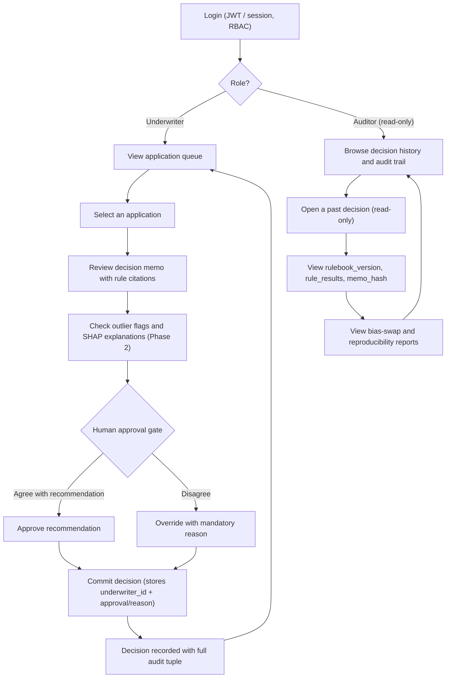

# User Journey — Agentic Underwriting Assistant

**Stage**: DISCOVER → User Stories (Part 2 — Generation)
**Date**: 2026-06-18
**Scope (Q6 = B)**: the **underwriter** review-to-decision journey **plus** the
**read-only auditor** review path. Admin is CLI-only and intentionally excluded
(no UI journey).

> Language convention: the system emits a **recommendation** (APPROVE / REFER /
> DECLINE-RECOMMEND); only the human underwriter makes a committed **decision**.
> No recommendation becomes a decision without passing the human approval gate
> with an explicit action carrying a reason (FR-UI-2, CON-BR4).

Mermaid syntax validated before file creation per
`common/visual-and-syntax-standards.md` (alphanumeric node IDs; special-character
labels quoted). A text alternative follows the diagram.

## Diagram (Mermaid)

## Text alternative (always included)

**Shared entry**
1. Login with JWT/session; RBAC routes the user by role (PER-4).

**Underwriter path (primary journey — maps to EPIC-5 + the human gate)**
1. View the application queue. *(US-UI-1)*
2. Select an application. *(US-UI-1)*
3. Review the decision memo with rule citations. *(US-UI-2)*
4. Check outlier flags and SHAP explanations. *(US-UI-3, Phase 2)*
5. Reach the **human approval gate** — an explicit action is required before any
   outcome is committed. *(US-UI-4, FR-UI-2)*
   - **Agree** → Approve the recommendation. *(US-UI-4)*
   - **Disagree** → Override **with a mandatory reason**. *(US-UI-5, CON-BR4)*
6. Commit the decision — the record stores `underwriter_id` + approval/reason; the
   write path rejects any record lacking them. *(US-UI-4/5, BR4)*
7. The decision is recorded with its full audit tuple
   (`rulebook_version`, `rule_results`, `timestamp`, `model_version`, `memo_hash`).
   *(US-PLAT-8, CON-AUDIT-1)*
8. Return to the queue for the next case. *(US-UI-6 history available throughout)*

**Auditor path (read-only — maps to EPIC-6)**
1. Browse decision history and the audit trail (read-only). *(US-PLAT-2)*
2. Open a past decision (read-only; cannot edit). *(US-PLAT-2, SEC-4)*
3. View its `rulebook_version` / `rule_results` / `memo_hash` and replay against
   the original rulebook version. *(US-RULES-4, US-PLAT-8)*
4. View the bias-swap report (delta = 0, blocking) and the reproducibility report
   (100%). *(US-PLAT-3, US-PLAT-4)*

**Admin (excluded from this diagram)**
- Operates out-of-band via CLI/migrations (rulebook versions, users, config). No
  UI journey. *(US-ADMIN-1/2, PER-3/PER-6)*

---

*End of user journey.*
